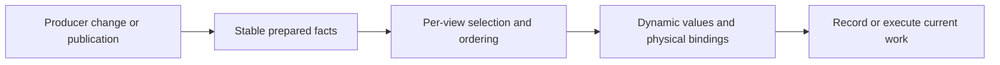

# CPU preparation, submission and data ownership

## Locate work that survives a cache hit

Read the current [RenderBundle owner](../../../packages/render/src/record/render-bundle-cache.ts)
and [prepared bindings](../../../packages/render/src/record/prepared-material-bindings.ts).
Determine whether reuse avoids only native construction, also command recording,
or the whole prepared-data walk. A path that still invokes `record(proxy)` and
compares commands can have excellent hits while paying most setup cost.

| Observed hotspot | Candidate change | Required falsifier |
| --- | --- | --- |
| Full traversal before every cache decision | Prepare stable object/material facts on producer revision changes; frame selects visibility and ordering | Add/remove/move objects and change view-specific work |
| Repeated key serialization and signatures | Carry existing revision/handle identity from the producer; avoid rebuilding equivalent strings/arrays | Unchanged count but changed bytes, resource or program |
| Broad epoch invalidates unrelated objects | Scope observation to the dependencies actually consumed | Changed local caster/material invalidates affected work; unrelated work still reuses |
| Unchanged material queue writes | Reuse successful context-owned bytes against the exact physical target | Intervening context, changed values, new frame, buffer replacement or page growth |
| Many small uploads | Coalesce proven adjacent ranges at the upload owner | Sparse edit preserves untouched data and overlapping page tails |
| Repeated layout/pipeline/bind-group setup | Retain durable handles; update dynamic values through the existing data owner | Layout/program replacement, texture recovery and device loss |
| Duplicate immutable mesh publication | Resolve the already published asset; transfer only producer-owned transport bytes | Sender detach does not corrupt author data; revision and retirement remain correct |
| Allocation/GC in per-frame setup | Reuse bounded typed storage and stable records, removing repeated intermediate collections | Mutable values remain observable; capacity growth and lifecycle release stay bounded |

A structural cache owns commands and their dependency lifetime. A data update
owns changing values. Do not force a command rebuild for a uniform-only change,
or reuse a command after the physical binding/layout changed. Single-frame
resources, query scopes and dynamic encoder state require their actual lifecycle
handling rather than unconditional retention.

For numeric composite keys, first reuse an existing producer identity or slot.
Use hierarchical Maps only when the data or ownership is naturally hierarchical;
replacing strings does not justify adding container levels. A numeric bucket hash
must compare complete fields after lookup and explicitly test collisions. Compare
cold rebuild CPU, retained heap and the already-cached path as well as query cost;
the [shadow claim case](cases/persistent-scene-prefix.md#numeric-shadow-claim-lookup)
rejects nested Maps with a large memory increase despite their CPU improvement.

Before retaining a native-creation optimization, measure the actual backend's
synchronous calls and the complete preparation/recording owner. Null creation
counts identify work but omit driver validation. Browser API elapsed time omits
deferred driver work and allocation/GC; coarse-clock zero readings are not zero
cost. Keep those measurements separate. The
2026-10-17 resource-factory observation
found tens of thousands of binding/view creations without establishing a
several-millisecond per-frame saving. Its bounded producer is in [Toolbox](toolbox.md#reuse-live-producers).

For Worker allocation distributions and GC measurement, use [GC and allocation ownership](gc.md).

### Establish immutable authoring ownership at loading

A frozen imported root does not prove its nested material values and passes are
immutable. Inspect the actual loaded payload before relying on identity reuse.
For fixed authoring data, a private snapshot at its loading owner can move repeat
validation out of frame preparation without freezing registry-owned inputs.

| Boundary | Qualification |
| --- | --- |
| Fixed imported authoring | Validate the actual catalogued identity/readiness and copy only the authored fields the consumer owns |
| Loader/program records | Keep cooked programs and registry receipts with their existing owner instead of duplicating them into the snapshot |
| Raw/custom/getter data | Preserve its existing read and mutation behavior; ownership inspection must not execute new getters |
| Managed runtime edits | Preserve material-value overrides, mesh changes, older publications, reentry rejection and lifetime release |
| Net benefit | Include one-time proof/copy/freeze cost and a matched full publication/completion owner; ordinary FPS remains separate |

The role-material owner case
measures this boundary on actual loaded character rigs. Its
ordinary combat result
still fails continuity and cold targets; the CPU gain does not establish a full-game gain.

### Prepare admitted runtime indices before interaction

When first interaction builds an index, distinguish missing preparation from
invalidated reuse. Census construction by loading/LIVE phase, owner, filter and
revision before adding another cache. Prepare the existing admitted snapshot at
the loading barrier; preserve ordinary readiness and mutation invalidation.

| Decision | Evidence required |
| --- | --- |
| Prepare all current owners | Count additional owners and surviving storage, including owners the measured route never queries |
| Replace a retained index | Trace its actual operations; a fixed snapshot need not retain a mutable tree's parent links, membership Map and duplicate bounds |
| Compact the representation | Preserve Number precision, closed/touching bounds, source order and exceptional arithmetic; rebuild at the existing snapshot boundary |
| Accept the change | Include preparation plus actual subsequent queries, after-GC heap and unique backing buffers; keep asset-loader wall time and ordinary combat separate |

The [query preparation case](cases/query-preparation-20261017.md) moved observed
first constructions out of LIVE but initially prepared many more owners and
retained about 60 MB. A compact private index reduced that cost; neither result
established stable full-game FPS or solved the remaining cold frame.

## Decide whether retention pays

Use [cache populations and window deltas](measurement.md#cache-populations-and-window-deltas)
before interpreting hit rate. Measure lookup/key work, dependency validation,
invalidation fan-out, rebuilding, allocation/retention and uploads against the
work actually avoided. Sample hit and miss paths under the same workload when
their individual costs are needed.

| Finding | Next experiment |
| --- | --- |
| High hits but many row checks or long keys every frame | Count checks/key characters and profile the hit path; test an existing producer revision fence that skips the unchanged walk |
| Rare validation reuse alongside frequent unrelated changes | Record the consumed dependencies and miss causes; test local invalidation while preserving same-count content changes and recovery |
| Backing storage reused while content is repacked/uploaded | Measure stable slot/value dirty ranges and exact physical-target writes separately; resizing the pool alone cannot remove payload work |
| Final shadows change while static layers reuse | Attribute view/layer maintenance and saved caster draws separately; keep dynamic rendering and coverage correctness |
| A cache appears unused or expensive | Compare retained/bypassed paths under a matched dynamic workload, preserving correctness, memory and ordinary completion throughput |

Reference-engine counterparts can explain a cache's purpose, but neither their
existence nor absence proves this implementation's net benefit. A deletion is
supported by a matched retained/bypass experiment or proven dead ownership,
not just a low hit rate. The [2026-10-14 audit](cases/cache-maintenance-20261014.md)
shows why near-total prepared-row hits and near-total UBO storage reuse can
coexist with substantial per-frame checking and uploads.

## Choose keys from existing identity

| Representation | Use when | Cost to include |
| --- | --- | --- |
| Existing numeric ID into an Array or TypedArray | IDs are dense and already have stable slots | Holes, growth, occupancy and slot-reuse lifetime |
| Existing numeric ID into a Map | IDs are sparse | Hash lookup and container storage |
| Stable object into a Map or WeakMap | A long-lived object already owns identity within one runtime | Stable references; Map retention or WeakMap collection/reconstruction |
| Losslessly packed integers into a number | Every field has a validated range and the total width fits | Range checks, exact decoding and overflow rejection |
| Custom composite-key hash table | Multiple fields must match and profiling confirms a hotspot | Collision equality, resizing, deletion and retained capacity |
| Nested numeric Maps | The hierarchy already exists and populations are moderate | Multiple lookups and many small Maps |
| Reused string key | Identity is textual or the path is infrequent | Construction, concatenation and text processing |

Reuse the producer's identity first. Do not add an interning registry, generated
ID or parallel membership table merely to replace a string. Stable object keys
are realm-local: cloned or transferred Worker records need their existing wire
identity. An ephemeral wrapper is a new key on every access.

For packed numbers, validate each integer field and the combined safe-integer
range at the owning boundary. JavaScript bitwise operators coerce to 32 bits;
packing wider keys requires exact arithmetic within `Number.MAX_SAFE_INTEGER`.
Reject overflow rather than accepting collisions. Include generation/owner facts
when a recycled slot can refer to a different live subject.

Compare the whole key path: construction, lookup, equality, insertion, deletion,
growth, allocation/GC and retained memory. Preserve occupancy and churn in the
matched workload. Exercise range boundaries, same-count content changes,
remove/reinsert, slot reuse, identity replacement and collision equality where
applicable. A lookup-only microbenchmark does not establish frame-time savings.

### Preserve the admitted publication's identity

A replacement key must identify the same subject as the original key. For a
retained draw plan, derive cache membership and retirement keys from the actual
admitted publication, not a mutable scene slot that now occupies its position.
An unchanged draw count does not prove unchanged membership or identity.

The [rejected entity-set prototype](cases/feature-transaction-references.md#correctness-and-measurement-falsifiers)
made this error: retained draw keys still named entity 1 after the current slot
changed to entity 900. Its faster numeric set described the wrong publication.
Exercise retained-plan reuse after slot replacement before accepting the key
change; capture canonical numeric identity at that publication's producer if it
is needed. Avoid a second long-lived membership index over unrelated live state.

### Preserve spatial key semantics

Choose the representation from the actual coordinate domain and lifetime. Keep
public IDs, wire formats and canonical signatures with their existing owner;
changing a transient lookup does not require changing serialized identity.

| Domain | Representation to consider | Correctness boundary |
| --- | --- | --- |
| Bounded source-local cells | Row-major numeric index | Validate bounds and safe-integer arithmetic; outside cells need a separate namespace or rejection |
| Bounded integer chunk/column coordinates | Lossless arithmetic packing | Prove every axis range and test the first value outside each boundary |
| Internally unbounded integer coordinates | Packed fast path with exact fallback | Numeric and fallback entries must coexist without aliases; preserve the public API's own rejection contract |
| Fractional navigation positions | Exact numeric fields in an existing spatial hierarchy | Do not floor or quantize distinct elevations/endpoints; include Map overhead in the experiment |
| Arbitrary compound string IDs | Existing owner/child lookup | Delimiters may occur inside IDs; grouping must preserve global iteration order when ties or numbering consume it |

Source-local flattening can alias an out-of-bounds coordinate with the next row
even when every result is a safe integer. Range-check before flattening, not only
afterward. For mixed packed/fallback keys, retain the consumer's canonical
coordinate ordering explicitly; default number/string ordering can change query
ties, checkpoint numbering or publication order.

Exercise the downstream operation as well as encode/decode round trips. A chunk
alias can omit a dirty neighbor and corrupt incremental remeshing while a local
lookup fixture still passes. Include wide/negative coordinates, fractional
navigation endpoints, duplicate replacement and ordered traversal. Compare full
ordered query/path/mesh outputs before interpreting timing. The
[Game/Voxel case](cases/voxel-key-indexes.md) records both a real wide-coordinate
remesh regression and a newer baseline whose query stringifications were already
zero; it does not establish a retained-memory improvement.

## Avoid sparse cache trees

Choose storage from actual fanout and lifetime before adding shader/layout/light
Map levels. Attach prepared facts to the existing shader, material or scene owner.

| Population | Candidate representation | Counterexample to cover |
| --- | --- | --- |
| Small closed layout domain | Fields on the existing fact record, such as mesh and clustered layout | Program/source change and device generation replace prepared handles |
| Usually one key, occasional fanout | Inline first key/value; allocate overflow Map only on a second distinct key | SameValueZero, stored undefined, overwrite, insertion order and iteration-time insertion |
| Usually one material handle | Scalar-backed read-only singleton; ordinary Set for real fanout | Empty membership, duplicate handles and retained previous publications |
| Scene and immutable plan identities | Scene-owned weak plan index | A retained plan must not keep a retired scene/device alive |
| Sparse, unbounded IDs | Existing Map owner | A dense array sized by the maximum ID can retain a large empty capacity |

A WeakMap weakens its keys, not every edge reachable through its values. A
`WeakMap<Plan, Entry>` whose entry strongly references a scene keeps that scene
reachable while the plan lives. A scene-owned weak plan lookup, or two weak
levels such as `WeakMap<Scene, WeakMap<Plan, Entry>>`, can avoid that edge. With
two weak levels either lookup order may work; inspect the value graph and actual
retirement policy rather than treating nesting order alone as lifetime proof.

The existing [FirstEntryMap](../../../packages/render/src/record/first-entry-map.ts)
implements a limited lookup surface, not the entire native Map API. Reuse only
where those semantics fit. Include owner-record storage, lazy overflow growth,
cold misses and high-fanout maintenance in the comparison; replacing a Map does
not make the enclosing record or its iterators allocation-free.

## Follow the existing authority

Use the current [GPU scene](../../../packages/render/src/gpu-scene.ts),
[publication](../../../packages/render/src/publication/publisher.ts),
[production preparation](../../../packages/render/src/gpu-driven/production-raster-prepare.ts)
and [batch topology](../../../packages/render/src/gpu-driven/batch-topology.ts)
owners. Derive active membership, revisions and resource references from them;
a parallel dirty catalogue creates another lifecycle to keep synchronized.
Different cameras may share candidate facts while retaining independent frusta,
visibility and indirect commands. Sharing a preparation plan does not authorize
sharing the resulting visible set.

Preserve the exact published asset handle when a Feature already owns it.
A GUID index can name a different material snapshot and can disappear when that
alias retires even though the Feature's original handle remains accepted.
Carry that handle through the existing dependency and binding authorities;
choosing any surviving alias can change shader values. Check different values
under one GUID, retirement of the indexed alias, stale explicit handles and
custom providers that still use the original GUID path. A missing GUID lookup
alone does not prove that the underlying asset was never published.

For source transport, preserve the [Render Worker boundary](../../../packages/app/src/execution/source-render-worker.ts).
`postMessage` transfer detaches buffers. Immutable author assets and transport
payloads are different ownership boundaries; transfer a proven owned payload and
retain a valid source for later consumers/recovery. Count receiver allocations,
not just apparent sender savings.

## Publish only the owner changes

Check whether an unchanged payload still marks its consumers dirty. At the
producer of a numeric vector, compare the live destination in its stored
representation before submitting; f32 rounding and signed zero are part of that
comparison. Read the current destination so external author edits are restored.
Keep invalid/non-finite handling and logical clocks/events on their existing path.
Do not apply this rule to all `World.set` payloads: managed aliases and explicit
publications can carry work even when an identity or byte comparison looks equal.

Inside a synchronous internal reader, check whether a public snapshot API builds
an entire component object or copies arrays merely to inspect current values.
A view can already borrow bytes while still paying unrelated field dispatch;
keep those costs distinct. Use an existing borrowed-column seam
only while those values are consumed before the next World mutation. Fixed pose
history, transport payloads and public caller snapshots retain their own storage.
The [Scene presentation owner](../../../packages/scene/reports/borrowed-presentation-owner-20261016.json)
compares the complete moving character subtree with and without those copies;
its separate work-count probe is not the uninstrumented timing result.

Immutable device programs have a different lifetime from graph resources. A
graph replacement can reuse an identical PSO/layout only inside its current live
device scope and with its complete shader/attachment contract. Keep graph views
and physical bind groups local, clear retired ownership and preserve retryable
creation errors. The [deferred lighting owner](../../../packages/render/reports/retained-deferred-program-owner-20261016.json)
uses complete native descriptor equality; repeated labels alone were different
variants elsewhere and did not authorize reuse.

For reverse dependencies, retain the existing accepted binding until its full
handles change. Keep an owned comparison copy when a published array can escape;
TypeScript readonly does not make caller-owned bytes immutable. Exercise rebind,
shared consumers, removal, generation reuse and discard before timing reuse.
The [dated animation/publication case](cases/full-scene-resources-20261016.md#pose-and-publication-change-frequency)
records complete-owner gains and a rejected byte-copy optimization with extra
retention. Fewer copies or allocations select an experiment, not its verdict.

## Scope rollback maintenance

Profile transaction setup and abort as well as successful cache hits. A stable
resource set can still copy every reference into temporary rollback containers
each frame. Inspect the existing mutation sites before adding another cache.

| Existing invariant | Candidate reduction | Required boundary |
| --- | --- | --- |
| Every inserted reference is fresh and opaque | Record this transaction's additions rather than copying all accepted keys | Cover every insertion site; never reuse an accepted key as a new reference |
| Abort removes newly indexed resources | Delete only recorded additions and retire their owned allocations | Multiple same-name replacements, partial failure and retry preserve accepted references |
| Submitted work still borrows old resources | Keep existing completion leases and retirement guards | Old buffers survive outstanding submissions; borrowed buffers are not destroyed |
| Named or parked entries can be replaced or removed | Retain their existing rollback proof | An additions-only list does not undo arbitrary mutations |

Keep additions local to the transaction and discard them at commit/abort. This
does not justify a persistent registry or copying the reference journal into
another owner. Measure stable, partial-change, full-replacement and abort cases
through the real prepare/commit/abort owner; preserve create/destroy/write counts
and output equivalence. A Null RHI fixture isolates CPU bookkeeping, not GPU or
whole-Game throughput.

The [feature reference case](cases/feature-transaction-references.md) removes five
reference-key Set copies but retains eight name/parked Map snapshots. Its
remaining setup is still O(N); report the work actually removed.

## Retain cooked programs across Worker admission

Source loader ownership is realm-local. Exercise `structuredClone` and the
[actual asset receiver](../../../packages/render/src/publication/receiver.ts)
when validating program reuse; a frame-only transfer with a resolver pointing
back at the Source World misses this boundary. Detach and own plain program JSON
once at accepted publication, then reuse its exact signature evidence and
canonical program key across changing instance membership. Keep all per-frame
values and physical device resources outside that ownership proof.

| Boundary | Required falsifier |
| --- | --- |
| Source to receiver | Mutating borrowed packet data cannot change adopted JSON; copy failure preserves accepted revision and assets |
| Same handle or fingerprint, new publication | Changed code/layout creates new owned evidence; a fingerprint string alone cannot prove equality |
| Custom mutable payload | Typed arrays, Maps, Dates and accessors retain exact observation and payload types; reject the immutable shortcut |
| Equivalent program, new logical alias | Shared compiled resources keep each admitted immutable alias descriptor as its own identity evidence; raw aliases still observe mutation and abort |
| Published package entries | Receiver, signature checks and VFX share one ownership registry in the built Render module graph |
| Device generation | Reuse declarations while rebuilding pipelines, bindings and storage for the current device |

The [VFX publication regression](../../../packages/vfx-render/src/__tests__/vfx-publication.integration.test.ts)
exercises the receiver rather than reconstructing a Source ownership mark in the
consumer. Verify the normal built package too: source aliases can hide a second
WeakSet accidentally bundled into a downstream package. Measure signature CPU
and preparation on completed frames; isolated traversal savings do not establish
whole-game FPS.

The [owned-alias receipt](../../../packages/render/reports/owned-program-alias-admission-20261017.json) records a warm-frame counterexample: borrowing the first compiled alias descriptor made another immutable alias recursively compare equivalent code and layout. Preserve the admitted alias descriptor when sharing compiled resources; retain full comparison for mutable inputs. Its complete-owner results were small and order-dependent, with commands and uploads unchanged; this is not whole-game FPS acceptance.

## Separate VFX program, Player and frame ownership

Use a small real producer before a full game: one Player exposes steady/retry
behavior, three can expose repeated shared-material capture, and the scoped
nine-firing-schedule case includes overlap, retirement and source ACKs. These
are diagnostic populations, not a required Engine-wide matrix.

| Reusable owner | Keep live or invalidating |
| --- | --- |
| One stock per-World extraction material capture | Start fresh for every candidate; preserve custom provider reads, absence/error behavior and mutable author fields |
| Stateless immutable emitter program | Share code/layout across Players; retain a preparation request while any consumer needs it; keep each Player's buffers, seed, ticks and feedback independent |
| Retained last submission | Capture the retained emitter's own material/mesh/texture closure alongside the current definition; do not overwrite current session state or force-field evaluation |
| Detached immutable binding/no-upload buffer metadata | Match the exact logical resource schema; raw/mutable declarations, current uploads, force fields and data-interface providers keep their normal path |
| Successful roster retirement, abort or device recovery | Retire unused templates only at their owning successful boundary; abort preserves accepted state; a new device rebuilds physical resources and requalifies readiness |

Reuse the existing ownership brand across the real published package closure.
A source-only WeakSet from another Render bundle is not receiver evidence.
The [full-effects case](cases/full-scene-resources-20261016.md#full-effects-program-publication-and-preparation-lifetimes)
links the complete producer comparisons and the rejected permanent-Player pool.

The [retained-material counterexample](../../../packages/vfx-render/reports/retained-material-closure-20261017.json)
uses a real Game brick effect, replacement, pause, publication and Renderer.
Keeping a numeric handle in a draw is insufficient when extraction never captures
that old definition's resources. A many-shooter control can hide the missing
lease because another Player keeps the same material alive; retain a single-owner
retirement falsifier as well as the shared workload. Disabled-session shadow
gating and asset-closure retention solve distinct boundaries.

## Remove temporary collection work at its owner

Use [private phase observation](measurement.md#keep-observation-cost-separate)
to locate repeated semantic work before replacing collections. Fewer arrays,
Sets or entries are a mechanism, not complete-owner savings. Include producer,
publication/transfer, projection/preparation, draw, completion, feedback and
retirement where affected; compare uninstrumented arms with the same work.

When another existing owner already guarantees uniqueness, remove the redundant
membership authority only after reading every insertion, lookup and flush path.
Preserve public observations even if an internal cleanup can be idempotent.

| Boundary | Required control |
| --- | --- |
| Binding/resource alias | Repeated names, overlapping ranges and enabled/unknown/copy barriers preserve command order and semantics |
| Getter/provider observation | Preserve callback and property access order/count, including raw mutable values and custom providers |
| Flush and reacquisition | A resource used after a flush joins its current batch; old ownership cannot leak into the next batch |
| Frame content and lifetime | Fresh mesh bytes and material values reach actual uploads; births, tail, idle, ACK and disposal preserve resources and commands |

The [coalescer case](cases/vfx-plan-phases-20261017.md) removed one redundant Set
because its resource-owner Map already controlled membership. Its command/upload
oracles qualified behavior; its complete-owner timing selected the candidate.

## Validate invalidation and memory

For authored scene batching, count published rows, retained mesh assets,
topology candidates, encoded draws and per-instance culling independently.
Collections can already share one GPU batch while retaining separate CPU
publication/preparation work. Hiding an original parent can retain every source
draw and add aggregate storage; verify the actual suppression boundary. The
[scene batching case](cases/full-scene-resources-20261016.md#scene-batching-has-several-independent-populations)
records both outcomes and the retained geometry tradeoff.

For a new skinned asset, count unique complete vertex tuples before accepting a
larger vertex stream. An offline exact-byte weld must include position, normal,
tangent/handedness, UV, joint indices and weights, and retain primitive, material
and triangle-corner order. Compare the expanded indexed shader inputs against
the original asset; preserve skeleton, inverse binds, animation and image bytes.
This proves storage/work-population reduction. It does not measure actual vertex
shader invocations, cache behavior or FPS; unchanged triangle count must remain
explicit. The [full-scene case](cases/full-scene-resources-20261016.md#exact-skinned-vertex-welding)
records one upstream asset adaptation and its comparison tool.

| Transition | Observe |
| --- | --- |
| Material/layout/program replacement | The next affected draw binds new resources and old commands retire |
| Texture failure then recovery | Missing-resource diagnostics remain visible and recovery invalidates reuse |
| Geometry changes with the same row/slot count | Bounds and content update without relying on count changes |
| Camera/light change | View selection, retained coverage and shadow dirtiness remain correct |
| Shared asset/material across Worlds | Owner identity prevents accidental cross-World borrowing |
| Device replacement or loss | Physical handles and prepared commands are rebuilt for the new generation |
| Grow/dispose/remove | Physical page identities, retained storage and resource destruction remain correct |

Measure CPU before optimizing a tiny arithmetic loop. If preparation dominates,
a higher native Bundle hit rate alone is unlikely to address it. Retention also
has a memory cost: report bytes/high-water and cleanup behavior with its CPU gain.

Private reference-engine research can inform producer-owned caching and static
material decisions. Query the pinned Knowledge Base reference when needed,
record its revision, and translate the mechanism into ForgeaX's owners. Its
architecture does not establish this Engine's measured benefit.
