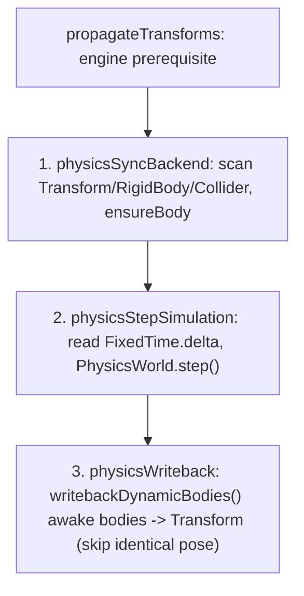

# forgeax-engine-physics

> Physics attaches `Transform + RigidBody + Collider` to an entity. Static/kinematic colliders synchronize resolved world TRS; dynamic bodies write simulated pose back to `Transform`. `@forgeax/engine-physics` defines component schemas (`RigidBody` / `Collider` / `CollidingEntities`), `PhysicsWorld` / `PhysicsWorld2D` resources, and the closed `PhysicsErrorCode` union. Implementations live in the WASM backends `@forgeax/engine-physics-rapier2d` and `@forgeax/engine-physics-rapier3d`. Import the default plugin from `@forgeax/engine/physics-rapier3d` or `@forgeax/engine/physics-rapier2d` and pass it in `createApp` plugins. The module statically selects one backend; activation initializes its WASM and installs the three-phase tick systems.

## Mental model

Physics is component-driven: attach components instead of calling a body-creation API. `physicsSyncBackend` scans `(Transform, RigidBody, Collider)` archetypes and calls `ensureBody` for new entities; `physicsStepSimulation` advances simulation; `physicsWriteback` writes dynamic positions/rotations to `Transform`. After `propagateTransforms`, resolved world TRS supplies static and non-CharacterController kinematic collider poses, including hierarchy, rotation, and scale. Rapier owns dynamic pose after creation. The selected backend publishes its ready resource under `PhysicsWorld`; the interfaces are `PhysicsWorld2D` and `PhysicsWorld`. World clamps host delta into `Time.delta`, then advances constant `FixedTime.delta` up to `maxStepsPerUpdate`. Discarded whole steps accumulate in `droppedSeconds` / `droppedUpdates`; only fractional `overstep` survives, with no later replay. Native plugin readiness completes before the App starts simulation. Read current collision pairs through read-only `CollidingEntities`.

Browser/Node Rapier 3D loading selects the SIMD payload only after a WebAssembly
feature probe succeeds; unsupported runtimes retain the scalar payload. Geometry
math and solver policy remain unchanged. Explicit native Hosts continue to load
their scalar transport and do not infer support from the JS runtime. Both browser
payloads are producer-owned, verified SDK inputs; do not substitute a separately
compiled WASM into a published game. See the backend README's Patched WASM delivery.

## Solver precision

In a root plugin, configure the selected backend with
`await ctx.plugin(physics3d, { solverIterations: 2 })` (or `physics2d`).
`PhysicsOptions.solverIterations` is an integer [1,32], defaults to 4, and applies
at activation; manual world constructors/factories accept the same options.
Fewer iterations can soften contacts/joints, increase penetration or jitter and
delay sleep. This changes solver convergence, not fixed cadence, CCD or rendering.
`RigidBody.additionalSolverIterations` only adds work to its connected island.
Do not advertise a native-step saving as a whole-game FPS gain; validate the actual
workload and settling. Read the [owning contract](../../packages/physics/README.md#solver-precision).

## Core API and components

| Name | Package | Form | Purpose |
|:--|:--|:--|:--|
| `RigidBody` | physics | Component | Body `type` (`RigidBodyTypeValue.{dynamic,static,kinematic}`), `mass`, and other parameters. |
| `Collider` | physics | Component | `shape` (see `ColliderShapeValue`), dimensions, and ordinary `mesh` shared ref. |
| `CollidingEntities` | physics | Read-only component | Entities touching this entity in the current frame. |
| `CharacterController` | physics | Component | Offset, slope, autostep, snap; angles in degrees; engine-written boolean `grounded`. |
| `PhysicsWorld.moveAndSlide` | physics | Method (3D `Vec3` / 2D `Vec2`) | Collision-aware movement: resolve `desiredDelta`, then write `Transform` and `grounded`. |
| `PhysicsWorld` | physics | 3D resource interface | Backend implements `step()` / `ensureBody` / `moveAndSlide` / `writebackDynamicBodies()` (awake dynamic bodies only; unchanged poses are not rewritten). |
| `PhysicsWorld2D` | physics | 2D resource interface | Equivalent 2D interface; `moveAndSlide` accepts and returns `Vec2`. |
| `RigidBodyTypeValue` / `ColliderShapeValue` | physics | Enum constants and `*FromF32` narrowing helpers | Type-safe component enum values. |
| `createRapier3DPhysicsWorld` | rapier3d | `async fn` | Construct a 3D PhysicsWorld manually; also used internally by `createApp`. |
| `createRapier2DPhysicsWorld` | rapier2d | `async fn` | Construct a 2D PhysicsWorld manually. |
| `PhysicsErrorCode` | physics (types SSOT) | Closed union; read source, do not copy members | Structured failure codes. |

### Collider transform projection

Physics consumes resolved world TRS, so child colliders follow parent translation, rotation, and scale. Cuboid half-extents use absolute per-axis scale. Spheres conservatively use the largest absolute scale. Capsules scale half-height along Y and cross-section by max(X,Z) in 3D or X in 2D. Negative scale uses its magnitude, without mirrored collision shapes. 2D projects only Z rotation into Rapier's scalar angle.

> [!IMPORTANT]
> Use enum constants such as `RigidBodyTypeValue.dynamic` / `ColliderShapeValue.sphere`, not raw numbers. Component fields/defaults: `packages/physics/README.md`, Component Schemas. Read `PhysicsErrorCode` from `packages/types/src/index.ts`; do not duplicate its members.

## Kinematic characters: moveAndSlide

Character movement is explicitly driven once per fixed tick with `PhysicsWorld.moveAndSlide(entity, desiredDelta)`, using `Vec3` in 3D and `Vec2` in 2D. Attach kinematic `RigidBody`, `Collider`, and `CharacterController`; combine input, gravity, and jump into `desiredDelta`. The method resolves collisions, slopes, autostep, and ground snapping; writes resolved position to `Transform` and contacts to `CharacterController.grounded`; returns actual displacement. There are no options or `dt` argument because displacement already includes time. Parameters are reread from components every frame (D-7 full reset).

```ts
import { FixedTime, FixedUpdate } from '@forgeax/engine-ecs';
import { vec3 } from '@forgeax/engine-math';
import { CharacterController, Collider, ColliderShapeValue, RigidBody, RigidBodyTypeValue, type PhysicsWorld } from '@forgeax/engine-physics';
import { Transform } from '@forgeax/engine-scene';

const char = world.spawn(
  { component: Transform, data: { pos: [0, 0.81, 0] } }, // Rest height: ground top + radius + halfHeight + offset.
  { component: RigidBody, data: { type: RigidBodyTypeValue.kinematic } },
  { component: Collider, data: { shape: ColliderShapeValue.capsule, radius: 0.3, halfHeight: 0.5 } },
  { component: CharacterController, data: {} },
).unwrap();

let verticalVelocity = 0;
const desiredDelta = vec3.create(); // Vec3 is a branded Float32Array; array literals do not typecheck.
world.addSystem(FixedUpdate, {
  name: 'move-character',
  after: ['physicsSyncBackend'],
  before: ['physicsStepSimulation'],
  queries: [],
  fn() {
    if (!world.hasResource('PhysicsWorld')) return;
    const pw = world.getResource<PhysicsWorld>('PhysicsWorld');
    if (!pw.hasBody(char)) return;
    const dt = world.getResource(FixedTime).delta;
    if (world.get(char, CharacterController).unwrap().grounded) verticalVelocity = 0;
    verticalVelocity -= 9.81 * dt;
    vec3.set(desiredDelta, 0, verticalVelocity * dt, 0); // Add input displacement once.
    pw.moveAndSlide(char, desiredDelta); // Returns the applied Vec3 displacement.
  },
}).unwrap();
```

> [!CAUTION]
> Common pitfalls: compare boolean `grounded` with `=== true`, never `!== 0` (always true). Spawn capsules at rest height (ground top + radius + halfHeight); embedding them in ground degenerates KCC contact. Check trajectory Y for continuous-slope snapping rather than relying on `computedGrounded()`. Guard asynchronous initialization with `if (!pw.hasBody(entity)) return;`, not by catching `body-not-found`. `physicsSyncBackend` skips kinematic mirroring for CharacterController archetypes to avoid double writes. Demo: `apps/hello/character`.

## Moving supports and dynamic pushes

Keep platform motion, contact queries and the character solve on the same fixed
timeline. Author platform Transform before physics sync; resolve the character
after sync and before step. Rapier KCC already accounts for contacted moving supports. Do not add platform
displacement again to `desiredDelta`: this duplicates the native carry and causes
relative drift. Pass input plus integrated gravity once per fixed tick. Do not copy
an interpolated render/camera pose into Physics or add a second post-solve
Transform translation. Clear support identity on jump, lost contact or
entity removal; reversal must not replay a stale delta. Scene's presentation
sampler supplies the matching camera/render pose.

Rapier controllers apply native dynamic-body contact impulses during movement.
Verify actual crate displacement and remove generic game-side contact-push
workarounds when adopting this backend. Explicit game forces such as knockback can use the public
impulse route; never translate a dynamic body's Transform each frame. Keep the
selected material/color and body mass in the acceptance fixture. Test sustained
standing, reversal, edge departure, jump and support deletion in the real game,
not only controller arithmetic.

## Three-phase tick order



> `createApp` with physics enabled registers these systems in this order. All return safely until the PhysicsWorld resource is ready.

## Usage skeleton

```ts
import { createApp } from '@forgeax/engine-app';
import { Collider, ColliderShapeValue, RigidBody, RigidBodyTypeValue } from '@forgeax/engine-physics';
import physics3d from '@forgeax/engine-physics-rapier3d';
import { Transform } from '@forgeax/engine-runtime';

const app = await createApp(canvas, { plugins: [physics3d] });
const world = app.world;

// dynamic body: falls under gravity
world.spawn(
  { component: Transform, data: { pos: [0, 5, 0] } },
  { component: RigidBody, data: { type: RigidBodyTypeValue.dynamic, mass: 1 } },
  { component: Collider, data: { shape: ColliderShapeValue.sphere, radius: 0.5 } },
);

// static ground: immovable collision target
world.spawn(
  { component: Transform, data: { pos: [0, 0, 0] } },
  { component: RigidBody, data: { type: RigidBodyTypeValue.static } },
  { component: Collider, data: { shape: ColliderShapeValue.cuboid, halfExtents: [5, 1, 5] } },
);

app.start();
```

## Pitfalls

- **Components attached but no movement**: check `Transform` (writeback target) and `createApp({ plugins: [the selected physics backend plugin] })` (tick installation). All three components are required.
- **No physics in initial frames**: asynchronous WASM loading leaves PhysicsWorld temporarily unavailable; systems return early by design.
- **Large host deltas**: never pass host delta directly into physics. World clamps `Time.delta` to `maxDeltaSeconds`, runs at most `maxStepsPerUpdate` fixed steps, and records dropped whole steps without later catch-up. The `physicsStepSimulation` guard for `dt <= 0` / `> 0.1s` is backend defense, not host-frame recovery.
- **2D/3D mismatch**: `'rapier-2d'` uses `PhysicsWorld2D`; `'rapier-3d'` uses `PhysicsWorld`. Schemas are shared but coordinate dimensions differ.

## Managed joints and skeletal motion

| Task | Execute |
|:--|:--|
| Ordinary body joints | Check `PhysicsWorld.createManagedJoints`; create a bounded validated group over existing body entities and retain its disposable lease. Read `packages/physics/README.md` and `src/managed-joints.ts` for anchors, limits and recovery. |
| Spring hair or tail | Import the motion API from `@forgeax/engine/animation/skeletal-motion`. Install `animationPlugin(lookup, { cadence: 'fixed' })` and `skeletalMotionPlugin()` in an assembled World. Bind saved plain-JSON `SkeletalMotionDefinition` to explicit animation targets. |
| Physical skeleton blend | Add `physics3d` and `skeletalMotionPlugin({ physics: true })`; use `bindSkeletalMotion`, exact `simulate(targets)` and visual weight controls. Read `packages/animation/README.md`, Managed skeletal motion. |
| Rig example and capture | Use `apps/hello/skin/skeletal-motion.html`; configuration, Scene, Mesh and Skin come through its ordinary Pack. Actual skin draw evidence follows `forgeax-engine-rhi-debug`. |

> [!IMPORTANT]
> Bone Transform and Physics writeback targets must be disjoint. Reset a discontinuous input before the next fixed tick. A native cleanup failure requiring `rebuild-world` is not a successful rebind.

## Further reading

- Component fields/defaults and enum/narrowing helpers: `packages/physics/README.md`, Component Schemas / Enum Constants.
- Three-phase ordering and early returns: `packages/physics/README.md`, Three-Phase Tick Pipeline; `packages/physics-rapier3d/src/rapier-physics-world-3d.ts`.
- PhysicsWorld resource interfaces: `packages/physics/src/physics-world.ts`.
- `CollisionEvent` / `CollisionEventPayload`: `packages/physics/src/collision-event.ts`.
- CharacterController schema and moveAndSlide parameters: `packages/physics/README.md`, Character Movement.
- Closed `PhysicsErrorCode` union: `packages/types/src/index.ts`; AGENTS.md Error model.
- Rapier WASM implementations: `packages/physics-rapier2d/src/` and `packages/physics-rapier3d/src/`.
- For 3D payload verification or rebuilding pinned local patches, use `packages/physics-rapier3d/README.md`, Patched WASM delivery. Diagnose missing CI payloads through [`forgeax-engine-debug`](../forgeax-engine-debug/SKILL.md).
- Physics auto-attachment: `packages/app/src/create-app.ts`; App setup: [`forgeax-engine-app`](../forgeax-engine-app/SKILL.md).

## Simulation participant

Register one ready physics participant with the ECS World when deterministic
source/fresh-target evidence must include portable physics state. Let ECS own
the record, restore transaction, trace, report, tolerance, and error contract.
Keep Rapier handles and native values inside the backend; never expose them to
App, Preview, or Remote. Recover by switching on the error code and following
its `expected`, `hint`, and `detail`.

## Mesh collision

Use `Collider.mesh` with a cooked MeshAsset and `ColliderShapeValue.convexHull`
or `.trimesh` in Rapier 3D. Convex hulls allow dynamic bodies; triangle meshes
allow static/kinematic bodies. Rapier 2D rejects these shapes and cylinder/cone.
Opt into glTF/FBX `importSettings.meshCollision: true`, or call Geometry's
`buildMeshCollision` for Scriptable Packs. Source/scale changes rebuild native
shapes; stable ticks and pose-only motion reuse them. Runtime vertex edits
invalidate the cooked attachment. Repair and recook the producer, then rebind
the ordinary mesh ref. Contract and lifetime: `packages/physics/README.md`,
Source mesh collision; `packages/import/README.md`, Mesh collision cooking.
