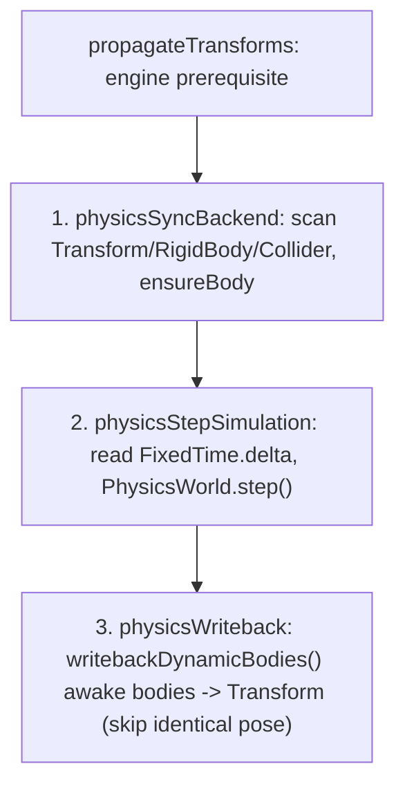

**语言**：[English](SKILL.md) · **简体中文**

> [!NOTE]
> 本文供人阅读；工具入口为英文 `SKILL.md`。示例代码与命令保留原文。

# forgeax-engine-physics

物理向实体附加 `Transform + RigidBody + Collider`。static/kinematic collider 同步解析后的 world TRS；dynamic body 将模拟姿态写回 `Transform`。`@forgeax/engine-physics` 定义 `RigidBody`、`Collider`、`CollidingEntities` schema，`PhysicsWorld`/`PhysicsWorld2D` resource，以及封闭 `PhysicsErrorCode` 联合。WASM 实现在 `@forgeax/engine-physics-rapier2d`、`@forgeax/engine-physics-rapier3d`。从 `@forgeax/engine/physics-rapier3d` 或 `@forgeax/engine/physics-rapier2d` 导入默认插件，传入 `createApp` plugins。模块静态选择一个后端；激活时初始化 WASM、安装三阶段 tick 系统。

## 心智模型

物理由组件驱动，附加组件而非调用 body 创建 API。`physicsSyncBackend` 扫描 `(Transform, RigidBody, Collider)` archetype，对新实体调用 `ensureBody`；`physicsStepSimulation` 推进模拟；`physicsWriteback` 把动态位置和旋转写回 `Transform`。`propagateTransforms` 后解析的 world TRS 为 static 和非 CharacterController 的 kinematic collider 提供姿态，包含层级、旋转、缩放。创建后 Rapier 拥有 dynamic pose。选定后端在 `PhysicsWorldResource` 或 `PhysicsWorld2DResource` 发布 ready resource，接口为 `PhysicsWorld`、`PhysicsWorld2D`。World 把 host delta 限制为 `Time.delta`，再以恒定 `FixedTime.delta` 最多推进 `maxStepsPerUpdate` 次。丢弃的完整步累计到 `droppedSeconds`/`droppedUpdates`，仅保留小数 `overstep`，以后不重放。App 开始模拟前原生插件必须 ready。通过只读 `CollidingEntities` 读当前碰撞对。

普通 `Collider` 投影使用解析后的 world TRS，负缩放取绝对值。source-owned static derived geometry 是明确例外：`sourceTransform.sceneMatrix` 提供完整 Scene 仿射矩阵，Rapier 将受支持 convex-compound/trimesh 映射到原生 pose 并保留 shear；镜像 trimesh 反转 winding。该 source 被接受期间 Scene matrix 是唯一姿态权威，ECS pose 编辑、直接 motion 调用、仅 body-type 更新都不会转移所有权。转移 pose/body-type 所有权前，先以该来源精确的空 static candidate 退役。见 Physics README 的 Derived Physics 契约。

Browser/Node Rapier 3D 只有在 WebAssembly 特性探测成功后才选择 SIMD payload，不支持时保留 scalar。几何计算和 solver 策略不变。显式 native Host 继续加载 scalar transport，不能从 JS runtime 猜测支持情况。两种浏览器 payload 都是生产者拥有、经过验证的 SDK 输入，不能在已发布游戏中换入单独编译 WASM。见后端 README 的 Patched WASM delivery。

## 求解器精度

在根插件中用 `await ctx.plugin(physics3d, { solverIterations: 2 })`（或 `physics2d`）配置。`PhysicsOptions.solverIterations` 为 [1,32] 整数，默认 4，激活时应用；手动 world constructor/factory 接受同样 options。降低迭代数可能软化 contacts/joints、增加穿透或抖动、延迟 sleep；改变的是收敛，不是固定步频、CCD 或渲染。`RigidBody.additionalSolverIterations` 只增加其连接 island 的工作。原生 step 节省只能报告为 step-time，必须验证真实工作负载与静止稳定性。见[所属契约](../../packages/physics/README.md#solver-precision)。

## 核心 API 与组件

固定步 controller 消费 `getCommittedBodyDynamics` 的精确 generation/step fence，再调用 `applyBodyForceAtPoint`/`applyBodyTorque`。这些是原生可加的 SI 力/扭矩，solve 后清零。持续 sensor 消费者用 `getSensorOverlaps`：完整的上一 completed roster 跨 pre-solve sync 保留，包括空步，并在 `stale` 暴露已退役成员。

刚体几何消费者可用 `getCommittedColliderPrimitives` 读取分离的已接受原生 shape、pose/scale、identity generations，并进行双向 packed-group 过滤。pose history 保存在消费者已接受 submission 边界，不能从 pending Scene TRS 推导原生表面运动。只有 `motionDiscontinuity` 相同才配对 collider poses；显式 `teleport`、`setBodyMotion` 在不替换 body/collider 时推进它，原生积分和普通 kinematic motion 保持它。

用 `intersectsCommittedBodyObb`、非负 `fullExtentsM` 和捕获的 generation/completed-step fence 选择整个 body。原生 owner 只把完整边长折半一次。快照 `rawAggregateCount` 在过滤前计算，只有原本为空的 aggregate 可查组件局部 bounds。native compound child 保留 collider identity 及显式 child index。见 Physics README 的 Fixed Dynamics and Sensor Rosters。

异步 force participant 用 `createSolverParticipant` 和分离 byte payload，不能持有 callback context/native object。选定后端拥有 Worker 执行、input-reader acknowledgement、结果时钟。reset/launch 等原生 motion 命令放在 `physicsSyncBackend` 之后、`waterBuoyancy`/`physicsStepSimulation` 之前。pending solve 是结构化 Result 拒绝，不能 catch 异常或修改快照。改 fixed-step continuation 或异步结果消费前读 [solver participants](../../packages/physics/README.md#solver-participants)。

Water 保存的 `WaterPontoonSet`/runtime participant 拥有浮力和 CPU DI；不能选择最近 Body，也不能把 point force 换成 `F*dt` impulse。可选 local residual query 保留接收 native entity/generation，external-source field 仅排除相同 receiver，保留背景和其他 entry waves。保存的 `WaterShallowCollider.dispersiveMotion` source role 区分完整 entry displacement 与被传输的 floating displacement；被动 heave 不授权反复 entry injection。修复任一边界都保留真实 native forces，以及 source-enabled idle/perturbation 证据。

Socket 引用必须为存活后代且排除 root。world force center 保留 hierarchy、signed scale、shear；coefficient geometry 使用 socket 的 immediate-parent-local position。运行时按 participant configuration/root generation 缓存每个 enabled-mask solve；重新初始化和 disabled wet-state 语义见 Water README。

完成的 `splashWakeEvents` 包含不可变 force-time contact geometry，以及相对选定水流的 contact-point velocity（含角运动）。保留 query time、fixed delta、root/Body generations；在 extraction 增加 World identity，不能连接当前 traces。`positionM` 仍为 pontoon center；只有 `contact.kind: 'water-plane-intersection'` 才允许 contact footprint。solver output wire 2 携带此快照并拒绝 wire 1。异步开关按 root 设置，其他 enabled root opt-in 时保留共享 solver；在 ECS query 迭代中推导，row facade 是借用对象，不能 spread 后离开迭代再读取。

| 名称 | 包 | 形式 | 用途 |
|:--|:--|:--|:--|
| `RigidBody` | physics | 组件 | `type`（`RigidBodyTypeValue.{dynamic,static,kinematic}`）、`mass` 等参数。 |
| `Collider` | physics | 组件 | `shape`（见 `ColliderShapeValue`）、尺寸、普通 `mesh` 共享引用。 |
| `CollidingEntities` | physics | 只读组件 | 当前帧接触该实体的实体。 |
| `CharacterController` | physics | 组件 | offset、slope、autostep、snap；角度为度，`grounded` 为 Engine 写入的布尔值。 |
| `PhysicsWorld.moveAndSlide` | physics | 方法，3D `Vec3` / 2D `Vec2` | 解析 `desiredDelta` 碰撞，再写 `Transform`、`grounded`。 |
| `PhysicsWorld` | physics | 3D resource 接口 | 后端实现 `step()`、`ensureBody`、`moveAndSlide`、`writebackDynamicBodies()`；只写醒着的 dynamic body，姿态不变不重写。 |
| `PhysicsWorld2D` | physics | 2D resource 接口 | 等价 2D 接口；`moveAndSlide` 接受并返回 `Vec2`。 |
| `RigidBodyTypeValue` / `ColliderShapeValue` | physics | 枚举常量和 `*FromF32` 缩窄函数 | 类型安全组件枚举。 |
| `createRapier3DPhysicsWorld` | rapier3d | 异步函数 | 手动构建 3D PhysicsWorld，`createApp` 内部也使用。 |
| `createRapier2DPhysicsWorld` | rapier2d | 异步函数 | 手动构建 2D PhysicsWorld。 |
| `PhysicsErrorCode` | physics，types 为唯一权威 | 封闭联合，成员以源码为准 | 结构化失败码。 |

### Collider 变换投影

Physics 消费解析后的 world TRS，子 collider 跟随父 translation/rotation/scale。Cuboid half-extents 使用各轴绝对缩放；sphere 保守取最大绝对缩放；capsule half-height 沿 Y 缩放，截面 3D 取 max(X,Z)，2D 取 X。负缩放只用大小，不镜像形状。2D 只把 Z 旋转投影为 Rapier 标量角。

隐藏网格但保留碰撞用 render `Visibility`。替换 starter prop 时一起移除 scene entry、body、collider。Rapier 3D 在 world scale 为零时暂停普通 static Collider，下次有效 fixed sync 恢复。`invalid-body-config` 时检查创作尺寸及解析 scale，包括父链。见 [Transform Pose Projection](../../packages/physics/README.md#transform-pose-projection)。

> [!IMPORTANT]
> 用 `RigidBodyTypeValue.dynamic`、`ColliderShapeValue.sphere` 等枚举常量，不用裸数字。字段和默认值见 Physics README 的 Component Schemas。`PhysicsErrorCode` 从 `packages/types/src/index.ts` 读取，不重复维护成员。

## 运动学角色：moveAndSlide

每个 fixed tick 显式调用一次 `PhysicsWorld.moveAndSlide(entity, desiredDelta)`，3D 用 `Vec3`，2D 用 `Vec2`。附加 kinematic `RigidBody`、`Collider`、`CharacterController`；输入、重力、跳跃合成到 `desiredDelta`。方法处理碰撞、斜坡、autostep、ground snapping，写入解析位置与 `grounded`，返回实际位移。位移已含时间，因此不接受 options 或 `dt`。每帧重读组件参数（D-7 full reset）。

```ts
import { defineSystem, FixedTime, FixedUpdate } from '@forgeax/engine-ecs';
import { vec3 } from '@forgeax/engine-math';
import { CharacterController, Collider, ColliderShapeValue, RigidBody, RigidBodyTypeValue, PhysicsWorldResource, PhysicsSync, PhysicsSimulation } from '@forgeax/engine-physics';
import { Transform } from '@forgeax/engine-scene';

const char = world.spawn(
  { component: Transform, data: { pos: [0, 0.81, 0] } }, // Rest height: ground top + radius + halfHeight + offset.
  { component: RigidBody, data: { type: RigidBodyTypeValue.kinematic } },
  { component: Collider, data: { shape: ColliderShapeValue.capsule, radius: 0.3, halfHeight: 0.5 } },
  { component: CharacterController, data: {} },
).unwrap();

let verticalVelocity = 0;
const desiredDelta = vec3.create(); // Vec3 is a branded Float32Array; array literals do not typecheck.
world.addSystem(FixedUpdate, defineSystem({
  name: 'move-character',
  after: [PhysicsSync],
  before: [PhysicsSimulation],
  queries: [],
  fn() {
    if (!world.hasResource(PhysicsWorldResource)) return;
    const pw = world.getResource(PhysicsWorldResource);
    if (!pw.hasBody(char)) return;
    const dt = world.getResource(FixedTime).delta;
    if (world.get(char, CharacterController).unwrap().grounded) verticalVelocity = 0;
    verticalVelocity -= 9.81 * dt;
    vec3.set(desiredDelta, 0, verticalVelocity * dt, 0); // Add input displacement once.
    pw.moveAndSlide(char, desiredDelta); // Returns the applied Vec3 displacement.
  },
})).unwrap();
```

> [!CAUTION]
> `grounded` 用 `=== true` 比较，`!== 0` 总为 true。胶囊生成在静止高度（ground top + radius + halfHeight），埋入地面会使 KCC 接触退化。斜坡连续吸附需检查轨迹 Y，不能只依赖 `computedGrounded()`。异步初始化用 `if (!pw.hasBody(entity)) return;`，不能 catch `body-not-found`。`physicsSyncBackend` 对 CharacterController archetype 跳过 kinematic mirroring，避免重复写。演示：`apps/hello/character`。

## 移动支撑与推动动态物体

platform motion、contact queries、character solve 使用同一 fixed 时间线。物理 sync 前创作 platform Transform，sync 后、step 前解析角色。Rapier KCC 已处理接触的移动支撑，不能再把平台位移加到 `desiredDelta`，否则重复 carry 产生相对漂移。每 fixed tick 只传一次输入与积分重力。不能把插值 render/camera pose 写回 Physics，也不能增加第二次 post-solve Transform 平移。跳跃、失去接触、实体移除时清 support identity，反向运动不能重放旧 delta；Scene presentation sampler 提供匹配 camera/render pose。

Rapier controller 移动时已施加原生 dynamic-body contact impulse。采用此后端时验证真实箱体位移，移除通用游戏侧 contact-push 绕过。击退等显式游戏力可用公开 impulse 路径，不能逐帧平移 dynamic body Transform。验收 fixture 保留所选 material/color 和 mass。在真实游戏测试持续站立、反向、离开边缘、跳跃、删除支撑，不能只测试 controller 算术。

## 三阶段 tick 顺序



启用 physics 的 `createApp` 按此顺序注册系统。PhysicsWorld resource ready 前，各系统均安全返回。

## 使用骨架

```ts
import { createApp } from '@forgeax/engine-app';
import { Collider, ColliderShapeValue, RigidBody, RigidBodyTypeValue } from '@forgeax/engine-physics';
import physics3d from '@forgeax/engine-physics-rapier3d';
import { Transform } from '@forgeax/engine-runtime';

const app = await createApp(canvas, { plugins: [physics3d] });
const world = app.world;

// dynamic body: falls under gravity
world.spawn(
  { component: Transform, data: { pos: [0, 5, 0] } },
  { component: RigidBody, data: { type: RigidBodyTypeValue.dynamic, mass: 1 } },
  { component: Collider, data: { shape: ColliderShapeValue.sphere, radius: 0.5 } },
);

// static ground: immovable collision target
world.spawn(
  { component: Transform, data: { pos: [0, 0, 0] } },
  { component: RigidBody, data: { type: RigidBodyTypeValue.static } },
  { component: Collider, data: { shape: ColliderShapeValue.cuboid, halfExtents: [5, 1, 5] } },
);

app.start();
```

## 常见问题

- 组件已附加但不移动：检查写回目标 `Transform`，以及 `createApp({ plugins: [the selected physics backend plugin] })` 的 tick 安装。三个组件缺一不可。
- 初始几帧无物理：WASM 异步加载时 PhysicsWorld 暂不可用，系统按设计提前返回。
- host delta 很大：由 World 驱动物理，限制 `Time.delta` 为 `maxDeltaSeconds`，最多 `maxStepsPerUpdate` 个 fixed step，记录并丢弃完整超额步，以后不补跑。`physicsStepSimulation` 对 `dt <= 0` / `> 0.1s` 的保护仅为后端防御，不是 host-frame 恢复。
- 2D/3D 不匹配：`'rapier-2d'` 使用 `PhysicsWorld2D`，`'rapier-3d'` 使用 `PhysicsWorld`。schema 共享，坐标维度不同。

## 托管关节与骨骼运动

| 任务 | 执行方式 |
|:--|:--|
| 普通 body joint | 检查 `PhysicsWorld.createManagedJoints`，在已有 body entity 上创建有界、经过验证的 group，持有可释放 lease。anchors、limits、recovery 见 `packages/physics/README.md`、`src/managed-joints.ts`。 |
| 弹簧头发或尾巴 | 从 `@forgeax/engine/animation/skeletal-motion` 导入；在已装配 World 安装 `animationPlugin(lookup, { cadence: 'fixed' })` 和 `skeletalMotionPlugin()`；把保存的纯 JSON `SkeletalMotionDefinition` 绑定到明确 animation targets。 |
| 物理骨骼混合 | 增加 `physics3d`、`skeletalMotionPlugin({ physics: true })`，用 `bindSkeletalMotion`、精确 `simulate(targets)`、视觉 weight 控制；见 Animation README 的 Managed skeletal motion。 |
| Rig 示例与捕获 | `apps/hello/skin/skeletal-motion.html` 的 configuration、Scene、Mesh、Skin 来自普通 Pack；实际 skin draw 证据遵循 RHI Debug 技能。 |

> [!IMPORTANT]
> Bone Transform 与 Physics writeback targets 必须不相交。下一 fixed tick 前重置不连续输入。原生清理失败要求 `rebuild-world` 时，不能报告成功 rebind。

## 深入阅读

- 组件字段/默认值、枚举及缩窄函数：Physics README 的 Component Schemas / Enum Constants。
- 三阶段顺序与提前返回：Physics README 的 Three-Phase Tick Pipeline；`packages/physics-rapier3d/src/rapier-physics-world-3d.ts`。
- Resource 接口：`packages/physics/src/physics-world.ts`。
- `CollisionEvent` / `CollisionEventPayload`：`packages/physics/src/collision-event.ts`。
- CharacterController schema 与 moveAndSlide 参数：Physics README 的 Character Movement。
- 封闭错误联合：`packages/types/src/index.ts`；AGENTS 的 Error model。
- WASM 实现：`packages/physics-rapier2d/src/`、`packages/physics-rapier3d/src/`。
- 3D payload 验证及固定 local patch 重建：Rapier3D README 的 Patched WASM delivery；CI 缺失 payload 用[调试技能](../forgeax-engine-debug/SKILL.zh-CN.md)。
- 自动附加：`packages/app/src/create-app.ts`；App 文档的 physics 选项。

## 模拟参与者

当确定性的 source/fresh-target 证据必须包含可移植物理状态时，在 ECS World 注册一个已经 ready 的 physics participant。record、restore transaction、trace、report、tolerance 和错误契约由 ECS 拥有。Rapier handle 与 native value 留在后端，不向 App、Preview、Remote 暴露。按错误码分支，遵循其 `expected`、`hint` 和 `detail` 恢复。

## 源网格碰撞

Rapier 3D 的 `Collider.mesh` 使用 cooked MeshAsset，shape 选择 `ColliderShapeValue.convexHull` 或 `.trimesh`。Convex hull 可用于 dynamic body，triangle mesh 只用于 static/kinematic。Rapier 2D 拒绝这些 shape 及 cylinder/cone。glTF/FBX 显式设置 `importSettings.meshCollision: true`，Scriptable Pack 则调用 Geometry `buildMeshCollision`。source/scale 变化重建 native shape，稳定 tick 和仅 pose 运动复用。运行时顶点编辑使 cooked attachment 失效；修复生产者、重新 cook，再绑定普通 mesh ref。契约/生命周期见 Physics README 的 Source mesh collision 与 Import README 的 Mesh collision cooking。

trimesh 是空心表面，角色只能站在脚下实际存在的三角形上。只有 bounds 或墙面的 mesh（Three 移植常用于墙面 raycast，地板来自独立 ground probe）需要单独 floor collider。带父级的 collider（`ChildOf`）使用 Scene world matrix，`world.addChild(root, collider, ChildOf, {})` 使其处于 root 姿态下。验证出生点，从胶囊下方朝下投射 `PhysicsWorld.raycast`，并在 `moveAndSlide` 后读取 `CharacterController.grounded`。

多个只读 completed-step 邻居消费者优先使用可选 `PhysicsWorld.getCurrentContactNeighborsBatch`。mask/normal filter 仍按请求提供；mutation 后结果与 owner reuse 全部失效。batch 保留 all-or-error 准入和每查询访问上限。
