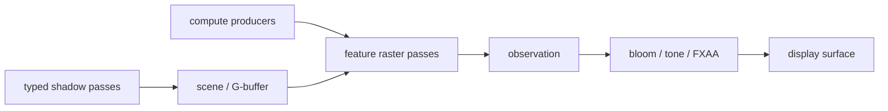

# forgeax-engine-render-pipeline

[Simplified Chinese](SKILL.zh-CN.md)

One full-size, full-rate, all-channel display CameraView uses the native surface
directly. Partial/scaled, held, stereo-channel and multiple display views retain
composition. Keep the view's preparation barrier, history, target readbacks and
receipt observations; Surface UI captures final display only after its own draw.
See [scene/output ownership](../../packages/render/README.md#native-output-core).

A new capture pipeline may hold submission or submit only a preparation candidate.
The current receipt stays pending in both cases, including after a ready frame.
Keep presentation publication in RenderCommit; waiting consumers must never inherit
prior readiness and sample an unwritten target. See the
[Three target contract](../../packages/three/README.md#ordered-hdr-targets-and-cube-environments).

## Volumetric clouds

Use Standard HDR with a single-sample camera, an `Atmosphere`, a
`DirectionalLight`, and one `VolumetricCloudLayer` per World. Copy the
[Render package example](../../packages/render/examples/volumetric-clouds)
into a project asset root. Find it at `examples/volumetric-clouds` in the
bundled Render package under `node_modules/@forgeax/engine` in an installed game.

Load `cloudGuids.material` with `cloudMaterialKind` and both instance GUIDs
with `cloudMaterialInstanceKind` from `@forgeax/engine/render/authoring`.
Spawn `VolumetricCloudLayer` from `@forgeax/engine/render` with the material
handle, altitude and thickness in meters. Keep the initial instance handle
for the base option. Use keyboard press edges to set `materialInstance` on
the same layer and bump `requestRevision` with each selection. See the
[cloud authoring contract](../../packages/render/README.md#volumetric-cloud-authoring-and-transport)
for the World code and inspection fields.

For wind and ground shadows, advance the layer's `windOffsetMeters` in
simulation and select Beer shadows with `shadowMode: 1` and
`castCloudShadows: true`. Cloud quality presets can vary `viewSampleCountScale`.
Mode 0 always traces at ceil-quarter dimensions and reconstructs at ceil-half
dimensions. `shadowResolution` controls the shadow map.

Verify each selection against `completedAdoption` and capture cloud silhouettes,
shadow movement and a fast camera turn in the browser. In a game with a local
renderer, inject `renderer` into the game plugin and read
`ctx.renderer.inspect({ fields: ['cloudLayer'] })`. Send unavailable status
to the HUD over the game's Host port. A fallback view using MSAA can keep
the sky with `Atmosphere.backgroundOnly: true`. Verify a completed frame
with the HUD notice in the browser.

## Water

Animated `before-medium` color features can use the optional
`temporal-reactivity` MRT alias when temporal AA exposes it. Load the existing
attachment, write alpha only (`writeMask: 8`) and merge with alpha `max`;
geometry retains velocity/depth RGB. Keep responsiveness bounded to the animated
receiver domain, including its dark samples. Preserve a single-color entry when
the alias is absent. See [receiver composition](../../packages/render/README.md#opaque-receiver-composition-before-media).

For shared Gerstner surface reads in a graphics RenderFeature, use
`waterGerstnerSurfaceBindings` with a Water source identity and the selected
cooked program contract. The receiving renderer qualifies actual fixed native
geometry and current buffers; do not copy private slots or wave clocks.
See [shared fixed Gerstner input](../../packages/render/README.md#shared-fixed-gerstner-input).

For a lake with waves, surface queries or buoyancy, start at the Water package's
[Lake Starter](../../packages/water/README.md#start-with-a-lake). It ships with
the matching SDK and npm package. Select it explicitly for
`test-experimental` Water work and verify a visible browser frame before
adding interactions. For a standalone water-looking mesh, use the stock
`single-layer-medium` material.

## Render preparation

For the opt-in dispersive Water producer, surface transport uses current native
submerged unions and horizontal velocity at facing boundaries. Flux divergence
drives the same depth-resolved wave modes with zero DC. Keep falling-object entry
volume separate, union compound native geometry before deriving boundary normals,
and preserve receiver-qualified buoyancy. Capture flux, projected rate and wave
state to prove bow origin, two-sided propagation and stopped decay; nonzero foam
alone does not establish sailing behavior. See [Render](../../packages/render/README.md#advanced-water-producer-entry).

For live native compilation detail, read `renderer.inspect().pipelineLibrary.pending`
or `execution.inspectRenderer({fields:['pipelineLibrary']})` in a Worker host.
For external queries, cold-to-warm counters and submitted bindings, follow
[Audit shader and pipeline work](../forgeax-engine-performance/SKILL.md#audit-shader-and-pipeline-work).
Rows contain the complete recorded recipe, semantic SHA-256 identity, shader
digests, native request origin, stage and elapsed time. `preload` distinguishes
exact startup/background membership, absence and unresolved indexing; runtime
origin alone does not mean a missed recipe. `unidentified` names the
coverage gap. The frame reason is only its first producer blocker. Preparation
barriers must not acquire an unwritten canvas texture. A pending receipt does
not establish that gameplay rendering continues.

A multi-view preparation barrier belongs to the complete physical frame. One
pending view holds capture, scene, compositor and Surface UI encoding; ready
siblings cannot publish a partial picture. Inspect the pending receipt and
actual tape before changing pipeline/shader work. See
[preparation semantics](../../packages/render/README.md#preparing-hidden-loadout-pipelines).

RenderGraph places private MSAA color resolves at the last unobserved writer.
Declare the final resolve pass unconditionally when it must run even with no
transparent draws; keep real producer predicates explicit. Intermediate sampled,
copy or attachment accesses retain the required result, and imported targets keep
their publication resolves. Count native attachments on the actual frame before
claiming a whole-game resolve reduction or a performance gain.

Compatible adjacent raster stages share one native pass by default. Inspect
`passes[].rasterBatch` for logical membership and the actual tape for physical
boundaries. GPU instrumentation times the group once; logical callbacks retain
their own resolvers/debug groups. CPU wrappers preserve batching. A replay runner
that observes or copies a logical result declares `requiresPassBoundary(name)`;
wrappers preserve it. Do not split ordinary passes merely to retain old timing rows.

For ordered offscreen draws use `Renderer.draw({ source, camera, targetWrite })` and
await a ready receipt when later operations require the written image. Target writes
reuse the primary capture graph; they reject destination sampling feedback. HDR cube
lighting uses `prepareRenderTargetEnvironment` after six completed faces, then
`RenderTargetEnvironment` on the Skylight entity; retain/release its native lease.
See [target lifecycle](../../packages/render/README.md#explicit-ordered-target-submissions)
and [Three initialization](../../packages/three/README.md#ordered-hdr-targets-and-cube-environments).

## Quick contract

Graphics producers that use only `vertex_index` select `vertexLayout: 'none'`.
Their material pipeline retains View and Material bindings without inventing a
mesh input. Declare every sampled graph target, including depth, in the pass's
`sampledTargets`; a binding declaration alone does not grant a graph read.

Standard Deferred is single-sample. Explicit Deferred with MSAA returns a structured
admission error; `auto` selects real Forward unless Deferred-only work forbids it.
SSR and Water must preserve that MSAA choice. Inspect `viewConfiguration` for the
last submitted requested/effective path, AA and scene sampling; `profile` remains
the device default. See [Render admission](../../packages/render/README.md#standard-lighting-contract).

`Camera.postProcessing` defaults to true and gates optional post effects and
their preparation/work scopes while preserving authored effect settings.
Tone/output transfer, manual exposure and raster MSAA retain their own
contracts. Water still extracts reset metadata when disabled; visual
underwater intent, intersection and audio state have separate consumers.
See the [Water entry](../../packages/water/README.md#material-family) before
changing underwater selection or optional Water work admission.

Advanced shallow and World Ocean FFT producers use the existing Water
RenderFeature and renderer-owned compute/copy lifetime. Follow the
[advanced Water entry](../../packages/water/README.md#advanced-simulation-entry)
for recipe/body/World ownership and named material outputs. Keep actual stage
readbacks and completion receipts distinct from extraction and submission.
The explicit `mode-projected-gravity/1` OceanPatch source follows the completed
native Physics clock and consumes its full elapsed interval. It must not clip
that interval, acknowledge partial work or reseed ordinary source motion.
Its reference depth and source slabs qualify a linear model, not Terrain depth;
the published mapping marks residual-only height/normal/foam material input.
Recipe `entryWaveMultiplier` defaults to 1 and scales only full-displacement
changes before evolution. Apply the same value to visual and receiver-qualified
fields; retain independent surface-transport flux and initialization baselines.
Producer history uses the same persistent outputs and submit/abort boundary:
copy accepted current fields before writers, seed previous after initialization,
and converge held/paused rendered frames. Declare those sampled/storage accesses
so RenderGraph supplies their RAW/WAR ordering; never advance history on abort.
The WaterBody shallow profile remaps sampled height/velocity and rebuilds
nonnegative depth against the current bed. Bottom-contour change suppression is disabled; do not reset wet remapped cells to the bed.
Shallow rigid capture consumes Physics' accepted native primitive snapshot and
held MeshAsset fields. Reuse the existing submission owner for prior poses and
use one grid-relative origin before f32 upload. Its end-of-step fraction `1` is
independent of solver substeps.
Select complete components through Physics' native OBB query at WaterSystem's
current `ComputeLocation` surface height and identity rotation. Full Y size is
the required authored `rigidMeshCollisions.overlapThicknessCells` times the
actual X-axis cell size; no implicit thickness is supplied.
Pass full side lengths to Physics for its single native half-extent conversion. Preserve
raw-empty-only held mesh bounds fallback and explicit component-bounds identity;
filtered-out native geometry never grants fallback. The field scalar is the
minimum accepted transform axis scale, while its coordinates use the full inverse.

The v2 visual FFT child reuses this World OceanPatch feature but keeps its
noise revision, scratch and `visualNormal` target separate from residual history.
After a complete child pass roster submits, retain the same target allocation on
held, paused and collision-pending frames only while parent generation, child
revision, noise revision, size and device still match. A new revision/device
must drop that resource; never declare a neutral visual texture current. Paused
frames with a new child revision still run the visual producer at the held clock.
The target is current only after matching completion. See the [v2 output
lifecycle](../../packages/render/src/water/advanced-feature.ts).

WaterInfo input wire v6 carries detached GPU WaterMesh sources, accepted WaveSet
readiness and the source loader's exact owner-qualified
availability alongside independent Body inputs. Prepared Water waits only for
pending dependencies; failed, missing and incompatible sources remain explicit.
Metadata never substitutes for the reflected shader's real WaterInfo target and
descriptor. Producers and receivers reject older WaterInfo input versions.
The shared builtin roster owns registration. Publication selects each Feature's
optional `source` adapter and retains it for the publisher lifetime; WaterInfo's
adapter emits the v6 DTO, never its renderer-owned frame. Local source capture
retains exact asset versions and renderer-owned view/device/graph facts. Plan
resolves captured revisions first. Shared fluid impulse noise residency consumes
the validated captured TextureAsset with its owning source scope; do not
re-resolve a released extraction snapshot through a live exact-version lookup. GPU WaterMesh consumes the same-frame
WaterInfo publication after WaterInfo plans, retaining normal generation fences.
GPU near sources derive their flat-far boundary mask only from the selected
same-view/Zone far receipt, with matching Body generation and mean height.
Scatter carries it at tile schema v7 byte 92, preserving the 96-byte stride;
transition tiles retain zero. A sliding near window does not establish adjacency.
Only an actual pending dependency may return a RenderFeature plan with
`pendingSource: { resource, reason }` and empty work. Such plans forbid native work and source
feedback. The Host aborts every producer in the held frame; ready sources still
require exact same-frame rows, and late callbacks cannot revive aborted inputs.

Optional saved Zone `gpuMesh` selects static-mesh raster/mips and actual GPU
traversal/count/prefix/scatter/indirect work. Require compute, storage and indirect
drawing; never substitute CPU-selected tiles. Params has seven fixed vec4 records
plus a variable-length mip tail. Use actual device limits instead of a 256-grid
cap. Per-view occlusion consumes the current graph depth. See the
[Render ABI](../../packages/render/README.md#gpu-water-mesh) before changing
binding offsets, static reuse or view/device/source retirement.

All per-view WaterInfo work and persistent history use the shared frame graph,
including fluid-disabled and constant-depth frames. Preserve World/view/Zone/
device isolation and stable view-scoped physical pass names. Producer feedback
keeps logical names; each view imports its own outputs. View order must not
transfer history to a view graph, force unchanged recaptures or rerun the solver.

Advanced shallow and World Ocean producers always retain shared graph ownership
with their original view scope, including frames without admitted contact foam
materials and pending-source holds. Skip those same pass identities in each view
graph. When Ocean contact FoamRT consumes shallow foam, admit both foam and mapping only from
one current publish pass with exact Body/simulation allocation generations.
Retained, blocked, unsupported and disabled plans must not re-inject old foam.
Released pixels stay in the existing shared history and decay in world space;
local material fallback remains active outside its finite capture coverage.
Preserve the additive four-cell edge weight.
Foam draw inspection reads the installed graph's exact uploaded Body descriptor
flag and reflected Water bindings. Require same-frame/device producer, imported
physical allocation and material consumer; a matching label or descriptor alone
is unavailable evidence. Failed import resolution withdraws its allocation key.

Local Water fluid fields follow the [Water runtime contract](../../packages/water/README.md#local-fluid-simulation).
Draw forces before fixed callbacks move the grid; a zero-step frame retains the
solver center. Ripple solver reads clamp, while normals and Shallow retain the
texture address mode. Movement retains history; disable/re-enable starts a new
generation with cleared targets and rejects old submission feedback. Accepted
queued impulses retain their payload/sequence and active impulses freeze while
disabled. Both survive mode/recipe edits while Body identity/generation and reset
revision match; explicit reset, Body replacement or removal clears both. Persistent
fluid history uses `World.identity` plus Scene-local instance identity; composition
indices route current assets/material rows only. Within a device generation,
source frame numbers advance strictly even for equal-time zero-step submissions;
old and duplicate acknowledgments cannot roll back force or capture-center history.
One force image is reused by
all catch-up callbacks; active lifetimes age once by the uncapped outer delta,
and normal/optional wave-foam passes run once per outer frame.
`foamFadePerFrame` and `foamWetFadePerFrame` use that outer-frame cadence.
Fluid configuration version 1 selects audited built-in kernels; it rejects
nonempty `materialGuids` and `textureGuids` rather than accepting unused shader
overrides. `impulseNoiseGuid` supplies the actual default force texture.
`waveFoam` owns its scalar capture extent and resolution separately from the
solver; the same Scene component supplies explicit world-space `waveFoamCenterM`.
Its submitted outer-frame history advances independently of fixed callbacks.
BeachFoam consumes that producer mapping with its existing linear-clamp amount
and linear-wrap height sampling, without duplicating author inputs in materials.
Preserve the Wave material's normalized-UV Shallow height sample.

The shared material field array preserves native texels, dimensions and each
field's declared nearest/linear and repeat/clamp semantics. Current and previous
displacement retain their submitted grid centers. Shadow, color, prepass and
motion consumers bind reflected resources through graph accesses; no pass may
omit WPO to avoid a missing binding. BeachFoam keeps its independent amount
clamp and height-wrap sampling. New source/plan boundaries clear stale fluid
candidates; a late abort can discard only its own token. Pending source is an
ordinary deferred frame; failed, missing and incompatible inputs stay errors.

RenderFeature plans explicitly wait for in-flight source inputs with
`ok({ pendingSource: { resource, reason }, work: [] })`. This branch keeps the
frame pending, aborts extracted ownership once and acknowledges no source intents.
Dependent view graphs wait before compiling missing shared exports. It cannot
declare graph work or native preparation. Missing, failed and
incompatible inputs retain their structured errors. See the
[producer contract](../../packages/render/README.md#renderfeature-the-producer-seam).

Covers making a game scene visible; stop here unless a task needs a section below.
Import components from `@forgeax/engine/render` and `Transform` from
`@forgeax/engine/scene`. One world unit is one metre; colors are linear RGB.

| Entity | Components and defaults | Limits |
|:--|:--|:--|
| Camera | `Transform` + `Camera { fov }` (vertical radians strictly in `(0, Math.PI)`; convert degrees with `degrees * Math.PI / 180`; `near` 0.1, `far` 2000, aspect follows the canvas) | One active `Camera` per World; extra cameras raise `render-system-multi-camera` (use `CameraView` for simultaneous views) |
| Sun | `DirectionalLight { direction, intensity, castShadow }`; `direction` is required, `intensity` is lux (default 1), `castShadow` defaults false | Any number: the first with `castShadow` (else the first) owns CSM shadows and the View sun lane; later ones are unshadowed lights (Three.js semantics) shaded in their own loop outside the light grid and not counted in `lightCount`; no `Transform` needed. `Atmosphere` needs exactly one |
| Local lights | `Transform` + `PointLight` / `SpotLight` (`intensity` candela, `range` Infinity, Point `decay` 2; Spot `direction`, `innerConeDeg`/`outerConeDeg` 60) | `StandardProfile.lightCount` (integer 1..1024, default 1024) local lights share one cluster path; past it the first lights by (kind, world, entity) are kept and the renderer warns once instead of rejecting the frame; point shadows need `PointLightShadow` plus the shader entry noted in the shadow section |
| Ambient | `Skylight { color, intensity }` (or an `equirect` for IBL); `groundColor` adds a Three-style hemisphere | With no light and no Skylight, Standard surfaces render black |
| Sky | Generate a linear HDR `EquirectAsset` in a Pack; bind it to `SkyboxBackground` and `Skylight` | One asset supplies the background and IBL. Use `Atmosphere` for physical air. |
| Mesh | `Transform` + `MeshFilter { assetHandle }` + `MeshRenderer { materials: [handle] }` | Handles come from `assets.load(guid, 'mesh' \| 'material')` |

- Materials: build in a Pack with `Materials.standard({ baseColor, roughness, metallic,
  emissive, emissiveIntensity })` or `Materials.unlit(...)`; CSS/hex strings are sRGB,
  numeric tuples linear. Textures, WGSL and budgets: `forgeax-engine-material`.
- Camera output: `tonemap` defaults to `TONEMAP_NONE`; `TONEMAP_ACES_FILMIC` is the
  filmic curve (`TONEMAP_AGX` is the desaturated base curve, only for a
  muted grade; presets in the SDK effects/lighting.md). `exposure` is Three's
  `toneMappingExposure` under every curve; Three WebGPU ignores `material.toneMapped`
  (see render README "Three material.toneMapped"). `antialias`
  (`ANTIALIAS_FXAA`/`_MSAA`/`_TAA`/`_SMAA`, default none) and `bloom: BLOOM_ENABLED`
  are Camera fields; see [Camera and built-in pipelines](#camera-and-built-in-pipelines).
- Colours and ambient units: write sRGB hex through
  `color.linearRgb(0xRRGGBB)` from `@forgeax/engine/math` (same as `THREE.Color`; `definePack` parameter defaults must stay literal linear `[r, g, b]`);
  bare tuples are already linear. Skylight is radiance, not irradiance, like Unreal
  `SkyLight`: Three `HemisphereLight`/`AmbientLight` intensity I is `intensity` I/π.
  Under `Atmosphere` the ambient is the sky's radiance, so it follows the sun
  (like Unreal's real-time SkyLight capture); Three's ambient stays fixed.
- Shadows: set `castShadow: true` on the light, then choose
  `shadowFilter: DirectionalShadowFilterValue.<label>`; opt entities out with
  `ShadowParticipation`. See [Directional shadow entry](#directional-shadow-entry).
- The Standard profile's `renderPath` defaults to `'forward'`. Set `'auto'` for
  a device-based default: storage buffers, six MRTs and the base Deferred
  attachment byte budget select Deferred; otherwise Forward. Camera/effect
  changes do not choose this default. Recovery reselects on the new device;
  `renderer.inspect().profile.renderPath` reports the concrete choice. Explicit
  `'forward'`/`'deferred'` retain existing admission.
  Diffuse GI needs Deferred capabilities. `CapsuleShadow` also supports Forward
  on WebGL2 through its cooked screen-data consumer. Deferred retains
  its later pass for Forward-only opaque materials. Stock Deferred AO uses the
  GBuffer before those writers; full-scene SceneData consumers still require
  complete producer coverage.
- Fog, atmosphere, volumetrics and custom passes are optional sections below. A black or
  wrong frame you cannot explain goes to `forgeax-engine-rhi-debug` first.

> [!IMPORTANT]
> RenderPipeline.build declares typed graph topology only. Renderer exclusively owns compile, last-known-good replacement, execution, retirement, finish(), and one queue.submit() per frame.

## WebGL2 Forward coverage and instances

Select `Camera.antialias: ANTIALIAS_MSAA` for four-sample coverage. WebGL2
must complete its real per-device HDR/depth resolve probe; inspect structured
capability errors rather than falling back to a retained single-sample graph.
AO, SSR, decals and screen shadows use independent single-sample surface data.
See [MSAA readiness](../../packages/render/README.md#msaa-on-webgl2).

Use `ANTIALIAS_MSAA_FXAA` for native four-sample Forward coverage followed by
FXAA. Ordinary Forward analytic `Fog` uses native vertex height fog before
blending; no screen/MSAA fog pass is added. Raw WGSL color writers publish
`program.forwardFog: 'height-vertex/1'` or explicitly use `renderState.fog: false`.
Full Atmosphere, Deferred and capture fog retain their screen transport.
Local `VolumetricFog` resolves nearest Reverse-Z depth on GPU for its per-pixel
integral. Keep full `Atmosphere` single-sampled and qualify WebGL2 fog separately.
Run the complete fog pixel owners and exercise the actual game; helper GPU
pixels and fewer graph passes alone do not establish whole-game performance.

Author instance transforms and Mesh LODs normally. Opaque uniform-only CPU
collections batch each 128-instance page by resident level. Preserve source
ordinals and transparent ordering; do not sort authored transform arrays.
See [LOD routes](../../packages/render/README.md) for cache and fallback limits.

## Native Terrain

Use `Terrain` from `@forgeax/engine/terrain` with one managed heightfield asset
and ordinary Transform. Author source heights, ordered material handles and
weights through the asset owner; painting uses `assets.update` on that same
handle. Render derives section draws and channel arrays. Capable devices use
compute; WebGL2 writes selected array layers through four raster attachments.
Both use the same WGSL arithmetic and retained input generations. Source bounds,
material encodings and lifecycle live in the [Terrain contract](../../packages/terrain/README.md).
Do not replace this path with hand-built meshes or per-fragment layer registries.

## Sky atmosphere and aerial perspective

For a portable physical display sky, explicitly set `Atmosphere.backgroundOnly:
true`. It reuses the shared optics through raster LUTs on WebGPU and WebGL2, but
supplies no aerial perspective or surface solar attenuation. Add `Skylight` without
an equirect for physical sky IBL; its Transform fixes the capture origin.
Cube, planar and environment captures require full Atmosphere. Verify both real
Browser backends with `atmosphere-background.browser.test.ts` and every LUT channel
with `atmosphere-tables.browser.test.ts`; use `physical-sky-ibl` Browser/Dawn
fixtures for isolated diffuse/specular response and cube/filter coherence. Retain
native optical quality gates.

Use one default `Atmosphere` and one `DirectionalLight` for full outdoor air. Author distance
in metres, coefficients in inverse metres, and solar intensity as outer-space
lux. Atmosphere Transform defines the ground reference; Skylight Transform
selects its independent capture position. Ordinary haze comes from Rayleigh/Mie
transport; `Fog` adds an extra height medium. Without `Atmosphere`, `Fog` leaves
the authored background unfogged; with it, `Fog` also covers the sky at the camera
far depth, independently of the planet intersection. Default `Fog` has positive
height falloff: add `Fog: {}` to fill the lower hemisphere while keeping the upper
sky visible. `Fog.skyOpacity`
scales that sky fog (1 physical, 0 sky unfogged). Read the
[physical atmosphere contract](../../packages/render/README.md#atmosphere-and-aerial-perspective).

Keep `groundAlbedo` at its default for Earth-like multiple scattering. Background
rays stop at the planet and show accumulated air radiance; author a mesh for a
visible ground surface. Do not add a sun-lit virtual ground overlay or mask all
downward display rays black. Validate both the absent surface term and retained
lower-sky air with `atmosphere-fog-background.browser.test.ts`.

Keep sky, AP, solar attenuation and captures on the shared optical kernel. AP
stores RGB luminance and RGB transmittance. Camera-specific tables belong to their
view; medium tables and pinned capture generations belong to Renderer. Verify
fixed-exposure AP on/off, sun sweeps and colour ROIs against high-sample transport,
then inspect real RHI Debug work/resources and GPU timings. Single-sample depth
and the declared device texture budget are required; unavailable is explicit.
Default full Atmosphere on WebGL2 Forward uses fragment LUT production and the
existing integer Cluster binding for RGB transport; keep compute/storage caps
unchanged. Require filterable/renderable RGBA16F, sixteen sampled textures and a
1024-wide Cluster texture. Run `atmosphere-full-webgl2.browser.test.ts` through
Browser Focus: its singleton exclusive owner compares actual WebGPU/WebGL2,
opaque/blended/Sprite AP, Fog/AO, retained cube/planar HDR captures and real WebGL
loss/recovery. Keep all sixty-frame controls and original image/deadline bounds.
Desktop evidence does not qualify mobile hardware or FPS; retain native optics,
ray, transport and 512-step quality owners.

## Local volumetric fog

Use one `VolumetricFog` entity for each local medium; select
`VolumetricFogSamplingValue.density` for an authored local 3D density field.
For spatial albedo, select `densityAlbedo` and supply a linear RGBA 3D source
with RGB = albedo × density and A = density. Keep empty texels zero in all
channels; the renderer filters optical coefficients through the same source
binding and lifetime. See [density coordinates](../../packages/render/README.md#volumetric-density-coordinates).
Read the [Render contract](../../packages/render/README.md#local-volumetric-fog)
for author fields, owner limits, accepted-count inspection, and consumer
boundaries. On overflow or invalid parameters, repair the named owner and
retry; never silently drop a volume or composite it through a second renderer.

Standard Forward and Deferred compose local volumes into linear scene color,
including with `Camera.tonemap = TONEMAP_NONE`. Tone mapping controls the later
output transform; it does not enable or disable the medium.

## Fog and translucency

`Fog.mode` selects the law: `exp` (default, density and height falloff, no start
distance), `exp2` (Three.js `FogExp2`) or `linear` (`near`/`far`, Three.js `Fog`);
`exp2` and `linear` use view depth, so Three.js values transfer. `Fog` fogs the opaque scene in place (`analytic-fog`, before transmission and
translucent draws); every blended writer fogs itself at its own depth through
`translucent_fog` and the View copy selected by its blend composition. Do not add
a post-translucency fog pass or composite particles before fog. The
[Render contract](../../packages/render/README.md#fog-and-translucency) states the
composition rules and limits; prove a fog-order bug with an RHI capture (fog work
before the translucent work, bound View offset `translucentViewOffset(...)`).
Forward MSAA uses that same fog kernel at each sample depth on the original
4x color producer, with an average display resolve. Water's late nearest-color
gather retains the opaque sample ID across underwater translucency.

Deferred Water SSR uses the shared closest-depth surface traversal with the
matching opaque normal layout, material coverage and motion. Water's displaced
receiver stays separate. Main AA owns temporal resolve; do not restore removed
SSR history slots or `waterTemporal` controls. Forward Water keeps its inline
Standard reflection route. GPU occlusion retains its furthest hierarchy.

An after-tonemap raster pass that reads depth declares `sceneDepth` on the
pass. With TAA, Standard then supplies full-output geometry coverage and a
matching unjittered View, using the authored deformation/alpha/cull rules.
This Engine adaptation adds one depth target and coverage work only on demand;
do not substitute TAA's dilated temporal metadata for geometry depth.
Water coverage carries SLW's existing FoamRT through the lane output and declares
its sampled read, retaining the same producer and graph lifetime for every pass.

## Transmission/refraction

Transmission/refraction stays in the Standard pipeline: one renderer-owned backdrop copy, optional
rough mip raster passes, transmission before ordinary transparent, then temporal/post. Use
`renderer.inspect().transmission` for capability, extent, format, mips, bytes, and recovery facts;
never add a second graph or app-owned scene-color copy. Below 21 sampled textures the renderer selects
the `TRANSMISSION_SHARED_SLOTS` variant; see the material skill for the budget error and check.

## Order-independent transparency

`Camera.transparency: TRANSPARENCY_WEIGHTED_BLENDED` replaces the sorted pass for eligible draws
with `oit-accumulate` (rgba16float accum + r16float weight, shared additive/revealage blend) and
`oit-composite` over scene color. Ineligible draws run in the sorted `transparent` pass before
OIT, matching three.js r187. `addStandardTransparentPasses` builds this for forward and deferred alike.
MSAA accumulates into 4x targets with 1x resolves. The composite targets resolved scene color
when no later scene-stage feature can write the multisampled color. TAA, fog, DoF and outline
treat the composite as the transparent pass. Planar/target captures stay sorted. The GPU-driven
lane carries no transparents.
Read `renderer.inspect().transparency` for requested/resolved mode, draw counts, closed ineligible
reasons, and the `capability-absent` fallback. Contract:
[render README](../../packages/render/README.md#order-independent-transparency).

## Stereo output (non-XR)

Add `StereoCamera { eyeSeparation, convergence, layout, swapEyes }` to a perspective
Camera; the renderer derives two CameraView eyes (own depth, post and TAA history, one
submit). Layouts are the closed `StereoLayoutValue` union: side-by-side, top-bottom and
write-mask anaglyph. Branch on `StereoCameraInvalidError.detail.field` for invalid
separation/convergence or unsupported orthographic, `Camera.target` and PlanarReflection
cameras. `inspect().views[].eye` identifies eye rows; composite receipts have no display
picking, so cast interaction rays from the mono Camera. Contract:
[render README](../../packages/render/README.md#stereo-output-non-xr).

## Routing

| Goal | Entry |
|:--|:--|
| tonemap / bloom / FXAA / MSAA | Camera fields |
| Image-based lens flare ghosts | `LensFlare` camera companion (HDR, after Bloom) |
| Skybox | SkyboxBackground |
| Side-by-side / top-bottom / anaglyph stereo | `StereoCamera` on a perspective Camera |
| Rough/glossy reflections of off-screen content under ray-traced GI | Deferred `diffuseGi: { gather, reflections: {} defaults 0.4/0.1 }` with `ibl: false`, any gather; `'exact'` traces both lobes, `'irradiance-field'`/`'screen-probe'` read the radiance cache above the trace threshold and trace Global SDF→Card below it, then denoise the traced lobe (hit-distance reprojection, same-reflector rejection, 3x3 variance clamp, 8-frame cap, edge-stopping filter; passes `irradiance-field.reflection-temporal` / `.reflection-denoise`). SSR stays first, world value fills misses. [Lite reflections](../../packages/render/README.md#lite-reflections-world-traced-specular-indirect) |
| CubeCamera / ReflectionProbe capture | `CubeCamera` / `ReflectionProbe` + one Renderer receipt path |
| RenderTarget source / readback | `Renderer.createRenderTargetTextureSource` + receipt-bound `observe` |
| Freeze a region of this frame for later material sampling | `Renderer.requestFramebufferSnapshot(target, { region, camera? })` into a 2D `rgba16float` target (linear-HDR scene color, copied before tonemap); observe the ticket via `observe(receipt, { framebufferSnapshots })`. Contract: [render README](../../packages/render/README.md#framebuffer-region-snapshot) |
| 3D / array RenderTarget (volume slices, layer atlases) | `shape: '3d' \| '2d-array'` + `depthOrArrayLayers`; one `Camera.target` writer per layer via `Camera.targetLayer`; `requestTargetReadback(target, { layer })`; [layered targets](../../packages/render/README.md#layered-targets-3d-and-2d-array) |
| Standard linear-output stages/camera effects | Camera companion + Standard output plan + ordinary RenderFeature |
| Encoded-output tail effects | createFullscreenRenderFeature + createRenderer({ features }); only effects that preserve spatial position |
| Diffuse GI (exact reference or Lumen-Lite irradiance field) | `StandardProfile.diffuseGi` with `gather: 'exact' \| 'irradiance-field'` (deferred, IBL off); exact MASK coverage runs 3 GPU-driven indirect rounds over a shared candidate pool, so a nonzero coverage-header `overflow` (invalid samples) means the pool, not the scene, ran out; [contract](../../packages/render/README.md#irradiance-field-diffuse-gi-lumen-lite) |
| Replace pass topology | RenderPipeline.build |
| Feature writes scene color/depth | createRenderFeatureTarget + staging.addGraphicsPass |
| Which GI world traversal ran (Global SDF or hardware Ray Query) | Automatic; read `renderer.inspect().diffuseGi.traversal` / `traversalFallback` / `acceleration` (screen-probe: `diffuseGi.field.*`) and the `irradiance-field.world-acceleration` build pass. Scene edits stay in place on both lanes; on Ray Query, `acceleration.blasBuilt` / `tlasBuilt` / `bytesBuilt` show the cost (move: TLAS only; add: one BLAS per new mesh; material: none); [world traversal seam](../../packages/render/README.md#world-traversal-seam-global-sdf-or-hardware-ray-query) |
| Static-scene diffuse GI with no per-frame tracing (build-time light bake) | Cook an `irradiance-volume` with `createIrradianceVolumeCooker()` (`@forgeax/engine-render/internal`, a NativeCooker over the exact path integrator; keep the GUID across rebakes), publish it in the Catalog, then `StandardProfile.diffuseGi: { gather: 'baked', volume: <guid>, resolution }` (deferred, IBL off). Inspect `renderer.inspect().diffuseGi.volume`; passes are only `baked-field.*`; dynamic objects receive, never contribute. [contract](../../packages/render/README.md#baked-irradiance-volume-build-time-light-bake) |
| Lumen-Lite Screen Probe diffuse GI (screen trace first, field fallback) | `StandardProfile.diffuseGi` with `gather: 'screen-probe'`, `probes` and the shared `field` (deferred, IBL off, compute required); inspect `renderer.inspect().diffuseGi` and `screen-probe.*` pass timings; [contract](../../packages/render/README.md#screen-probe-diffuse-gi) |
| Camera-following GI probes over a large world (scroll re-traces only exposed slabs) | `field.clipmap: { levels, dimensions }` (or `DiffuseGiTierScene.clipmapDimensions`); `probeBudget` splits over levels; inspect `renderer.inspect().diffuseGi.probes.clipmap`. [Clipmap](../../packages/render/README.md#camera-following-probe-clipmap) |
| Pick a diffuse GI quality preset (low/medium/high/epic) with capability fallback | `resolveDiffuseGiTier(tier, scene, renderer.inspect().capabilities)` and spread `.profile` over the Standard profile; `.fallback.reason` is data. [Quality tiers](../../packages/render/README.md#quality-tiers) |
| Move/remove/add objects or change materials under the irradiance field without a reset | Nothing to call: moves, removals, adds and material changes edit Cards, the Global SDF box and nearby probes in place within the field's spare capacity (overflow or a handedness flip rebuilds); non-field changes skip re-projection; skinned/morph meshes are excluded from the field. Card capture (field and exact `global.cards`) is progressive, `cards.budget` tiles per frame. Inspect `renderer.inspect().diffuseGi.edits`. [Dynamic content](../../packages/render/README.md#dynamic-content) |
| A GI scene with more Cards than `cards.maxCaptureBytes`, or several GI CameraViews | Nothing to call: the field streams Card residency on both world traversals (Global SDF and Ray Query) by view distance and screen size (`inspect().diffuseGi.residency` resident/pending/evicted); CameraViews split the probe, capture and relight budgets equally (`views[i].diffuseGi.share`), each view owning its field memory. [Card residency](../../packages/render/README.md#card-residency) |
| Compute produces vertex/index/indirect buffers for raster | staging.addComputePass + staging.addGraphicsPass, sharing prepared GPU buffer refs |
| RHI backend / capability | `forgeax-engine-rhi` |
| Frame capture/replay | forgeax-engine-rhi-debug |

Pending readback tickets retain their requested format, mip extent, layer and device
generation. Resize may still read the matching accepted image. If no physical target
matches, `observe` returns `render-target-operation-failed` without an invalid copy;
request a new ticket for the replacement extent. Submitted copies keep their original
receipt. See [target lifecycle](../../packages/render/README.md#target-and-probe-lifecycle-index).

## Directional shadow entry

Enable `DirectionalLight.castShadow: true` before choosing a shadow filter;
bare lights default off. DirectionalLight.shadowFilter selects the receiver.
It is an ECS enum; assign
DirectionalShadowFilterValue.pcfVogel, .pcf1, .pcf3, .pcf5, .pcfSoft,
.pcssMedium, or .pcssHigh numeric constants, not string labels. Valid labels are
pcfVogel, pcf1, pcf3, pcf5, pcfSoft (Three.js PCFSoftShadowMap), pcssMedium, pcssHigh; default is pcfVogel. Do not create
numeric or compatibility aliases. PCSS
shadowAngularRadius is in radians, defaults to 0.00465, and accepts
[0.0001, 0.05]. maxPenumbraTexels is in texels, defaults to 32, and must be
a finite integer in [1, 64]. Other CSM fields, units, and defaults live in the
Directional shadow quality table in
[`packages/render/README.md`](../../packages/render/README.md); do not duplicate the schema here.

For detached directional shadows, inspect the actual frame before increasing
bias. Native CSM shares a bounded caster/receiver budget and uses one-sided
per-texel receiver correction;
`normalBias` is an optional world-unit offset and can move a query above a small
caster. See the owning README for defaults and units. Automatic CSM admits
upstream blockers and pancakes their near depth in the shared caster VS;
explicit shadow matrices and point/spot views keep ordinary clipping. Contact
shadow tests must also pass with screen-space contact shadows disabled. The
CSM Browser capture gate validates the active near-clamp policy in the caster
header together with cascade selection; the policy lane is not padding.
The complete cube/plane contact matrix shares one renderer and World, resetting scene
entities through `despawnAll()` per case. The contact and curved Browser owners use singleton/exclusive processes; preserve
all cases and pixel thresholds when changing scheduling. Dawn runs both owners
in `shadow-quality`; see the CI guide.

For small-scale contact occlusion below cascade resolution (grass, foliage,
feet), set DirectionalLight.contactShadowLength in meters (default 0, off;
typical 0.1-0.5). Deferred marches inline; Forward rasterizes the same visibility
from semantic depth/normal, including WebGL2. It respects `ShadowParticipation.receive`
and changes only directional lighting. It is independent of castShadow. See
Screen-space contact shadows in the render README.

Use `ProjectedDecal` for ordered color/normal/roughness projection onto opaque
Standard surfaces in Forward or Deferred with single-sample depth. Forward
updates the AO/SSR normal surface and modifies the material before BRDF evaluation;
Forward MSAA uses separate single-sample surface inputs; Deferred MSAA remains
an explicit `projected-decal-invalid` request. See render README
"Projected decals" for material, display-camera and projector limits.

`DirectionalLight.sourceAngle` (degrees, finite, >= 0, default 0.5357 = the
sun's apparent diameter) gives the sun an angular size for direct specular: a
smooth surface shows a sun-sized highlight instead of a sub-pixel glint (Unreal
SphereMaxNoH + energy normalization). `0` restores the old point-light lobe
bit-identically; diffuse and shadows are unchanged. Direct lighting also floors
roughness at 0.02 (Unreal View.MinRoughness); environment reflections are not.

For skinned characters, add the `CapsuleShadow` tag component to cast the
directional shadow from `SkeletonAsset.shadowCapsules` (fitted at glTF/FBX
import) instead of re-rasterizing the mesh into every cascade. Use Forward
(including WebGL2) or Deferred with a `castShadow` DirectionalLight; read
`renderer.inspect().capsuleShadow.fallbacks` when an entity is not admitted.
See Capsule character shadows in the render README.

Per-entity opt-out is `ShadowParticipation { cast, receive }` (Bevy
`NotShadowCaster` / `NotShadowReceiver`; absent means both true, except that a
mesh whose every material blends casts nothing unless the component is authored). `cast: false`
leaves every shadow map, and `receive: false` skips all shadow sampling on that
surface, including the WebGL2 uniform fallback. `PointLightShadow` bias uses
Bevy units: `depthBias` in world meters (default 0.08), `normalBias` in cube
texels (default 0.6). Point sampling is hardware 2x2 and needs
`forgeaxShader({ engineEntries: { pointShadows: true } })`; a DevKit game project
(`forgeax dev` / `project play` / `project build`) sets
`package.json#forgeax.pointShadows: true` instead. Without it
`renderer.inspect().pointShadow.status` is `unavailable`, never `ready`. Directional and
spot bias keep normalized depth plus world-meter normal offset.

After authoring, read renderer.inspect().directionalShadow once. This bounded
POD uses the same field names as Render/Runtime READMEs: requested, effective,
`status`, `fallbackReason`, `lastKnownGood`, `pixelEvidence`,
`cascadeCount`, `mapSize`, `shadowMapBytes`, `writerPasses`, `blockerTaps`,
filterTapUpperBound, seamTapUpperBound, deviceGeneration, and
graphGeneration. WebGL2 admits PCSS through the cooked no-storage variant:
raw blocker reads and bilinear shader comparisons share one depth binding.
Native variants retain hardware comparisons. Both keep the same Medium/High
blocker, penumbra, bias and cascade policy. Inspect effective and candidate
status; a requested label alone is not pixel evidence. RhiNull remains
rhi-null-structural. not-run must remain not-run.

For shadow cost, read renderer.inspect().shadowRaster: `passCount`, `drawCount`,
and per-view `cache` plus `invalidationReason`. A static scene that keeps
missing names the changing input; fix that producer instead of disabling shadows.
Moving or animated casters only re-raster the views they touch: one
renderer-global classification splits settled and dynamic casters, and every
directional, spot, and point-face view keeps settled casters in a cached
`layer: 'static'` view and redraws only dynamic casters over a copy of it. `shadowRaster.views[]` lists both
identities; a static-layer hit with final-layer misses is the expected cost of a
scene with moving characters. Directional views also skip casters smaller than
one or two shadow texels; `views[].texelCulled` counts them per view.
A static-layer miss under an unchanged light matrix redraws only the changed
casters' footprint; `views[].dirtyRectCount` present means a partial redraw,
absent on a miss means a full one. Any light-matrix change, including a
cascade that moved by whole texels with the camera, is a full static redraw:
re-rastering settled casters is cheaper than shifting the retained depth.
Without GPU-driven shadow views (the direct lane or no storage buffers) the
whole directional atlas is retained while the persistent caster content and the
cascade matrices are unchanged, so camera-only motion redraws only when a
cascade crosses a page; skinned casters keep it redrawing every frame.
Declare level geometry `Mobility` static (`@forgeax/engine-scene`) so its casters
join the static layer at once even when spawned later; undeclared casters join
at the first frame only as part of the initial population, otherwise one 16-frame
window after creation or 100 unchanged frames after a move.

For per-frame CPU cache cost, read renderer.inspect().renderScene.frameCaches:
lifetime `hits`/`misses` for `visibilityProjection`, `temporalSnapshots`,
`transparentSort` and `renderBundles` (residency lives in
`renderScene.gpuDriven.residencyValidation*`). Diff two samples for a window
rate. Camera-only motion should keep visibility and temporal near 100%; a
distance-sorted transparent set legitimately misses when the orbit swaps pairs.
Render bundles re-record only the changed material batch; a pass whose batches
never repeat backs off to direct recording and probes again later. A quiet
scene (no movers or churn) should report zero steady-state bundle misses; a
persistent miss means some per-batch command input, such as a bind group,
is recreated every frame.

Diagnose failures through error.code, error.expected,
error.hint, and code-specific error.detail, not message parsing. For
shadow-invalid-config, read detail.field, detail.actual,
detail.bound, and detail.reason; repair that authored field and retry. If
status is rejected with lastKnownGood retained, repair or rebuild/cold-cook
the identified producer, invoke renderer.recover(), then retry. Do not label
fallback, LKG, or structural evidence as accepted PCSS.

Read evidence in this order: authored label/unit, inspect()'s
requested/effective/reason → `deviceGeneration`/`graphGeneration` →
MVD receipt backend and visual/readback/timing status. Only available supports
the corresponding pixel claim; unsupported and not-run remain explicit. Renderer alone owns
compile, LKG, execute, retire, finish(), and one queue.submit() per frame. This skill
adds no second query, buffer, UBO, binding, atlas, pass, RPC, or recovery owner.

## Selection outline

For the standalone Three renderer, use `setThreeOutline(renderer, camera, options)`
with original Three objects or group roots. It projects visible descendants into
the existing regular Outline stage for that display camera. See the
[Three camera selection contract](../../packages/three/README.md#camera-selection-outline).

Use `Outline` on the active camera for an explicit camera-World entity set,
linear visible/hidden colors, integer output-pixel width, and
`OutlineOcclusionValue.visible`, `.hidden` or `.all`. Read the
[Render contract](../../packages/render/README.md#selection-outline) for bounds,
coverage and graph placement. Empty selection, zero width and component removal
produce no Outline passes. Inspect `renderer.inspect().perFramePassNames`, then capture the
selection, classification and composite work through RHI Debug; retain live and
fresh-device replay pixels plus the missing-composite falsifier.

## Camera and built-in pipelines

```ts
import {
  ANTIALIAS_FXAA,
  BLOOM_ENABLED,
  TONEMAP_REINHARD_EXTENDED,
} from '@forgeax/engine/render';

world.spawn(
  { component: Transform, data: cameraTransform },
  {
    component: Camera,
    data: {
      fov: Math.PI / 3,
      aspect: canvas.width / canvas.height,
      near: 0.1,
      far: 1000,
      tonemap: TONEMAP_REINHARD_EXTENDED,
      exposure: 1,
      antialias: ANTIALIAS_FXAA,
      bloom: BLOOM_ENABLED,
      bloomThreshold: 1,
      bloomIntensity: 0.35,
      bloomSmoothWidth: 0.01,
      bloomRadius: 0,
    },
  },
);
```

Built-in topology:



renderer.perFramePassNames reports compiled pass order; it observes topology and does not execute it.

### Display-P3 output

The canvas colour space is the closed union `'srgb' | 'display-p3'`. Choose it with
`createRenderer(canvas, { outputColorSpace: 'display-p3' })` or switch at runtime with
`renderer.setOutputColorSpace(space)` (a Result; applied at the next draw). The working space
stays linear Rec.709. The Output Transform converts to linear P3 after tone mapping and then
applies the sRGB OETF. Author wide colours with `displayP3([r, g, b, a])`, not with raw
out-of-range numbers.

Branch on `renderer.inspect().output.colorSpace`, never on the backend. Its `status` is either
`'applied'` or `'fallback'`, and `effective` is what the surface presents. A fallback has
`fallback.detail.observed` in `configure-rejected | configuration-absent | color-space-absent |
color-space-mismatch`, and the Renderer keeps drawing sRGB. Readback of the `'final-display'`
domain carries `colorSpace`: decode P3 bytes with `color.displayP3ToLinear`, not as sRGB. An RHI
Debug tape records `rhiCaps.canvasColorSpace`, and the Output Transform uniform
`TonemapParams.outputGamut` (byte 16) is `1` for P3. Limits and the SSOT are listed in the
[render README](../../packages/render/README.md#display-p3-output-colour-space).

### Built-in camera Depth of Field

DoF is authored on the active perspective `Camera` through the Engine-owned
`DepthOfField` component. Its presence enables the shared Standard post chain;
`maxRadiusPixels: 0` or component removal is the exact zero-work path. Use the
closed numeric values exported by Render when selecting a side or quality:

```ts
import {
  Camera,
  DepthOfField,
  DepthOfFieldQualityValue,
  DepthOfFieldSideValue,
} from '@forgeax/engine-render';

world.addComponent(camera, {
  component: DepthOfField,
  data: {
    focusDistance: 8,
    fStop: 1.4,
    sensorHeight: 0.024,
    maxRadiusPixels: 16,
    quality: DepthOfFieldQualityValue.medium,
    blurSide: DepthOfFieldSideValue.both,
  },
});
```

Near/far/both use the same signed thin-lens CoC. Quality changes tap density and
does not change the radius. The feature consumes the Standard `RenderExtent`
domain and uses `max(1, ceil(axis / 2))` for half-resolution resources. It reads
the current matching depth contract, including the multisampled depth variant;
it does not reinterpret an invalid temporal-v1 sample as raw depth.

Read `renderer.inspect().depthOfField` after a submitted frame. `requested` is
the current component projection; `effective`, `graphGeneration`,
`deviceGeneration`, and `lastKnownGood` describe the last successful submit.
When candidate compilation or submission fails, the candidate is retained only
as a diagnostic and the prior accepted projection remains effective. Use the
reported `fallbackReason` before retrying the existing Renderer recovery path.
With no component on the active camera, the projection stays present as
`status: 'off'` with zero DoF graph facts. Invalid authoring fields and
orthographic requests remain inspectable through the camera snapshot's
structured `error` (`code`, `expected`, `hint`, `detail`) and report
`invalid` or `unsupported` without graph admission.

### Built-in lens flare

`LensFlare` is an HDR camera companion following the Unreal Engine lens-flare
model: every linear HDR pixel above `threshold` (`r + g + b`) is disc-blurred
(`bokehSize`) and re-imaged as eight ghosts at `ghostScales[i] * X` for a source
at screen offset X, tinted by `ghostTints` and `tint`. It runs directly after
Bloom and before exposure/tone mapping; zero intensity, zero tint, or no live
ghost is the exact zero-work path. It needs no light entity: occluded sources
simply are not bright pixels. Invalid fields report
`lens-flare-invalid-parameter`. Contract:
[render README](../../packages/render/README.md#camera-lens-flare).

### Built-in barrel distortion

`BarrelDistortion` is an ordinary camera companion. It samples the submitted
linear-LDR scene at the output extent after LUT and before FXAA and the single
output encoding. `strength` is finite in `[0, 0.35]`; `centerX` and `centerY`
are top-left-origin output-viewport fractions in `[0, 1]`. Missing or zero
strength is the exact-zero path. Positive strength uses auto-crop, so the
camera FOV stays fixed while the visible scene region becomes narrower.

```ts
import { BarrelDistortion, Camera } from '@forgeax/engine-render';

world.addComponent(camera, {
  component: BarrelDistortion,
  data: { strength: 0.2, centerX: 0.5, centerY: 0.5 },
});
```

The same output-sized mapping is available from the public Render package:
`createBarrelDistortionMapping(width, height, data)` derives the immutable POD,
then `mapDisplayToScene(out, mapping, x, y)` and `mapSceneToDisplay(out, mapping,
x, y)` use continuous physical pixels. Reuse the mapping from the submitted
`FrameReceipt` (or the serialized worker frame signal); do not read a newer ECS
component when the displayed frame is still older. An inverse point outside the
display rectangle is a miss. Legacy `pick` coordinates remain unwarped; use the
explicit `pickDisplay`/`computeDisplayScreenRay` entrypoints once per pointer.
DOM/ShadowRoot HUD layout is not transformed. World labels and vertex distance
tests must project through the inverse mapping into displayed pixels.

The built-in feature is registered through the ordinary ordered feature host and
uses the existing in-flight retirement. Missing or zero strength produces zero
resources, uploads, and passes while keeping the shader declaration available
to production Naga/Dawn validation. Each accepted receipt carries the immutable
mapping, output extent, camera matrices, device generation, graph generation,
and frame identity, including the identity case. Display consumers must reject
retired, lost, or zero-size contexts and never recover a camera from the live
World. Browser consumers can use the App frame-submission subscription to carry
that same context across the Engine Worker boundary.

Read `renderer.inspect().barrelDistortion` for the effective mapping, output
extent, accepted `frameId`, `deviceGeneration`, `graphGeneration`, and
`lastKnownGood`. An invalid component reports the closed
`barrel-distortion-invalid-parameter` error with `detail.field`, `detail.value`,
and the expected bound. A missing `rgba16floatRenderable` capability is admitted
only when the extracted plan is active; an empty or zero-strength plan remains
zero-work. Repair the producer or disable the component, then retry through the
same Renderer recovery route. While a candidate is pending or fails, the
previous mapping and picture stay paired; a successful disable publishes an
explicit identity mapping and retires the old resources after in-flight work.
Do not treat a missing mapping as identity, and do not use a newer World camera
to interpret an older submitted frame.

## GPU pass timing boundary

The public Render route is one opt-in on `RendererOptions.gpuPassTiming`, one
`draw()` `FrameReceipt`, and one `observe(receipt, { include: ['timings'] })`
request. Observation returns bounded JSON-safe facts for that receipt. Branch
on the closed statuses `complete`, `partial`, `unavailable`, and `failed`, then
read the matching `reason` or `error` `code`, `expected`, `hint`, and `detail`.
Pass duration is a pass fact; it is not frame latency. `current` status,
completeness, and `latestKnownGood` are distinct projections, and an omitted
`timings` include does not start work or materialize a future observation.

Render owns the session, generation fence, parser, retention, and recovery
publication. The bounded fact contract is
[`packages/render/src/record/gpu-pass-timing/contract.ts`](../../packages/render/src/record/gpu-pass-timing/contract.ts).
RenderGraph contributes only neutral pass-boundary seams such as
`timestampWrites` and `after(frame)`; it never owns timing policy or status.

```ts
const renderer = created.value;
const frame = renderer.draw(request);
if (frame.ok) {
  const observation = await renderer.observe(frame.value, { include: ['timings'] });
  if (observation.ok && observation.value.timings !== undefined) {
    const timing = observation.value.timings;
    if (timing.status === 'complete') console.log(timing.frame.passes);
    else console.log(timing.reason?.code ?? timing.error?.code, timing.latestKnownGood);
  }
}
```

Use the producer-owned recovery `hint` and inspect the named source before
retrying. Do not add a timing controller, second counter, live trace, or
membership-specific accepted-evidence path.

Target/probe capture stays inside this same typed graph. Each cube face uses its own face camera
and array-layer view; promotion waits for `FrameReceipt.completed`. PMREM work is bounded to one
face/mip step per frame, and a probe outside its box selects the renderer's Skylight irradiance
fallback. A healthy `renderer.recover()` result with `renderer-state-invalid` is a guard, not a
device-loss recovery result; recovery invalidates the old generation and rebuilds physical targets.

## Custom RenderPipeline

```ts
import {
  addTypedScenePass,
  addTypedOutputTransformPass,
  createRenderPipelineTarget,
  importRenderPipelineSurface,
  type RenderPipeline,
} from '@forgeax/engine/render/authoring';

export const customPipeline: RenderPipeline = {
  build({ graph, contributeFeatures, observationCaptureDomains }, topology) {
    const surface = importRenderPipelineSurface(graph, topology);
    if (!surface.ok) return surface;

    const color = createRenderPipelineTarget(graph, 'scene-color', {
      format: 'rgba16float',
      size: 'surface',
    });
    if (!color.ok) return color;
    const depth = createRenderPipelineTarget(graph, 'scene-depth', {
      format: 'depth24plus-stencil8',
      size: 'surface',
    });
    if (!depth.ok) return depth;

    const scene = addTypedScenePass(graph, {
      name: 'main',
      color: color.value,
      depth: depth.value,
      selector: { LightMode: ['Forward'] },
    });
    if (!scene.ok) return scene;

    const features = contributeFeatures([
      {
        kind: 'scene-color',
        texture: color.value.texture,
        view: color.value.view,
        format: color.value.format,
        sampleCount: color.value.sampleCount,
      },
      {
        kind: 'scene-depth',
        texture: depth.value.texture,
        view: depth.value.view,
        format: depth.value.format,
        sampleCount: depth.value.sampleCount,
      },
    ]);
    if (!features.ok) return features;

    if (topology.camera.tonemap === 'none') {
      return addTypedOutputTransformPass(graph, color.value, surface.value.storage, {
        outputOnly: true,
        observationCaptureDomains,
      });
    }
    return addTypedOutputTransformPass(graph, color.value, surface.value.display ?? surface.value.storage, {
      observationCaptureDomains,
    });
  },
};
```

Forward the build context's `observationCaptureDomains` to the final output transform: it
captures the requested `final-display` receipt there, so `requestObservation(['final-display'])` and
`observe(receipt, { include: ['final-display'] })` work on a custom graph. Unrequested frames add
no copy.

Feature installation happens through the public renderer construction options:

```ts
import { createRenderer } from '@forgeax/engine-runtime';
import { createFullscreenRenderFeature } from '@forgeax/engine-render/authoring';

const feature = createFullscreenRenderFeature({
  identity: 'game::vignette',
  source: VIGNETTE_WGSL,
  reads: ['ldrColor'],
});
const created = await createRenderer(canvas, { features: [feature] });
if (!created.ok) throw created.error;
const renderer = created.value;
```

Use `standardProfile` in the same construction options for Standard quality.
The returned `Renderer` has no runtime `configureStandard` or
`installRenderFeature` methods; the feature host owns declarations, graph
admission, and in-flight retirement after construction.

> [!CAUTION]
`postEffects` run after the encoded output and must not add a second spatial
warp. A spatial effect belongs in the Standard output plan so its sampling
domain, target, FXAA order, and one OETF writer remain explicit.

## Typed resource ownership

RenderGraphBuilder accepts only opaque handles created or imported by that builder:

| Resource | Creation/import | Pass access |
|:--|:--|:--|
| texture | `createTexture` / `importTexture` | `sampled-read`, `storage-read`, `storage-write`, `color-attachment`, `depth-stencil-read`, `depth-stencil-write`, `copy-src`, `copy-dst` |
| Texture view | view / importView | Attachments and texture read/write access |
| buffer | `createBuffer` / `importBuffer` | `uniform-read`, `storage-read`, `storage-write`, `vertex-read`, `index-read`, `indirect-read`, `copy-src`, `copy-dst` |
| TLAS | `importAccelerationStructure` (caller-owned, never allocated) | `acceleration-structure-build` (copy passes only), `acceleration-structure-read` (requires `caps.rayQuery`, else `capability-missing` `'ray-query'`) |

storage-write followed by vertex-read/index-read/indirect-read establishes compute-to-raster dependencies and required barriers. Do not duplicate this with a resource ledger, string keys, or manual pass dependencies.

```ts
const compacted = graph.importBuffer(
  'visible-draws',
  { size: maxBytes, usage: STORAGE | VERTEX | INDIRECT },
  (frame) => frame.visibleDrawBuffer,
);
if (!compacted.ok) return compacted;

const cull = graph.addComputePass('cull-and-compact', {
  accesses: [{ resource: compacted.value, usage: 'storage-write' }],
  encode: ({ pass, frame }) => {
    pass.setPipeline(frame.cullPipeline);
    pass.setBindGroup(0, frame.cullBindings);
    pass.dispatchWorkgroups(frame.cullWorkgroups);
  },
});
if (!cull.ok) return cull;

return graph.addRasterPass('visible-raster', {
  accesses: [
    { resource: compacted.value, usage: 'vertex-read' },
    { resource: compacted.value, usage: 'indirect-read' },
    { resource: color.view, usage: 'color-attachment' },
  ],
  colorAttachments: [{ view: color.view, loadOp: 'load', storeOp: 'store' }],
  encode: ({ pass, resources }) => {
    const buffer = resources.buffer(compacted.value);
    if (!buffer.ok) throw buffer.error;
    pass.setVertexBuffer(0, buffer.value);
    pass.drawIndirect(buffer.value, indirectOffset);
  },
});
```

## Render publication

For a separate Render Worker, keep `extract` beside World and construct the same
declared feature in the receiver bootstrap. Use `assetDependencies(data)` for
GUID resources and `onSourceFrameSubmitted(data, feedback)` for source-owned
intent acknowledgment. `onSourceFrameCompleted` receives the same submitted
source data and actual Renderer receipt facts in publication order, before
storage returns. Keep GPU state in receiver-local planning/submission.
Bootstrap `configureRenderer` owns pipeline/post-effect installation;
`executionBootstrapHost.renderTargets` owns source target descriptions. Follow
[Render publication](../../packages/render/README.md#render-publication) for
payload ownership, geometry, resources and lifecycle rules.

## RenderFeature compute → raster

The pipeline owns attachments; features declare required logical targets:

```ts
const sceneColor = createRenderFeatureTarget({
  kind: 'scene-color',
  format: 'rgba16float',
  sampleCount: 1,
});
```

Feature prepare creates GPU programs, bindings, and buffer refs. contribute uses the same refs in addComputePass and subsequent addGraphicsPass vertexData/indexData/indirect commands. Projection imports each physical buffer once and records compute storage-write plus raster vertex-read/index-read/indirect-read in the renderer's graph.

Rules:

- Use RenderFeatureTargetHandle for attachments; do not guess internal pipeline names.
- Share prepared buffer refs between compute and raster; do not duplicate handle registries.
- Include topology changes in the contribution signature; compile and atomically replace the last-known-good graph next frame.
- Missing capabilities require structured errors or an explicit fallback lane; never silently submit invalid compute.
- One Renderer consumes one source World. Caches belong to that Renderer; source epochs, full entity handles and device/target generations still guard replacement and retirement.

Prepared-compute VFX authoring: forgeax-engine-vfx. Builder/error contracts: packages/render-graph/README.md.

## Points and Lines main-pass route

Points and Lines are a raster consumer of the existing Standard main geometry
pass. Route them as `MeshAsset` topology -> `Points` or `Lines` style ->
`Materials.unlit` -> retained extract -> prepared expansion -> recorded draw.
The renderer owner retains the expanded vertex/index resources and carries the
vertex layout into record; the main pass binds the Points/Lines view at group 0,
binding 10 and resolves the dedicated manifest-backed material pipeline.

This is not a second graph, renderer, cache, recovery ledger, or backend branch.
The normal material and legacy topology paths remain unchanged. A point draw is
non-indexed when the source has no indices; a line draw preserves indexed or
non-indexed source semantics after paired expansion. Prepare must publish the
complete resource set atomically, and stale or failed preparation keeps the
retained last-known-good state.

Evidence routing is explicit:

| Route | Evidence strength |
|:--|:--|
| direct WebGPU focused probe | pixels, source/derived bytes, bindings, draw, and validation errors |
| clustered unlit | structural material/graph contract unless a lane-specific runtime capture exists |
| WebGL2 | structural no-compute/no-storage/no-indirect contract unless a WebGL2 runtime capture exists |
| RhiNull | structural resource and command bookkeeping only; never pixel or GPU timing evidence |

For a failure, inspect the same retained/prepared/record state, repair the
source or producer, and rerun the route. Do not add application WGSL, manually
fetch a stand-in mesh, or bypass capability data with a backend-name switch.
The browser gate may be explicitly skipped by the loop authority; record that
as skipped, never as a pass. A Dawn timeout is blocked environment evidence,
not a successful smoke result.

## Appending post-processing

```ts
const created = await createRenderer(canvas, { features: [vignetteFeature] });
if (!created.ok) throw created.error;
const renderer = created.value;
```

## GPU-driven LOD selection

The built-in GPU-driven lane selects LOD on the GPU per view. LOD members with
an identical chain share one batch that owns one indirect command and one
visible segment per level; the cull computes projected height from GpuScene
transforms and the view camera and appends each item to its level (two levels
for a crossfade pair). Camera motion across a LOD threshold keeps
`filteredPlanBuilds` at zero and uploads no height payload. Diagnose a wrong
level with the view readback (`lodSelection` histogram, per-level segments) or
an RHI Debug capture of the per-level `drawIndexedIndirect` commands, not by
adding a CPU selection path. `indirectDrawCount` counts per-level commands.

Shadow views rank LOD against their own light view-projection, never coarser
than `SHADOW_LOD_COARSEST` (LOD1), so a caster never drops to a proxy that no
longer matches its lit silhouette. The cap depends on no camera: main-camera
motion never invalidates a retained shadow layer and runs no CPU LOD walk.

## GPU-driven residual rows and buffer limits

The GPU lane culls only residual CPU-drawn rows on the CPU: `ExtractedFrame.gpuOwned` lists them, and verification, receipts and dynamic-geometry consumption visit only those rows; do not iterate all draws to find GPU-owned work. Opaque rigid Unlit and morph (a compute geometry producer, one batch per morphed entity) are GPU-lane members. Buffers size by membership and the adapter's `maxBufferSize`/`maxStorageBufferBindingSize`, which device admission requests when above defaults; a requirement beyond the bindable bound is a structured `limit-exceeded` error (1,048,576 transform rows at the 128 MiB default), never a silent CPU fallback or split binding. Pose and row ingest enter the Renderer's Render World only through its `render-sync` system; features read rows, they do not write them.

## GPU-driven occlusion (two-phase HZB)

The Standard Deferred GPU view splits GBuffer drawing. The first pass draws
last frame's visible instances, `occlusion-hzb-*` builds from its depth, and
`gpu-driven.occlusion-cull` identifies instances to append in `g-buffer-late`.
Disable the Deferred optimization with `RenderPipelineAsset.config.gpuOcclusion: false`.
The Standard Forward view consumes a single GPU instance selection for its
prepass and color pass. Its AO and SSR pyramids follow their consumers. Deferred
shadow passes follow `g-buffer-late`. Directional and spot final-layer
casters whose receiver prism the camera pyramid hides are skipped
(`shadowRaster.views[].cameraCulled`). This is off for Forward, point lights, static
layers, and any frame where another camera, capture, probe, fog or ray-diffuse
consumer reads the maps (volumetric fog counts only when enabled). A missing
shadow near an occluder edge means a too-small receiver dilation. A
`cameraCulled` of 0 in a Deferred scene with occluders means the graph did not
bind the pyramid; check the admission roster first.
`apps/perf/shadow-stress/scripts/inspect-shadow-cull-tape.mjs` audits a
capture: the instances each shadow view drops must equal its camera-culled
count. There is no
reprojection: history is a per-instance visibility bit. A missing object that
reappears one frame late means a broken late append; a falsely culled object
means a wrong footprint or pyramid level. Diagnose it with `readLodSelection()`
(`occlusion.culled` / `late`, also projected into `renderer.inspect().lodOcclusion`)
and an RHI Debug capture of the pyramid mips and
late indirect commands, not by disabling the cull.

## Verification

| Change | Minimum verification |
|:--|:--|
| pipeline topology | `pnpm --filter @forgeax/engine-render test` |
| RenderFeature projection | render + runtime integration tests |
| RHI access/barrier | render-graph unit + Dawn mixed compute→raster capture/replay |
| Engine/RHI/demo | All hello/learn-render Dawn smokes at 60 completed frames + pnpm test:browser + pnpm test:dawn |

Checkpoints:

- Graph compilation precedes swapchain acquisition; failure retains the last-known-good graph.
- One shared encoder, one finish(), and one submission per frame.
- Retired graphs wait for in-flight execution before destroying resources.
- Compute-produced indirect buffers include both storage and indirect physical usage.
- Browser/Dawn checks provide real execution evidence; RhiNull proves structure only.

## SSOT

- Pipeline contract: `packages/render/src/render-pipeline.ts`
- Builtin topology: `packages/render/src/pipeline/standard-pipeline.ts`, `packages/render/src/pipeline/standard-post.ts`
- Typed targets/primitives: `packages/render/src/render-pipeline.ts`, `packages/render/src/typed-render-graph-primitives.ts`
- Feature projection: `packages/render/src/features/plan.ts`, `packages/render/src/features/host.ts`
- Graph builder/access validation: `packages/render-graph/src/builder.ts`
## Public material MRT

Author `MaterialPass.outputs` in WGSL location order, cook/load the material, then
bind matching `colorTargets` in `addTypedScenePass`. Install the graph through
`createRenderer(canvas, { pipeline })`; reuse the same graph views for downstream
passes. Use per-output blend/write masks and per-attachment `colorClearValues`.
See [the public MRT contract](../../packages/render/README.md#public-material-mrt).
Validate every attachment with the Browser and Dawn material-mrt fixtures,
including resize, live/replay equality and missing-draw falsification.

## Selective surface lighting

Set `lightingChannels` on the light and `MeshRenderer`; unsigned u32 intersection
selects direct illumination independently of camera visibility. Defaults match
all; zero disables only surface direct light. Use `0x80000000` for bit 31, never
`1 << 31`. Read the [Render contract](../../packages/render/README.md#surface-direct-light-channels)
for shader consumers, integer ABI, invalid-input recovery, captures and cost.
Shadow casting stays with `ShadowParticipation.cast`; unmatched receivers may
still cast. GI, IBL, baked light and volumetric scattering keep their existing
policies. Use linear HDR and a light-off independent oracle, then RHI Debug to
check actual light/receiver carriers and matching shader work.

## Screen-space AO

Standard enables SSAO by default. Set project
`settings.rendering.ambientOcclusion.enabled` to disable it or select
`method: 'gtao'` for Deferred. A camera's `AmbientOcclusion` component
overrides enablement and numeric view parameters. Omitted values inherit.
Forward and WebGL2 use single-level SSAO and report a GTAO request as a
Forward SSAO selection. Deferred GTAO uses its own submitted per-view history,
independent of the main antialiasing mode. AO consumes current depth and
attenuates indirect light. Use the
[AO contract](../../packages/render/README.md#screen-space-ambient-occlusion)
and `renderer.inspect().standardLighting.ambientOcclusion` to trace effective
method, passes, resource extent and accepted history.

## Portable Hi-Z, SSR and exposure

Use the Standard pipeline's admitted execution plan; do not select backends in
game shaders. Compute retains native workgroup algorithms. Fragment Hi-Z uses
independent attachments and legal mip publication; SSR uses its shared SceneData,
material response MRT and the View-owned accepted scene-color history.
Forward SSR requires built-in
Standard materials and single sampling; Deferred keeps its own admission contract.
Auto exposure preserves the weighted 256-bin histogram with integer reductions,
never mean luminance. Read the [portable contract](../../packages/render/README.md#portable-hi-z-ssr-and-histogram-exposure)
for capacity, format receipts, physical pass inspection and real GPU gates.
The public WebGL2 World/Camera owner is
`packages/runtime/src/__tests__/standard-effects-webgl2.browser.test.ts`: exposure,
SSR and their SSAO combination retain 60 completed frames, actual fragment work,
paired pixels and disable-to-baseline recovery. AO admits opaque/masked Unlit
surface inputs; Forward SSR still requires built-in Standard receivers. Standard
Morph and Skin+Morph surface inputs consume the same position/normal/tangent
deformation as color, with Morph before Skin. Do not clear Morph weights or
substitute bind-pose geometry to admit an effect. GPU VFX
retains its independent compute/indirect capability gate; route CPU-updated
particle sprites through `Points` rather than treating them as GPU VFX fallback.

## Editor assistance

The built-in editor assistance Feature consumes the single source frame. Use
`editorAssistance(world)` for editor selection and bounded geometry contributions;
ordinary games leave it disabled. It owns no helper World or entity. Author
Outline remains unchanged. View controls use the App target tools; projection,
asset versions, GPU resources and submitted-frame picking remain Engine-owned.
See the Render README's Editor assistance contract before extending its inputs.

## Portable temporal antialiasing

Use `ANTIALIAS_TAA` at native input size for TAA, or attach `DynamicResolution`
for TAAU. `ANTIALIAS_TSR` selects the separate 1x-history TSR resolver at either
native or reduced input size. TSR uses compute/storage textures when available
and fragment/MRT on HDR devices with at least three color attachments, including
WebGL2. It never silently changes algorithms. History, jitter, DRS changes,
CameraView isolation and successful-submit advancement share one temporal owner.
Inspect `renderer.inspect().temporal` and each view's temporal projection; a
Browser test using WebGPU alone does not qualify the WebGL lane. See the
TSR guide.

For an effect that modifies lit opaque receivers before Water/transparency,
use the generic `before-medium` placement. Keep source and destination textures
distinct while sampling scene color, then copy the result to the declared scene
attachment. Fullscreen reads accept exact SceneData and feature-texture tokens;
put them in `sampledTargets`, use explicit `uint` reads for packed normal inputs,
and let prepared bindings retain token authority. Canonical Terrain requires
its selected Deferred GBuffer writer receipt; never patch derived section
materials to bypass Terrain's closed material contract. See Render README's
Opaque receiver composition before media contract.
