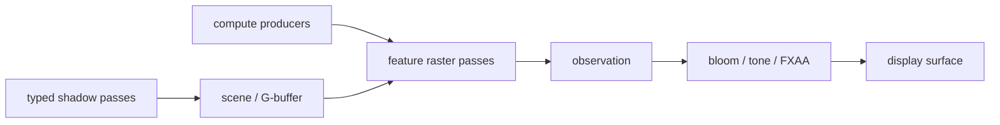

# forgeax-engine-render-pipeline 中文参考

[English tool entry](SKILL.md)

供人阅读的简体中文版本；工具入口仍为 SKILL.md，标识符和代码保持原契约。

单个全尺寸、全速率、全通道 display CameraView 直接使用原生 surface；局部/缩放、held、立体通道、多 display view 保留合成。保持 preparation barrier、history、target readback、receipt 观察；Surface UI 必须自己 draw 后才捕获最终 display。见[场景/输出所有权](../../packages/render/README.md#native-output-core)。

新捕获管线可能 hold submission 或仅提交 preparation candidate；即使曾有 ready frame，当前 receipt 在两者下仍 pending。呈现发布归 RenderCommit；等待者不能继承旧 ready 后采样未写 target。见 [Three target](../../packages/three/README.md#ordered-hdr-targets-and-cube-environments)。

<a id="volumetric-clouds"></a>
## 体积云

Standard HDR、单采样 Camera、Atmosphere、DirectionalLight、每 World 一个 VolumetricCloudLayer。将 [Render 示例](../../packages/render/examples/volumetric-clouds) 复制到项目资产根；安装包在 examples/volumetric-clouds，SDK ZIP 在 source/engine/packages/render/examples/volumetric-clouds。

从 @forgeax/engine/render/authoring 用 cloudMaterialKind 加载 cloudGuids.material，两个实例 GUID 用 cloudMaterialInstanceKind。从 @forgeax/engine/render spawn VolumetricCloudLayer，传 material handle、米制 altitude/thickness；base 选项保留初始实例。键盘 press edge 在同一 layer 设置 materialInstance，每次选择增加 requestRevision。World 代码/检查字段见[云创作契约](../../packages/render/README.md#volumetric-cloud-authoring-and-transport)。

风和地面阴影：模拟推进 windOffsetMeters，shadowMode:1、castCloudShadows:true 选择 Beer 阴影；质量可改 viewSampleCountScale。模式 0 始终 ceil-quarter 追踪、ceil-half 重建；shadowResolution 控阴影图。每次选择用 completedAdoption 验证，并浏览器捕获云轮廓、移动阴影、快速转相机。本地 renderer 游戏注入 renderer 后读 ctx.renderer.inspect({fields:['cloudLayer']})，通过游戏 Host port 将不可用状态送 HUD。MSAA fallback 可用 Atmosphere.backgroundOnly:true 保天，在浏览器验证带 HUD 提示的完成帧。

<a id="water"></a>
## 水

湖泊波浪、表面查询、浮力从 Water [Lake Starter](../../packages/water/README.md#start-with-a-lake) 开始，匹配 SDK/npm 均附带。test-experimental Water 工作明确选择它，先验证可见浏览器帧再加交互。单独水观感 mesh 用 stock single-layer-medium 材质。

## 渲染准备

opt-in 色散 Water producer 的 surface transport 使用当前原生浸没 union 和迎流边界水平速度，flux divergence 驱动相同深度解析、零 DC 波模式。下落物入水体积独立；复合原生几何先 union 再求边界法线，保留 receiver-qualified buoyancy。捕获 flux/projected rate/wave state 证明船首起源、双向传播、停后衰减，非零泡沫不足证明航行。见 [Render](../../packages/render/README.md#advanced-water-producer-entry)。

实时原生编译看 renderer.inspect().pipelineLibrary.pending，Worker host 用 execution.inspectRenderer({fields:['pipelineLibrary']})。行含完整 recipe、语义 SHA-256、shader digest、native request origin/stage/elapsed。preload 区分精确 startup/background 成员、缺失、未解析索引；runtime origin 不等于漏 recipe，unidentified 指覆盖缺口。frame reason 只给首个 producer blocker。准备屏障不能取得未写 Canvas texture；pending receipt 不证明游戏仍渲染。

多视图 preparation barrier 属完整物理帧：一个 view pending 就 hold capture/scene/compositor/Surface UI 编码，ready 同级不能发布局部图。先查 pending receipt/真实 tape，再改 shader/管线。见[准备语义](../../packages/render/README.md#preparing-hidden-loadout-pipelines)。

RenderGraph 将私有 MSAA color resolve 放最后未观察 writer。无透明 draw 也必须执行的最终 resolve pass 无条件声明，真实 producer predicate 保持显式；中间 sampled/copy/attachment access 保留所需结果，import target 保持 publication resolve。宣称全游戏 resolve 减少/性能收益前数真实帧原生 attachment。

相容相邻 raster stage 默认共一个 native pass。passes[].rasterBatch 看逻辑成员、tape 看物理边界；GPU 计时整组一次，逻辑 callback 保各自 resolver/debug group，CPU wrapper 保留 batching。观察/复制逻辑结果的 replay runner 声明 requiresPassBoundary(name)，wrapper 透传；不能为旧计时行拆普通 pass。

有序离屏用 Renderer.draw({source,camera,targetWrite})；后续需图时 await ready receipt。target write 复用 primary capture graph，拒 destination sampling feedback。HDR cube 六个完成 face 后 prepareRenderTargetEnvironment，再在 Skylight entity 挂 RenderTargetEnvironment，保留 retain/release native lease。见[target 生命周期](../../packages/render/README.md#explicit-ordered-target-submissions)和 [Three 初始化](../../packages/three/README.md#ordered-hdr-targets-and-cube-environments)。

## 快速契约

Standard Deferred 单采样。显式 Deferred+MSAA 结构化拒绝；auto 在非 Deferred-only 需求时选真实 Forward。SSR/Water 保留 MSAA 选择。viewConfiguration 看最后提交 requested/effective path、AA、scene sampling；profile 仍为设备默认。见[准入](../../packages/render/README.md#standard-lighting-contract)。

Camera.postProcessing 默认 true，门控可选后效及准备/工作范围，保创作参数；tone/output transfer、manual exposure、raster MSAA 各按自己的契约。关闭时 Water 仍抽取 reset metadata；水下视觉意图、intersection、audio 状态消费者分开。改 underwater/可选 Water 准入前读 [Water](../../packages/water/README.md#material-family)。

Advanced shallow/World Ocean FFT 使用既有 Water RenderFeature 与 renderer-owned compute/copy 生命周期；[高级入口](../../packages/water/README.md#advanced-simulation-entry) 定义 recipe/body/World 和命名材质输出。实际阶段 readback/completion receipt 区别于 extract/submit。

显式 mode-projected-gravity/1 OceanPatch 跟完成的 native Physics clock，消费完整 elapsed interval，不裁剪/承认部分工作/普通源运动时重播种。reference depth/source slabs 限定线性模型，不是 Terrain depth；发布 mapping 标 residual-only height/normal/foam 材质输入。recipe.entryWaveMultiplier 默认 1，仅演化前缩放完整 displacement 改变；视觉和 receiver-qualified 字段同值，surface-transport flux/初始化 baseline 独立。

producer history 共用 persistent outputs 和 submit/abort 边界：writer 前复制已接受 current，初始化后 seed previous，held/paused render frame 收敛。声明 sampled/storage access 让 graph 提供 RAW/WAR，abort 不推进 history。WaterBody shallow profile 重映射 height/velocity，对当前 bed 重建非负 depth；底部轮廓改变抑制关闭，不把湿 remap cell 重置到 bed。

shallow rigid capture 消费 Physics 已接受 native primitive snapshot 与 held MeshAsset 字段；prior pose 复用 submission owner，f32 上传前共用 grid-relative origin。步末 fraction 1 与 solver substep 无关。在 WaterSystem 当前 ComputeLocation 表面高度、identity rotation 用 Physics native OBB query 选择完整 component。完整 Y size 必须为创作 rigidMeshCollisions.overlapThicknessCells × 实际 X cell size，无隐式厚度；向 Physics 传完整边长，仅其转换一次 half extent。保持 raw-empty-only held mesh bounds fallback 和显式 component-bounds identity；native geometry 被过滤不能触发 fallback。field scalar 取已接受 transform 最小轴 scale，坐标用完整 inverse。

v2 visual FFT child 复用 World OceanPatch feature，但 noise revision/scratch/visualNormal 与 residual history 分开。完整 child pass roster 提交后，仅 parent generation、child revision、noise revision、size、device 全匹配才能在 held/paused/collision-pending 帧保留 target allocation。新 revision/device 丢资源，不能把 neutral visual texture 标 current。暂停中 child revision 变仍在 held clock 执行 visual producer，匹配 completion 后才 current。见[v2 生命周期](../../packages/render/src/water/advanced-feature.ts)。

WaterInfo input wire v6 携 detached GPU WaterMesh、已接受 WaveSet readiness、source loader 精确 owner-qualified availability，Body 独立。Prepared Water 仅等待 pending dependency；failed/missing/incompatible 明确。metadata 不能代替反射 shader 的真实 WaterInfo target/descriptor；producer/receiver 拒旧版本。shared builtin roster 注册，publication 选择 Feature 可选 source adapter、保留 publisher lifetime；WaterInfo adapter 发 v6 DTO，不发 renderer frame。本地 capture 保精确资产版本和 renderer view/device/graph facts，plan 先 resolve 捕获 revision。共享 fluid impulse noise residency 消费已验证 captured TextureAsset 和 owner scope，不能把释放的 extraction snapshot 经 live exact-version 重解析。

GPU WaterMesh 在 WaterInfo plan 后消费同帧 publication，保留 generation fence。GPU near source 的 flat-far boundary mask 只来自选中的 same-view/Zone far receipt，Body generation/mean height 匹配。scatter 在 tile schema v7 byte92 传它，stride96，transition tile 保零。near window 滑动不证明相邻。只有实际 pending dependency 可返回 pendingSource:{resource,reason}、work:[]，不得 native work/source feedback；Host abort held frame 每个 producer，ready source 仍需同帧精确行，迟 callback 不可复活 aborted input。

可选保存的 Zone.gpuMesh 选 static-mesh raster/mip 与真实 GPU traversal/count/prefix/scatter/indirect，必须 compute/storage/indirect，不得 CPU tile 替代。Params 七固定 vec4 加变长 mip tail，用实际设备限制、不设 256 grid cap。per-view occlusion 读当前 graph depth；binding offset/static reuse/view-device-source retirement 见 [ABI](../../packages/render/README.md#gpu-water-mesh)。

所有 per-view WaterInfo/persistent history 共用 frame graph，含 fluid-disabled/constant-depth。保留 World/view/Zone/device 隔离、稳定 view-scoped physical pass name；feedback 用 logical name，每 view import 自己输出。view 顺序不能转移 history 到 view graph、强迫未变 recapture、重跑 solver。advanced shallow/World Ocean 始终保原 view scope 的 shared graph owner，含未准入 contact foam material/pending holds；各 view graph 跳同 pass identity。Ocean contact FoamRT 用 shallow foam 时，foam/mapping 只从同 current publish pass、精确 Body/simulation allocation generation 准入。retained/blocked/unsupported/disabled 不重注旧 foam。已释放像素在既有 shared history 世界空间衰减，有限 capture coverage 外保本地材质 fallback，保留 additive 四 cell edge weight。

foam draw inspect 读 installed graph 精确上传 Body descriptor flag/反射 Water binding。需同帧/device producer、import physical allocation、material consumer；仅同 label/descriptor 不是 available 证据。import resolve 失败撤 allocation key。

本地 fluid 按[运行契约](../../packages/water/README.md#local-fluid-simulation)：fixed callback 移 grid 前画 force；零步帧保留 solver center。Ripple solver read clamp，normal/Shallow 保留 address mode。移动保留 history，disable/re-enable 新 generation、清 target、拒旧 submit feedback。已接受 queued impulse 保留 payload/sequence，active disabled 时冻结；只要 Body identity/generation/reset revision 匹配，两者跨 mode/recipe edit 保留，显式 reset/Body 替换/移除清两者。persistent history 用 World.identity + Scene-local instance identity，composition index 仅路由当前资产/材质行。

device generation 内 source frame 严格递增（含等时零步提交），旧/重复 ack 不回滚 force/capture center。catch-up 共用一个 force image，active lifetime 按未截断 outer delta 老化一次，normal/可选 wave-foam 每 outer frame 一次，foamFadePerFrame/foamWetFadePerFrame 同节奏。fluid config v1 选已审 built-in kernel，拒非空 materialGuids/textureGuids，不接受无效 override；impulseNoiseGuid 是实际默认 force texture。waveFoam 独立拥有 scalar capture extent/resolution，同 Scene component 明确 world-space waveFoamCenterM；提交 outer history 独立于 fixed callback。BeachFoam 用其 mapping、原 linear-clamp amount/linear-wrap height，不复制作者输入到材质。Wave 材质保持 normalized-UV Shallow height sample。

shared material field array 保留 native texel/dimension、各字段 nearest/linear、repeat/clamp；current/previous displacement 保提交 grid center。shadow/color/prepass/motion 通过 graph access 绑定反射资源，不得为缺 binding 省 WPO。BeachFoam 保独立 clamp/wrap。新 source/plan 边界清陈旧 fluid candidate，迟 abort 仅丢自己的 token。pending 普通延迟帧，failed/missing/incompatible 仍错。

RenderFeature plan 明确用 ok({pendingSource:{resource,reason},work:[]}) 等 in-flight input，保持帧 pending、抽取 owner abort 一次、不 ack source intent；依赖 view graph 在编译缺失 shared export 前等待。无 graph work/native preparation。见[producer 契约](../../packages/render/README.md#renderfeature-the-producer-seam)。

以下覆盖游戏可见场景，任务不需要则不再深入。从 @forgeax/engine/render 导组件、scene 导 Transform；世界单位米、颜色线性 RGB。

| 实体 | 组件/默认值 | 限制 |
|:--|:--|:--|
| Camera | Transform+Camera；fov 垂直弧度严格 (0,PI)，角度 ×PI/180；near0.1/far2000，aspect 随 Canvas | 每 World 一 active Camera，多余报 render-system-multi-camera；同时多视图用 CameraView |
| Sun | DirectionalLight.direction 必填，intensity lux 默认1，castShadow false，无需 Transform | 任意数量，首 castShadow（否则首个）拥 CSM/View sun lane，其余独立 loop、无阴影、不计 lightCount；Atmosphere 要恰一盏 |
| 本地光 | Transform+PointLight/SpotLight，强度 candela、range Infinity、Point decay2、Spot direction 和 inner/outerConeDeg60 | lightCount 整数1..1024，默认1024，同 cluster；超限按(kind,world,entity)留前者并警告一次、不拒帧；point shadow 另需组件和 shader entry |
| 环境 | Skylight{color,intensity} 或 equirect IBL，groundColor 加 Three hemisphere | 无光/Skylight 的 Standard 为黑 |
| 天空 | Pack 生成线性 HDR EquirectAsset，绑 SkyboxBackground/Skylight | 同资产供背景/IBL，物理空气用 Atmosphere |
| Mesh | Transform+MeshFilter{assetHandle}+MeshRenderer{materials:[handle]} | assets.load(guid,'mesh'|'material') 获取 handle |

材质在 Pack 用 Materials.standard({baseColor,roughness,metallic,emissive,emissiveIntensity}) 或 unlit；CSS/hex 是 sRGB，数字 tuple 线性，见[材质](../forgeax-engine-material/SKILL.zh-CN.md)。Camera tonemap 默认 TONEMAP_NONE；ACES_FILMIC 电影曲线，AGX 是去饱和基础曲线、用于低饱和调色（SDK effects/lighting.md 预设）。exposure 所有曲线下是 Three toneMappingExposure；Three WebGPU 忽略 material.toneMapped。antialias 可 FXAA/MSAA/TAA/SMAA、默认 none，bloom:BLOOM_ENABLED。

sRGB hex 用 math.color.linearRgb(0xRRGGBB)，同 THREE.Color；definePack 参数默认必须字面线性 [r,g,b]，裸 tuple 已线性。Skylight 是辐亮度非辐照度，同 Unreal SkyLight；Three Hemisphere/Ambient 强度 I 对应 I/π。Atmosphere 下 ambient 随太阳的天空 radiance；Three ambient 固定。

光先 castShadow:true，再 DirectionalShadowFilterValue.<label>，实体用 ShadowParticipation 排除。Standard renderPath 默认 forward；auto 按设备 storage、6 MRT、基础 Deferred attachment byte budget 选 Deferred，否则 Forward；相机/效果不改变此默认，recover 按新设备重选，inspect.profile.renderPath 报具体路径。显式 forward/deferred 保准入。Diffuse GI 需 Deferred；CapsuleShadow 在 WebGL2 Forward 可用 cooked screen-data。Deferred 保后续 Forward-only opaque pass，stock AO 用其之前 GBuffer；全场景 SceneData consumer 仍要完整 producer 覆盖。雾/大气/体积/自定义 pass 按需读；解释不清黑帧先 RHI Debug。

> [!IMPORTANT]
> RenderPipeline.build 只声明 typed topology。Renderer 独占 compile、LKG 替换、execute、retire、finish() 和每帧一次 queue.submit()。

## WebGL2 Forward 覆盖和实例

Camera.antialias:ANTIALIAS_MSAA 选四采样；必须完成真实 per-device HDR/depth resolve probe。看结构化 capability error，不回退 retained 单采样 graph。AO/SSR/decal/screen shadow 用独立单采样 surface data。见 [MSAA](../../packages/render/README.md#msaa-on-webgl2)。

ANTIALIAS_MSAA_FXAA 为原生四采样 Forward 后 FXAA。普通 Forward analytic Fog 在 blending 前用 native vertex height fog，无 screen/MSAA fog pass。原始 WGSL color writer 发 program.forwardFog:'height-vertex/1' 或明确 renderState.fog:false。完整 Atmosphere/Deferred/capture fog 保留 screen transport；Local VolumetricFog GPU resolve 最近 Reverse-Z depth 做逐像素积分。完整 Atmosphere 保单采样，WebGL2 fog 单独资格验证。跑完整 fog pixel owner、实际游戏；helper GPU 像素/少 graph pass 不证明全游戏性能。

照常创作 instance transform/Mesh LOD。opaque uniform-only CPU collection 按 resident level 对每128实例页 batching，保留 source ordinal/透明顺序，不排序创作 transform array。cache/fallback 见 [LOD](../../packages/render/README.md)。

## 原生 Terrain

@forgeax/engine/terrain Terrain + 单 managed heightfield + 普通 Transform。源高度、有序 material handle/weight 由资产 owner 创作；painting 对同 handle assets.update。Render 派生 section draw/channel array。compute-capable 用 compute，WebGL2 四 raster attachment 写选中 array layer，同 WGSL 算术/retained generation。见 [Terrain](../../packages/terrain/README.md)，不得手工 mesh/per-fragment layer registry 替代。

## 天空大气与空气透视

可移植物理 display sky 明确 Atmosphere.backgroundOnly:true；WebGPU/WebGL2 raster LUT 共光学，不提供 AP/表面太阳衰减。Skylight 无 equirect 提供物理 sky IBL，Transform 定 capture origin。cube/planar/environment capture 要完整 Atmosphere。两真实 Browser backend 用 atmosphere-background.browser.test.ts，每 LUT channel 用 atmosphere-tables.browser.test.ts；physical-sky-ibl Browser/Dawn 验隔离 diffuse/specular/cube/filter coherence，保留 native optical gates。

完整户外用一个默认 Atmosphere+一个 DirectionalLight；距离米、系数米倒数、太阳外太空 lux。Atmosphere Transform 定地面基准；Skylight Transform 定独立 capture position。普通 haze 来 Rayleigh/Mie，Fog 加 height medium。无 Atmosphere 时 Fog 不雾化背景，有时 Fog 也在 camera far depth 雾化天空，不依赖行星交点。默认正 height falloff，Fog:{} 填下半球、保上天；skyOpacity 1 物理、0 不雾化 sky。见[大气](../../packages/render/README.md#atmosphere-and-aerial-perspective)。

地球多散射保留 groundAlbedo 默认。背景 ray 到行星停止、呈累积空气 radiance；可见地面需 mesh，不能加太阳照虚拟地面 overlay 或把向下 display ray 全黑。atmosphere-fog-background.browser.test.ts 验无 surface term/保下天空气。sky/AP/solar/capture 共光学 kernel；AP 存 RGB luminance/transmittance。相机表归 view，medium table/pinned capture generation 归 Renderer。固定曝光 AP on/off、sun sweep/color ROI 对高采样 transport，再查真实 RHI work/resource/GPU timing。需单采样 depth/声明 texture budget，不可用显式。

WebGL2 Forward 完整大气用 fragment LUT、既有 integer Cluster RGB transport，不改 compute/storage cap。需 filterable/renderable RGBA16F、16 texture、1024宽 Cluster。Browser Focus 跑 atmosphere-full-webgl2.browser.test.ts，singleton/exclusive owner 比真实两 backend、opaque/blended/Sprite AP、Fog/AO、retained cube/planar HDR、实际 WebGL loss/recovery。保60帧及原图像/截止界。桌面不资格认定移动/FPS，保留 native optics/ray/transport/512-step owner。

## 局部体积雾

每局部介质一 VolumetricFog；VolumetricFogSamplingValue.density 用局部3D 密度。空间 albedo 用 densityAlbedo、线性 RGBA3D：RGB=albedo×density，A=density；空 texel 全零，同 source binding/lifetime 过滤光学系数。见[密度坐标](../../packages/render/README.md#volumetric-density-coordinates)、[Render](../../packages/render/README.md#local-volumetric-fog) 的作者字段/owner 限制/accepted-count/consumer 边界。溢出/无效修命名 owner 重试，不能静默丢 volume/第二 renderer 合成。Forward/Deferred 都进线性 scene color，TONEMAP_NONE 也一样；tone mapping 控后续输出，不开关介质。

## 雾与半透明

Fog.mode：exp 默认（density/height falloff，无 start distance）、exp2（Three FogExp2）、linear（near/far，Three Fog）；后二者用 view depth，可迁移 Three 值。opaque 原地 analytic-fog 在 transmission/translucent 前；每 blended writer 通过 translucent_fog/对应 blend composition View copy 在自身 depth 加雾。不能后置 fog/先合粒子。见[合成契约](../../packages/render/README.md#fog-and-translucency)，用 tape 证明 fog 先于透明 work、正确 translucentViewOffset(...)。Forward MSAA 在原4x color producer 各 sample depth 同 kernel，平均 display resolve；Water late nearest-color gather 跨 underwater translucency 保留 opaque sample ID。

Water SSR 借既有 temporal color owner：有 main TAA 用其 color，否则 DoF 后、MotionBlur/Bloom 前 color-only HDR snapshot。ScreenSpaceReflection.waterTemporal 用 WaterSsrTemporalValue.auto（默认，仅无 main TAA 自己 resolve）、always/off。Water MSAA 真 Forward4x opaque producer，完整 SLW/SSR raster1x，匹配 opaque normal/velocity/legal depth。

after-tonemap raster 读深度要声明 sceneDepth。TAA 时 Standard 供 full-output geometry coverage/匹配 unjittered View，保形变/alpha/cull。仅按需增 depth target/coverage，不以 TAA dilated metadata 代几何深度。Water coverage 通过 lane output 携已有 SLW FoamRT、声明 sampled read，同 producer/graph lifetime。

## 透射/折射

始终 Standard：renderer-owned backdrop copy、可选 rough mip raster、transmission 先普通 transparent，后 temporal/post。inspect().transmission 看 capability/extent/format/mip/bytes/recovery，不能第二 graph/app scene copy。采样纹理少于21选 TRANSMISSION_SHARED_SLOTS，budget error/check 见材质 Skill。

## 顺序无关透明

Camera.transparency:TRANSPARENCY_WEIGHTED_BLENDED 对符合 draw 用 oit-accumulate（rgba16float accum+r16float weight，共 additive/revealage blend）、oit-composite 合到 scene；不符合者在之后 sorted transparent。addStandardTransparentPasses 同用于 Forward/Deferred。MSAA4x 累积1x resolve；TAA/fog/DoF/outline 视 composite 为透明 pass；planar/target capture 保留 sorted；GPU-driven 无透明。inspect().transparency 看 requested/resolved/count/闭合不合格原因/capability-absent fallback。见[契约](../../packages/render/README.md#order-independent-transparency)。

## 立体输出（非 XR）

透视 Camera 加 StereoCamera{eyeSeparation,convergence,layout,swapEyes}，派生两 CameraView eye，各 depth/post/TAA history，一次 submit。StereoLayoutValue 闭合 side-by-side/top-bottom/write-mask anaglyph。非法 separation/convergence、不支持 orthographic/Camera.target/PlanarReflection 按 StereoCameraInvalidError.detail.field 分支。inspect.views[].eye 标 eye；composite receipt 无 display picking，交互 ray 从 mono Camera 发。见[契约](../../packages/render/README.md#stereo-output-non-xr)。

## 路由

| 目标 | 入口/契约 |
|:--|:--|
| tone/bloom/FXAA/MSAA | Camera 字段 |
| 图像 lens ghost | LensFlare，HDR、Bloom 后 |
| Skybox | SkyboxBackground |
| 立体三布局 | 透视 Camera+StereoCamera |
| ray GI 屏外 rough/glossy 反射 | Deferred diffuseGi:{gather,reflections:{}} 默认0.4/0.1、ibl:false；任意 gather。exact 追两 lobe；irradiance-field/screen-probe 高于 trace threshold 读 cache，低于 Global SDF→Card 追踪并去噪（hit-distance reprojection、同 reflector rejection、3x3 variance clamp、8-frame cap、edge-stop，irradiance-field.reflection-temporal/.reflection-denoise）。SSR 优先、world 补 miss；[Lite](../../packages/render/README.md#lite-reflections-world-traced-specular-indirect) |
| CubeCamera/ReflectionProbe | 同组件+单 Renderer receipt |
| target source/readback | createRenderTargetTextureSource+receipt-bound observe |
| 冻结本帧区域供后材质 | requestFramebufferSnapshot(target,{region,camera?})，2D rgba16float、tonemap 前 HDR；observe(receipt,{framebufferSnapshots})；[契约](../../packages/render/README.md#framebuffer-region-snapshot) |
| 3D/array target | shape:'3d'或'2d-array'+depthOrArrayLayers，每 layer 一 Camera.target writer/targetLayer，requestTargetReadback(target,{layer})；[分层](../../packages/render/README.md#layered-targets-3d-and-2d-array) |
| Standard 线性阶段/相机效果 | companion+Standard output plan+普通 Feature |
| 编码输出尾效果 | createFullscreenRenderFeature+createRenderer({features})，仅保持空间位置 |
| Diffuse GI | diffuseGi.gather exact/irradiance-field，Deferred、IBL off；exact MASK coverage 在 shared candidate pool 跑3 GPU-driven indirect round，coverage header overflow 非零代表 pool 耗尽/无效样本，不是场景耗尽；[契约](../../packages/render/README.md#irradiance-field-diffuse-gi-lumen-lite) |
| 改 pass topology | RenderPipeline.build |
| Feature 写 scene color/depth | createRenderFeatureTarget+staging.addGraphicsPass |
| GI world traversal | 自动；inspect.diffuseGi.traversal/traversalFallback/acceleration，screen-probe 看 field.*；irradiance-field.world-acceleration pass。两路原地编辑；Ray Query blasBuilt/tlasBuilt/bytesBuilt 记成本：move 仅 TLAS、add 每新 mesh 一 BLAS、material 无；[契约](../../packages/render/README.md#world-traversal-seam-global-sdf-or-hardware-ray-query) |
| 静态光烘焙、无逐帧追踪 | createIrradianceVolumeCooker()（render/internal NativeCooker、exact integrator，rebake 保留 GUID）cook irradiance-volume、发 Catalog，再 diffuseGi:{gather:'baked',volume:<guid>,resolution}，Deferred/IBL off；inspect.volume，仅 baked-field.*，动态只接收不贡献；[契约](../../packages/render/README.md#baked-irradiance-volume-build-time-light-bake) |
| Lumen-Lite Screen Probe | gather:'screen-probe'、probes、shared field，Deferred/IBL off/compute；inspect.diffuseGi、screen-probe.* timing；[契约](../../packages/render/README.md#screen-probe-diffuse-gi) |
| 大世界随相机 probe | field.clipmap:{levels,dimensions} 或 DiffuseGiTierScene.clipmapDimensions，probeBudget 分层，滚动仅重追暴露 slab；inspect.probes.clipmap；[契约](../../packages/render/README.md#camera-following-probe-clipmap) |
| GI 质量 low/medium/high/epic | resolveDiffuseGiTier(tier,scene,inspect.capabilities)，展开 .profile，fallback.reason 为数据；[档位](../../packages/render/README.md#quality-tiers) |
| irradiance field 移/删/加/改材质 | 无需调用；容量内原地改 Cards/Global SDF box/近 probe，overflow 或 handedness flip 重建；非 field 变化跳重投影，skin/morph 排除；field/exact global.cards 渐进按 cards.budget tile/frame；inspect.edits；[动态](../../packages/render/README.md#dynamic-content) |
| 超 cards.maxCaptureBytes/多 GI view | 两 traversal 按距离/屏尺寸流式 residency，inspect.residency resident/pending/evicted；views[i].diffuseGi.share 平分 probe/capture/relight，各 field memory；[驻留](../../packages/render/README.md#card-residency) |
| compute 产 vertex/index/indirect | staging.addComputePass/addGraphicsPass，共 prepared refs |
| RHI 后端/能力 | [RHI](../forgeax-engine-rhi/SKILL.zh-CN.md) |
| 帧捕获/重放 | [RHI Debug](../forgeax-engine-rhi-debug/SKILL.zh-CN.md) |

pending readback ticket 保留 format/mip extent/layer/device generation。resize 仍可读匹配 accepted image；无物理匹配时 observe 返回 render-target-operation-failed、不做非法 copy，换尺寸要新 ticket。已提交 copy 保原 receipt。见[target/probe 生命周期](../../packages/render/README.md#target-and-probe-lifecycle-index)。

<a id="directional-shadow-entry"></a>
## 方向阴影入口

先 DirectionalLight.castShadow:true，裸光默认关；shadowFilter 为 ECS enum，赋 DirectionalShadowFilterValue.pcfVogel/pcf1/pcf3/pcf5/pcfSoft/pcssMedium/pcssHigh 数字常量，不用字符串。有效 label 同名，pcfSoft 对 Three PCFSoftShadowMap，默认 pcfVogel；不造数字/兼容 alias。PCSS shadowAngularRadius 弧度默认0.00465、[0.0001,0.05]；maxPenumbraTexels 默认32、有限整数[1,64]。其他 CSM 字段/单位/默认读 [Render](../../packages/render/README.md) 的质量表，不复制 schema。

阴影脱离先查实际帧再增 bias。native CSM 共 bounded caster/receiver budget、单侧 per-texel receiver correction；normalBias 可选世界偏移，可能把 query 移到小 caster 上方，默认/单位看 owner README。auto CSM 接受上游 blocker，在共 caster VS pancake near depth；显式 shadow matrix/point/spot 保留 clipping。接触阴影测试关闭 screen contact 后也要通过。CSM Browser capture 同时验 caster header 的 active near-clamp policy/cascade，policy lane 非 padding。完整 cube/plane matrix 共 renderer/World，每 case despawnAll；contact/curved Browser singleton/exclusive，调度修改保全部 case/pixel threshold。Dawn 两者在 shadow-quality，见 CI guide。

低于 cascade 分辨率的草/叶/脚接触遮挡用 contactShadowLength 米，默认0关闭、典型0.1–0.5。Deferred inline march，Forward 从 semantic depth/normal raster 同 visibility（含 WebGL2）；尊 receive，仅改方向光，与 castShadow 独立。见 Screen-space contact shadows。

ProjectedDecal 向 opaque Standard 按序投 color/normal/roughness，Forward/Deferred 单采样 depth。Forward 更新 AO/SSR normal surface、BRDF 前改 material；Forward MSAA 用独立1x surface；Deferred MSAA 明确 projected-decal-invalid。材质/display-camera/projector 限制见 Projected decals。

sourceAngle 单位度、有限≥0，默认0.5357太阳视直径，影响 direct specular（Unreal SphereMaxNoH+能量归一），光滑面呈太阳大小高光。0 逐位恢复旧点光 lobe，diffuse/shadow 不变。direct roughness floor0.02（Unreal View.MinRoughness），环境反射不改。

蒙皮角色加 CapsuleShadow tag，以导入 glTF/FBX 拟合的 SkeletonAsset.shadowCapsules 投方向阴影，避免各 cascade 重画 mesh。Forward 含 WebGL2/Deferred，光需 castShadow；未准入看 inspect.capsuleShadow.fallbacks，见 Capsule character shadows。

实体用 ShadowParticipation{cast,receive}，对应 Bevy NotShadowCaster/NotShadowReceiver；缺省两 true，唯全 blend 材质 mesh 无显式组件时不 cast。cast:false 离开全部 map，receive:false 跳全部采样，含 WebGL2 uniform fallback。PointLightShadow depthBias 世界米默认0.08，normalBias cube texel 默认0.6；硬件2x2采样需 forgeaxShader({engineEntries:{pointShadows:true}})，DevKit 项目在 package.json#forgeax.pointShadows:true。否则 inspect.pointShadow.status 为 unavailable，绝非 ready。directional/spot bias 仍 normalized depth+米 normal offset。

创作后读一次 inspect.directionalShadow 有界 POD：requested/effective/status/fallbackReason/lastKnownGood/pixelEvidence/cascadeCount/mapSize/shadowMapBytes/writerPasses/blockerTaps/filterTapUpperBound/seamTapUpperBound/deviceGeneration/graphGeneration。WebGL2 PCSS 用 cooked no-storage，同 depth binding raw blocker/bilinear shader compare；native 保留 hardware comparison，同 Medium/High blocker/penumbra/bias/cascade。看 effective/candidate status，仅 requested label 非像素证据；RhiNull 仍 rhi-null-structural，not-run 保留 not-run。

成本看 inspect.shadowRaster.passCount/drawCount、各 view cache/invalidationReason。静态不断 miss 要修改变输入的 producer，非关阴影。moving/animated 只重画影响 view；renderer-global 分类 settled/dynamic，directional/spot/point-face 各有 cached layer:'static'，复制后只画 dynamic。views[] 两身份，static hit/final miss 是移动角色正常成本。方向 view 省小于1或2 shadow texel caster，texelCulled 计数。light matrix 未变的 static miss 仅改 caster footprint，dirtyRectCount 存在代表 partial，不存在全重画。任何 light matrix 变（含 camera 导致 cascade 整 texel 移动）都全 static redraw，比移保留 depth 便宜。

无 GPU-driven shadow view（direct/no storage）时 persistent caster/cascade matrix 不变保整个方向 atlas，相机移动仅跨 page 才重画，skin 每帧重画。关卡几何 Mobility static（scene）使后加 caster 立即进 static；未声明者仅初始首帧入，后加等16帧，移动后100不变帧。

CPU frame cache 看 inspect.renderScene.frameCaches 的 lifetime hits/misses：visibilityProjection/temporalSnapshots/transparentSort/renderBundles；residency 在 renderScene.gpuDriven.residencyValidation*。两次差为窗口率；camera-only 时前两近100%，距离透明 orbit 换序 miss 合理。bundle 只重录变化 material batch；从不重复 batch 的 pass 退 direct 后续再探。静止无 churn steady miss 应零，持续 miss 表示 bind group 等每批命令输入重建。

错误看 code/expected/hint/code-specific detail，不解析 message。shadow-invalid-config 看 detail.field/actual/bound/reason，修作者字段重试；rejected+LKG 保留时修/重建/cold-cook 指定 producer，renderer.recover 后重试，不能称 fallback/LKG/structure 为 accepted PCSS。证据顺序：作者 label/unit、requested/effective/reason→device/graph generation→MVD receipt backend、visual/readback/timing status。仅 available 支持对应像素主张，unsupported/not-run 明示。Renderer 仍唯一生命周期 owner，不增 query/buffer/UBO/binding/atlas/pass/RPC/recovery owner。

## 选择描边

active Camera 上 Outline，显式 camera-World entity set、线性 visible/hidden color、整数 output pixel width、OutlineOcclusionValue.visible/hidden/all。边界/coverage/placement 见[契约](../../packages/render/README.md#selection-outline)。空 selection、0宽、移组件零 pass。查 perFramePassNames，再 RHI Debug 捕获 selection/classification/composite；保留 live/新 device replay pixels 和 missing-composite 反证。

<a id="camera-and-built-in-pipelines"></a>
## 相机与内置管线

```ts
import {
  ANTIALIAS_FXAA,
  BLOOM_ENABLED,
  TONEMAP_REINHARD_EXTENDED,
} from '@forgeax/engine/render';

world.spawn(
  { component: Transform, data: cameraTransform },
  {
    component: Camera,
    data: {
      fov: Math.PI / 3,
      aspect: canvas.width / canvas.height,
      near: 0.1,
      far: 1000,
      tonemap: TONEMAP_REINHARD_EXTENDED,
      exposure: 1,
      antialias: ANTIALIAS_FXAA,
      bloom: BLOOM_ENABLED,
      bloomThreshold: 1,
      bloomIntensity: 0.35,
      bloomSmoothWidth: 0.01,
      bloomRadius: 0,
    },
  },
);
```

内置拓扑：



renderer.perFramePassNames 只观察编译顺序、不执行。

### Display-P3 输出

Canvas 色域闭合 srgb/display-p3。createRenderer(canvas,{outputColorSpace:'display-p3'}) 或 setOutputColorSpace(space)（Result，下 draw 生效）。工作仍 linear Rec.709，tone 后转 linear P3、再 sRGB OETF。宽色用 displayP3([r,g,b,a])，不用裸越界数。

按 inspect.output.colorSpace、不按 backend 分支；status applied/fallback，effective 是 surface 实际值。fallback.detail.observed 为 configure-rejected/configuration-absent/color-space-absent/color-space-mismatch，继续画 sRGB。final-display readback 带 colorSpace，P3 字节用 color.displayP3ToLinear，不作 sRGB 解。tape 记 rhiCaps.canvasColorSpace，TonemapParams.outputGamut byte16为1表示 P3。见[限制/SSOT](../../packages/render/README.md#display-p3-output-colour-space)。

### 内置景深

active perspective Camera 加 Engine DepthOfField 开 shared Standard post；maxRadiusPixels:0/移除是精确零工作。side/quality 用 Render 闭合数字值：

```ts
import {
  Camera,
  DepthOfField,
  DepthOfFieldQualityValue,
  DepthOfFieldSideValue,
} from '@forgeax/engine-render';

world.addComponent(camera, {
  component: DepthOfField,
  data: {
    focusDistance: 8,
    fStop: 1.4,
    sensorHeight: 0.024,
    maxRadiusPixels: 16,
    quality: DepthOfFieldQualityValue.medium,
    blurSide: DepthOfFieldSideValue.both,
  },
});
```

near/far/both 共 signed thin-lens CoC，quality 仅 tap density 不改半径。消费 Standard RenderExtent，半分辨率 max(1,ceil(axis/2))，读当前匹配 depth 含 MSAA variant，不将无效 temporal-v1 作 raw depth。提交后 inspect.depthOfField：requested 当前，effective/graphGeneration/deviceGeneration/LKG 最后成功 submit。candidate compile/submit 失败仅保诊断，旧 accepted 仍 effective；按 fallbackReason 走既有 recover。active camera 无组件仍投影 status:off、零 graph facts。非法字段/正交请求在 camera snapshot.error 保留 code/expected/hint/detail，invalid/unsupported、不准入。

### 内置镜头光晕

LensFlare 是 HDR companion，Unreal 模型：线性 HDR 超 threshold（r+g+b）的像素 disc blur（bokehSize），屏偏移 X 的源重映为8个 ghostScales[i]*X，以 ghostTints/tint 染色。Bloom 后、exposure/tone 前。0 intensity/0 tint/无 live ghost 精确零工作。无需光实体，被遮挡源非亮像素自然消失。非法 lens-flare-invalid-parameter。见[契约](../../packages/render/README.md#camera-lens-flare)。

### 内置桶形畸变

BarrelDistortion 普通 Camera companion，LUT 后/FXAA 与单 output encoding 前，在 output extent 采已提交 linear-LDR。strength 有限[0,0.35]，centerX/Y 左上原点 viewport 比例[0,1]，缺省/0精确零工作。正值 auto-crop，Camera FOV 不变、可见区域缩。

```ts
import { BarrelDistortion, Camera } from '@forgeax/engine-render';

world.addComponent(camera, {
  component: BarrelDistortion,
  data: { strength: 0.2, centerX: 0.5, centerY: 0.5 },
});
```

公共 createBarrelDistortionMapping(width,height,data) 派生 immutable POD，mapDisplayToScene/mapSceneToDisplay 用连续物理像素。重用已提交 FrameReceipt（或序列化 worker frame signal）的 mapping，不能旧图读新 ECS。inverse 点出 display rectangle 为 miss。legacy pick 未扭曲，pointer 用一次显式 pickDisplay/computeDisplayScreenRay。DOM/Shadow HUD 不变形，world label/vertex distance 通过 inverse mapping 投 display pixels。

普通 ordered feature host 注册，既有 in-flight retire。缺省/0 无资源/upload/pass，shader declaration 保留 production Naga/Dawn 校验。每 accepted receipt（含 identity）携 immutable mapping/output extent/camera matrices/device+graph generation/frame identity。消费者拒 retired/lost/zero-size context，不从 live World 恢复 camera。浏览器 App frame-submission subscription 可同 context 跨 Worker。

inspect.barrelDistortion 看 effective mapping/extent/accepted frameId/device+graph generation/LKG。非法闭合 barrel-distortion-invalid-parameter，detail.field/value/expected bound。rgba16floatRenderable 缺能力仅 active extracted plan 才要求；空/0仍零工作。修 producer/禁组件再既有 recover。pending/失败保旧 mapping 与图配对，成功关闭显式 identity 后 in-flight retire 资源。不能缺 mapping 视 identity 或新 World 相机解释旧帧。

## GPU pass 计时边界

RendererOptions.gpuPassTiming opt-in，一次 draw FrameReceipt，一次 observe(receipt,{include:['timings']})。返回该 receipt 有界 JSON-safe 事实，穷尽 complete/partial/unavailable/failed，再看对应 reason/error 的 code/expected/hint/detail。pass duration 非 frame latency；current/completeness/latestKnownGood 分开，省 include 不启动工作或未来观察。

Render 拥 session/generation fence/parser/retention/recovery publication，[有界契约](../../packages/render/src/record/gpu-pass-timing/contract.ts)。RenderGraph 只给 timestampWrites/after(frame) 等中性边界，不拥 policy/status。

```ts
const renderer = created.value;
const frame = renderer.draw(request);
if (frame.ok) {
  const observation = await renderer.observe(frame.value, { include: ['timings'] });
  if (observation.ok && observation.value.timings !== undefined) {
    const timing = observation.value.timings;
    if (timing.status === 'complete') console.log(timing.frame.passes);
    else console.log(timing.reason?.code ?? timing.error?.code, timing.latestKnownGood);
  }
}
```

用 producer-owned hint、先查命名源再重试，不增 timing controller/第二 counter/live trace/成员专用 accepted-evidence 路径。

target/probe capture 同 typed graph，各 cube face 独立 camera/array-layer view，晋级等 FrameReceipt.completed。PMREM 每帧至多 face/mip 一步，probe box 外用 Skylight irradiance fallback。健康 renderer recover 报 renderer-state-invalid 是 guard，非 device-loss 恢复；recover 失效旧代重建 physical target。

## 自定义 RenderPipeline

```ts
import {
  addTypedScenePass,
  addTypedOutputTransformPass,
  createRenderPipelineTarget,
  importRenderPipelineSurface,
  type RenderPipeline,
} from '@forgeax/engine/render/authoring';

export const customPipeline: RenderPipeline = {
  build({ graph, contributeFeatures, observationCaptureDomains }, topology) {
    const surface = importRenderPipelineSurface(graph, topology);
    if (!surface.ok) return surface;

    const color = createRenderPipelineTarget(graph, 'scene-color', {
      format: 'rgba16float',
      size: 'surface',
    });
    if (!color.ok) return color;
    const depth = createRenderPipelineTarget(graph, 'scene-depth', {
      format: 'depth24plus-stencil8',
      size: 'surface',
    });
    if (!depth.ok) return depth;

    const scene = addTypedScenePass(graph, {
      name: 'main',
      color: color.value,
      depth: depth.value,
      selector: { LightMode: ['Forward'] },
    });
    if (!scene.ok) return scene;

    const features = contributeFeatures([
      {
        kind: 'scene-color',
        texture: color.value.texture,
        view: color.value.view,
        format: color.value.format,
        sampleCount: color.value.sampleCount,
      },
      {
        kind: 'scene-depth',
        texture: depth.value.texture,
        view: depth.value.view,
        format: depth.value.format,
        sampleCount: depth.value.sampleCount,
      },
    ]);
    if (!features.ok) return features;

    if (topology.camera.tonemap === 'none') {
      return addTypedOutputTransformPass(graph, color.value, surface.value.storage, {
        outputOnly: true,
        observationCaptureDomains,
      });
    }
    return addTypedOutputTransformPass(graph, color.value, surface.value.display ?? surface.value.storage, {
      observationCaptureDomains,
    });
  },
};
```

将 build context.observationCaptureDomains 传最终输出变换，它在此捕获请求 final-display receipt，使 requestObservation(['final-display'])和 observe(...include)可用，未请求帧零 copy。

Feature 通过公共构造选项安装：

```ts
import { createRenderer } from '@forgeax/engine-runtime';
import { createFullscreenRenderFeature } from '@forgeax/engine-render/authoring';

const feature = createFullscreenRenderFeature({
  identity: 'game::vignette',
  source: VIGNETTE_WGSL,
  reads: ['ldrColor'],
});
const created = await createRenderer(canvas, { features: [feature] });
if (!created.ok) throw created.error;
const renderer = created.value;
```

Standard 质量同构造选项 standardProfile。返回 Renderer 无运行 configureStandard/installRenderFeature，构造后 declaration/admission/in-flight retire 归 feature host。

> [!CAUTION]
> postEffects 在编码输出之后，不可第二空间 warp。空间效果归 Standard output plan，保持 sampling domain/target/FXAA 顺序/单 OETF writer 显式。

## 类型化资源所有权

RenderGraphBuilder 仅接受自身创建/import 的 opaque handle：

| 资源 | 创建/import | pass access |
|:--|:--|:--|
| texture | createTexture/importTexture | sampled-read、storage-read/write、color-attachment、depth-stencil-read/write、copy-src/dst |
| view | view/importView | attachment 与 texture 读写 |
| buffer | createBuffer/importBuffer | uniform-read、storage-read/write、vertex-read、index-read、indirect-read、copy-src/dst |
| TLAS | importAccelerationStructure，caller 拥有、不分配 | acceleration-structure-build 仅 copy pass；read 需 caps.rayQuery，否则 capability-missing 'ray-query' |

storage-write→vertex/index/indirect-read 建立 compute-raster 依赖/barrier，不增 ledger/string key/manual dependency。

```ts
const compacted = graph.importBuffer(
  'visible-draws',
  { size: maxBytes, usage: STORAGE | VERTEX | INDIRECT },
  (frame) => frame.visibleDrawBuffer,
);
if (!compacted.ok) return compacted;

const cull = graph.addComputePass('cull-and-compact', {
  accesses: [{ resource: compacted.value, usage: 'storage-write' }],
  encode: ({ pass, frame }) => {
    pass.setPipeline(frame.cullPipeline);
    pass.setBindGroup(0, frame.cullBindings);
    pass.dispatchWorkgroups(frame.cullWorkgroups);
  },
});
if (!cull.ok) return cull;

return graph.addRasterPass('visible-raster', {
  accesses: [
    { resource: compacted.value, usage: 'vertex-read' },
    { resource: compacted.value, usage: 'indirect-read' },
    { resource: color.view, usage: 'color-attachment' },
  ],
  colorAttachments: [{ view: color.view, loadOp: 'load', storeOp: 'store' }],
  encode: ({ pass, resources }) => {
    const buffer = resources.buffer(compacted.value);
    if (!buffer.ok) throw buffer.error;
    pass.setVertexBuffer(0, buffer.value);
    pass.drawIndirect(buffer.value, indirectOffset);
  },
});
```

## 渲染发布

独立 Render Worker 把 extract 放 World 旁，receiver bootstrap 建同声明 feature。assetDependencies(data)声明 GUID 资源，onSourceFrameSubmitted(data,feedback) ack source intent；onSourceFrameCompleted 按 publication 序在 storage 归还前获同 submitted data 和真实 receipt facts。GPU 状态归 receiver-local plan/submit。bootstrap.configureRenderer 装 pipeline/post，executionBootstrapHost.renderTargets 拥 source 描述。见[payload/几何/资源/生命周期](../../packages/render/README.md#render-publication)。

## RenderFeature compute → raster

pipeline 拥 attachment，feature 声明 logical target：

```ts
const sceneColor = createRenderFeatureTarget({
  kind: 'scene-color',
  format: 'rgba16float',
  sampleCount: 1,
});
```

prepare 建 GPU program/binding/buffer ref；contribute 在 compute 和后续 graphics vertexData/indexData/indirect 用同 ref。projection 每 physical buffer import 一次，在 renderer graph 记 storage-write+vertex/index/indirect-read。

- attachment 用 RenderFeatureTargetHandle，不猜内部 pipeline 名。
- compute/raster 共享 prepared refs，不复制 handle registry。
- contribution signature 含 topology 变化；编译后下帧原子替 LKG。
- 缺 capability 结构化错误或明确 fallback，不能静默非法 compute。
- 一 Renderer 消费一 source World，cache 归 Renderer；source epoch/full entity/device-target generation 保替换退役。

prepared-compute VFX 见[VFX](../forgeax-engine-vfx/SKILL.zh-CN.md)，builder/error 见[RenderGraph](../../packages/render-graph/README.md)。

## Points/Lines 主 pass

现有 Standard main geometry 的 raster consumer：MeshAsset topology→Points/Lines style→Materials.unlit→retained extract→prepared expansion→recorded draw。renderer 保留 expanded vertex/index，layout 传 record；main pass group0 binding10绑 view，专用 manifest-backed material pipeline。无第二 graph/renderer/cache/recovery ledger/backend branch，普通材质/legacy topology 不变。无 source index 点 draw 非 indexed，line 成对展开后保留 indexed 语义。prepare 原子发布完整资源，stale/failed 保留 retained LKG。

| 路径 | 证据 |
|:--|:--|
| direct WebGPU probe | pixels、source/derived bytes、binding、draw、validation |
| clustered unlit | material/graph 结构，除非同 lane runtime capture |
| WebGL2 | no-compute/storage/indirect 结构，除非 WebGL2 capture |
| RhiNull | 资源/命令结构，不是 pixel/GPU timing |

失败查同 retained/prepared/record 状态，修 source/producer 重跑。不加 app WGSL、手取替 mesh、backend-name switch 绕 cap。loop authority 明确 skip browser 才可，记 skipped 非 pass；Dawn timeout 为 blocked 环境证据。

## 附加后处理

```ts
const created = await createRenderer(canvas, { features: [vignetteFeature] });
if (!created.ok) throw created.error;
const renderer = created.value;
```

## GPU-driven LOD

内置每 view GPU 选 LOD；同 chain 成员共 batch、每 level 一 indirect command/visible segment。cull 用 GpuScene transform/view camera 投影 height，每 item append level，crossfade 两 level。跨阈值 camera motion 保持 filteredPlanBuilds=0、不传 height payload。错 level 看 lodSelection histogram/per-level segment 或 tape 逐 level drawIndexedIndirect，不加 CPU 选择。indirectDrawCount 按 level 命令计。

shadow 按自己的 light VP 选，最粗 SHADOW_LOD_COARSEST（LOD1），不落到不匹配 lit 轮廓 proxy。cap 不依赖 camera，main 相机动不失效 retained shadow、无 CPU LOD walk。

## GPU residual row 与 buffer 限制

CPU 只 cull 残余 CPU-drawn 行：ExtractedFrame.gpuOwned 列出，verification/receipt/dynamic-geometry 只访这些，不全 draw 遍历找 GPU 工作。opaque rigid Unlit、morph（compute 几何，每 morphed entity 一 batch）进 GPU lane。buffer 按成员数和 maxBufferSize/maxStorageBufferBindingSize，超默认时 device admission 申请。超 bindable 上限结构化 limit-exceeded（默认128MiB 为1048576 transform 行），不能 CPU fallback/split binding。pose/row ingest 仅经 render-sync 进 Renderer Render World；feature 只读不写。

## GPU occlusion：双阶段 HZB

唯一 main-view occlusion owner。main GPU lane 拆 scene（1x/MSAA）：early g-buffer/main 画上帧可见，occlusion-depth-pyramid-*由 depth 建 furthest pyramid，gpu-driven.occlusion-cull 测其余，g-buffer-late/main-late 画揭露者。默认开，pipeline.config.gpuOcclusion:false opt-out，无 CPU fallback。Deferred shadow 在 g-buffer-late 后；directional/spot final caster 若 receiver prism 被 camera pyramid 挡则跳，shadowRaster.views[].cameraCulled。Forward/point/static layer/另 camera、capture、probe、fog、ray-diffuse 读 map 的帧关闭（fog 仅 enabled 算）。边缘丢 shadow 是 receiver dilation 太小；有遮挡 Deferred cameraCulled=0先查 admission roster，可能 graph 未绑 pyramid。

apps/perf/shadow-stress/scripts/inspect-shadow-cull-tape.mjs 验每 view 丢 instance 数等 cameraCulled。无 reprojection，history 是 per-instance visibility bit。晚一帧重现为 late append 坏，误 cull 为 footprint/mip 错。readLodSelection().occlusion.culled/late（inspect.lodOcclusion 同投影）和 RHI pyramid mip/late indirect 诊断，不关 cull。

## 验证

| 改动 | 最少验证 |
|:--|:--|
| pipeline topology | pnpm --filter @forgeax/engine-render test |
| Feature projection | render+runtime integration |
| RHI access/barrier | render-graph unit+Dawn 混合 compute→raster capture/replay |
| Engine/RHI/demo | hello/learn-render Dawn 全部60完成帧+test:browser+test:dawn |

graph compile 在 swapchain acquisition 前，失败保留 LKG；每帧单 encoder/finish/submit；retired graph 等 in-flight 再销毁；compute indirect buffer 有 storage+indirect usage；Browser/Dawn 是真执行，RhiNull 仅结构。

## 单一事实来源

- pipeline：packages/render/src/render-pipeline.ts。
- 内置：pipeline/standard-pipeline.ts、standard-post.ts。
- typed targets/primitives：render-pipeline.ts、typed-render-graph-primitives.ts。
- projection：features/plan.ts、host.ts。
- graph/access：packages/render-graph/src/builder.ts。

## 公共材质 MRT

MaterialPass.outputs 按 WGSL location 序创作，cook/load，再 addTypedScenePass 匹配 colorTargets。createRenderer(canvas,{pipeline})安装，下游用同 graph view；per-output blend/write mask、per-attachment colorClearValues。见[MRT](../../packages/render/README.md#public-material-mrt)。Browser/Dawn material-mrt 验证每 attachment，含 resize/live-replay 相等/missing-draw 反证。

## 选择性表面光照

light/MeshRenderer.lightingChannels 以 unsigned u32交集选 direct，与 camera visibility 独立。默认全匹配，0仅关 surface direct。bit31用0x80000000，不用1<<31。shader/integerABI/invalid recovery/capture/cost 见[契约](../../packages/render/README.md#surface-direct-light-channels)。cast 仍 ShadowParticipation.cast，未匹配 receiver 仍可 cast；GI/IBL/baked/volume 策略不变。linear HDR+light-off 独立 oracle，再 RHI 查真实 light/receiver carrier 和 shader work。

## Three r184 默认值

AmbientOcclusion{}、StandardProfile.ssao:true 都 GTAO；radius0.25/thickness1/distanceExponent1/distanceFallOff1/resolutionScale1，高质量搜36depth candidate。scale0.5省 pixel；半球采样需 algorithm:'ssao'。符合 WebGPU/wgpu-WebGL2也可 Forward 输入，AO 不强制 Deferred。WebGPU 生产 raster、内部 Renderer acceptance override 验 compute；WebGL2 fragment，把 visibility 和 Cluster 合 integer texture 保满材质 budget。raw intensity 先于原 bilateral filter，directLightingStrength 默认0，独立控两路径 direct AO 衰减。见[AO](../../packages/render/README.md#screen-space-ambient-occlusion)。

提交后 inspect.standardLighting.ambientOcclusion：pass/graph generation 是 accepted，requested-unavailable 列 missing active stage/retry-rebuild 恢复；也报 normal/depth SceneData schema、数值、已知 allocation byte、raw/filter workload。省 byte 为 unknown，work count 是预算非实测 GPU。disabled 无 AO pass/Cluster region/history/per-frame upload。公共 Camera/ssao-*恢复示例见 README。

Camera.colorLut 默认 strength1，显式0关，无 LUT 零工作。FXAA 按 Three GPU r184六步搜索、relative0.063、subpixel blend1；[对比页](../../apps/parity/color-lighting/render-defaults.html)/脚本用生产 shader 和固定 Three。

Bloom opt-in、不依 tone。Unreal 默认 threshold -1（全 pixel 按能量散射）、intensity0.5、smoothWidth0.01、radius0；正 threshold 只 highlight（WebGPU BloomNode threshold0/intensity1）。用 bloomSmoothWidth/bloomRadius，旧 soft-knee/scatter 移除。bloomThreshold 范围[-1,65504]，<0关闭阈值（Unreal -1无 BloomSetup）。各 level 用4-tap HIGH(4x4)下采样，threshold 读过滤 half-res，避免 subpixel specular 闪烁。5 Gaussian level 和 weighted composite 共 graph。

SSR opt-in、full internal resolution，maxDistance1/thickness0.1/maxRoughness1；1080p temporal descriptor Deferred compute 约182MiB、portableForward261MiB，≤320MiB/view。TAA motion=input pixel/128，current weight 默认 TAA0.05/TAAU0.025。taaFlickering 默认开、0关，UE TSR 移植，在2帧振荡扩大 luma clip，reactive/moving 仍更新，额外 rgba8 history（TAA42B/px）。Point/Spot shadow near/far0.5/500，正 finite range 替 far；RectArea 默认10x10/unlimited。Directional/Spot 默认 shadow 关，需显式 castShadow；Mesh 默认参与除 ShadowParticipation 排除，Point 需 PointLightShadow，无全局 gate。game-3d 继承 projection/CSM 默认，保显式艺术 ACES/FXAA/light 颜色强度。

## 可移植 Hi-Z、SSR 与曝光

用 Standard 已准入 execution plan，不在游戏 shader 选 backend。compute 保留 native workgroup；fragment Hi-Z 独立 attachment/legal mip publication，SSR 共享 SceneData/material response MRT/completion-fenced history。Forward SSR 需 built-in Standard+1x，Deferred 按自身准入。auto exposure 保留 weighted256-bin integer histogram，绝不用 mean。见[容量/format receipt/physical pass/GPU gates](../../packages/render/README.md#portable-hi-z-ssr-and-histogram-exposure)。

公共 WebGL2 World/Camera owner 在 packages/runtime/src/__tests__/standard-effects-webgl2.browser.test.ts：exposure/SSR/GTAO 组合保60完成帧、真实 fragment work、paired pixels、disable-baseline 恢复。AO 接受 opaque/masked Unlit，Forward SSR 仍 Standard。Standard Morph/Skin+Morph surface 和 color 共 position/normal/tangent deformation，Morph 先 Skin；不能清 weight 或 bind-pose 替代。GPU VFX 独立 compute/indirect gate；CPU 更新 sprite 走 Points，不称 GPU VFX fallback。

## 编辑器辅助

built-in Feature 消费单 source frame。editorAssistance(world)供 selection/有界 geometry 贡献，普通游戏关闭；无 helper World/entity，作者 Outline 不变。View 控件用 App target tools，projection/asset version/GPU/submitted picking 仍 Engine owner。扩输入前看 Render Editor assistance。

## 可移植时域抗锯齿

原 input size 用 ANTIALIAS_TAA，TAAU 加 DynamicResolution。ANTIALIAS_TSR 选独立1x-history resolver，可原/降 input；有 compute/storage 则用之，HDR≥3color attachment（含 WebGL2）fragment/MRT，不静默换算法。history/jitter/DRS/CameraView 隔离/success-submit 推进共 temporal owner。inspect.temporal 和 per-view 投影；仅 WebGPU Browser 不能资格认定 WebGL。见TSR。
