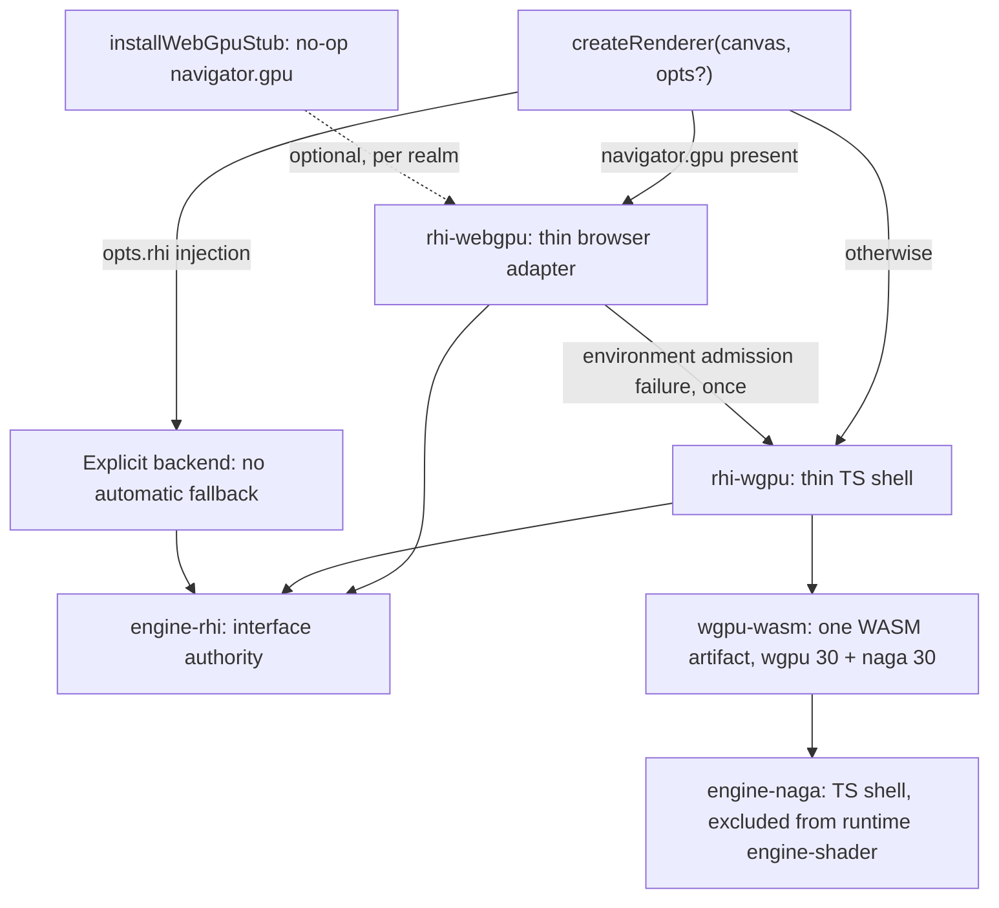

**语言**：[English](SKILL.md) · **简体中文**

> [!NOTE]
> 本文供人阅读；工具入口为英文 `SKILL.md`，示例代码保留原文。

# forgeax-engine-rhi

## 延迟 pipeline 检查

`device.pipelineLibrary?.inspect({runtimeRequests:true})` 显式物化 WebGPU owner 有界 runtime-demand history。Renderer/Worker 调用者使用 runtimeRequests:true；普通 inspection 不展开。history mode 省略旧完整 pending recipe list，避免哈希未缓存 Shader 文本；compilation counters/cached nullable identities 仍可用。recipe 用 semantic identity，request 用 (libraryId, sequence)。null recipe、不支持 history、ring eviction 都是不完整证据。同步 returned handle 不等于 native completion。nearest-recipe matching、Shader source copy、scene/provenance 遍历不能进入逐帧处理。见 [owner 契约](../../packages/rhi-webgpu/README.md#device-pipeline-library)。

> RHI 是 Engine/GPU 间的纯接口。不明渲染失败先用 [RHI Debug](../forgeax-engine-rhi-debug/SKILL.zh-CN.md)；材质用 [Material](../forgeax-engine-material/SKILL.zh-CN.md)，pass/后处理用 [Render Pipeline](../forgeax-engine-render-pipeline/SKILL.zh-CN.md)。本技能负责 backend、capability、descriptor、resource lifetime。rhi-webgpu 适配浏览器；rhi-wgpu + wgpu-wasm 提供兼容路径；显式注入 rhi-null 用于结构测试。

opaque ray-query 基础工作查[参考验证](../../scripts/raytracing/README.md)和 [native owner](../../packages/rhi-wgpu-native/README.md#opaque-scene-reference-transport)。portable compute replay、native scene re-execution、RHI AS command capture 分开。RHI Debug 可在支持 ray-query 的 RhiNull，以及 Node opt-in napi addon @forgeax/engine-rhi-wgpu-native 的 native-wgpu device 记录 BLAS/TLAS build，见 [Node binding](../../packages/rhi-wgpu-native/README.md#node-binding-napi-rs)。

## Native timestamp 诊断

Windows 源码检出缺 native compiler 时用 source-bound [Windows artifact producer](../../packages/rhi-wgpu-native/README.md#portable-prebuilt-delivery-contract)。加载前先准入 artifact，拒绝 host CPU flags、未知 DLL 依赖、source mismatch。独立 consumer load 不是硬件 qualification；加载成功后仍回到真实物理 DX12 gates。

可选 producer 的非 main branch push 同时构建 addon/desktop conformance artifact；分别验证加载/物理 GPU 路径。preview SM 6.10 是基础 setup 之外的显式 maintainer diagnostic，见 [hit-vertex-return](../../packages/rhi-wgpu-native/README.md#optional-dx12-hit-vertex-return-diagnostics)。

Windows qualification 中 Rust desktop owner 与 Node addon 均选 DX12、链接 DXC。先验证 adapter Dx12 身份/实际 Ray Query，再跑 acceleration/world-traversal、Renderer GI。同 Node device 关闭 Ray Query 提供 Global SDF control。保留平台报告，Metal 不等于 DX12。Windows 本地 GPU 也通过已有 lease，见[并发会话](../../scripts/ci/README.md#concurrent-local-sessions-and-the-gpu-lease)。

计数器过时或倒置时，以 FORGEAX_WEBGPU_NODE=wgpu-native 经既有 Dawn setup 跑 packages/rhi-wgpu-native/src/__tests__/timestamps.dawn.test.ts。保留 draw、clear-only、zero-draw、dispatch、empty compute 的 raw reused-query、adapter、validation errors；包含 zero/indirect compute、中间 copy 的多次 resolve、省略 stride 且非零 offset 的单行 texel copy。native-ray-query foundation 发布 receipt。fresh counter 不能证明独占 pass 成本；接受预算前验证 boundary scope/observer overhead。

## 颜色光照 parity 交接

backend/native readback 失败先读 status index，再读 [parity README](../../apps/parity/color-lighting/README.md)和具名 CaseReport。保留 backend identity、native format、frame、size、raw hash。能力损失是不完整证据，不能当 fallback pass。

## 心智模型

RHI 遵循四项规则，契约以 AGENTS 的 RHI form rules 为准：

- 规范对齐：descriptor 匹配 @webgpu/types ^0.1.70；用 'x' in src 区分缺字段和显式 undefined，遵循 WebGPU descriptor。
- 不透明 handle：仅 brand 的 Id<T> 在编译期拒绝原始 GPU 字段访问；模块路径区分 RHI Buffer 与 native GPUBuffer。
- 无数学依赖：接受 POD、ArrayBuffer/Float32Array，不依赖 engine-math。
- 实现共同发布：rhi-webgpu/rhi-wgpu 同步 release，createRenderer 根据 navigator.gpu 选运行路径，不要求游戏作者选择。

功能用 device.caps.X 准入，字段以 RhiCaps 为准，不在此复制。Windows native source-pin 变化用[可选 artifact producer](../../scripts/ci/README.md#windows-native-ray-query-artifact-producer)，addon load/独立 conformance executable 是不同路径，保留完整 terminal report（unsupported、upstream/performance cases、真实 array readback），exit 0 不等于 API qualification。可选 upstream diagnostic 用固定 source/fixture bundle，在本地 GPU lease 下运行 packages/rhi-wgpu-native/scripts/run-wgpu-upstream-prebuilt.mjs。原 test name、截图阈值、timeout 保留，不重设 fixture baseline。producer Naga CPU 与物理 DX12 GPU 结果分开；native paired-query benchmark 不是 Renderer GI 性能。wgpu pin 变化触发 build/windows-dx12-desktop producer，等待新 source-bound artifact，不能复用旧 pin 结果。

WebGL2 device loss 用 backend device.lost 和现有 Renderer recovery。renderer.recover() 前恢复 retained browser context；App split Render Worker 替换 realm/canvas。真实 GL loss、host injected loss、OS reset 分开。无 DOM event native canvas 仅证明 active-queue detection，见[后端契约](../../packages/rhi-wgpu/README.md#device-loss)。

Rust owner PR 改 WASM 时，stable/WebKit consumer 用既有 source-qualified preparation action。缺 main-only release asset 不是 GPU 失败，应验证或构建当前源码，不复用旧字节。见 [CI preparation](../../scripts/ci/README.md#pinned-webgpu-compatibility)，各 carrier 断言/期限不变。

## 核心 API 速查

| 名称 | 包 | 形式 | 用途 |
|:--|:--|:--|:--|
| createRenderer(canvas, ...) | runtime | 异步函数 | Engine 入口，以 navigator.gpu 自动选 RHI。 |
| device.caps | rhi | RhiCaps | 含 backendKind 的能力准入。 |
| RhiCaps.backendKind | rhi | webgpu / wgpu-native / wgpu-webgl2 / null | 实际实现路径。 |
| Opaque handles | rhi | 仅 brand 的 Id<T>，如 Buffer/Texture | 原始 GPU 字段访问为编译错误。 |
| Descriptors | rhi | Pick<GPUXxxDescriptor, ...> + ExplicitUndefined<> | WebGPU 对齐创建参数。 |
| RhiErrorCode | rhi | 封闭联合，以源码为准 | 结构化失败，无 default 的穷尽 switch。 |

> [!IMPORTANT]
> 完整 handle/interface/descriptor 签名见 packages/rhi/README.md，错误成员见 packages/rhi/src/errors.ts，不复制清单。已发布 RHI 声明加载其声明的 @webgpu/types 依赖，即使消费者显式设置 compilerOptions.types 也如此。

## 后端选择与依赖



启动失败检查两个结构化 backend cause 及 host capability，见 [Runtime 诊断](../../packages/runtime/README.md#browser-backend-selection-and-diagnosis)。在实际 WebView 用 completed frame/pixel readback 验证 native WebGPU/WebGL2，浏览器初始化不证明设备支持。

## 使用骨架

```ts
import { createRenderer } from '@forgeax/engine-runtime';

const created = await createRenderer(canvas);
if (!created.ok) throw created.error;
const renderer = created.value;

// capability-gated: inspect() is the public POD boundary; raw devices stay
// inside the RHI/backend construction seam.
const caps = renderer.inspect().capabilities;
if (caps.backendKind === 'wgpu-native') {
  // native-only path; webgpu / wgpu-webgl2 / null take the portable branch
}
if (caps.rgba16floatRenderable) {
  // HDR render-target path available (IBL cubemap, HDR post-processing)
}
```

大部分游戏作者停在 createRenderer，使用 material/render-pipeline 技能。直接创建 buffer/texture 属于后端贡献或 custom pass。

## RhiNull：无头空操作后端

@forgeax/engine-rhi-null 无 GPU/DOM 依赖，单元测试断言 command structure。通过 Channel 1 显式注入，绝不由 navigator.gpu 自动选择：

```ts
import type { RhiNullDevice } from '@forgeax/engine-rhi-null';
import { rhi } from '@forgeax/engine-rhi-null';
import { createRenderer } from '@forgeax/engine-runtime';

// canvas is a required positional param; RhiNull never touches the DOM, so a
// minimal stub suffices in headless CI (no `undefined` — it won't typecheck).
const canvas = { width: 1, height: 1 } as unknown as HTMLCanvasElement;
const created = await createRenderer(canvas, { rhi });
if (!created.ok) throw created.error;
const renderer = created.value;
const attached = renderer.attach(world);
if (!attached.ok) throw attached.error;
if (!world.update().ok) throw new Error('World update failed');
const frame = renderer.draw({
  leases: [attached.value],
  camera: { lease: attached.value },
  environment: { lease: attached.value },
});
if (!frame.ok) throw frame.error; // no-op execution, command stream submitted

// Read structural facts through renderer.inspect(). Detailed RhiNull counters
// belong to owner-local tests using the injected backend pack, not Renderer.
console.log(renderer.inspect().capabilities.backendKind); // 'null'
```

### 关键语义

- backendKind null 表示无真实 GPU 的结构 bookkeeping；graph barrier 与 webgpu/wgpu-webgl2 同组，不插 barrier。
- 除保留 multiDrawIndirect、pushConstants、textureBindingArray 外 boolean caps 均 true；maxColorAttachments=8，最大化结构能力覆盖。
- 跳过 shader 编译，返回合法 ShaderModule brand；createRenderer 只在 Result 成功时发布 Renderer。
- 每 device 注册 handle，setVertexBuffer/setBindGroup 以既有 rhi-not-available、destroy-after-destroy 等结构化错误拒绝跨 device/已毁 handle。
- totalDispatchCount/totalDrawCount 包含直接和间接命令，配合 framePassNames 断言 compute-before-raster，不证明 shader/pixel 正确。
- 无像素：getCurrentTexture 只有 brand，无 GPU texture data，不能替代 smoke/Dawn readback。
- 每个 injected createRenderer 各有独立 RhiNullDevice/Bookkeeper。

API/caps/bookkeeping/与 Vitest mock 差异见 packages/rhi-null/README.md。

<a id="webgpu-stub-cpu-diagnostics-without-gpu-work"></a>
## WebGPU stub：无 GPU 工作的 CPU 诊断

@forgeax/engine/rhi-webgpu 导出的 installWebGpuStub(profile) 替换当前 realm navigator.gpu 和 webgpu canvas context 为 no-op GPU。createApp({ gpuStub }) 在 main、Engine Worker、Render Worker 安装。generated host 用 ?forgeax-gpu-stub=1 及 DEFAULT_WEBGPU_STUB_PROFILE（Chrome155、Apple M4 Pro）。其他设备 profile 在该设备用 captureWebGpuStubProfile(navigator.gpu, name) 捕获。

| 问题 | RhiNull | WebGPU stub |
|:--|:--|:--|
| 用途 | Node 结构单测 | 无 GPU 的真实浏览器路径 CPU 成本 |
| backendKind/caps | null，固定 caps/limits | webgpu，profile features/limits |
| Engine 路径 | null 分支，不走 rhi-webgpu 翻译 | 原 rhi-webgpu/render 分支 |
| 验证 | handle 所有权/生命周期 | 无，所有调用成功 |
| 选择 | 显式 opts.rhi | 每 realm ambient navigator.gpu |

submit 立即完成，mapped range 填零，GPU feedback 为空。不能用于 pixels/GPU timing/FPS/compatibility；真实 GPU/Dawn 仍为渲染权威。

## 顶点布局别名：多 UV clamp-to-last

> [!IMPORTANT]
> WebGPU 允许不同 shaderLocation 的 attribute 共享 buffer offset。mesh 有 n 套 UV、shader 声明 m>n 时，实际 draw 的 [n,m) 指向第 n-1 套 offset。

### WebGPU 行为

ValidateVertexAttribute 不检查 byte-range overlap；不同 shaderLocation 共享 offset 合法且有意。setBindGroup overlap 限制不适用于 vertex attribute，支持 D-1 决策。

```ts
// Legal: vertex attributes share a buffer offset.
{
  arrayStride: 80,
  attributes: [
    { shaderLocation: 6, offset: 72, format: 'float32x2' },  // uv1: actual data.
    { shaderLocation: 7, offset: 72, format: 'float32x2' },  // uv2 aliases uv1.
    { shaderLocation: 8, offset: 72, format: 'float32x2' },  // uv3 aliases uv1.
  ]
}
```

现有路径通过 setVertexBuffer(0, ...) 使用一个 interleaved stream，别名留在 buffer 0。

### deriveVertexBufferLayout 的 clamp-to-last 绑定

| n 与 m | 行为 | 绑定 |
|:--|:--|:--|
| n>0，m<=n | 一一对应 | shader 0..m-1 用真实 offset。 |
| n>0，m>n | clamp-to-last | 0..n-1 真实，剩余 location 共享 n-1 offset。 |
| n=0 | zero buffer | 分配 8 字节 zero default vec2，所有 UV offset=0。 |

所有组合静默，匹配约定 UE 语义。mesh n=0..8、shader m=1..8 均成功创建 PSO，不报 unsupported-vertex-layout。

### 推导规则

唯一入口 deriveVertexBufferLayout(map, { shaderUvSetCount? })：

1. 规范顺序 position/normal/uv/tangent/skinIndex/skinWeight/uv1/uv2/uv3/uv4/uv5/uv6/uv7。
2. ATTRIBUTE_FORMAT_MAP、ATTRIBUTE_BYTE_STRIDE 推导 format/size，CANONICAL_KEYS.indexOf(key) 得 shaderLocation。
3. countMeshUvSets(map) 扫 UV_KEYS，从 defined UV key 得实际 count。
4. shader count 超过 mesh count 时 emitAliasEntries 为 [n,m) 增加 UV shaderLocation、最后一套 aliasOffset、UV format。
5. 无 UV（fromIndex=0）时 stride 加 8 字节，添加 zero vec2f 支撑的首 UV entry。

原 locations0..5 保持 position=0/normal=12/uv=24/tangent=32/skinIndex=48/skinWeight=56；uv1..uv7 从72/80/...继续，glTF/FBX interleaving 同规范。

### PSO cache key

cacheKeyOf 已哈希排序后的 layout keys/byteLength，uv1..uv7 自然区分布局，不能再增 variant axis 或 uvSetCount cache field（D-5）。

### RhiNull 交互

setVertexBuffer 只追踪 brand，不验证真实 stride/attribute。deriveVertexBufferLayout 仍产别名，command ledger 可作结构断言。

## 纹理互操作与零复制视频

按 capability data 准入，不能按 backendKind：

| 方法 | 准入 | 失败 |
|:--|:--|:--|
| nativeDevice() | 存在 native WebGPU device | rhi-wgpu/null 返回 feature-not-enabled。 |
| importTexture(gpuTexture)，异步 | caps.textureImport | foreign device：rhi-not-available；shape/usage：rhi-descriptor-invalid；device-lost。 |
| importExternalTexture({ source }) | caps.externalTexture，需要 importExternalTexture/media realm | 未解码 element/closed frame：rhi-descriptor-invalid；缺能力：feature-not-enabled。 |

browser rhi-webgpu 两 cap 均 true；Dawn node textureImport true、externalTexture false；rhi-wgpu 均 false；rhi-null 结构准入二者。ExternalTexture 在当前 task 后过期，必须每帧导入。externalTexture:{} layout entry 也接受 textureView，使 copy fallback/borrowed GPU texture 共用 layout/texture_external shader。borrowed texture 的 destroyTexture 仅移除 bookkeeping，所有权留调用者。graphics-extras 的 probeVideoHighPerfUpload 只看 caps.externalTexture。游戏用 renderer.importTexture，见 Render README External textures，不直接调用这些 RHI 方法。

### 两路都不可用：video-upload-unsupported

host 不提供 element 的 VideoPlayer 在同 record 路径经 renderer error channel 发 VideoUploadUnsupportedError。用 renderer.subscribe 和 err.code===video-upload-unsupported 的穷尽 switch 消费，定义在 packages/runtime/src/errors.ts。

### 能力边界

| 边界 | 含义 |
|:--|:--|
| Dawn 不解码视频 | 无 HTMLVideoElement/VideoFrame realm，零复制和视频像素需 browser e2e；GPUTexture import/texture_external layout 可在 Dawn 运行。 |
| RHI Debug | recorder 把每个导入帧快照为 rgba8 texture view，tape 无 media object 也可 replay。 |
| 不处理 audio track | 视频音频不属于 RHI。 |

## Pipeline library 所有权

device.pipelineLibrary 仍可选。支持设备上 resource identity 跨累积注册增长保留；真实 handles、active requests、command/bundle owners 保留依赖，Renderer roster 为其 generation 保留 prewarm 结果。device content index 不增 strong reuse cache/source-body quota。source/state 不同仍不同，label 不授权等价。

export(limits?) 与 prepare(manifest,{inputLimits}) 有独立有限 action policy，兼容默认值在 PIPELINE_LIBRARY_LIMITS。限制覆盖 output、escaping、temporary materialization、transport，不是 process memory。export failure 保留 readiness/recovery 且可重试；未知 dependency/pending compilation 明确失败。Renderer/Worker inspection 转发 pipelineLibraryLimits，返回真实 pipelineLibraryPolicy。改限额前查 [owner 契约](../../packages/rhi-webgpu/README.md#device-pipeline-library)。retained-live-graph export 不证明全路覆盖。

## 资源释放：destroyBuffer / destroyTexture

RhiDevice.destroyBuffer/destroyTexture 与创建配对，各 backend 对称。

### 正常路径

```ts
// GPU handles remain owner-local. Public Renderer exposes capability facts only;
// resource creation belongs to a RenderFeature plan or an owner-local test.
console.log(renderer.inspect().capabilities.backendKind);
```

RhiDevice 自动补全同时暴露 createBuffer/destroyBuffer，在同入口发现释放（charter F1）。

### 签名与错误

| 方法 | 签名 | 结果 |
|:--|:--|:--|
| RhiDevice.destroyBuffer | (buf: Buffer) => Result<void, RhiError> | 成功 ok(undefined) |
| RhiDevice.destroyTexture | (tex: Texture) => Result<void, RhiError> | 同上 |

重复 destroy 立即失败：

```ts
const r1 = device.destroyBuffer(buf); // ok
const r2 = device.destroyBuffer(buf);
// r2.ok === false
switch (r2.error.code) {
  case 'destroy-after-destroy':
    // AI user self-detects "I already released this"
    // hint: "object already destroyed; track lifecycle in caller or check isDestroyed before re-destroy"
    break;
}
```

destroy-after-destroy 是仅新增的 minor RhiErrorCode 成员，两后端用独立于 WASM 边界的 RHI-shim bookkeeping。rhi-descriptor-invalid 同属 add-only minor：

- rhi-descriptor-invalid：调用 descriptor 格式错误，Rust wasm_bindgen(catch) 返回固定前缀 [wgpu-wasm] failed to parse，TS wrap() 分类。
- webgpu-runtime-error：有效 descriptor 因 runtime 条件被拒，如 binding limits。

hint 定位 fragment.targets[0] 等字段，code 供穷尽处理，权威 packages/rhi/src/errors.ts。

### Runtime GpuResource

Runtime 暴露 GpuBuffer/GpuTexture 及联合 GpuResource。wrapper 有 boolean isDestroyed、destroy(): Result<void,RhiError>，转发同重复销毁失败。Renderer.dispose() 经 gpuStore.destroyAll、graph.drain、instance-buffer 清理、IBL cache 清理、context.unconfigure、listener cleanup 释放；重复 dispose 幂等。App.stop() 仅停 frame scheduling，App.dispose() 同时 dispose renderer。

### Chromium adapter pool 注意事项

> [!CAUTION]
> 公开路径不能调用 device.destroy()，Chromium 在 GPUDevice.destroy 后可能无法重新取得 adapter。公开 API 只暴露资源销毁；低层 diagnostic 可通过 _internal_getRawDevice(device) 销毁 raw device。

GpuResource 只有一个销毁 owner，无 refcount/shared ownership。

## 常见问题

- Opaque brand 在编译期拒绝 raw GPU field access，使用 RHI method。
- 不假设原生能力，用 device.caps 准入。
- 缺 WebGPU types 时检查发布 RHI type reference、解析 @webgpu/types 依赖，native descriptor 声明由 source 拥有。
- runtime shader 导入 naga 被物理隔离 grep gate 拒绝；naga 只属构建期 shader-compiler。
- destroy-after-destroy 为有意设计，穷尽处理或需幂等时先查 wrapper isDestroyed。
- 公共路径只销毁资源，避免 Chromium adapter pool 损坏，raw device diagnostic 必须内部 escape hatch。
- wgpu-wasm Channel3 submit 后静默黑图/GPU loss：历史 submit void 且无 wasm_bindgen(catch)，error-sink validation 未到 JS。R5 M4 安装 device.on_uncaptured_error、每 queue last-error slot、submit 返回 Result，提交后读清 slot，传 [rhi-code:<code>]，TS queue.ts 映射既有 queueSubmitFailed/webgpuRuntimeError。现在经 onError 报 validation，实例仍可用于下一帧。

## 硬件 Ray Query

按 device.caps.rayQuery.supported（false 含封闭 reason）准入，不 try/catch 探测。browser WebGPU、wgpu WebGL2 报 backend-has-no-ray-query；RhiNull 仅 new RhiNullAdapter({ rayQuery: limits }) 模拟支持。native wgpu 从 EXPERIMENTAL_RAY_QUERY 推导，缺时 adapter-lacks-feature。

```ts
if (device.caps.rayQuery.supported) {
  // vertexBuffer/indexBuffer need BLAS_INPUT_BUFFER_USAGE (refused as data without ray query)
  const blas = device.createBlas({ geometries: [{ vertexFormat: 'float32x3', vertexCount, index: { format: 'uint32', count } }] });
  const tlas = device.createTlas({ maxInstances: 1024, updateMode: 'refit' });
  encoder.buildAccelerationStructures(
    [{ blas, geometries: [{ vertexBuffer, vertexStride: 12, index: { buffer: indexBuffer } }] }],
    [{ tlas, instances: [{ blas, transform: rowMajor3x4, customIndex, mask: 0xff }] }],
  ); // rebuild the TLAS each frame to move instances
}
```

以 enable wgpu_ray_query; 开头的 shader 为 capability variant，无 Ray Query 时 feature-not-enabled。其他设备保留 compute/SDF traversal。见 RHI README Hardware Ray Query。GI world trace 经单一 worldTraversalWgsl('global-sdf'|'ray-query') 接口选择；renderer 自选 supported 且 limits 内的 ray-query，否则 global-sdf，并在 inspect().diffuseGi 给封闭 traversalFallback，无用户开关。Browser/Dawn 始终 backend-has-no-ray-query。Node opt-in @forgeax/engine-rhi-wgpu-native 是 native wgpu30 + Ray Query extension 上的 W3C GPU，经 rhi-webgpu shim 消费。

运行任意 *.dawn.test.ts/hello-gi scripts：设 FORGEAX_WEBGPU_NODE=wgpu-native；caps 来自真实 adapter（含 Lavapipe25.2/Metal）；FORGEAX_WGPU_NATIVE_RAY_QUERY=off 在同设备给 Global SDF 对照。

probe-direction/scheduling 变化要在 native wgpu、Dawn 都跑 production direction-integral audit、in-place add、two-CameraView fairness，ray budgets、physical targets、convergence windows、threshold 不变。native-ray-query.yml foundation/mutation roster 包含这些 owner，维护命令/证据边界查 CI README。其他证据为 RhiNull 结构和 rhi-wgpu-native cargo GPU tests（pnpm ci:graphics 下 FORGEAX_REQUIRE_NATIVE_RAY_QUERY=1）。缺 addon 为 adapter-unavailable。

## 延迟 membership timing

Render 为唯一 timing owner。opaque pass descriptor timestampWrites -> resolveQuerySet -> mapAsync 只包围真实 render/compute 工作。可信 backend 发布 caps.timestampQuery 和正 timestampPeriodNanoseconds；RhiNull/当前 wgpu WebGL2 为 false/null。旧 encoder writeTimestamp 不属 RHI，当前 Dawn 即使宣称 feature 也拒绝。不能合成 ticks、加 profiler、把 Render reason union 移到 RHI。feature-not-enabled 保留为 RHI detail，在边界转为 Render timestamp-query-unsupported。

通用 GPU pass timing 同边界：RHI 仅提供 capability primitive/opaque handles；Render 拥有 admission、pass identity、receipt binding、parsing、retention、status、recovery，benchmark validation 是离线 Render 职责。RhiNull 拒绝或精确零 command evidence 不能升级为真实 GPU tick/duration，membership timing 不是通用已接受证据。

## 深入阅读

- Handle/interface/descriptor/ExplicitUndefined：packages/rhi/README.md。
- 封闭错误码：packages/rhi/src/errors.ts。
- Capability 层与字段：RHI README、packages/rhi/src/index.ts。
- RHI form rules（规范、不透明、无数学依赖、双实现、single-wasm、命名）：AGENTS 对应章节。
- Backend/WASM：packages/rhi-webgpu/src/、packages/rhi-wgpu/src/、packages/wgpu-wasm/；Rust 构建见 CONTRIBUTING。
- Null 契约与实现：packages/rhi-null/README.md、src/。
- 声明式 RHI-pure graph：[Render Pipeline](../forgeax-engine-render-pipeline/SKILL.zh-CN.md)；RenderGraphErrorCode 在 packages/render-graph/src/errors.ts。
- createBindGroupLayout 接受变长 entries；material group1 从上游 shader paramSchema 派生，RHI 只创建装配 descriptor。sampler-first 见 [Shader](../forgeax-engine-shader/SKILL.zh-CN.md)。
- 渲染诊断先 [RHI Debug](../forgeax-engine-rhi-debug/SKILL.zh-CN.md)，再用 [Debug](../forgeax-engine-debug/SKILL.zh-CN.md) 找 owner 症状。

## 捕获视面

RenderFeature.capture 按 Feature 决定录入哪些视面，目前 planar mirror，probe/cube 后续：默认 display-only、all，或 { faces: ['planar'|'probe'|'cube'] }。GPU particle 声明 all，每个录制 face 按该 face 分辨率多一次 particle draw。用 createGpuParticleFeature({ capture: 'display-only' }) 退出，post effect 保持 display-only。每 capture face 编译一个 graph，在其 scene pass 后包含 Feature pass；rhi capture 中表现为 display passes 之前的额外 pass。

## WebGPU 兼容性改动

native calls、RHI input forms、descriptor/enum、可选行为、WGSL、record/replay conversion 改动先读 [CI compatibility contract](../../scripts/ci/README.md#pinned-webgpu-compatibility)。先跑 surface diff，再附 review decision 显式更新 baseline；它是 review tripwire，不是执行证明。使用 owner red/green regression、真实 byte/pixel 结果。保留 TypedArray 元素单位、DataView/ArrayBuffer 字节单位、source subview、显式零；复用 bufferWriteRange，不重复算区间。四个 Ubuntu lane 覆盖 native Chrome/Linux WebKit fallback，Android/iOS 认证独立，不能从 UA、launch、typecheck、Null、CPU-provider 推断。

在固定 Ubuntu carrier 跑 node scripts/ci/run-webgpu-compatibility.mjs。software Vulkan carrier 同时选 software ANGLE 保证 swapchain 互操作。SharedImage backing failure 先诊断 carrier，不能先改 shader；保留 sandbox、完整 scene assertions。stable 还跑 native minimum、真实 Compatibility Mode、带 fresh-device pipeline-archive import 的变化 Renderer scene；WebKit 跑支持的 WebGL2 scene。四 job、浏览器执行十分钟预算不变，preparation/GPU queue time 分报。不能恢复 diagnostic limit/driver overrides 让 policy phase 通过。featureLevel 仅标准 adapter request hint，实际执行 mode 由真实 device feature set 证明。

depthTextureLoad 为独立 operation capability。内置 Renderer startup/recovery 在 canvas acquisition 前准入并退役被拒 device。RHI-only Compatibility Mode 仍有效；Runtime 自动后端可退 WebGL2，显式 injection 保留错误。RHI mode probe 成功不能算内置 Renderer 支持。native graphics-stage storage limits 尊重显式零，不能只用 general limit。
