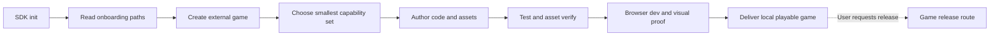

# ForgeaX Engine SDK

## First five minutes: understand before authoring

SDK `init` and project `new` return the local `AGENTS.md` and this skill in
`onboarding.read`. Read those entries, select the requested delivery scope in the
game's guide, and load only the focused skills/package contracts needed now.
Use [the capability catalog](references/feature-catalog.md) on demand for discovery;
its historical audit snapshot is neither current-HEAD proof nor an enablement list.

For a new or resumed game task, read the game's local `AGENTS.md` before editing.
Its **Run, test, build, and release** section selects local playable delivery, game
release or a specialized task. Follow that selected scope and stop condition. SDK
archive verification does not replace game acceptance.

> [!IMPORTANT]
> Available is not enabled. A package in the SDK means the capability can be selected; a game enables it only through its `forge.json`, plugin composition, ECS components, assets, renderer features, or build configuration. Do not install or register every capability.

Translate the requested game into a small capability adoption plan before editing:

```text
Need: <player-visible or production requirement>
Use: <one ForgeaX capability and its owner>
Entry: <focused skill, CLI operation, or package README>
Proof: <test, asset verification, browser evidence, or package output>
Defer: <available capabilities not needed now>
```

| Need | Start with | Proof before claiming it works |
|:--|:--|:--|
| Frame loop, execution tier, input, plugin assembly | `forgeax-engine-app`, then `forgeax-engine-ecs` or `forgeax-engine-state` | Unit/system test plus real browser interaction |
| Scene, imported files, code-first packs, GUID loading | `forgeax-engine-assets`; discover operations through `forgeax-engine-cli` | `asset verify`, build catalog, runtime load by GUID |
| PBR, textures, custom WGSL | `forgeax-engine-material`, then `forgeax-engine-shader` | Shader check, material readiness, browser pixels |
| Lighting, shadows, sky, fog, AA, post effects, custom passes | `forgeax-engine-render-pipeline` | Requested pipeline active and real GPU/browser evidence |
| GPU particles, trails, ribbons, beams | `forgeax-engine-vfx` | Cooked effect, runtime playback, browser pixels |
| Bodies, colliders, character motion | `forgeax-engine-physics` | Fixed-step/collision test plus playable behavior |
| BGM, SFX, spatial audio | `forgeax-engine-audio` | Host playback, intent/cleanup evidence, user gesture handling |
| Black frame, wrong binding, GPU divergence | `forgeax-engine-rhi-debug`; use `forgeax-engine-debug` for symptom routing | One capture artifact, inspect/replay or paired differential |
| Create, inspect, develop; build/preview/package when requested | `forgeax-engine-cli` | The selected game delivery scope passes |

Create a game only after selecting its template: `forgeax project new <dir> --template game-3d` for every
3D game; use `--template empty` otherwise. Missing selection is `sdk-template-required`.

> [!IMPORTANT]
> `game-3d` is a runnable, contentful third-person reference, not an empty 3D scene. It copies
> authored scene/physics, character/animation, material/mesh, and UI examples into the new project;
> those examples affect visible composition, collision space, and asset closure. After creation,
> read the generated project's `README.md` and keep, adjust, replace, or remove starter content by
> game goal; update scene, runtime, and pack references together when removing it.

Use [the full capability catalog](references/feature-catalog.md) for less common areas such as animation/skinning, UI/font/video, picking, networking, intelligence, profiler, Remote, custom RenderGraph/RHI work, and source-mode Engine development. Then read only the focused skill and owning package README. The catalog is a discovery index, not a substitute for those precise contracts.

For browser-compositor screenshots, software/hardware backend selection, Engine frame readiness, repeated play-test checkpoints, and local Engine binding, use [the browser capture and local-Engine guide](references/browser-capture-and-local-engine.md).

The default game-consumer route is:



Run `forgeax help --tree --json`, then `forgeax help <command-path> --json`, before guessing authoring-operation inputs. Use the CLI skill for the command boundary. Start the seven-stage ForgeaX closed loop only when the user explicitly authorizes it for the current task.

Successful `new` also performs a two-second, best-effort check of the configured npm registry's `@forgeax/engine-sdk` channel tag (`next` for a development SDK, `latest` for stable). Only a strictly newer semantic version produces a text warning; JSON always records `sdkUpdate` as `available`, `current`, `skipped`, or `unavailable`. Offline mode and `FORGEAX_DISABLE_UPDATE_CHECK=1` skip the query, and registry failure never rolls back a created game. Treat the warning as information, not migration authority: install the newer SDK in another directory, read its release notes, then migrate and test each existing game explicitly. Games remain pinned and are never rewritten by SDK discovery.

## SDK production and publication

For an explicitly requested Engine/SDK change, SDK archive verification or SDK
publication, read [SDK production](references/sdk-production.md). Its exact-ZIP
subject is the SDK distribution. Game ZIP packaging belongs to the game's release
route; ordinary game creation does not enter Candidate, Promotion or SDK consumers.

## Plugin asset authoring

Create functional Packs: export small native behaviors from the same file, and split
complex implementations into ordinary TypeScript modules. Follow the
[Plugin contract](../../packages/plugin/README.md): persistent definitions live in
Pack, and schema-v3 project `roots` select their GUIDs. Use `asset plugin inspect`
to check sourceKey and definitions, then inspect native Fiber state to confirm
activation. Verify a new session after code or configuration changes; engine and
frontend effects own scene and DOM cleanup respectively. For source reuse, read
`help asset source import` or `help asset source clone` and transfer the author closure.
