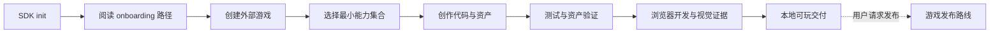

**语言**：[English](SKILL.md) · **简体中文**

> [!NOTE]
> 本文供人阅读；工具入口为英文 `SKILL.md`。代码示例保持原文。

# ForgeAX Engine SDK

## 游戏工作从这里开始

游戏根目录 `AGENTS.md` 已提供硬规则、默认命令与路由。先用短路径完成第一次正确编辑，不必预读大技能：

0. 能力与边界：先看 [Engine 概览](ENGINE-OVERVIEW.md)，把游戏需求映射到 Engine 能力，识别 Engine 不负责的部分。
1. 签名和导入：先查 API 索引，再搜 node_modules README 或 .d.ts。
2. `empty` 项目的效果配方：效果手册约 2 KB 索引；水面外观用内置 `single-layer-medium`，雾/光束用 `beam-pillar`，室内发光用 `runtime-light-emissive`，雨雪火焰火花用 `particles-*`。只打开所需文件。
3. 命令查 [CLI 技能](../forgeax-engine-cli/SKILL.zh-CN.md)顶部 Quick contract；相机、光照、后处理查 [Render Pipeline](../forgeax-engine-render-pipeline/SKILL.zh-CN.md)的 Quick contract。可选交互项目/资产审阅查看游戏根 `skills/forgeax-view-start/SKILL.zh-CN.md`，或 SDK 中的 `tools/view/skills/forgeax-view-start/SKILL.md`。使用 `node /absolute/forgeax-sdk/tools/view/start.mjs --project /absolute/game`。View 仅随 SDK 分发，启动器初始化其运行环境，不通过冷 CLI help 发现。
4. 深入需求从下方能力表选一行，只读相应章节。布局、资产、配置见游戏项目指南；验收、发布、受阻检查见交付指南。
5. Look-dev：场景首次构建后，以及每次 light/material/fog/sky/post/camera 编辑后，运行 `dev look` 并完成[视觉自查](#visual-self-review)，再进入 gameplay；`project play` 截图用于 gameplay 验收。
6. 移植 Three.js 效果前，先查原生等价能力与缺口，再决定简化。

### 一个 Engine 插件与一个 HUD 的完整路径

Engine root 构建场景、拥有游戏状态，frontend root 拥有 DOM。二者经 `gameHost.port` 通信，`project play` 读取注册的 projection。每个插件从 `*.pack.ts` 导出为 `kind: 'plugin'` output，再由 `forge.json#roots` 选择，和模板一致。

```ts
import type {} from '@forgeax/engine/app';
import type {} from '@forgeax/engine/assets-runtime';
import { Update, defineSystem } from '@forgeax/engine/ecs';
import { createBoxGeometry } from '@forgeax/engine/geometry';
import type { Plugin } from '@forgeax/engine/plugin';
import { Materials, MeshFilter, MeshRenderer } from '@forgeax/engine/render';
import { Transform } from '@forgeax/engine/scene';

// Engine root: builds the scene, pushes HUD state and exposes a read projection.
export const game: Plugin.Object<{}> = {
  name: 'my-game/engine',
  inject: ['world', 'assets', 'gameHost'],
  apply(ctx) {
    const { world, assets, gameHost: host } = ctx;
    ctx.effect(function* () {
      host!.setPointerLockAllowed?.(false); // cursor-aimed game: no mouse-look lock
      const mesh = assets!.create(createBoxGeometry(1, 1, 1).unwrap()).unwrap();
      yield () => assets!.release(mesh).unwrap();
      const material = assets!.create(Materials.standard({ baseColor: [0.8, 0.3, 0.2, 1] })).unwrap();
      yield () => assets!.release(material).unwrap();
      const box = world.spawn(
        { component: Transform, data: { pos: [0, 0.5, 0] } },
        { component: MeshFilter, data: { assetHandle: mesh } },
        { component: MeshRenderer, data: { materials: [material] } },
      ).unwrap();
      yield () => world.despawn(box).unwrap();
      let score = 0;
      const updateHud = defineSystem({
        name: 'my-game/hud', queries: [],
        fn: () => host!.port?.postMessage({ channel: 'hud', state: { score: ++score } }),
      });
      world.addSystem(Update, updateHud).unwrap();
      yield () => world.removeSystem(Update, updateHud).unwrap();
      const unregister = host!.gameProjection?.registerRead({ id: 'my-game.state', title: 'Score', read: () => ({ score }) });
      if (unregister) yield unregister;
    });
  },
};

// Frontend root: owns the DOM and listens on the same channel.
export const hud: Plugin.Object<{}> = {
  name: 'my-game/hud',
  inject: ['gameHost'],
  apply(ctx) {
    const host = ctx.gameHost!;
    ctx.effect(function* () {
      const port = host.presentationPort ?? host.port;
      const label = host.uiRoot?.appendChild(document.createElement('div'));
      const receive = (event: MessageEvent) => {
        if (event.data?.channel === 'hud' && label) label.textContent = `Score ${event.data.state.score}`;
      };
      port?.addEventListener('message', receive);
      port?.start();
      yield () => { port?.removeEventListener('message', receive); label?.remove(); };
    });
  },
};
```

`forgeax-engine-cli`、`forgeax-engine-render-pipeline`、`forgeax-engine-debug`、`forgeax-engine-material`、`forgeax-engine-app` 是大型参考：搜索所需标题，不要整篇预读；上下文中已有文件直接复用。

<a id="visual-self-review"></a>

## 视觉自查

每次 light/material/fog/camera 编辑后，用 `forgeax dev look --hide-ui true --json` 做 look-dev：对正在运行的 `dev start --headless true` 耗时数秒，等待编辑，仅标记 renderer error 或 flat frame，PNG 由你判断。`project play` 只用于玩法验收。无运行 owner、仅看场景时用 `forgeax asset preview --kind scene --guid <guid> --json`，通过创作相机渲染 SceneAsset。首次查看及交付前打开 PNG，对每项用一句话作答，任何“否”均修复再看：

1. 亮度：是否符合目标时段，白天明亮、夜晚暗而有受光区域，没有爆白或死黑？使用 `--hide-ui true` 判断，菜单遮罩会压暗并掩盖问题。
2. 饱和度：是否达到目标鲜艳程度？发灰发白常来自主体前的雾、冷色 `Skylight` fill 或 AgX。
3. 对比：主体是否突出？平板或空洞背景应添加创作 sky asset 的 `SkyboxBackground` 或场景陈设。
4. 氛围：调色与光照是否匹配温暖、诡异、霓虹、舒适等目标？
5. 构图：主体是否约占半幅，没有近裁剪或遮挡，相机/HUD 不挡主体？跟随相机还要从树、石、墙处于相机与玩家之间的位置观察。
6. 主体：玩家与关键道具是否体现游戏主题？模板角色只是占位机器人，其他英雄应在 `character.pack.ts` 重建网格、材质。

## 前五分钟：先理解，再创作

先看 [Engine 概览](ENGINE-OVERVIEW.md)，了解能做与不能做什么。SDK `init`、project `new` 在 `onboarding.read` 返回本地 `AGENTS.md` 和本技能；阅读入口、在游戏指南选交付范围，仅加载当前所需专题技能/包契约。按需查能力目录，历史审计快照不等于当前 HEAD 证明或启用清单。

新建或恢复游戏任务，编辑前先读游戏本地 AGENTS，其运行、测试、构建、发布章节选择本地可玩、游戏发布或专门任务。遵循所选范围和停止条件，SDK 归档验证不能替代游戏验收。

> [!IMPORTANT]
> 可用不等于启用。SDK 包只说明能力可选择；游戏经 `forge.json`、插件组合、ECS 组件、资产、renderer features 或 build 配置才启用它。只安装注册实际使用的能力。

首次编辑前，把需求转成能力采用计划，存入 `docs/engine-plan.md`；每项功能一个块，总计约一页：

```text
Need: <玩家可见或生产需求>
Use: <一项 ForgeAX 能力及其 owner>
Entry: <专题技能、CLI 操作或包 README>
Proof: <测试、资产验证、浏览器证据或包输出>
Defer: <目前不需要的可用能力>
Gap: <Engine 未覆盖的部分及最小手写内容>
```

按各块指定能力构建。对于目录/API 索引已列出的 mesh、camera rig、input、particle、collision、UI、post effect，只有先查无匹配后才可自行实现，标记 `Gap`，保持最小，并在 `docs/feedback.md` 记录。省略计划通常导致重复实现和能力闲置。

| 需求 | 从哪里开始 | 声称可用前的证据 |
|:--|:--|:--|
| 帧循环、执行层级、输入、插件装配 | App，再 ECS 或 State 技能 | 真实浏览器交互；只有游玩无法触及才加单元测试。 |
| Scene、导入文件、代码 Pack、GUID 加载 | Assets；通过 CLI 发现操作 | `asset verify`、构建 catalog、运行时 GUID 加载。 |
| 代码道具、硬表面、套件网格 | Modeling | `m.validate()` closed/volume 事实、导出 MeshAsset、浏览器像素。 |
| PBR、纹理、自定义 WGSL | Material，再 Shader | Shader check、material readiness、浏览器像素。 |
| 湖、波浪、水查询、浮力（显式 opt-in） | [Water](../forgeax-engine-render-pipeline/SKILL.zh-CN.md#water) | 添加交互前先在 completed browser frame 验证湖面。 |
| 光照、阴影、天空、雾、AA、后处理、自定义 pass | Render Pipeline | 请求管线生效与真实 GPU/浏览器证据。 |
| 可编程体积云、云材质实例、移动云影 | [体积云](../forgeax-engine-render-pipeline/SKILL.zh-CN.md#volumetric-clouds) | 材质 adoption 完成、云与阴影可见、时间运动及回退。 |
| 雨雪火花尘火（`Points`、effects/particles-core.md）、GPU 粒子/轨迹/条带/光束 | VFX | 路径选择、cooked effect、运行时播放、浏览器像素。 |
| Body、Collider、角色运动 | Physics | fixed-step/碰撞测试及可玩行为。 |
| BGM、SFX、空间音频 | Audio | Host 播放、intent/cleanup 证据、用户手势处理。 |
| 黑帧、错误 binding、GPU 分歧 | RHI Debug；Debug 路由症状 | 一个 capture artifact、inspect/replay 或配对差分。 |
| 创建、检查、开发；按需 build/preview/package | CLI | 所选游戏交付范围通过。 |

创建前明确模板：所有 3D 游戏用 `forgeax project new <dir> --template game-3d`，其余用 `--template empty`。缺选择返回 `sdk-template-required`。

> [!IMPORTANT]
> `game-3d` 是可运行、有内容的第三人称参考，不是空白 3D 场景。复制到新项目的 scene/physics、character/animation、material/mesh、UI 示例会影响构图、碰撞空间和资产闭包。创建后读生成项目 README，按目标保留、调整、替换或删除初始内容；删除时同步 scene、runtime、Pack 引用。

动画/蒙皮、UI/字体/视频、picking、networking、intelligence、profiler、Remote、自定义 RenderGraph/RHI、源码模式 Engine 开发等少见领域查完整能力目录，再只读专题技能与 owner README。目录是发现索引，不能替代精确契约。

浏览器合成器截图、软件/硬件后端选择、Engine frame readiness、重复 play-test 检查点、本地 Engine 绑定见浏览器捕获与本地 Engine 指南。

默认游戏消费者路径：



猜测创作操作输入前先运行 `forgeax help --tree --json`，再 `forgeax help <command-path> --json`。命令边界用 CLI 技能。仅用户明确授权当前任务时才启动七阶段 ForgeAX 闭环。

成功 `new` 还对配置 npm registry 的 `@forgeax/engine-sdk` channel tag 执行两秒尽力检查：development 用 `next`，stable 用 `latest`，rc 同时比较 `rc`、`latest` 以提示已晋升稳定版。只有严格更新语义版本产生文本警告；JSON 始终记录 `sdkUpdate` 为 `available/current/skipped/unavailable`。离线和 `FORGEAX_DISABLE_UPDATE_CHECK=1` 跳过，registry 失败不回滚。警告仅为信息，不授权迁移；在其他目录安装新 SDK，读 release notes，再显式迁移测试每个游戏。游戏版本保持固定，SDK 发现不改写游戏。

## SDK 生产与发布

PR source cancellation：分别检查 shader admission、两个 cold profile 时长、browser journey、上传。专用 manifest producer 在预留 V8 heap/native memory 后准入 Worker budget，profile packager 保留子进程请求并行度。保留 source job 40 分钟、seed/peer consumer 30 分钟、两个 cold profile publications、全部 browser assertions；下一完整运行重新 qualify。

PR seed 在 `build:engine` 取消：检查实时 stage 输出及同 head Core base/shared point admission 前提。等待 producer 发生在不变的 30 分钟 seed 预算之前。下载在 runner temp 中跨 clean 保留；重建 compiler 后，两份原始 path-bound publications 必须通过当前 source/profile/digest 检查。clean JS 重建前，从同一现有 archive 采用 source-qualified Core native WASM/glue 对，因为独立原生构建可能字节不同；保留匹配派生 browser glue。不能把 point 改称 base、复制 JS compiler outputs、重写 receipt、延长 seed 预算。见 [SDK consumers](../../scripts/ci/README.md#sdk-consumers)。seed 准备变化时跑完整 source-export contract 命令。public-policy owner 在 Core native adoption 前检查 source acceptance，在 SDK production 前检查 provenance，使用实际命令而非已退役独立 native-build step 名称。

cold SDK 在 shader 编译后 heap 失败：分别检查 profile-container/declaration 子进程，其 heap 必须继承 runner 预算；compiler 子进程显式 heap 不会传给父进程。遵循 [CI 内存策略](../../scripts/ci/README.md)，SDK seed packaging 保留一个 compiler worker 与有界 publication verification subprocess。publication verification 的 JSON admission 继承相同 runner-derived child heap；GC 后独立的 128 MiB retained-heap 断言及完整 source/count/digest 检查仍必需，显式 512 MiB Node 参数不能覆盖环境使检查未执行即失败。

SDK carrier 路径失败：在现有 containment owner 比较规范 download 与 resolver-selected Engine roots。同一 installer 验证 alias parent 和 out-of-download package redirect；保留 version、digest、writable-output、empty-target 检查。见 [SDK consumer diagnostics](../../scripts/ci/README.md#sdk-consumers)。

两种 SDK transport 均含可编辑 `source/engine/` 及同发布 prebuilt outputs。专题 Engine 变更安装源码依赖，仅重建变更 owner，经 `project engine use-local` 绑定；未改 owner 复用交付构建。绑定见本地 Engine 指南，局部重建命令见 SDK README。

archive/post-consumer integrity 经既有有界 file-I/O owner 重读字节数和 SHA-256。被取消的 integrity tail 为未验证；保留全部 artifact，仅排除 SQLite 可变 store。见 SDK consumer diagnostics。

source-consumer job 取消先比较完整阶段时长。PR archive consumer 显式用 `--profile core`：保留经 embedded View Host 的单模块编辑、独立 cold Engine build、两个 source templates、完整 integrity checks。第二次 cold View tool build/diagnostic journey 延后，因为 installed View 与 Engine/View matrix 已覆盖。默认 `--profile full` 保留额外 source View build/journey 用于 release qualification。receipt 写明 profile 与延后验证，不能把 core 称为 full evidence。

预编译 Rapier 的 source consumer 意外要求 Rust：把 `SDK_SOURCE_WASM` 闭包与完整 producer receipt 对比，包括 3D SIMD glue/declarations。遵循 [native artifact admission](../../scripts/ci/README.md#native-rapier-artifact-admission)，补导出文件，不绕过 source/inventory/digest 检查。

明确请求 Engine/SDK 变更、归档验证、SDK 发布时读 SDK production。其 exact-ZIP 对象为 SDK 分发；游戏 ZIP 属于游戏 release route，普通游戏创建不进入 Candidate、Promotion、SDK consumers。

channel/source 和发布顺序见发布契约：`main` 发布 `next`，每周 `rc` 测试线发布 `rc`，`stable` 发布 `latest`。镜像 channel 经 source qualification 后 GitHub/npm 独立发布；source mirror 保留正式 GitHub Release identity 检查，推进 public `main`（开发）或 `stable`（稳定）。Stable Promotion 再经 `sdk-release-public.yml` 把原始已验证 Release assets 复制到公开仓库；已有稳定版本可用该 workflow 补齐或重试。交付要求 public Release 和所有其他已启用阶段完成。

Linux x64 可本地执行完整 development Candidate/Promotion：`node scripts/forgeax/local-sdk-release.mjs --stage all`，安装 workspace 别名为 `pnpm sdk:release:local -- --stage all`。在 `artifacts/sdk-local/<version>/local-release-state.json` 固定 version/source SHA，中断后恢复精确同一 Candidate。RC/stable 仍走 GitHub Actions。见仓库[本地发布流程](../../packages/engine/RELEASING.md)。

Candidate gates 通过后，`--stage preflight --version <locked-version>` 只检查 npm access/source-mirror 前提，不发布；`--stage promote` 恢复相同 locked Candidate 并发布。

> [!IMPORTANT]
> 每次 SDK 发布先执行选择发布流程：推 release branch 或 dispatch workflow 前明确 flow（development、rc cut/fix、rc promotion、stable hotfix）、version、source SHA、npm tag。用户未明确时请其选择 channel/version。

## PluginAsset 创作

创建按功能组织的 Pack：小型原生行为可从同文件导出，复杂实现拆到普通 TypeScript module。遵循 [Plugin 契约](../../packages/plugin/README.md)：持久定义在 Pack，schema-v3 项目 `roots` 选择 GUID。用 `asset plugin inspect` 检查 sourceKey/definitions，再检查 native Fiber state 确认激活。代码或配置变化后验证新会话；engine/frontend effects 分别拥有 scene/DOM cleanup。源码复用先读 `help asset source import` 或 `help asset source clone`，转移作者闭包。
