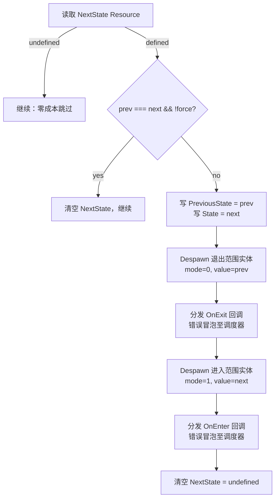

**语言**：[English](SKILL.md) · **简体中文**

> [!NOTE]
> 本文供人阅读；工具入口为英文 `SKILL.md`。

# forgeax-engine-state

ForgeAX 类型化状态转换与状态范围的 ECS 生命周期。适用于定义游戏模式、切换关卡、按状态控制系统，以及创建和移除状态所属实体。

> 单 World 类型化状态机：`defineState` + `setNextState` + 状态范围实体生命周期 `despawnOnExit` / `despawnOnEnter` + 用户调度标签 `OnEnter` / `OnExit`。复用已有组件、资源、Query 和 despawn 原语，聚合 `@forgeax/engine-state`。

## 理解模型

状态机由模块级 `StateToken`（`defineState` 创建的品牌类型）和 ECS `World` 中逐 token 的 Resource 构成。在模块级用 `as const` 变体元组定义状态，通过 `setNextState(world, token, variant)` 请求转换，用 `getState` / `getPreviousState` 读取当前与前一状态。实体通过 `despawnOnExit` / `despawnOnEnter` 归属某一状态变体，在离开或进入该变体时自动 despawn。`OnEnter` / `OnExit` 返回用于注册转换回调的分发标签。

`transitionStatesSystem` 每帧运行，由 `registerStatesPlugin` 注册，`createApp` 自动调用注册。它读取 `NextState` Resource、切换 `State`、despawn 范围实体、分发回调，最后清空 `NextState`。

## 核心 API 速查

| 名称 | 形式 | 用途 |
|:--|:--|:--|
| `defineState(name, variants as const)` | `=> StateToken<N, V>` | 在模块级定义类型化状态机；`as const` 支持编译期变体收窄 |
| `StateToken` | 品牌接口 | 持有 `name`、`variants`、`nameToIdx`（Map）、`defaultValue`（`variants[0]`） |
| `setNextState(world, token, variant)` | `=> Result<void, StateError>` | 请求下一帧转换 |
| `setNextStateForce(world, token, variant)` | `=> Result<void, StateError>` | 相当于 `setNextState` 加 `force=true`，相同状态也重新触发 |
| `getState(world, token)` | `=> Result<string, StateError>` | 读取当前状态变体字符串 |
| `getPreviousState(world, token)` | `=> Result<string, StateError>` | 读取前一帧状态变体字符串 |
| `inState(token, variant)` | `=> (world: World) => boolean` | 运行条件工厂；当前状态匹配给定变体时为 true |
| `registerStatesPlugin(world)` | `=> () => void` | 幂等地插入逐 token Resource 并注册 `transitionStates`；`createApp` 自动调用 |
| `despawnOnExit(world, entity, token, variant)` | `=> void`，重复会抛错 | 标记实体，在 token 离开 variant 时 despawn |
| `despawnOnEnter(world, entity, token, variant)` | `=> void`，重复会抛错 | 标记实体，在 token 进入 variant 时 despawn |
| `OnEnter(token, variant)` | `=> string` | 返回进入回调的分发标签 |
| `OnExit(token, variant)` | `=> string` | 返回退出回调的分发标签 |
| `addOnEnter(token, variant, fn)` | `=> UnsubscribeHandle` | 注册进入 variant 的回调 |
| `addOnExit(token, variant, fn)` | `=> UnsubscribeHandle` | 注册离开 variant 的回调 |
| `StateError` | 结构化错误 | `.code`（四成员封闭联合）、`.expected`、`.hint`、`.detail` |
| `forgeax dev eval` | 统一实时命令 | 查询当前 World 的状态 token |

> [!IMPORTANT]
> `StateErrorCode` 是四成员封闭联合：`'state-already-defined'`、`'state-not-registered'`、`'invalid-variant'`、`'state-default-required'`。唯一权威为 `packages/state/src/errors.ts`，请阅读源码。

## 转换流水线（逐 token、逐帧）



## 常用代码骨架

```ts
import { createApp } from '@forgeax/engine-app/browser';
import { Update } from '@forgeax/engine-ecs';
import { defineState, setNextState, getState, despawnOnExit, OnEnter, addOnEnter, inState } from '@forgeax/engine-state';
import { createPrimitiveMesh } from '@forgeax/engine-geometry';
import { defineSystem, Transform, MeshFilter, MeshRenderer, Camera, DirectionalLight } from '@forgeax/engine-runtime';

// 1) Define state machines at module level
export const LevelId = defineState('LevelId', ['main-menu', 'tutorial', 'street-a'] as const);
export const GamePhase = defineState('GamePhase', ['loading', 'playing', 'paused'] as const);
// LevelId.variants           -> readonly ['main-menu', 'tutorial', 'street-a']
// LevelId.defaultValue       -> 'main-menu'
// LevelId.nameToIdx.get('tutorial') -> 1

const res = await createApp(canvas);
// registerStatesPlugin is called automatically by createApp
const { world, assets } = res.unwrap();
const cube = assets.create(createPrimitiveMesh('cube').unwrap()).unwrap();

// 2) Spawn level-scoped entities
function spawnTutorial(world: World): void {
  const e = world.spawn(
    { component: Transform, data: { pos: [0, 0, 0] } },
    { component: MeshFilter, data: { assetHandle: cube } },
  ).unwrap();
  despawnOnExit(world, e, LevelId, 'tutorial');
}

// 3) Request transitions
setNextState(world, LevelId, 'tutorial');
// Next frame: transitionStatesSystem flips LevelId -> 'tutorial'

// 4) Read current state
const current = getState(world, LevelId);
if (current.ok) console.log('Current level:', current.value);

// 5) Register transition callbacks
addOnEnter(LevelId, 'tutorial', (w) => {
  spawnTutorial(w);
  console.log('Entered tutorial level');
});

// 6) Force re-trigger (e.g. restart level)
setNextStateForce(world, LevelId, 'tutorial');
// Even though already 'tutorial', force=true re-fires OnExit/OnEnter + scoped despawn

// 7) Gate a system to run only in 'Playing' state
const GameplaySystem = defineSystem({
  name: 'gameplay',
  queries: [{ with: [Transform] }],
  runIf: inState(GamePhase, 'Playing'),
  fn: (world, queryResults, commands) => {
    // Only runs when GamePhase === 'Playing'
  },
});
world.addSystem(Update, GameplaySystem);
```

## inState 条件工厂：按游戏状态控制系统

`inState(token, variant)` 返回适用于 `SystemDescriptor.runIf` 的 `(world: World) => boolean`。每帧从 World Resource 存储读取 token 当前值，与给定变体一致时返回 `true`。

```ts
import { defineSystem } from '@forgeax/engine-ecs';
import { inState, defineState } from '@forgeax/engine-state';

const GameState = defineState('GameState', ['Menu', 'Playing', 'Paused'] as const);

// System runs only when GameState === 'Playing'
const Gameplay = defineSystem({
  name: 'gameplay',
  queries: [{ with: [Transform] }],
  runIf: inState(GameState, 'Playing'),
  fn: (world, queryResults, commands) => {
    // frame logic -- runs only in Playing state
  },
});
```

行为如下：

- 状态匹配：返回 `true`，系统正常执行。
- 状态不匹配：返回 `false`，静默跳过系统，不执行查询或 fn。
- 状态未激活，即 Resource 尚未插入：返回 `false`，可以在 `registerStatesPlugin` 前安全使用。

实现复用 `packages/state/src/resources.ts` 的 `stateResourceKey(token)` 派生逐 token Resource key，再通过 `world.getResource(key)` 读取当前索引，与 `token.nameToIdx.get(variant)` 比较。不增加原语，只消费 ECS Resource CRUD。

> [!IMPORTANT]
> `inState` 是条件工厂。附加条件在调用方系统组合；state 包不提供布尔组合器。

## 常见问题

- **存在范围实体时释放插件：** disposer 先移除调度和资源，再释放组件 lease。存活实体或系统可能以 `component-in-use` 拒绝释放。移除报告的使用者，再重试同一个 disposer，然后才重新安装；被拒绝的 lease 仍有所属方。
- **在 `registerStatesPlugin` 前调用 `setNextState`：** 返回 `StateError { code: 'state-not-registered' }`。`createApp` 自动注册；手动 `createRenderer` 用户必须先调用 `registerStatesPlugin(world)`，再执行状态操作。
- **同实体与 token 重复 `despawnOnExit`：** 抛出 `ComponentAlreadyPresentError`，遵循 ECS 默认 exclusive=false 的快速失败。一个实体只能携带一个 `__scopedTo__<tokenName>` 组件。
- **force 标志：** `setNextStateForce` 跳过同状态空操作检查，用于重启语义，即相同变体也重新触发 `OnExit`、`OnEnter` 和范围 despawn。
- **下一帧才转换：** `setNextState` 写入 `NextState` Resource；转换发生在 `transitionStatesSystem` 执行时，位于 `input-frame-start-scan` 之后、`propagateTransforms` 之前。下一帧之前，`getState` 看不到新值。
- **回调顺序：** `OnEnter` / `OnExit` 在 `transitionStatesSystem` 内执行。转换先 despawn 旧状态退出实体，调用 OnExit，再 despawn 新状态进入实体，调用 OnEnter。回调接收 `World`，可以自由 spawn 和查询。
- **回调错误冒泡：** 回调没有 try-catch 包装。抛错会中止转换系统并传播到 ECS 调度器；`State` 切换已提交，不回滚，后续 token 跳过该帧。回调内部应验证并返回，不抛错。
- **在 `registerStatesPlugin` 前使用 `inState`：** 安全；返回 `false`，直到 Resource 插入前系统静默跳过，不抛错或返回错误。

## 深入阅读

- `StateToken` 品牌类型和 `as const` 编译期收窄：`packages/state/src/define-state.ts`。
- `StateErrorCode` 四成员封闭联合及可辨识详情：`packages/state/src/errors.ts`，唯一权威。
- `transitionStatesSystem` 八步流水线：`packages/state/src/transition-system.ts`。
- `inState` 条件工厂、谓词闭包与 Resource key 派生：`packages/state/src/conditions.ts`。
- `createApp` 中自动连接 `registerStatesPlugin`：`packages/app/src/create-app.ts`。
- 实时状态检查：`forgeax dev eval`，命令在当前 World realm 执行。
- 仅消费 ECS 原语的零侵入设计：[`forgeax-engine-ecs`](../forgeax-engine-ecs/SKILL.zh-CN.md)。
- App bootstrap 和 `createApp` 自动注册：[`forgeax-engine-app`](../forgeax-engine-app/SKILL.zh-CN.md)。
