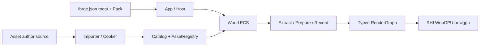

# ForgeaX Game Project Guide

This is an AI-first TypeScript game project. Discover capabilities through commands and existing contracts before editing author source. Build outputs, caches, and indexes are derived, not handwritten authorities.

## First project visit

Before writing code or assets:

1. Read this file for project structure, asset authority, and verification paths.
2. Read the short capability tour in [`skills/forgeax-engine-sdk/SKILL.md`](skills/forgeax-engine-sdk/SKILL.md) and select only the capabilities needed now.

Consult the [feature catalog](skills/forgeax-engine-sdk/references/feature-catalog.md)
on demand for broader discovery. Its generation baseline is historical; available
capabilities are not features already enabled in this game.

For every new or resumed task, select checks from [Run, test, build, and release](#run-test-build-and-release)
before editing and complete that route's acceptance before handoff.

`forgeax project new --json` returns the two entry paths in `value.onboarding.read`;
text mode prints one per line. Discover commands through `forgeax help --tree --json`;
do not infer APIs or inputs from capability names.

> [!IMPORTANT]
> `forge.json` owns project configuration, stable GUIDs own asset identity, and `forge.json#roots` is the sole plugin assembly authority. Do not create parallel manifests, lifecycles, or runtime entrypoints.

> [!CAUTION]
> Edit the current game project directly and run relevant checks by default. ForgeaX closed loop creates a separate multi-stage delivery workflow and requires explicit user agreement for the current task. The root `skills/` supplies Engine usage knowledge; its presence does not authorize starting a closed loop.

## `game-3d` template disposition

Treat a project created from `game-3d` as a runnable Engine capability reference.
Its player-visible content is not the product foundation for a new game. For original games,
vertical slices, portfolios, branded experiences, and high-fidelity tasks, replace or redesign
character appearance, showcase meshes, material palettes, composition, lighting/environment,
UI copy, and example names. Reuse input, controller math, physics wiring, camera smoothing,
animation bindings, pack structure, and GUID loading where appropriate. Replace template identity throughout:
`forge.json` id/name/root GUIDs, plugin identities, `package.json` name, package/asset GUIDs, and source keys. Changing only display names, colors, or positions is insufficient.

Before writing game code or assets, record `Template Disposition` in the task notes:

```text
Template Disposition
- Runtime/controller code: KEEP | ADAPT | REPLACE — reason
- Player character and animation: KEEP | ADAPT | REPLACE — reason
- Scene entities and composition: KEEP | ADAPT | REPLACE — reason
- Meshes and materials: KEEP | ADAPT | REPLACE — reason
- Lighting and environment: KEEP | ADAPT | REPLACE — reason
- UI and copy: KEEP | ADAPT | REPLACE — reason
- Template tests: KEEP | REWRITE | REMOVE — reason
- Residual template identifiers allowed at delivery: <explicit allowlist or none>
```

Every player-visible `KEEP` requires a reason it belongs to the new game's identity; otherwise
return to assets/composition first. Take the first browser screenshot after the first replacement
or blockout pass, before extensive gameplay expansion. Residual-search commands, template owners, and test rewrite boundaries are in
`templates/game-3d/README.md`.

## Identify the project structure

`forge.json#roots` owns the actual entrypoints. This is the recommended `empty` layout; capability demos may add owner plugins and project tests, while keeping generated build state separate from author source.

> [!NOTE]
> `empty` retains only a zero-entity `SceneAsset` as an optional asset-chain starting point, without a preset `Camera`, mesh, material, or light.
> 2D and other non-3D games declare their scene, rendering, and input capabilities as needed.

```text
AGENTS.md                 AI entrypoint: project, assets, tools, debugging, Engine model
README.md                 Human quick start for the template/game
docs/feedback.md          Development issues and Engine/SDK feedback
forge.json                Project identity and build/host/frontend/engine root asset GUIDs
package.json              Single @forgeax/engine dependency and pnpm scripts
pnpm-workspace.yaml       pnpm 12 native-build and cross-platform dependency policy
pnpm-lock.yaml            SDK-generated reproducible dependency closure
.npmrc                    Engine dynamic-dependency hoisting; ZIP projects also pin the SDK store
assets/                   Sole content root: game plugins, asset author source, external sources
assets/**/__tests__/      Vitest unit tests colocated with their owner
.assetlib/                Local asset workspace; excluded from author-source/cook/runtime scans
.assetlib/downloads/      Original downloads for archival and sorting; untracked by default
.assetlib/staging/        Extracted working copies; untracked by default
skills/<skill>/           Ordinary SDK-installed files; committable and independently readable
.cursor/skills/*          Cursor discovery links to the same skill content
.codebuddy/skills/*       CodeBuddy discovery links to the same skill content
.workbuddy/skills/*       WorkBuddy discovery links to the same skill content
.forgeax/skills/*         ForgeaX discovery links; all of .forgeax/ is local generated state
node_modules/             Offline installation output; do not commit
dist/                     Build projection; do not commit or edit manually
release/                  Shareable archives and SHA-256 from package; do not commit
.forgeax/                 Local generated state and caches; do not edit manually
```

## Issue feedback and game archives

When an Engine, SDK, template, build, asset, runtime, or browser issue occurs, confirm the facts
and append it to `docs/feedback.md` immediately. Include date, scope, reproduction, expected/actual
results, evidence paths, and status. Exclude tokens, passwords, and sensitive data. Maintain this project feedback record instead of leaving findings only in chat or terminal output.

After building and verifying the runtime closure, `forgeax project package --format web-zip` copies
the root `README.md` and `docs/feedback.md` verbatim into the ZIP at the same paths. Update the README
and known unresolved issues before release; package fails explicitly if either file is missing.

`forgeax project new` copies all Engine skills from SDK-root `skills/` into ordinary game-root files, then creates relative discovery links for each agent. `skills/` is the content SSOT. Mount-directory `.gitignore` files ignore only CLI-managed skill names, preserving user rules and skills. Verify or repair links:

```bash
pnpm exec forgeax skill verify --json
pnpm exec forgeax skill install --json
```

`skill install` idempotently rebuilds missing links and removes stale manifest-owned links. It fails on unmanaged destination files without overwriting them. `.forgeax/skill-install-manifest.json` is local installation evidence; after deleting `.forgeax/`, run `skill install` to restore it.

## SDK setup and project creation

Create projects with the CLI at the SDK root. Initialize once after downloading or extracting the SDK;
initialization prepares the native closure in a temporary SDK project without writing to a game:

```bash
node ./bin/forgeax.mjs project init                  # Once per SDK/platform
node ./bin/forgeax.mjs project new ../my-3d-game --template game-3d  # 3D games
node ./bin/forgeax.mjs project new ../my-game --template empty       # Other games
cd ../my-game
```

Read the generated `README.md` and apply [template disposition](#game-3d-template-disposition).
When removing example content, update its scene, runtime code, and pack dependencies together.

If the SDK is not installed, use the online entrypoint
`pnpm dlx @forgeax/engine sdk install <versioned-sdk-directory>`. It obtains the exact version from
the public npm registry without private GitHub Release access. Create games outside the SDK
directory.

`package.json` declares only `@forgeax/engine`; import capabilities from its root or
`@forgeax/engine/<package-directory>` focused subpaths. The `.npmrc` setting
`public-hoist-pattern[]=@forgeax/engine-*` lets Vite dev resolve dynamic imports within Engine
packages. It does not make physical packages direct user dependencies and must not expand to
`shamefully-hoist`.

Game targets must be outside the SDK root; the root and descendants return `project-target-inside-sdk`. Use sibling directories or other external absolute paths. For existing external projects, run SDK-root `init`, then game-root `forgeax project init` to restore exact dependencies, scripts, and offline lockfiles. `new` uses `--ignore-scripts` to reuse SDK init's native side-effects cache without repeating esbuild/Rapier/WASM postinstall. Full ZIP projects also pin the real SDK store path in `.npmrc` for subsequent offline commands. The ZIP includes bare `packages/` and `store/pnpm/`, so project creation needs no npm network; the npm carrier omits the store and downloads the same versions.

> [!TIP]
> On macOS, manually clear quarantine only when Gatekeeper explicitly blocks a trusted download:
> `xattr -dr com.apple.quarantine /path/to/forgeax-sdk`. Preview and publish production builds through
> an HTTP(S) static server rather than `file://`.

## Game code and plugins

Game logic is a native Cordis `Plugin`. `forge.json#roots` selects PluginAsset GUIDs for
build, Node host, browser frontend, and Engine execution. Small behaviors use named exports
in `.pack.ts`; larger implementations use ordinary TypeScript modules. Pack `build()` produces
definitions; native `apply()` installs effects and composes children. Cleanup belongs to
`ctx.effect()`. Keep unit tests in `__tests__/` beside their owning source.

- `roots.engine`: World and ECS logic; renderer placement follows App policy.
- `roots.frontend`: browser capabilities such as DOM, input, and Web Audio.
- `roots.host`: resident Node services and tools.
- `roots.build`: importers, shader producers, and authoring tools.
- Discover `asset plugin create`, `asset plugin inspect`, and `project root set` through `forgeax help`. Configuration belongs to Pack; code/configuration changes compile before replacing the session.
- Components, resources, and `Update` / `FixedUpdate` systems express ECS game state. Use engine-state for transitions without introducing a second object scene tree.

## Asset authority and formats

The asset chain is author source → importer/cooker → DDC → catalog/pack-index → runtime `assets.load(guid, kind)`. Runtime identity uses GUIDs, not guesses from disk paths.

`.assetlib` is the game's local asset workspace. Keep original downloads in
`.assetlib/downloads/` and extracted working copies in `.assetlib/staging/`. The template's
`.gitignore` excludes both; Engine does not automatically scan, import, or package them. Once content
is selected for the game, copy it into `assets/` and establish its author source and GUID chain
through `.meta.json`, `*.pack.ts`, or `*.pack.json`.

| Form | Use | Handwritten? |
|:--|:--|:--|
| `lib.ts` | Shared pure geometry, material, scene, or VFX constructors | Yes; does not register asset identity |
| `*.pack.ts` | Procedurally generate related assets; declare packageId and return a sourceKey-to-Asset topology | Yes; preferred code-first form |
| `*.pack.json` | v3 direct/instance author source; sourceKey names direct assets, parent + values defines instances | Yes |
| `*.ui.html` + `*.ui.css` | Readable UI source; matching `.meta.json` registers the UI importer and GUID | Yes; suitable for multiline editing |
| `<source>.<ext>.meta.json` | Stable GUID and import policy for images, glTF/FBX, fonts, audio, video | Yes; CLI creates/maintains it |
| `pack-index.json`, cooked packs, DDC | Build/runtime projections | No; rebuild after deletion |

ScriptablePack filenames must end in `.pack.ts`. Same-file runtime behaviors use named exports; the default export remains the Pack definition. Keep reusable content in `lib.ts` and packageId, parameters, and output construction in packs. Each `build()` output key is a stable `sourceKey`; its GUID derives from `UUIDv5(packageId, sourceKey)`. Preserve sidecars when changing external sources so importer GUIDs survive reimport. Pack author source does not maintain per-output GUID tables.

### Asset capabilities

Use `@forgeax/engine/types` and package READMEs for exact payload contracts:

| Capability | Content and owner |
|:--|:--|
| Scene | Instantiable entities, components, hierarchy, and skin bindings |
| Mesh | Geometry factories or glTF/FBX importers; bounds and nonempty submeshes are required |
| Texture | 2D/cube/HDR images; sidecar policy controls import compression |
| Material | `MaterialAsset` passes, parameter schemas, and build-time shader modules |
| VFX | Compiler-cooked particles, billboards, meshes, ribbons, trails, and beams |
| UI | `UiAsset` ShadowRoot mounts; consumer plugins own behavior and disposal |
| Audio | Host-owned decode/playback; Engine Workers emit POD intents |
| Video | Video textures; browser media objects stay outside World |
| Font | Build-time MSDF atlas and runtime payload |
| Animation / skin | Clips, graphs, and joint-path bindings from code or model importers |

For complex meshes/materials/VFX, use geometry factories, model importers, MaterialAsset builders, and the VFX compiler, then consult package types and READMEs. Run `asset verify` and TypeScript tests for handwritten POD.

### Production, import, and validation

```bash
pnpm exec forgeax asset add assets/character.glb --json
pnpm exec forgeax asset verify --json
pnpm exec forgeax asset list --json
pnpm exec forgeax asset inspect <guid-or-unambiguous-name> --json
pnpm exec forgeax asset shader check --path assets/shaders/example.wgsl --json
pnpm exec forgeax project build --json
```

`asset add` creates external-source sidecars; `asset verify` validates GUIDs, sidecars, ScriptablePacks, and external closure; `build` runs importers/cookers and emits `dist/pack-index.json`. For `asset not in pack index`, check asset roots, sidecar GUIDs, and build/dev catalogs before considering other diagnosis. Do not bypass AssetRegistry with manual fetches.

## CLI as the single tool entrypoint

Discover commands with `forgeax help --tree --json`, inspect `forgeax help <path> --json`,
then execute `forgeax <path> --input request.json --json`. Do not guess inputs.
Prefer `--json` to retain error codes, expected, hint, and detail. Setup and delivery
commands appear in their workflow sections; focused tools include:

| Command | Purpose |
|:--|:--|
| `forgeax dev start` | Start the development server and HMR asset catalog |
| `forgeax asset ...` | Add, validate, list, and inspect external assets |
| `forgeax asset shader check` | Build-time WGSL compilation/reflection diagnostics |
| `forgeax project plugin inspect/configure/disable/enable/install/uninstall` | Candidate validation, Fiber reconciliation, and atomic Entry maintenance |
| `forgeax project skill install/verify` | Rebuild/verify agent discovery links from game-root `skills/` |
| `forgeax help [path] --json` / `forgeax help --tree --json` | Discover commands, input schemas, and the full command tree |
| `a Node or Bun script using the SDK command client <program.mjs>` | Contract-bound remote evaluation/inspection of a live instance |

After `new` succeeds, a best-effort query checks npm's `@forgeax/engine-sdk` `latest` tag. Text mode announces only strictly newer versions; JSON `value.sdkUpdate` records full status. This is not an in-place upgrade: install a new SDK separately, read release notes, then migrate and test each game pinned to an older Engine. Offline or unavailable registries do not block creation; deterministic automation can set `FORGEAX_DISABLE_UPDATE_CHECK=1`.

## Run, test, build, and release

Choose the delivery scope from the user's request before running tools:

| User intent | Route | Stop when |
|:--|:--|:--|
| Create, change, or locally play a game (default) | [Local playable delivery](#local-playable-delivery) | The user can open it, the requested core interaction and result work, and known limitations are stated |
| Publish, deploy, or distribute a game artifact | [Game release](#game-release) | The actual target artifact and host pass release checks |
| Engine/SDK changes, SDK publication, or performance work | The owning package/CI, SDK production, or performance guide | The explicitly selected acceptance contract passes |

### Local playable delivery

```bash
pnpm exec forgeax project check --json
pnpm test
pnpm typecheck
pnpm exec forgeax dev start --json
```

`project check` validates Node/pnpm, manifest, and dependencies; `pnpm test` runs Vitest.
New/init projects provide `typecheck`; older games can use `pnpm exec tsc --noEmit`,
reporting the missing script as onboarding debt. Select relevant tests and asset checks.
Accept the final game only with evidence from the actual entry and host handed to the user:

| Required evidence | Passing condition |
|:--|:--|
| Startup and errors | Run `dev verify --revision <current-revision> --json` against the delivery execution; inspect its runtime report and artifacts. A failed or blocked gate cannot establish runtime acceptance. |
| Appearance | Open the captured screenshot and confirm the requested scene and UI are visible; a saved image path alone is insufficient. |
| Core interaction | Drive the requested controls and observe their gameplay result in the running game; data/unit tests do not exercise this path. |
| Restart/reload | Repeat startup and a core interaction after reload; use evidence from the final code and build. |

Each successful check qualifies only the subject and execution it observed. Service
availability, transport readiness and build success do not establish runtime health
or gameplay. Missing observations remain unverified. A visible fatal or failed Engine
startup fails acceptance even when other checks pass.
Fix the failing owner and verify a fresh session; never suppress the error or remove the
required plugin to obtain a pass.

Use `project build` and `project preview` to verify served `dist` when delivery or
changed build/asset paths require production output. Local delivery provides a usable
local URL. ZIP packaging, HTTPS hosting, full-board/stress runs, fixed frame counts,
performance counters, and unrelated shortcut regressions need an explicit requirement
or observed risk. Hand over the working game without expanding the acceptance loop.

Report the playable entry, observed interaction/result, viewed screenshot reference,
reload result, and limitations. A build, URL, HTTP 200, canonical-template test, or service
handshake alone cannot accept the authored game. Say "complete" or "fixed" only when
all required evidence above passes; retain each missing check as unverified.
When a check is blocked, diagnose its owner and attempt supported recovery or another
available observation route. `dev verify` can use the Engine browser owner when the
interactive browser tool is unavailable; `dev status`/`dev capture` retain diagnostics.
A different execution can diagnose the owner but cannot accept the failing or unobserved
delivery target. If recovery remains blocked, report the concrete error, attempted remedies, completed checks, and
missing evidence to the user; never turn an unavailable check into a pass.
For Linux batch jobs, follow [Linux unattended validation](skills/forgeax-engine-cli/references/linux-unattended.md)
before retrying: explicit headless needs no Xvfb; virtual headed capture does.
A blocked browser is not a completed runtime acceptance. If the requested capability
has no supported entry, report that finding; an unchanged template is not its demo.
After repair, recheck affected paths; unchanged bytes need no repeated packaging or unrelated validation.

For Engine/SDK compatibility defects, reproduce on the pinned Engine, compare the selected
newer release, and retest after repair; never silently upgrade during diagnosis. Discover
`dev start/status/capture/reload/stop` through `forgeax help dev --tree --json`;
the CLI skill owns session/capture details.

### External SDK startup

The browser/frontend integration plugin initializes third-party SDKs and owns cleanup.
Read the installed contract and await readiness before API calls or dependent UI.
For separate consumers, publish the native service only after success and declare consumer
`inject`; plugin array order cannot establish async readiness. Pack `build()` and module
evaluation must not start platform SDKs; browser SDKs must not run in Engine Workers.
Verify in the actual Preview/host; development stubs cannot qualify injected-host readiness.

### Game release

Enter this route when the user requests publication, deployment, or a distributable
artifact. Local preview and handing a local URL to the user remain local delivery.

```bash
pnpm exec forgeax project build --json
pnpm exec forgeax project preview --json
pnpm exec forgeax project package --output release/game-web.zip --json
```

The production gate serves the final `package`/`dist` over HTTPS, drives the target
scene for 300 frames, and fails on App, browser, uncaptured GPU, or static-resource
errors. Inspect the actual game picture, core inputs and reload; validate asset paths
and the shipped closure. Record resolution, browser and device. Add gameplay-peak
stress, entity/candidate/draw counts and median/p95 timing when performance is part
of the requested goal or a measured risk; use the owning performance guide.

`package` emits a Web ZIP and `.sha256`; its root contains `index.html` and the static
Engine/game closure in `forgeax-dist.json`, excluding SDK source, `node_modules`
and author source. Validate those final bytes once. A subsequent source repair
invalidates the affected evidence and artifact; writing a report alone does not.
ESM, WASM, fetch and asset indexes require HTTP(S), so `file://` is not a player
runtime. Offline desktop packaging requires a separately requested OS-specific
browser shell or local HTTP launcher.

The SDK verifier proves the SDK archive can create and run canonical projects.
It cannot replace verification of the authored game. SDK archive integrity,
Candidate/Promotion and Engine publication belong to the SDK skill's
[production guide](skills/forgeax-engine-sdk/references/sdk-production.md).

## Live debugging: RHI Debug first for difficult rendering issues

> [!IMPORTANT]
> For unexplained black screens, missing objects, lighting/shadow defects, flicker, post-processing errors,
> or browser/backend divergence, read [`forgeax-engine-rhi-debug`](skills/forgeax-engine-rhi-debug/SKILL.md) first.
> Capture the actual failing frame and use draw/dispatch, bindings, resources, and render-target pixels
> to locate the owner before editing. Do not wait to exhaust logs, remote/profiler queries, or speculative material/shader tweaks.

- Follow explicit startup, asset, or schema `.code/.detail` failures directly to their owner; run only relevant `doctor`, `asset verify`, or `shader check` diagnostics.
- Reproduce the target image and interaction in the original browser/backend with Playwright. Screenshots establish the symptom; RHI tapes explain GPU work.
- Enable recording with `dev start --rhi-capture true`, reproduce, then run `rhi capture`; capture does not create a live instance. Follow the RHI Debug skill's wiring/recovery path and retain `.rhitape`, digest, `workIndex`, and failure detail. If recording is unavailable, preserve blocker evidence and continue feasible focused diagnosis.
- Let tape evidence determine additional World/Renderer/resource queries or debug-draw spatial visualization. Fix Engine gaps in the owning Engine subsystem and record them in `docs/feedback.md`, without hiding them behind game-side substitutes.
- Recapture and verify the same scene/backend after repair, and add the failing path to regression coverage. Offline replay does not replace real-browser appearance and interaction checks.

## Engine mental model



- App assembles Host, World, Renderer, input, audio, and plugins; World owns game state and time.
- Render owns extract/prepare/record and GPU Scene projection; RenderGraph owns pass resource lifetime; RHI is the hardware boundary without math policy.
- High-quality rendering paths include procedural sky/environment light, Directional/Point/Spot lights, shadow atlas/CSM, PBR/IBL, VFX, and HDR/SSAO/TAA/bloom post-processing.
- Advanced capabilities include GPU particles, compute/raster RenderFeatures, and custom WGSL shaders. Like composable material blueprints, they use reviewable, compilable, reflectable shader modules and `MaterialAsset` parameter schemas as author source.
- Branch on capability data for unavailable features. Do not depend on backend names or pass WebGPU objects through Engine boundaries.

For needs spanning multiple capabilities, adopt the smallest set that delivers current player value and acceptance evidence. An atmospheric combat scene can start with ECS + input + PBR lighting/shadows + Scene Fog. Add GPU VFX, physics, spatial audio, or custom shaders when requirements or evidence justify them, not merely because the SDK includes them.

## Authoritative documentation

Installed package READMEs define exact API contracts, for example `node_modules/@forgeax/engine/node_modules/@forgeax/engine-pack/README.md`, `engine-runtime`, `engine-ecs`, `engine-render`, `engine-material`, `engine-vfx`, and `engine-rhi-debug`. Game-root `skills/` contains SDK-installed task guides; the SDK also provides the complete public source snapshot at `source/engine/`.

For errors, read closed `*ErrorCode` unions and actual source types instead of copying lists that can drift. Expected failures return `Result`; branch on `.code` and retain `.expected`, `.hint`, and `.detail`.

## Optional visual project and asset inspection

Use installed ForgeaX View when the user requests project/asset inspection or a
preview of its current state. Finish requested development and checks first; for
inspection-only tasks, check project/asset readiness. Do not start View mid-development
or for questions about View. With the same SDK CLI:

1. Check backend/View status. Resolve `@forgeax/view/host.pack.json` from View installed in the SDK CLI runtime, not bare `packages/view`. npm Engine/View outputs are prebuilt; do not rebuild them.
2. Reuse a compatible backend; otherwise run `backend start --root <workspace> --host-pack <installed View host.pack.json> --json`. Check ownership/use before replacing another workflow's backend.
3. After backend readiness, run `view start --root <workspace> --project <project-root> --json` with the project's absolute path. Open the returned URL and verify the requested project/assets.

On failure, inspect Host Pack selection, package resolution, backend logs, and
View/project status before retrying.
