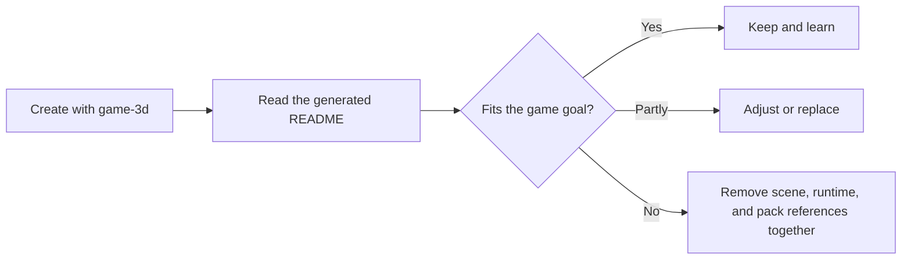
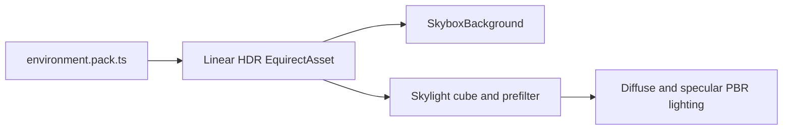
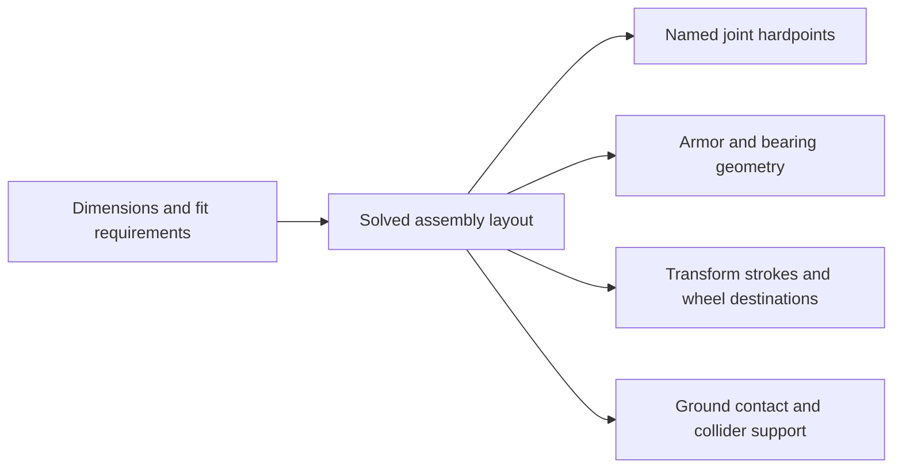

# ForgeAX Game 3D

Compact third-person reference: pointer-locked camera, camera-relative movement, Rapier character
collision, a fantasy PBR showcase, a transforming red-and-blue armored convoy robot, and one UiAsset.

> [!IMPORTANT]
> `game-3d` is a runnable, contentful reference—not an empty 3D scene. `forgeax project new` copies a
> working scene, the feature-owned plugin Packs, procedural meshes and materials, a skinned character, and
> UI into the new project. These starter contents intentionally affect the visible composition,
> player collision space, and asset closure.
>
> Treat this as a guidance starting point: read the examples, keep what matches your game, and
> adjust or replace the rest. Do not delete visible scene entities, their colliders, or their pack
> dependencies independently; use the dependency guide below when pruning the starter.

> [!IMPORTANT]
> Click the game to lock the camera. Move with <kbd>W</kbd><kbd>A</kbd><kbd>S</kbd><kbd>D</kbd>,
> look with the mouse (or hold the right mouse button and drag when unlocked), jump with <kbd>Space</kbd>, hold <kbd>Shift</kbd> to run, and transform with <kbd>T</kbd>, and release the pointer with <kbd>Esc</kbd>.
> On touch displays, use the visible left joystick to move and drag the right **Look** pad to turn.
> Tap **Jump** and hold **Run** for 1.7× movement speed. Release the joystick or Run button to stop that action.
> **Shape a vase** opens the initially collapsed editor and pauses touch controls; **Close vase** returns to play.
> UI fields keep their native keyboard input. Hosts without a game message port show a capability notice instead of gameplay controls.



## Adapting camera and physics interactions

| Requested change | Implementation and acceptance |
|:--|:--|
| First-person camera | Adapt the camera and hide all self-occluding player render descendants for that view, including attachments; retain the collision body. Inspect standing, turning and sliding screenshots. Moving the camera inside the third-person head alone leaves self-occlusion. |
| Mouse drag rotation | Implement the requested button-held drag using the shared InputSnapshot, or explicitly agree on click-to-lock controls. Check focus and the gesture inside the actual preview embedding; pointer lock is not a drag gesture. |
| House LODs | Preserve silhouette and window/opening landmarks in every level. Use native `MeshAsset.lods` and `lodHysteresis`, then inspect both travel directions around the transition band. Coverage blending does not morph unrelated geometry; a predicted HUD tier is not Renderer evidence. |
| Moving platforms or pushable crates | Follow the installed [Physics skill](skills/forgeax-engine-physics/SKILL.md#moving-supports-and-dynamic-pushes). Verify simulation contact, actual displacement and presentation through standing/reversal/jump/removal, rather than only pure math tests. |

The starter's third-person controls are defaults. Keep the new game's README and
HUD consistent with its actual controls. For unexplained lighting or flicker,
capture the failing frame with RHI Debug before changing materials or shadows.

## Optional platform SDK integration

Keep platform SDK initialization, loading reports and pause/resume registration in
a game-owned frontend plugin. Engine provides App controls and canvas sizing;
the game owns HUD layout, input/audio cleanup and the actual playable boundary.
See the installed DevKit README's **Platform SDK adaptation** section for a
minimal Zaohua example. This template does not install or initialize a platform
SDK; choose that integration only for the requested target platform.

## Behavior Packs

Start with the Pack for the feature you want to change. `game.pack.ts` only composes the engine
root. Each feature owns its namespace, configuration, and asset references. There is no special
`plugin.ts` entry file; native Cordis still owns every installed behavior's lifetime.

| Pack | Owns | Runtime implementation |
|:--|:--|:--|
| `assets/game.pack.ts` | Engine root; references physics and scene | Same-file `game` export |
| `assets/physics.pack.json` | Rapier capability | Existing npm plugin |
| `assets/world/world.pack.ts` | Scene instance; references scene data, player and camera | Same-file `scene` export |
| `assets/player/player.pack.ts` | Movement settings and walk-clip reference | `player.ts`, a normal implementation module |
| `assets/camera/camera.pack.ts` | Camera behavior | Same-file `camera` export |
| `assets/ui/ui.pack.ts` | Browser frontend root, guide and vase controls | Same-file `ui` export |
| `assets/runtime-vase/vase.pack.ts` | Runtime vase generation and bound mesh lifetime | Same-file `vase` export |

`build()` produces persistent definitions. `apply()` installs runtime contributions through
`ctx.effect()`. Pass generated values through asset configuration; runtime code cannot capture
locals from a build invocation. Each behavior declares its own `packageId`; `$asset` references point to the GUIDs derived from
the owning Pack and output key. Copying a feature requires its referenced asset and source closure.

To scaffold another behavior in one file:

```sh
forgeax asset plugin create --path assets/combat/combat.pack.ts --json
```

## Execution and UI

New projects default to automatic Engine, Render and Kernel Workers. `forge.json`
places gameplay/physics in the Engine realm and the guide UI in the browser frontend realm.
The Host loads the UiAsset by GUID, mounts it in the Host `#game-ui` container, and observes
browser pointer-lock state; gameplay consumes the frozen input snapshot in its
World. `assets/camera/camera.pack.ts` is the pointer-lock reference: it opens the lock
gate with `setPointerLockAllowed` and reads mouse look only while
`input.mouse.pointerLocked`. When turning it into a first-person shooter, follow the
pointer-lock FPS rules in the `forgeax-engine-app` skill (fire only while locked, pause on
lock loss, keep touch overlays off the desktop canvas). `FORGEAX_EXECUTION_WORKERS='{"engine":false}'` selects local execution
through the same bootstrap. Shared kernels require COOP/COEP on production
hosting; DevKit dev and preview already provide them.

## Runtime vase

The vase at the front of the showcase is generated when the game starts. Release the
camera with <kbd>Esc</kbd>, edit **Height**, **Radius**, or **Sides**, then select
**Generate vase**. The same scene entity and asset GUID receive the new mesh. A rejected
parameter set preserves the previous vase.

`assets/runtime-vase/vase-program.ts` supplies a native JS generator, parameter metadata,
and a fixed material dependency to the App's `runtimePacks` producer. The mesh is published
to its Catalog and loaded by GUID; variants are not stored in the cooked geometry Pack.
`vase.pack.ts` is an ordinary PluginAsset under the scene owner. The Host UI sends values
through the borrowed `GameHost.port`, so the same controls work with an Engine Worker.
Disposal cancels generation, removes the entity, and withdraws the owned generator.

To remove this example, remove its child reference from `world.pack.ts`, its Pack and
program files, and the vase panel/control binding from the UI together.

## Starter content guide

| Content | Role | Adjust or remove together |
|:--|:--|:--|
| `assets/scene.pack.ts` | Runnable scene and 3C example: ground, obstacles, lights, sky, camera, kinematic `Player`, and `Player Body`. Showcase obstacles have matching static `RigidBody` + `Collider` components. | Move, recolor, or replace entities freely. Removing a blocking/showcase object means removing its scene entity and matching collider; keep or update `Ground` for the floor and `Player`/`Main Camera` for the starter runtime. |
| `assets/character.pack.ts` + `assets/player/player-rig.ts` | Skinning and animation example: generated player mesh, skeleton, skin, joint paths, and walk clip. | When replacing player art, update the `Player Body`/`Skin` scene reference and the binding code in `assets/player/player.ts` together; do not leave stale identity rows in the pack closure. |
| `assets/fantasy-meshes.pack.ts`, `geometry.pack.ts`, and `materials.pack.ts` | Procedural geometry, PBR material, and fantasy-showcase examples. Geometry also supplies the ground and obstacle meshes used by the scene. | Keep, tune, or replace the examples. When deleting a showcase, remove its scene GUID references and now-unused pack/source keys together; preserve anything still referenced by the scene. |
| `assets/materials.pack.ts` + `assets/shaders/rusted-iron.wgsl` | Import-first Standard Surface example: a short `evaluate_surface` function drives the engine-owned lit passes. | Change the WGSL parameters and matching Pack values together; keep `moduleSlots.surface` pointed at the imported module. |
| `assets/environment.pack.ts` and lighting in `assets/scene.pack.ts` | Authored procedural HDR daylight shared by the visible sky and PBR environment lighting. | Tune the environment generator and the single `DirectionalLight`; keep `Skylight` and `SkyboxBackground` bound to the same environment GUID. |
| `assets/guide.ui.html` + `assets/guide.ui.css` + `assets/ui/ui.pack.ts` | Readable ShadowRoot control overlay authoring, pointer-lock state, and crosshair example. | Restyle or replace the HTML/CSS pair, or remove the corresponding UI mount/update code in `assets/ui/ui.pack.ts` and its `.ui.html.meta.json` sidecar together. |

The current reference implementation expects the authored `player`, `camera`, and `player/joint/*`
binding keys, plus the walk clip and guide UI. Those are requirements of this runnable sample—not
a rule that every game must keep the same content. If the game changes that contract, change the
owning runtime code and author sources together.

## Runtime service ownership

Player and camera plugins resolve their World once when the injected plugin
activates. Frame systems, player service callbacks and cleanup use that same
World. Cordis still owns dependency replacement and system retirement; frame
updates do not repeatedly resolve services through Context.

## Procedural sky and PBR reflections

`assets/environment.pack.ts` generates an ordinary linear HDR `EquirectAsset`
from source. The scene binds the same GUID to `SkyboxBackground` and `Skylight`,
so the blue daylight background and PBR environment lighting share one authored
image. The generator includes a broad circumsolar response and subdued ground
bounce; the single `DirectionalLight` owns direct sunlight. Its intensity is
3.2, with the default exposure of 1 and ACES Filmic output. These values belong to this
artistic environment; they are not a physical Atmosphere's lux/exposure preset.

The sun explicitly caps `shadowDistance` at 56 meters for the 28-meter showcase
and its third-person camera. The camera keeps its general far-plane default;
shadow coverage is a separate scene choice. Inheriting that 2000-meter range
spreads the cascades too thinly and loses contact shadows. Filter, cascade count,
resolution and bias keep the Engine defaults. When enlarging a game, tune shadow
coverage to its visible content instead of extending it to the camera far plane
automatically.

To tune sunlight in View, select `assets/scene.pack.ts` in the Content Browser
and open **Parameters → Runtime**. `sunColor` is a linear RGB vector and
`sunIntensity` ranges from 0 to 10. Both update the existing `Sun` immediately;
they do not require **Generate**. **Save** writes their defaults back to
`scene.pack.ts`; before saving, edits remain in memory. The bound fields also
appear in the Sun's `DirectionalLight` Inspector. View detects parameter
declarations added to this source while the project is open.

To expose another field, select it in Inspector and choose **Expose**. The Agent
reference includes its source, reflected type and exact binding path. Follow the
[installed Pack parameter recipe](skills/forgeax-engine-assets/SKILL.md#view-pack-parameters)
and check this source with `forgeax asset inspect assets/scene.pack.ts --parameters-only --json`.
This check does not generate assets; verify the live effect in View separately.



The mirror sphere and torus show specular environment reflections; rough materials
receive blurred reflections and nonmetal surfaces receive diffuse sky lighting.
Changing the environment source rebuilds the same asset GUID through the normal
Pack producer. No external sky image or runtime source generator is required.

These are sky reflections. Reflecting nearby scene objects requires the Engine's reflection
probe or screen-space reflection features, which this starter does not enable.

## Import-first Surface material example

[`assets/shaders/rusted-iron.wgsl`](assets/shaders/rusted-iron.wgsl) declares
`game_3d::rusted_iron_surface` and implements only
`evaluate_surface(SurfaceInput) -> SurfaceData`. The companion
[`assets/materials.pack.ts`](assets/materials.pack.ts) supplies the parameter
schema and values, and its `moduleSlots.surface` selects that module for the
Standard material. Authors therefore write the surface calculation, not
Forward/Deferred/ShadowCaster stages or light bindings.

The build and runtime route is one ownership chain:

```text
WGSL source + Pack values -> importer/cooker -> DDC payload + pack-index
  -> catalog -> assets.load(materialGuid, 'material')
```

The cooker resolves the imported module and the Engine derives the pass family
from the root parameters. Runtime reads the cooked GUID record; it never parses
raw WGSL or repairs a missing artifact. For the TypeScript form of the same
contract, see the [`Materials.standard` Surface example](../../packages/render/README.md#standard-surface-authoring).

## Procedural character

Convoy uses the native modeling toolchain at build time. Its twin-window chest is the truck cab;
the head retracts, arms fold behind the cab, legs rotate into the chassis and six tires slide onto
three axles. The same low-poly mesh and rigid skin appear throughout the reversible transformation.
Press <kbd>T</kbd> to transform. In truck mode, <kbd>W</kbd>/<kbd>S</kbd> control forward/reverse throttle and <kbd>A</kbd>/<kbd>D</kbd> steer; releasing throttle brakes. Wheel rotation follows the driving speed. Touch users can
close the vase panel and tap **Transform**. Jump is available in robot mode.

| Author source | Responsibility |
|:--|:--|
| `assets/player/convoy-layout.ts` | Physical dimensions, manufacturing clearances, solved hardpoints, panel spans, telescope engagement and vehicle destinations |
| `assets/player/convoy-model.ts` | Shared low/high part recipe: boxes, bevels, tapered armor, panel lines, linear grilles, radial tire tread and rigid rig export |
| `assets/player/convoy-frame.ts` | Load-bearing axles, nested bearings, sliding tracks, spine, abdomen carriage and measured fit bands |
| `assets/player/player-rig.ts` | Named body/mechanism topology and rest anchors derived from the solved assembly |
| `assets/character.pack.ts` | Stable mesh/skeleton/skin identities, walk clip and 512-2048 texel atlas resolution (default 1024) |
| `assets/player/modeling-build.pack.ts` | Convoy NativeCooker registered through `forge.json.roots.build` |
| `assets/player/convoy-finish.ts` | Cooked paint, roughness and clearcoat masks with delivery mips |
| `assets/player/player.ts` | Reversible animation clock, separate body/wheel masks, movement and read projection |
| `assets/player/player-input.ts` | Keyboard and touch transformation edges through the existing semantic control channel |

### Assembly constraints

`createConvoyLayout` authors wheel radius, cab width/depth/interior height and leg-guide
length. Bone lengths, material thicknesses, bearing sizes and running clearances describe
the construction. Joint anchors, armor boundaries, telescope strokes and contact heights
are derived from those relationships. Edit the primitive dimensions or a fit requirement;
the mesh, rig, motion and collision support consume the same solved layout.



| Physical relationship | Derived result |
|:--|:--|
| Tire diameter plus bridge clearance | Rear axle pitch, bridge length and both bearing bores |
| Guide endpoints and minimum engagement | Leg extension stroke; the foot-shell clearance also determines ankle height and shin length |
| Folded thigh, counter-rotating bogie and ground plane | Vehicle rear-axle destination, hip drop and two-stage track travel |
| Shoulder hardpoint and counter-rotating gimbals | Front wheel rest anchors that fold onto the same vehicle track and contact plane |
| Actual helmet envelope, packing clearance and cap underside | Roof aperture, head retraction and guide lengths that clear the stowed helmet |
| Floor, roof and window-frame inner boundaries | Cab panels, roof rails, windshield spans and abdomen docking stroke |

Plate roles explicitly select bearing bores and shoulder openings; dimensions do not
identify a part. Surface ornament, colors and local styling offsets remain authored.
Lightweight tests change all five primary dimensions independently. The default assembly
owns one adaptive full-motion interference scan and continuous floor checks. Taller-cab
and longer-guide regressions check actual geometry, connectivity, running fits and floor
clearance at rest, mid-fold and stowed, plus final forward kinematics. Template tests admit
at most two files concurrently, reuse models within a suite and bake a 128-pixel map fixture;
the normal project build separately validates the delivered 1K textures.

The automatic low-poly UV atlas covers the armor and wheels. Repeating mechanical hardware
uses separate brushed-metal and rubber microfinish tiles, preserving atlas space for visible panels.
The `bake-receiver` and `bake-detail` checkpoints expose the matching unique-atlas inputs. Each rigid part has a matching `bake:`
group on the high model, preventing neighboring moving parts from contaminating the projection.
The high model carries rounded chamfers, vent recesses, bolts and tread that are absent from the low.
The cab back bevel and bearing radius also bound the shared projection cage; wheels
keep their tighter group cages. Cold cooks use those known projection envelopes directly.
Frame members merge in balanced batches before joining the body, avoiding a full-body
rollback copy for every small rod and bearing while preserving the published asset bytes.
The bake and skinned export share weighted normals with explicit sharp edges and matching UV cuts.
The abdomen retracts on twin guides before the cab folds; the waist armor, belt and flexible guard
keep a continuous body volume in robot mode. Physical shell connectivity and the complete swept
path are checked separately from the final textured studio views. The leg-fold trajectory
keeps the feet, bogies and folding guards above the floor; the capsule support height follows
the wheel contact plane, with a 10 mm character-controller offset.

| Map | Runtime use |
|:--|:--|
| Tangent normal | High surface detail on the low mesh |
| Base color | Red/blue enamel, steel, rubber, glass and signal palette |
| ORMH | Green roughness and blue metallic channels drive Standard PBR; red stores AO and alpha stores height |
| AO | Occlusion reuses the identical ORMH red channel |
| Emissive | Cyan eyes/headlights and amber roof markers |
| Coat | Red clearcoat mask and green clearcoat roughness |
| Height, curvature, edge wear, position, cavity | Bake inspection and finish inputs; these auxiliary maps are excluded from runtime publication |

Only the low mesh, skeleton, clips and five skinned Standard material slots reach the renderer:
unique baked armor plus shared dark steel, bright steel, brass and rubber finishes. The high
geometry is a bake input. No runtime modeling import or external model/texture payload is needed.

The build-only Convoy cooker caches its completed five-texture finish and delivery
mips alongside the raw native bake. Native producer identity, source inputs and
finish version own the cache key; metadata and pixel digests reject stale or
damaged entries. Fresh disposable source copies reuse identical results while
each restored texture retains its own backing buffer. GUIDs bind at publication.

The template tests retain closed surfaces, unit normals, a 24,000-triangle budget, rigid plate
lengths, bind consistency and the closed opposite-limb walk cycle. Additional tests sample the
continuous native transformation, check clip targets and rest rotations, and bake actual normals,
AO, height, material response and emission. `scripts/convoy-playthrough.mjs` exercises real keyboard
transformation, an intermediate pose, driving, reverse transformation and reload.

## Coordinate contract

ForgeAX uses a right-handed world with `+Y` up. This template sets yaw `0` to camera-forward `-Z`
and camera-right `+X`. Mouse-right turns the view right; mouse-down looks down and mouse-up looks
up. In robot mode, WASD is projected onto the camera's horizontal forward/right axes, then the character turns to
that resolved world-space movement. Pitch never adds vertical movement; Rapier remains the only
owner of the final player position.

The authored UI derives joystick and look geometry from `getBoundingClientRect()` in
logical CSS pixels. Look deltas are normalized by the same viewport extent, so DPR
does not change sensitivity. Each control retains its own contact until release;
document listeners handle release outside a control without requiring native pointer capture.
The `game-3d/player-controls` protocol uses the borrowed `GameHost.port` for bounded
movement axes, look deltas, a jump edge, held Run, and reset. The player samples this
intent and desktop `InputSnapshot` once in `Update` before physics. Fixed steps reuse
movement/Run; the camera consumes look once. A jump survives Updates with no fixed step
and is consumed by one `FixedUpdate`, even when a frame has several physics steps.
The same input Update selects the walk weight before animation sampling, including
Updates with no fixed step. Camera following runs after physics and before Scene
propagation, so rendering receives the current player, joint and camera world transforms.

Touch gameplay uses this UI path throughout: it never mixes UI button messages with
raw gameplay contacts, which the Host intentionally clears while UI owns input.
Cancel, blur, visibility, resize, editor focus/open, control-mode changes and disposal
reset held input and pending jump/look. Native display/visibility cancellation uses
the existing UI pointer-cancel events. The template borrows the message port and
removes its listeners without closing it. Physics remains the position authority.

## Reference ownership

| Source | Owns |
|:--|:--|
| `assets/camera/third-person.ts` | Camera axes, pointer look, pitch clamp, orbit, and facing math |
| `assets/player/player-input.ts` | Bounded game-owned UI protocol, Update sampling with desktop keys/mouse, and one-shot jump consumption |
| `assets/ui/player-controls.ts` | Visible joystick/look/button gestures, geometry, feedback, and cancellation through the borrowed port |
| `assets/ui/guide-controller.ts` | Host input-mode presentation, localized guide and touch vase disclosure |
| `assets/camera/camera.pack.ts` + `assets/player/player.ts` | Pointer-lock policy, fixed-step movement, camera follow, animation binding, and UI state |
| `assets/scene.pack.ts` | Kinematic player controller plus static colliders for every visible obstacle |
| `assets/character.pack.ts` | Native low/high armor recipe, baked PBR atlas, rigid transforming skin, and walk/transform/wheel clips |
| `assets/fantasy-meshes.pack.ts` | Klein bottle, trefoil knot, and astral bloom multi-material meshes |
| `assets/guide.ui.html` + `assets/guide.ui.css` | Readable HTML/CSS authoring pair for the control/lock-state overlay |
| `assets/guide.ui.html.meta.json` | UI importer declaration and stable public GUID |

> [!IMPORTANT]
> Keep the engine root from `assets/game.pack.ts` and the frontend root from `assets/ui/ui.pack.ts` in `forge.json#roots`. The engine root mounts the physics and scene-owner assets. Player motion runs in `FixedUpdate` through
> `PhysicsWorld.moveAndSlide`; visible walkable/blocking geometry has a matching static
> `RigidBody` + `Collider`, including the fantasy showcase pieces. Do not write player positions
> directly around collision or use a render mesh as implicit physics.

```bash
pnpm exec forgeax project check --json
pnpm test
pnpm exec forgeax project build --json
pnpm typecheck
pnpm exec forgeax project preview --json
pnpm exec forgeax project play scripts/playthrough.mjs --require-ui --json
pnpm exec forgeax project package --output release/game-3d-web.zip --json
```

`test` / `typecheck` are template-local checks. `serve` is the development game
path, `preview` serves the validated build, and `package` emits the Web release
ZIP; do not use `pnpm dev` or `pnpm build` as template lifecycle commands.

During development append confirmed Engine, SDK, template, build, asset, runtime,
or browser issues to [`docs/feedback.md`](docs/feedback.md). `forgeax project package
--format web-zip` attaches both this README and that feedback file unchanged to
the release archive.

The UI overlay is intentionally authored as the `guide.ui.html` / `guide.ui.css`
pair. DevKit's standalone host includes the Engine UI importer in its default
build composition; the `.ui.html.meta.json` sidecar declares the importer,
semantic source key, and stable public GUID. DevKit cooks the pair into the
runtime `UiAsset` package. Keep HTML and CSS multiline and readable in source
control; the generated Pack and DDC output are build projections, not
hand-edited sources.

The Host provides the `#game-ui` overlay container. The frontend root plugin mounts the guide there; the engine root owns physics, the scene, player, and camera.

The detailed convoy separates silhouette from surface cost. Layered shoulder and knee armor,
finger silhouettes, bearing hubs and hydraulic rods stay in the runtime skin. Scale-aware
louvers, hex bolts, engineering numbers, hub lug circles, tire sidewall rings and chevron
tread exist only in the high bake source. The default 1K atlas carries them through tangent
normals, AO and PBR maps. Object-space cavity grime, edge chips and enamel roughness variation
are cooked once; a separate RG mask limits clearcoat to intact paint and glass. Normal mips
renormalize, and ORMH mips use the normal variance to reduce distant specular sparkle.
The five 1024-square RGBA8 maps with complete mip chains use about 26.7 MiB,
one quarter of the former 2048-square default's 106.7 MiB. The Pack resolution
parameter remains available for explicit authoring choices.

The authored recipe reuses plate shells, one bolt and wheel variants within each build.
Each appended instance receives its own bake group and rigid binding. Template test files
run serially so offline baking and repeated mesh construction keep their declared case
budgets on small SDK consumers. Every geometry, determinism and runtime test still runs.

### Pack cooking and cache recovery

`assets/character.pack.ts` declares the low/high model and deferred bake sources.
The build plugin selected by `forge.json.roots.build` registers the Convoy surface
cooker, which calls Modeling's `createBakeCooker` and applies the authored paint,
roughness and clearcoat finish. Ordinary `forgeax project build` produces the
five runtime textures and their complete 1K mip chains through the asset pipeline.

The project ships source recipes, with no default atlas JSON or separate baking
command. The producer uses the normal DDC for the raw bake and finished textures;
matching concurrent outputs share one atlas job. Geometry, bake settings, producer
identity and finish version determine reuse. Source changes or missing/corrupt
cache entries return to the same producer during normal building. Changes to the
finish algorithm increment `CONVOY_FINISH_VERSION`.

To verify recovery, clear the project's derived cache and run `forgeax project build`
again. No authored output needs restoring first. Each independent dimensional test
constructs the native model, validates its closed surface and scans the complete
motion within a 120-second case budget. This includes all 21 floor samples and
independent endpoint checks; no construction work is moved outside the timer.
