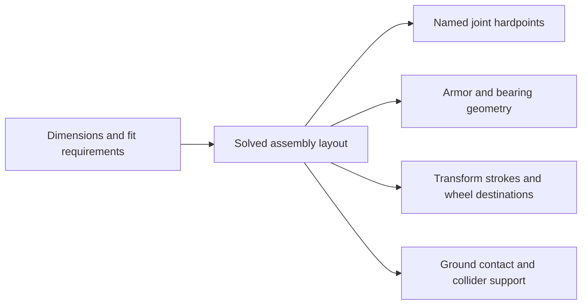

# Game 3D template guide

Details behind the skeleton index in [`../README.md`](../README.md). Open the section you need;
each feature folder is described once here.

## What each folder demonstrates

The feature folders `assets/player/`, `assets/camera/` and `assets/ui/`
can each be deleted as a whole; then remove their GUID references as the table below lists.

| Path | Demonstrates | Delete it with |
|:--|:--|:--|
| `assets/game.pack.ts`, `physics.pack.json` | Engine root: composes physics and the scene. `forge.json#roots.engine` holds the GUID of its `plugin/engine` output. Keep. | — |
| `assets/world/` | Scene instance: scene data + player + camera plugins, referenced by GUID. | Remove a feature's GUID line from its children list when you delete that feature. |
| `assets/scene.pack.ts` | Authored scene: ground, obstacles, sun (`DirectionalLight`), analytic `Atmosphere` sky, `Skylight` ambient, camera, player with static colliders. | Edit freely; removing an obstacle means removing its collider too. |
| `assets/player/` | Input sampling, fixed-step `moveAndSlide` movement, walk animation, the `game-3d.player` read projection, HUD state sent to the UI. Provides the `game3dPlayer` service. | Delete it; also remove its GUID from `world.pack.ts`. |
| `assets/player/character.pack.ts`, `shared/player-rig.ts` | Procedural skinned character: mesh, skeleton, skin, walk clip. The robot is a placeholder. | Reshape the mesh and materials into your game's hero; the skeleton and walk clip can stay. |
| `assets/camera/` | Pointer-lock third-person camera in the three.js style: an `eye` and a `look` point, each eased toward its goal, written with `setTransformLookAt`; snaps after `game3dPlayer.teleport`. Change the camera by changing how those two points move. | Delete it; also remove its GUID from `world.pack.ts`. |
| `assets/materials.pack.ts`, `shaders/rusted-iron.wgsl` | Procedural materials and an import-first Surface shader. | Delete the shader and its material together. |
| `assets/geometry.pack.ts` | Minimal primitive meshes (ground, cube, ramp) for the static colliders. The one rich procedural mesh is the multi-submesh character. | Remove unused meshes and their scene entities. |
| `assets/ui/` | One UiAsset (`guide.ui.html/css`). Engine→UI: `player-hud.ts` shows state posted over `GameHost.port`. Touch: `player-controls.ts` posts virtual stick/button intent, HUD hidden on touch. The screen-centre crosshair is off by default; set `crosshair: true` in the `plugin/host` config of `ui.pack.ts` to show it while the pointer is locked. `forge.json#roots.frontend` holds the GUID of its `plugin/host` output. | Delete it; also remove `roots.frontend` from `forge.json`. |
| `assets/shared/` | What features share without importing each other: package ids and GUID helpers, port channel names and message types (`player-protocol.ts`), the `game3dPlayer` service type (input, look angles, `teleport` / `onTeleport`), the player rig and third-person math. | Shrink as features go. |
| `*/__tests__/` | A few key tests per feature; `assets/__tests__/plugin-fixture.ts` is the shared fake. | Deleted with the feature. |
| `scripts/` | `playthrough.mjs` (`project play` journey; PlayContext API in `skills/forgeax-engine-sdk/references/api/play.md`). | Edit for your game. |

Feature folders import only `shared/` and their own files, so each one can be deleted on its
own and the project still typechecks. Features talk through port messages and named services;
the root packs reference feature plugins by GUID. After deleting, remove the GUID references
listed above, then run `pnpm exec forgeax project check --json` and `pnpm test`.

## Behavior Packs

`game.pack.ts` only composes the engine root. Each feature owns its namespace, configuration
and asset references; native Cordis owns every behavior's lifetime (clean up in `ctx.effect()`).
`build()` produces persistent definitions, `apply()` installs runtime contributions. `$asset`
references point at GUIDs derived from the owning pack and output key. To scaffold another one:

```sh
forgeax asset plugin create --path assets/combat/combat.pack.ts --json
```

## Execution and UI

`forge.json` puts gameplay and physics in the Engine realm and the guide UI in the browser
frontend realm. The Host mounts the UiAsset in `#game-ui`. Gameplay reads the
frozen input snapshot; `assets/camera/camera.pack.ts` is the pointer-lock reference.
Shared kernels need COOP/COEP in production; `forgeax project preview` provides them.

## Sky and lighting

The sky is the analytic `Atmosphere` component driven by the sun, the shadow-casting `DirectionalLight`;
no sky image is stored. It uses `backgroundOnly: true` so it runs on baseline WebGPU and WebGL2 devices;
remove that flag for aerial perspective on devices with 32 sampled textures per stage. A second `DirectionalLight` without `castShadow` is a cool, unshadowed light from the opposite
side; the sun is the first shadow-casting one. `Skylight` without an `equirect` uses the sky for ambient light, and its `groundColor`
turns that into a hemisphere ambient with a warm bounce from below. Colors are written as sRGB
hex through `color.linearRgb(0x…)` (pack `parameters` defaults stay literal linear
`[r, g, b]`, since View rewrites them in place); the camera uses ACES with `exposure` 0.95. Tune the
sun's `sunColor`/`sunIntensity` in View under **Parameters → Runtime** on `scene.pack.ts`. The
sun caps `shadowDistance` at 56 m for the 28 m showcase; tune it to your own level size.

## Import-first Surface material example

[`assets/shaders/rusted-iron.wgsl`](../assets/shaders/rusted-iron.wgsl) declares
`game_3d::rusted_iron_surface` and implements only `evaluate_surface(SurfaceInput) -> SurfaceData`.
[`assets/materials.pack.ts`](../assets/materials.pack.ts) calls `Materials.standard({ surfaceModule, parameters })`:
`surfaceModule` names the imported module and `parameters` is its root parameter contract; the
material values then fill those parameters.

## Procedural character

Convoy uses the native modeling toolchain at build time. Its twin-window chest is the truck cab;
the head retracts, arms fold behind the cab, legs rotate into the chassis and six tires slide onto
three axles. The same low-poly mesh and rigid skin appear throughout the reversible transformation.
Press <kbd>T</kbd> to transform. In truck mode, <kbd>W</kbd>/<kbd>S</kbd> control forward/reverse throttle and <kbd>A</kbd>/<kbd>D</kbd> steer; releasing throttle brakes. Wheel rotation follows the driving speed. Touch users can
tap **Transform**. Jump is available in robot mode.

| Author source | Responsibility |
|:--|:--|
| `assets/shared/convoy-layout.ts` | Physical dimensions, manufacturing clearances, solved hardpoints, panel spans, telescope engagement and vehicle destinations |
| `assets/player/convoy-model.ts` | Shared low/high part recipe: boxes, bevels, tapered armor, panel lines, linear grilles, radial tire tread and rigid rig export |
| `assets/player/convoy-frame.ts` | Load-bearing axles, nested bearings, sliding tracks, spine, abdomen carriage and measured fit bands |
| `assets/shared/player-rig.ts` | One named joint hierarchy derives rest anchors, modeling motion rules, runtime bone order and animation paths |
| `assets/player/convoy-parts.ts` | Paired low/high part identity, rigid bindings and balanced frame assembly |
| `assets/player/character.pack.ts` | Stable mesh/skeleton/skin identities, walk clip and 512-2048 texel atlas resolution (default 1024) |
| `assets/player/modeling-build.pack.ts` | Standard Modeling asset-job cooker registered through `forge.json.roots.build` |
| `assets/player/convoy-job.ts` | One deferred asset set for geometry, rig, clips, materials and finished texture maps |
| `assets/player/convoy-surfaces.ts` | Authored material slots and explicit categorical finish IDs |
| `assets/player/convoy-finish.ts` | Cooked paint, roughness and clearcoat masks with delivery mips |
| `assets/player/player.ts` | Reversible animation clock, separate body/wheel masks, movement and read projection |
| `assets/player/player-input.ts` | Keyboard and touch transformation edges through the existing semantic control channel |

### Assembly constraints

`createConvoyLayout` authors wheel radius, cab width/depth/interior height and leg-guide
length. Bone lengths, material thicknesses, bearing sizes and running clearances describe
the construction. Joint anchors, armor boundaries, telescope strokes and contact heights
are derived from those relationships. Edit the primitive dimensions or a fit requirement;
the mesh, rig, motion and collision support consume the same solved layout.



| Physical relationship | Derived result |
|:--|:--|
| Tire diameter plus bridge clearance | Rear axle pitch, bridge length and both bearing bores |
| Guide endpoints and minimum engagement | Leg extension stroke; the foot-shell clearance also determines ankle height and shin length |
| Folded thigh, counter-rotating bogie and ground plane | Vehicle rear-axle destination, hip drop and two-stage track travel |
| Shoulder hardpoint and counter-rotating gimbals | Front wheel rest anchors that fold onto the same vehicle track and contact plane |
| Actual helmet envelope, packing clearance and cap underside | Roof aperture, head retraction and guide lengths that clear the stowed helmet |
| Floor, roof and window-frame inner boundaries | Cab panels, roof rails, windshield spans and abdomen docking stroke |

Plate roles explicitly select bearing bores and shoulder openings; dimensions do not
identify a part. Surface ornament, colors and local styling offsets remain authored.
Lightweight tests change all five primary dimensions independently. The default assembly
owns one adaptive full-motion interference scan and continuous floor checks. Taller-cab
and longer-guide regressions check actual geometry, connectivity, running fits and floor
clearance at rest, mid-fold and stowed, plus final forward kinematics. Template tests admit
at most two files concurrently, reuse models within a suite and bake a 128-pixel map fixture;
the normal project build separately validates the delivered 1K textures.

The automatic low-poly UV atlas covers the armor and wheels. Repeating mechanical hardware
uses separate brushed-metal and rubber microfinish tiles, preserving atlas space for visible panels.
The `bake-receiver` and `bake-detail` checkpoints expose the matching unique-atlas inputs. Each rigid part has a matching `bake:`
group on the high model, preventing neighboring moving parts from contaminating the projection.
The high model carries rounded chamfers, vent recesses, bolts and tread that are absent from the low.
The cab back bevel and bearing radius also bound the shared projection cage; wheels
keep their tighter group cages. Cold cooks use those known projection envelopes directly.
Frame members merge in balanced batches before joining the body, avoiding a full-body
rollback copy for every small rod and bearing while preserving the published asset bytes.
The bake and skinned export share weighted normals with explicit sharp edges and matching UV cuts.
The abdomen retracts on twin guides before the cab folds; the waist armor, belt and flexible guard
keep a continuous body volume in robot mode. Physical shell connectivity and the complete swept
path are checked separately from the final textured studio views. The leg-fold trajectory
keeps the feet, bogies and folding guards above the floor; the capsule support height follows
the wheel contact plane, with a 10 mm character-controller offset.

| Map | Runtime use |
|:--|:--|
| Tangent normal | High surface detail on the low mesh |
| Base color | Red/blue enamel, steel, rubber, glass and signal palette |
| ORMH | Green roughness and blue metallic channels drive Standard PBR; red stores AO and alpha stores height |
| AO | Occlusion reuses the identical ORMH red channel |
| Emissive | Cyan eyes/headlights and amber roof markers |
| Coat | Red clearcoat mask and green clearcoat roughness |
| Edge wear, position, cavity, material ID | Internal finish inputs; these auxiliary maps are excluded from runtime publication |

Only the low mesh, skeleton, clips and five skinned Standard material slots reach the renderer:
unique baked armor plus shared dark steel, bright steel, brass and rubber finishes. The high
geometry is a bake input. No runtime modeling import or external model/texture payload is needed.

The ordinary Modeling assets job builds the complete set once per parameter set. Its
bake receives the host compute cache; the Pack product cache stores the finished assets.
Explicit material-family IDs keep paint, bare metal, glass and rubber independent of
their display colors. The normal cook requests only the maps the finish consumes;
standalone AO and height are requested by the small diagnostic test instead.

The template tests retain closed surfaces, unit normals, a 24,000-triangle budget, rigid plate
lengths, bind consistency and the closed opposite-limb walk cycle. Additional tests sample the
continuous native transformation, check clip targets and rest rotations, and bake actual normals,
AO, height, material response and emission. `scripts/convoy-playthrough.mjs` exercises real keyboard
transformation, an intermediate pose, driving, reverse transformation and reload.

## Coordinate contract

Right-handed, `+Y` up; yaw `0` looks along `-Z`. WASD is projected onto the camera's horizontal
axes and the character turns toward the resolved movement. Pitch only aims the camera.
Rapier owns the final player position (`PhysicsWorld.moveAndSlide` in `FixedUpdate`); player positions
flow through collision; give every walkable or blocking mesh a static
`RigidBody` + `Collider`.
