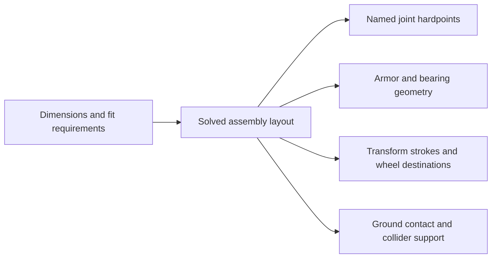

# Game 3D template guide

Details behind the skeleton index in [`../README.md`](../README.md). Open the section you need;
each feature folder is described once here.

## What each folder demonstrates

The feature folders `assets/player/`, `assets/camera/` and `assets/ui/`
can each be deleted as a whole; then remove their GUID references as the table below lists.

| Path | Demonstrates | Delete it with |
|:--|:--|:--|
| `assets/game.pack.ts`, `physics.pack.json` | Engine root: composes physics and the scene. `forge.json#roots.engine` holds the GUID of its `plugin/engine` output. Keep. | — |
| `assets/world/` | Scene instance: scene data + player + camera plugins, referenced by GUID. | Remove a feature's GUID line from its children list when you delete that feature. |
| `assets/scene.pack.ts` | Authored scene: ground, obstacles, sun (`DirectionalLight`), analytic `Atmosphere` sky, `Skylight` ambient, camera, player with static colliders. | Edit freely; removing an obstacle means removing its collider too. |
| `assets/player/` | Input sampling, fixed-step `moveAndSlide` movement, walk animation, the `game-3d.player` read projection, HUD state sent to the UI. Provides the `game3dPlayer` service. | Delete it; also remove its GUID from `world.pack.ts`. |
| `assets/player/character.pack.ts`, `shared/player-rig.ts` | Procedural skinned character: mesh, skeleton, skin, walk clip. The robot is a placeholder. | Reshape the mesh and materials into your game's hero; the skeleton and walk clip can stay. |
| `assets/camera/` | Pointer-lock third-person camera in the three.js style: an `eye` and a `look` point, each eased toward its goal, written with `setTransformLookAt`; snaps after `game3dPlayer.teleport`. Change the camera by changing how those two points move. | Delete it; also remove its GUID from `world.pack.ts`. |
| `assets/materials.pack.ts`, `shaders/` | GPU-generated paving texture with mipmaps and an anisotropic sampler; rusted iron uses an import-first Surface shader. | Delete each shader with its generator or material. |
| `assets/geometry.pack.ts` | Primitive meshes for the ground and rusted iron sphere directly ahead of the player, with matching static colliders. The character has multiple submeshes. | Remove unused meshes and their scene entities. |
| `assets/ui/` | One UiAsset (`guide.ui.html/css`). Engine→UI: `player-hud.ts` shows state posted over `GameHost.port`. Touch: `player-controls.ts` posts virtual stick/button intent, HUD hidden on touch. The screen-centre crosshair is off by default; set `crosshair: true` in the `plugin/host` config of `ui.pack.ts` to show it while the pointer is locked. `forge.json#roots.frontend` holds the GUID of its `plugin/host` output. | Delete it; also remove `roots.frontend` from `forge.json`. |
| `assets/shared/` | What features share without importing each other: package ids and GUID helpers, port channel names and message types (`player-protocol.ts`), the `game3dPlayer` service type (input, look angles, `teleport` / `onTeleport`), the player rig and third-person math. | Shrink as features go. |
| `scripts/` | `playthrough.mjs` (`project play` journey; PlayContext API in `skills/forgeax-engine-sdk/references/api/play.md`). | Edit for your game. |

Feature folders import only `shared/` and their own files, so each one can be deleted on its
own and the project still typechecks. Features talk through port messages and named services;
the root packs reference feature plugins by GUID. After deleting, remove the GUID references
listed above, then run `project check` and the adapted playthrough.

## Remove or hide starter content

| Intent | Edit in `assets/scene.pack.ts` |
|:--|:--|
| Remove the demo obstacle | Delete the complete `iron-sphere` entry and its `sphere-reflection` probe. The entry owns the mesh, rigid body and collider together. |
| Replace the floor | Replace the complete `ground` entry. Add collision to the surfaces the player should stand on. |
| Hide a mesh and keep collision | Add `Visibility: { state: VisibilityStateValue.hidden }` to the entity's components. Import `Visibility` and `VisibilityStateValue` from `@forgeax/engine/render` and add `Visibility` to `sceneComponents`. Keep the transform scale appropriate for the collider. |

Check that the new scene is visible, the replacement floor supports the player, and the space
cleared by a removed obstacle is traversable.

When switching to a first-person camera, hide `player-body` with the same
`Visibility` component and keep the controller on `player`. The skinned
body follows the joint world transforms. A zero scale on the mesh node does
not hide the body. Check the first completed frame and a mouse-look turn.

## Behavior Packs

`game.pack.ts` only composes the engine root. Each feature owns its namespace, configuration
and asset references; native Cordis owns every behavior's lifetime (clean up in `ctx.effect()`).
`build()` produces persistent definitions, `apply()` installs runtime contributions. `$asset`
references point at GUIDs derived from the owning pack and output key. To scaffold another one:

```sh
forgeax asset plugin create --path assets/combat/combat.pack.ts --json
```

## Execution and UI

`forge.json` puts gameplay and physics in the Engine realm and the guide UI in the browser
frontend realm. The Host mounts the UiAsset in `#game-ui`. Gameplay reads the
frozen input snapshot; `assets/camera/camera.pack.ts` is the pointer-lock reference.
Shared kernels need COOP/COEP in production; `forgeax project preview` provides them.

## Sky and lighting

The clear-day recipe uses one shadow-casting `DirectionalLight`, physical
`Atmosphere` and default `Skylight`, with a thin height medium. It has no sky image
or independent fill lights. The full aerial-perspective and solar-attenuation
paths remain enabled; half the default Mie scattering/absorption gives clearer
low-angle sky. Fog density is `0.00008` per metre, with the Engine's default height
falloff and atmosphere-driven source color.

| Owner | Authored choice | Purpose |
|:--|:--|:--|
| Ground | 2 km square with a matching static collider | Keep actual geometry beneath the horizon instead of hiding a small platform's void with dense fog |
| Ground Surface | Light warm stone, alternating 2 m checker cells; GPU-generated 512 px sRGB texture, full mip chain and 16x anisotropic repeat sampler | Preserve perspective detail at grazing angles and filter distant cells without a procedural distance fade |
| Sun | Slightly warm linear RGB `(1,0.95,0.87)`, intensity 12 lux | A creative showcase key within the current HDR working range; this is not a measured daylight calibration |
| Shadows | 56 m cascade distance | Spend near-field shadow resolution on the character and sphere |
| ReflectionProbe | 128 px, local to the sphere, on-change updates | Reflect the real lit ground into the metal rather than leaving its underside at sky-only black |
| Camera | ACES, FXAA, auto exposure, compensation 0, range `[-12,4]`, Bloom off | Preserve bright color and readable highlights without a glow wash |

Engine light APIs retain lux/candela meanings. The starter's creative intensity
is not a redefinition of those units. Raising it to real daylight values requires
checking HDR headroom, exposure limits and fallback together. `rangeEv` is log2
of the exposure multiplier, not Unreal's camera EV100.

The initial 12-degree orbit pitch, 6.5 m distance and 0.7 m target-height offset
are shared between scene bootstrap and the runtime follow camera in
`assets/shared/third-person.ts`. Mouse look still changes the orbit normally.
The iron sphere directly ahead of the player retains its radius-1 m static
collider. The local reflection probe has a one-work-per-frame renderer budget;
its initial filtered reflection appears after several completed submissions.

Tune `sunColor` / `sunIntensity` in View under **Parameters → Runtime** on
`scene.pack.ts`. In `materials.pack.ts`, `tileColor` / `tileContrast` belong to
`generator/paving`; `tileSize` controls the material UV repeat. `gpuTextureOutputs`
publishes `gpu-texture/paving/albedo` for the ordinary Standard material's
`baseColorTexture`. Build prepares `shaders/paving-texture.wgsl`; Renderer generates
the pixels and ten mip levels on the GPU. The sampler uses linear magnification,
minification and mip interpolation, repeat addressing and `maxAnisotropy: 16`.
The texture contains a seamless 2-by-2 cell repeat, with sRGB encoding and
linear-light mip averaging. No CPU pixel buffer or per-frame texture upload is needed.

## Import-first Surface material example

[`assets/shaders/rusted-iron.wgsl`](../assets/shaders/rusted-iron.wgsl) declares
`game_3d::rusted_iron_surface` and implements only `evaluate_surface(SurfaceInput) -> SurfaceData`.
[`assets/materials.pack.ts`](../assets/materials.pack.ts) calls `Materials.standard({ surfaceModule, parameters })`:
`surfaceModule` names the imported module and `parameters` is its root parameter contract; the
material values then fill those parameters.

## Procedural character

Convoy uses the native modeling toolchain at build time. Its twin-window chest is the truck cab;
the head retracts, arms fold behind the cab, legs rotate into the chassis and six tires slide onto
three axles. The same low-poly mesh and rigid skin appear throughout the reversible transformation.
Press <kbd>T</kbd> to transform. In truck mode, <kbd>W</kbd>/<kbd>S</kbd> control forward/reverse throttle and <kbd>A</kbd>/<kbd>D</kbd> steer; releasing throttle brakes. Wheel rotation follows the driving speed. Touch users can
tap **Transform**. Jump is available in robot mode.

| Author source | Responsibility |
|:--|:--|
| `assets/shared/convoy-layout.ts` | Physical dimensions, manufacturing clearances, solved hardpoints, panel spans, telescope engagement and vehicle destinations |
| `assets/player/convoy-model.ts` | Shared low/high part recipe: boxes, bevels, tapered armor, panel lines, linear grilles, radial tire tread and rigid rig export |
| `assets/player/convoy-frame.ts` | Load-bearing axles, nested bearings, sliding tracks, spine, abdomen carriage and measured fit bands |
| `assets/shared/player-rig.ts` | One named joint hierarchy derives rest anchors, modeling motion rules, runtime bone order and animation paths |
| `assets/player/convoy-parts.ts` | Paired low/high part identity, rigid bindings and balanced frame assembly |
| `assets/player/character.pack.ts` | Stable mesh/skeleton/skin identities, walk clip and 512-2048 texel atlas resolution (default 1024) |
| `assets/player/modeling-build.pack.ts` | Standard Modeling asset-job cooker registered through `forge.json.roots.build` |
| `assets/player/convoy-job.ts` | One deferred asset set for geometry, rig, clips, materials and finished texture maps |
| `assets/player/convoy-surfaces.ts` | Authored material slots and explicit categorical finish IDs |
| `assets/player/convoy-finish.ts` | Cooked paint, roughness and clearcoat masks with delivery mips |
| `assets/player/player.ts` | Reversible animation clock, separate body/wheel masks, movement and read projection |
| `assets/player/player-input.ts` | Keyboard and touch transformation edges through the existing semantic control channel |

### Assembly constraints

`createConvoyLayout` authors wheel radius, cab width/depth/interior height and leg-guide
length. Bone lengths, material thicknesses, bearing sizes and running clearances describe
the construction. Joint anchors, armor boundaries, telescope strokes and contact heights
are derived from those relationships. Edit the primitive dimensions or a fit requirement;
the mesh, rig, motion and collision support consume the same solved layout.



| Physical relationship | Derived result |
|:--|:--|
| Tire diameter plus bridge clearance | Rear axle pitch, bridge length and both bearing bores |
| Guide endpoints and minimum engagement | Leg extension stroke; the foot-shell clearance also determines ankle height and shin length |
| Folded thigh, counter-rotating bogie and ground plane | Vehicle rear-axle destination, hip drop and two-stage track travel |
| Shoulder hardpoint and counter-rotating gimbals | Front wheel rest anchors that fold onto the same vehicle track and contact plane |
| Actual helmet envelope, packing clearance and cap underside | Roof aperture, head retraction and guide lengths that clear the stowed helmet |
| Floor, roof and window-frame inner boundaries | Cab panels, roof rails, windshield spans and abdomen docking stroke |

Plate roles explicitly select bearing bores and shoulder openings; dimensions do not
identify a part. Surface ornament, colors and local styling offsets remain authored.
The default assembly runs an adaptive full-motion interference scan and continuous floor checks.
If you change the assembly dimensions, inspect geometry, clearance and fit at rest, mid-fold and
stowed. The normal project build bakes the delivered 1K textures.

The automatic low-poly UV atlas covers the armor and wheels. Repeating mechanical hardware
uses separate brushed-metal and rubber microfinish tiles, preserving atlas space for visible panels.
The `bake-receiver` and `bake-detail` checkpoints expose the matching unique-atlas inputs. Each rigid part has a matching `bake:`
group on the high model, preventing neighboring moving parts from contaminating the projection.
The high model carries rounded chamfers, vent recesses, bolts and tread that are absent from the low.
The cab back bevel and bearing radius also bound the shared projection cage; wheels
keep their tighter group cages. Cold cooks use those known projection envelopes directly.
Frame members merge in balanced batches before joining the body, avoiding a full-body
rollback copy for every small rod and bearing while preserving the published asset bytes.
The bake and skinned export share weighted normals with explicit sharp edges and matching UV cuts.
The abdomen retracts on twin guides before the cab folds; the waist armor, belt and flexible guard
keep a continuous body volume in robot mode. Physical shell connectivity and the complete swept
path are checked separately from the final textured studio views. The leg-fold trajectory
keeps the feet, bogies and folding guards above the floor; the capsule support height follows
the wheel contact plane, with a 10 mm character-controller offset.

| Map | Runtime use |
|:--|:--|
| Tangent normal | High surface detail on the low mesh |
| Base color | Red/blue enamel, steel, rubber, glass and signal palette |
| ORMH | Green roughness and blue metallic channels drive Standard PBR; red stores AO and alpha stores height |
| AO | Occlusion reuses the identical ORMH red channel |
| Emissive | Cyan eyes/headlights and amber roof markers |
| Coat | Red clearcoat mask and green clearcoat roughness |
| Edge wear, position, cavity, material ID | Internal finish inputs; these auxiliary maps are excluded from runtime publication |

Only the low mesh, skeleton, clips and five skinned Standard material slots reach the renderer:
unique baked armor plus shared dark steel, bright steel, brass and rubber finishes. The high
geometry is a bake input. No runtime modeling import or external model/texture payload is needed.

The ordinary Modeling assets job builds the complete set once per parameter set. Its
bake receives the host compute cache; the Pack product cache stores the finished assets.
Explicit material-family IDs keep paint, bare metal, glass and rubber independent of
their display colors. The normal cook requests only the maps the finish consumes;
request standalone AO and height only when diagnosing those outputs.

`scripts/convoy-playthrough.mjs` exercises real keyboard transformation, an intermediate pose,
driving, reverse transformation and reload.

## Coordinate contract

Right-handed, `+Y` up; yaw `0` looks along `-Z`. WASD is projected onto the camera's horizontal
axes and the character turns toward the resolved movement. Pitch only aims the camera.
Rapier owns the final player position (`PhysicsWorld.moveAndSlide` in `FixedUpdate`); player positions
flow through collision; give every walkable or blocking mesh a static
`RigidBody` + `Collider`.
