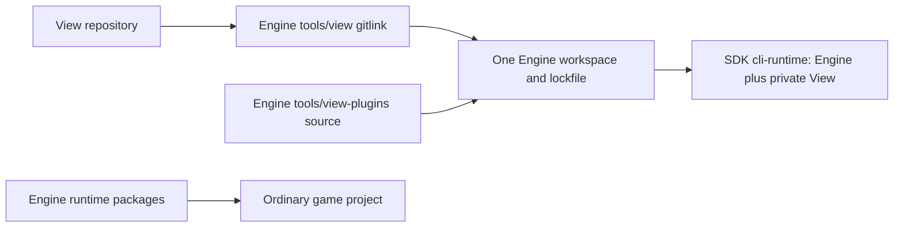

# ForgeaX View

View is an optional asset viewer and project workspace and read-only observer of Engine AI runs.
The CLI and frontend are clients of Engine APIs. The Engine service owns runs,
project facts, assets, scenes, observation, capture, and termination; View owns
window resources, tab bindings, and presentation.

## Pack parameters

Select a Pack in Content Browser, enable its Details panel and open Parameters.
Generation inputs wait for **Generate**; runtime inputs preview immediately.
Only nonempty parameter groups are shown; a runtime-only Pack does not show a
generation prompt. **Rebuild source** remains available for TS Packs without
generation inputs when you change their build code.
**Save** writes the original source without generating a draft preview. The panel
shows **Saving…** until Engine has published the saved source, then **Saved**.
TS values stay in their
parameter descriptor's `default`, JSON fields stay in JSON, and existing Pack
instances retain their `values` overrides.

Bound Inspector fields share the same Engine draft, undo history and Save.
For a TS field controlled by code, **Expose** adds the exact project and preview,
source revision, reflected field schema, current value and resolved binding path
to the conversation draft. The reference includes the same Engine's
`asset.inspect` parameter check and the minimal declaration-editing recipe.
Unresolved nested fields request source/override resolution instead of inventing
a binding. **Add parameter with Agent** also remains available when declaration
parsing fails, carrying that failure with the source context.
Nothing is submitted automatically. Source conflicts preserve local edits.
See the authoring design.

## Start here

Agent guidance: [forgeax-view-start](skills/forgeax-view-start/SKILL.md).

### Published npm SDK

For a game created with the published SDK, use the
[npm startup workflow](skills/forgeax-view-start/SKILL.md#published-npm-sdk).
Resolve View's `host.pack.json` from the SDK CLI runtime, then use that same
installed CLI and backend `--root` for `backend status/start`, `help view`,
`view status` and `view start --project`. The View commands come from the
selected Host Pack after backend readiness. Keep the backend's terminal session
alive until the returned URL is open and the requested project/assets are
visible. The skill supplies the exact commands, Windows path handling and
failure sequence; published packages need no local source build.

### Local Engine checkout

For a known game project using a local Engine checkout, one script prepares
the builds and services and returns the project URL as JSON:

```sh
node skills/forgeax-view-start/scripts/start-view.mjs \
  --project /absolute/path/to/game \
  --engine /absolute/path/to/forgeax-engine
```

Open its `url` in a browser to load the project. The script leaves the
browser, Play, and independent AI runs to their separate operations. See the
[skill](skills/forgeax-view-start/SKILL.md#local-engine-checkout-one-script) for
reuse, restart, and failure behavior.

### Service boundaries

> [!IMPORTANT]
> View requires an Engine backend started with `--host-pack` and a matching
> View package. Published npm packages include built outputs; a local checkout
> requires explicit builds. A running backend must be restarted to change its
> selected host Pack.

Select View's installed host Pack when starting Engine. The game project does
not need a View asset or a `forge.json.roots.host` change:

```sh
forgeax backend start --root /path/to/workspace \
  --host-pack /path/to/forgeax-view/host.pack.json --json
forgeax view start --root /path/to/workspace --project /path/to/game --json
```

The packaged `host.pack.json` identifies View's native plugin and its CLI
declarations. The Engine backend loads that Pack from the View package; the
game remains an ordinary project opened through the Engine workspace API.
Use a separate workspace root when the game already declares its own host root.
The selected host Pack is visible in `backend status`.

Start the backend, then enable View:

```sh
forgeax backend status --root /path/to/workspace --json
forgeax view start --root /path/to/workspace --json
# Override the project when it differs from the backend workspace.
forgeax view start --root /path/to/workspace --project /path/to/game --json
# Optional explicit allocation on an already-running View.
forgeax view project open --root /path/to/workspace --project /path/to/game --json
```

Open the `url` returned by `view start` in your browser. Explicit `--project`
wins; otherwise a backend root containing `forge.json` is included automatically.
The browser connects and opens that project without asking you to type its path.
`view project open`
allocates the project and returns its headed document as `projectTarget.url`;
open that URL, or leave an already-open empty shell to navigate there.
Only an unknown project requires the **Open project** dialog. Open a project before using
any View page, including Runtime capture. `backend start` and `view start` do
not open a project or run a game. These
commands do not launch Playwright or install Chromium. Repeat `view start` to
retrieve the URL of the existing interface.

| Step | What success means |
|:--|:--|
| `backend start` | Engine API and declared host plugins are available; no browser or renderer is required |
| `view start` | View is serving its interface on the existing Engine Host |
| Open the returned URL | The browser has loaded the Shell and connected its frontend plugins |
| Open a project | Engine has opened the chosen project; its rendering target has its own readiness and errors |
| Play or start an AI run | An explicit Engine execution target has started |

When the request includes a project path, opening the Shell is only an
intermediate state. Return the URL with that project intent, or run
`view project open` and open its headed URL; wait for
the project name, its directories, and an Engine target to appear. A final
screenshot that still shows `No project`, an empty path, or a disabled
**Open project** button does not prove that the project opened. A JSON result
that only contains `projectTarget.url` does not prove the headed page has
loaded. Scene preview
and Play are later, separate gates: open a scene asset to verify the hierarchy,
and select **Play** to verify the game target and rendered pixels.

### Use a local Engine checkout

Build the local repository explicitly, then bind the game to those outputs:

```sh
pnpm --dir /path/to/forgeax-engine build:engine
node /path/to/forgeax-engine/scripts/forgeax/prepare-shader-release-inputs.mjs --build --profile base-ssao
test -s /path/to/forgeax-engine/packages/vite-plugin-shader/dist/engine-inputs/base-ssao/manifest.json
test -s /path/to/forgeax-engine/packages/vite-plugin-shader/dist/engine-inputs/base-ssao/imports.json
cd /path/to/game
pnpm link /path/to/forgeax-engine/packages/engine
pnpm exec forgeax project engine use-local /path/to/forgeax-engine --json
pnpm exec forgeax project engine check --json
pnpm exec forgeax backend start --host-pack /path/to/forgeax-view/host.pack.json --json
pnpm exec forgeax view start --json
```

The explicit build and shader preparation happen before startup; the local
browser proof uses those prepared outputs. Prepare the matching `point-ssao`
profile instead when point shadows are enabled. Recheck the profile files after
rebuilding the shader package: without them, every new Backend falls back to
source compilation, which can take minutes. The package link selects the local
CLI and Node-side Pack dependencies; the
existing project binding selects local workspace exports for Engine's browser
host. The binding is stored in `.forgeax/engine-binding.json`. It must report
`mode: "local"`, the selected checkout, and a healthy build. No SDK archive or
candidate packing is required for this path. Rebuild affected Engine packages
after source changes; binding does not implicitly build Engine or rewrite its
exports to TypeScript source. Resolve `node_modules/@forgeax/engine` and confirm
that it belongs to the same checkout recorded by the binding. A healthy browser
binding cannot prevent Node-side Pack imports from using a different checkout;
that mismatch can add stale component defaults and make scene cooking fail.
Open the returned View URL, then choose the game
project explicitly. A running backend keeps its original Engine; apply a
binding change with explicit `backend stop` / `backend start`. Independent runs
retain their own input version and lifecycle.

A Pack initialization timeout occurs while loading its module and dependencies,
before asset generation. The loader transpiles reachable TypeScript helpers;
built Engine package exports remain JavaScript imports. The timeout alone does
not establish that the entire Engine was compiled. Preserve the original Pack
filename and diagnostic when investigating a different local binding.
Engine may load a PluginAsset through a compiled chunk. View resolves its static
UI from the selected View package's `@forgeax/view/plugin` entry instead of
using that chunk's URL. Game plugins execute in Engine's Worker; browser UI
belongs to frontend plugins.
Engine-owned generated binaries that the viewer bundles (for example the wgpu
WASM used by RHI inspection) are not copied into `dist/viewer`. The build keeps
their hashed URLs under `assets/engine/<package-dir>/<hash>/<file>`, and both View
servers read those bytes from `pkg/` of the exact-version Engine installation
(`view-workspace-core/viewer-static`). The browser's existing provenance check
still verifies the bytes.

### Observe an AI run

```sh
forgeax engine run start --root /path/to/game --json
forgeax engine run status --root /path/to/game --json
```

In View, select **Runtime capture** and choose the screenshot source:

| Source | Interaction |
|:--|:--|
| **Play** | Displays screenshots of this document's Play target. Start and interact with the game in Scene. Visible capture pages sample about once a second; hidden pages stop sampling. Stop preserves the last image until another Play or project is selected. |
| **Independent Engine run** | Select **View project run** to discover the open project's current Engine run and pin that exact identity. No project path or run ID needs typing. Cached Engine screenshots refresh at most once every five seconds. |

Screenshots show their capture time and frame number. Logs and runtime identities
are folded into details. A replacement run never silently replaces the observed
run; **Reconnect current run** explicitly discovers and pins the new identity.
The last accepted image remains marked after the old run ends. **Disconnect**
clears the binding and image without stopping the game.

API/CLI clients can still bind an independent project with exact `{root, runId}`.
Omitting `runId` in `view.display.bind` discovers the run once through
`engine.run.observe`; it does not start a run or follow replacements. Opening or
closing a project does not change an existing independent binding.

### Open a project

With View already started, allocate the project from the command line:

```sh
forgeax view project open --root /path/to/workspace --project /path/to/game --json
```

Then open the returned `projectTarget.url`. An empty shell that is already
connected navigates there when the snapshot gains that target. The required
dialog remains available: enter the **Project path** and select **Open project**. The
browser opens the Engine-generated workspace document. Scene and asset
previews use inline Engine surfaces; **Play** explicitly creates the isolated
game iframe. Hierarchy and Inspector operate on the selected Engine target.
The selected Play immediately requests the panel's measured device-pixel extent
through Engine `preview.resize` when attached, including during startup; Engine
waits for its native readiness before applying it. Repeated measurements share
the pending request, and later layout changes debounce. This preserves Retina
layout without leaving an initial resize behind capture and picking commands.
Detaching or hiding the panel cancels its resize requests while the same game
document continues running until Engine acknowledges cleanup.
Opening a project does not start an independent AI run.
In Content Browser, select a folder or asset and choose **Open**, double-click
it, or press **Enter**. A single click selects it for inspection. **Preparing
Play** means Engine is freezing the game's inputs; **Stop** can cancel this
preparation before a game target appears, or stop the target after it appears.
Stopping a matching Play immediately returns panel observations to the Scene;
its game document remains owned until Engine acknowledges cleanup. A failed
stop retains that Engine owner and reports the explicit failure.
Standalone `.html` project files open in a singleton HTML UI page. Its toolbar
sets phone, tablet or desktop CSS-pixel dimensions, orientation, fit/100% zoom
and refresh; the right panel shows the file and viewport details. The preview
uses an opaque-origin sandboxed iframe. Same-project relative stylesheets,
images, fonts and classic scripts are read through the project-scoped file
service; unsupported imports, blocked remote references and missing resources
are reported beside the preview. Module scripts and CSS `@import` are unsupported.
Engine `.ui.html` fragments use their sibling `.ui.css` inside a ShadowRoot,
matching the authored UI pair without running a game.
If project scanning fails, View remains available. Inspect the Engine source
diagnostic, repair that project, then select **Open project** again.

### Check status and stop

```sh
forgeax view status --root /path/to/workspace --json
forgeax backend status --root /path/to/workspace --json
forgeax view stop --root /path/to/workspace --json
forgeax backend stop --root /path/to/workspace --json
```

`view stop` disconnects the interface and releases View plugins; it preserves
the Engine backend and does not close your browser window. Closing a page loses
its actual Scene rendering targets, but not the backend or independent AI run.
`backend stop` releases the Engine workspace and its Host. Stop an independent
run separately with `forgeax engine run stop --root /path/to/game --json`.

After detaching frontend authority, resident View shutdown terminates its owned
WebSocket connections before joining server cleanup. A disappeared browser cannot
retain the backend by leaving a close handshake unanswered.

The API/CLI operations can be composed by a caller. No startup operation
implicitly runs the following steps on its behalf.

## Source integration and distribution

View retains its own repository and review boundary. Engine selects its exact source
at `tools/view` and owns the workspace lock, integrated build, SDK inventory and publisher.
The public npm products are `@forgeax/engine` and `@forgeax/engine-sdk`. The SDK
embeds View as a private local `@forgeax/view` package, using the same version as
its Engine dependency. Historical standalone `@forgeax/view` prerelease tags are
retired; do not use them to pair View with an Engine channel. Install the SDK
channel to receive its matching View tool. Games install `@forgeax/engine`; they
do not acquire a View dependency.



The SDK launcher resolves the selected tool's exported `host.pack.json` from its own
`.forgeax/cli-runtime`. Its install inputs live in `toolchain/cli-runtime`; game template
inputs remain independent. Resident and embedded entries use the same selected panels
and frontend plugins. A content-derived revision identifies that build.

| Concern | Owner |
|:--|:--|
| Generic shell, page/slot/panel services | View |
| RHI Debug and Profiler presentation | Engine ordinary `tools/view-plugins` source |
| World, Renderer, capture and model semantics | Existing Engine packages |
| Paired package versions, source expansion, offline store | Engine SDK pipeline |

Every page declares `context: 'project'` or `context: 'artifact'`. Artifact pages can
inspect saved captures before opening a project. Scene and asset pages retain project
recovery. Plugins use native Cordis ownership for registration, mounts and disposal.

## Development and verification

Initialize Engine's pinned View, then use its single workspace:

```sh
git submodule update --init tools/view
pnpm install --frozen-lockfile
pnpm build:engine
pnpm build:tools
pnpm --dir tools/view check:packages
pnpm --dir tools/view test:view
pnpm test:view -- --candidate
```

A dependency change requires an Engine lockfile change and paired review. There is no
View workspace/lockfile or independent release workflow. View CI selects an explicit
Engine candidate commit and overlays the proposed View source. Engine's required
`view-integration` lane tests the pinned consumer; `primary-pnpm` retains main ancestry
verification. A candidate pass does not authorize an unmerged final gitlink.

The workflow's `FORGEAX_ENGINE_COMMIT` is the paired Engine candidate authority.
The current pair includes Pack source drafts, live field bindings and source-error
recovery; View parameter tests must exercise those Engine capabilities.
CI checks Engine out at the workspace root and overlays View at `tools/view`, so
Engine's composite build actions resolve their nested actions and source paths.
Node and pnpm versions come from Engine's `.nvmrc` and `.pnpm-version`. Build and
browser lanes reuse Engine's `prepare-wgpu-wasm` and `prepare-rapier-wasm` actions
before building Engine. The wgpu action verifies the current source content key,
reuses valid local/cache/release bytes, and compiles the pinned source when that
artifact is unavailable. Its final provenance check remains required; an
unpublished candidate never falls back to an older WASM payload.
The diagnostic probe explicitly selects RHI Debug after refresh or service restart;
its sky oracle samples the outer margin clear of both Game 3D HUD cards, retaining
the blue/gradient assertions and real frame capture.
The separate Runtime Capture UI proof explicitly retains its qualified 1280x720
independent-run image under CI, including DOM/Shadow DOM pixels, reload and View loss.

Contributor Game 3D and runtime-content probes bind the actual Engine source root.
SDK npm/ZIP consumers separately run the installed View scripts, retaining JS/TS
live publication and cold reopening. SDK Project owns installed Game 3D build,
input and rendering; Engine/View integration owns its complete Play, cancellation
and View restart journey without repeating it in the installed View stages.
Source qualification cannot replace the retained independent package evidence.
The preparation-cancellation probe schedules Stop within the real Play click,
allowing the request microtask to run before cancelling its exact transport
request. This fixes the tested boundary before target adoption; the original
30-second cancellation bound and separate adopted-Stop cleanup checks remain.

The integration gate retains startup, page/plugin lifecycle, independent AI run and
ordinary game-3d browser probes. It also verifies diagnostic artifact pages in both
resident and embedded modes. Browser errors, missing target identity, incomplete frames
and GPU loss remain failures. Install the qualified browser separately and set
`FORGEAX_BROWSER_EXECUTABLE`; View startup does not install or launch a browser.

Inactive Dock pages stay mounted but leave browser layout through `hidden`.
The Engine's existing controlled-preview policy pauses its continuous frame
loop and retains the World, tools and renderer; explicit hidden capture still
uses that same App. Revealing the page restores layout and rendering. Independent
game and Play execution keep their own lifetimes and are not paused by View.

The Content Browser joins the Engine catalog with Pack's bounded source index
and a bounded project HTML file listing. Incomplete listings are visible.
Asset cards query `assets.thumbnails` in batches of at most 32 visible GUIDs.
Engine publishes `thumbnailEpoch` through `engine.workspace.state` when a result
changes; View relays that epoch in its page-scoped workspace state and refreshes
the visible batch. Catalog revisions retire ready image rows before replacement
queries, so a completion notification cannot cancel the query and retain an old
image. Image bytes stay in the Content Browser, outside workspace
snapshots and the catalog. Folder and source cards keep their own presentation.
`summary.get` is the bounded workspace query for external status readers:
it exposes project identity, phase, browser generation, revision and at most 16
target identities, with a `hasMoreTargets` flag. It does not serialize catalog
assets, resource opens or page selection. The full `tabs.get` snapshot remains
the View UI state contract.
`pages.list` separately returns at most 16 connected page IDs with their bounded
workspace summaries. `pack.reveal` is a public workspace operation: the same
project/source revision and optional page ID can be submitted through the API,
`forgeax view workspace call`, or another client adapter. Its result is a
visible-page receipt or an explicit non-action failure; no adapter owns reveal.
Zero-output and malformed Pack sources remain file cards with diagnostics, and
one-output Packs retain their source parent. Activating a Pack only expands it;
selecting a specific output opens the existing Engine preview route. Assets from
`.pack.ts` show their Catalog `sourceKey` when present; GUIDs remain their
operation identity. A page-scoped Pack reveal checks project/source revision,
targets one authenticated frontend connection, and accepts `shown` only after
the Scene, Content Browser Dock panel and Pack card are visible. Workspace
selection/open requests and Display run binding belong to that frontend
connection; disconnect retires its projection and pending reveal.
Reveal temporarily admits only the addressed Pack through the current filters.
Search and filter preferences stay intact; manual navigation cancels the focus.
Request cancellation and timeout retire the pending receipt and notify the exact
frontend to stop remaining asynchronous navigation. A late visible acknowledgment
cannot complete a cancelled request; an old cancellation cannot cancel a newer reveal.
The entry URL uses `view-frontend`; after a project opens, the full View shell
uses the exact `forgeax-workspace:<sessionId>:<targetId>` caller of the current
headed project target. Both are page sessions, while other Engine target callers
cannot claim the View page. Each fresh entry document opens its own Engine
session from the confirmed project intent; it does not copy another document's
headed target URL. Each target still owns one accepted browser caller. Refresh
retains that target and replaces only its browser generation. View selection,
resource opens and Display bindings belong to the exact frontend connection.
The Pack receipt rechecks the source revision and project at acknowledgment.

> [!NOTE]
> A page-less CLI client can still use page operations such as `tabs.get`,
> `scene.select`, and `asset.open` when exactly one View frontend is connected;
> the Broker directs those calls to that page's session. With multiple pages,
> these operations return `view-page-ambiguous` before changing page or Engine
> state. `summary.get` and Engine project facts remain shared reads.
> Use `pages.list` to choose an exact page, then `pack.reveal` to direct a
> revision-bound Pack navigation. Both operations have CLI entry points.

Hierarchy and Inspector use the optional live target tools
plugin, reporting capability errors when absent. `dev:ui` starts a private
fixture Host and serves the same Viewer code path as `dev`. Its catalog and
scene responses arrive through the Host workspace API. Use
`pnpm dev -- --view-host <http-origin>` to connect the development Viewer to an
existing compatible View Host. `--view-host` is the Host HTTP origin; Vite's
`--host` option only selects the development server's bind address. The
development server proxies the View bootstrap and health endpoints; workspace
data uses the Host WebSocket.
Material editing and runtime property writes are not implemented.

Every scene entity uses the same grouped read-only Inspector. Its bounded top
card shows the selected entity root and a one-level projection of functional
components returned by `entity.inspect`; mesh filter/renderer data share one
Static Mesh row. It does not show child entities or infer component attachment
edges. The Scene Tree remains responsible for parent/child navigation.
Component selection filters Inspector details without changing scene selection;
selecting the entity root restores the full groups. Common, Object, Rendering,
Physics, Animation, Media, Effects, Behavior and All remain available when
populated, with empty groups omitted.
Common displays the current entity's transform and primary capability. Ordinary
meshes retain only Transform, Static Mesh and Materials; scene instances show
Transform and Scene Instance. Local `Transform.quat` is displayed as XYZ degrees;
copied values and JSON retain the Engine quaternion XYZW. Schema-defined
collections retain Engine truncation/unavailability; their length never implies
a vector. Multi-selection displays its count and inspects only the primary.
The Inspector displays the references returned by Engine's existing entity
inspection. World-local handles remain handles; resource names and links require
an explicit GUID. Material overrides are shown separately from unavailable
declared-slot/default-material facts, so an empty override array never means
the mesh has no materials. All preserves the raw component fields. Resource links use the existing
independent asset pages and do not replace the Scene surface or control runs.

Scene Tree entities offer **Browse to Asset** and **Edit Asset** for direct asset
references. Native Engine `entity.inspect` resolves held resources to Registry
identities, including effective material slots, through the existing exact-target
inspection contract. It writes no entity data and requires no View runtime Pack
or query plugin. A unique primary is
available directly; without one, the shortcuts stay disabled and direct users
to exact Inspector reference fields. Scene Tree has no Related Assets submenu.
Asset names are read-only; separate folder and external-link buttons browse to
the asset or open its asset viewer. Unsupported reference controls stay visible
but disabled, and multi-selection continues to address the primary entity.

Dedicated pages consume the exact owner and asset binding returned by Engine and reuse their admitted live preview when the same asset is opened again. Concurrent opens of that asset share one request. New resources show loading progress immediately; a failed open retains the prior successful binding. Switching resource pages preserves their targets. Replacing a resource or closing its page detaches the borrowed surface and awaits cleanup of only its exact preview; cleanup failure keeps the page and error visible and permits retry. Absent optional display or statistics capabilities stay unavailable. Other registered assets open generic
read-only details without creating a hidden preview; resource tabs use asset
names. Builtins, uncatalogued resources and stale references remain unavailable.
Before reuse, asset pages compare the current `source.publication` returned by
Engine inspection. Runtime inspection facts and a preview's adopted binding
remain distinct from that Catalog source tuple; reopening never reloads a live
runtime asset implicitly.
The frontend service stays resident across panel/selection/tab changes and
cancels obsolete reads when its Scene binding retires. Runtime Content has no
internal query Pack to hide or remove from saved content. New-page
menus keep their registered type labels while open tabs show asset names. Play
and independent AI runs retain their existing ownership. See the
design and verification boundaries.

Content Browser shows only authored source directories from the Engine project's
`assetRoots`, resolved from `forge.json` (default `["assets"]`). Generated files,
external catalog sources and standalone files outside those roots remain absent
from the directory tree, cards, searches and source navigation. Empty configured
roots remain visible. Runtime catalog identities remain complete for inspection
and asset viewers; the browser does not redefine the Engine catalog.

Content Browser settings expose the optional **Runtime asset tools** panel.
The ordinary asset browser keeps this panel closed and its details pane off by
default. Runtime asset tools consume Engine's optional
`engine.runtime-pack.*` operations. The panel lists admitted generators, edits parameters,
creates or updates an identified instance, imports content/snapshots, and downloads
durable content JSON. Generated assets appear in the ordinary catalog and use the
existing dedicated previews. Its plugin controls install existing PluginAssets
and inspect/dispose only the current View connection's native installations.
Missing Engine support remains an explicit capability error.

Operations address `projectTarget` and its World, independently of the selected
preview or AI run. A project replacement resets drafts and aborts pending calls;
closing this panel does not withdraw saved definitions or game installations.
The displayed published generation describes producer output, not a claim that
every preview has switched its resource bindings.
Reopening an output selects the newly opened live preview. Other consumers retain
their acquired results. Mesh properties read the selected live preview's Engine
`assetBinding`: its publication generation/digest and the geometry counts, bounds
and material slots captured from that same payload. A project-level `asset.inspect`
supplies facts when no consumer binding is available. View does not derive binding
facts from source parameters or the producer's current generation.

`node scripts/verify-runtime-content-ui.mjs` exercises the actual Chromium UI
against explicit fixture responses, including save/import, failed generation
with an older successful result, plugin controls and replacement cancellation.
Set `FORGEAX_BROWSER_EXECUTABLE` to an installed browser when necessary. These
UI checks do not replace real Engine execution, rendered previews or SDK evidence.

## Browser proof workload

`FORGEAX_BROWSER_CI_LIGHTWEIGHT=1` selects the shared test workload in
`scripts/browser-proof-workload.mjs`. The combined plugin-boundary probe also uses
its 1000x700 CI viewport (1440x900 for full diagnostics), lowering the actual
Mesh/Material panel render extents. All ten Play cycles, inline preview
fresh-frame capture, panel sizing checks and original deadlines remain. It changes only disposable project copies
and repeated sampling. SDK/template inputs remain immutable.

| Work | CI | Ordinary diagnostic |
|:--|:--|:--|
| Runtime scene window | 60 completed frames | 300 completed frames |
| Dedicated preview open/capture/close | 2 complete cycles | 6 complete cycles |
| Browser viewport | 1000x700 | Runtime 1440x1000; Game 3D 1440x900 |
| Game 3D directional shadow map | 256, three authored cascades | Authored template: 1024, three cascades |

Game 3D changes only the directional shadow map on its disposable project copy.
It reads the public template directly, without importing contributor-only Engine
scripts. All three authored cascades, local lights, geometry, entity identities,
shader programs and material slots stay intact. An unexpected authored shadow
size fails before browser startup instead of silently changing the workload.

Both JS and TS retain live admission and saved-source cold reopening. Every
preview cycle creates one observed GPU device, renders real geometry, closes it,
and verifies all of its buffers/textures stay released through later cycles.
Pixel bounds, geometry aspect, exact publication bindings, Play controls,
independent lifecycle assertions, and all existing deadlines remain unchanged.
Evidence records the selected workload. Paired CI derives the complete Engine
consumer roster and partitions it across at most four shards.

Inline asset probes admit the exact canvas's first completed `ready` frame inside
their existing panel-extent wait before requesting a fresh capture. Layout and
completed warming frames keep that wait pending. The capture's ten-second bound,
natural panel dimensions, pixels and target identity checks remain unchanged.

## Lifecycle and operation ownership

The resident Node process contains a BackendHost. It loads the Engine domain
plugin first, then the optional View PluginAsset and its native backend children.
The browser FrontendHost activates View's projected frontend root and its
Shell/panel children. UI-only plugins have no
backend/API/CLI stubs. The viewport presents the Engine preview; the content
browser only mounts its resource UI. AI Display presents cached status, logs and
recent images from an independent Engine run; it contains no execution iframe.

| Action | Result |
|:--|:--|
| Disable a View panel or dispose its native Fiber | Engine domain tools remain callable; independent AI execution is unchanged |
| Close the View browser | Its Scene target is lost; the independent AI run continues |
| Finish a CLI call | The resident backend and Engine live owner remain running |
| Stop View explicitly | Dispose View plugins and connections; Engine backend, AI runs and caller-owned browsers survive |

`view.*` domain operations are thin aliases of Engine ToolApi handlers. UI
selection never resolves a business target. Pass `targetId` and
`targetGeneration` (from `preview.target.generation`) for preview/camera calls.
Engine alone owns camera versions, conflicts, idempotency and disconnect rollback.
View observation uses only `engine.run.observe`. Frontend callers cannot control
independent runs; the Engine plugin enforces that permission boundary. Use Engine CLI directly to control independent runs:

```sh
forgeax engine run start --root /path/to/game --json
forgeax engine run status --root /path/to/game --json
forgeax engine run capture --root /path/to/game --revision RUN_REVISION --require-ui --json
forgeax engine run stop --root /path/to/game --json
```

Engine snapshots source, assets, configuration and resolved dependencies before
starting its private browser, headless by default. Scene edits do not update
that run. Stop/start selects a new input version; reload keeps the current
snapshot. View tabs, focus, dimensions and lifecycle cannot alter execution.
Observation displays capture time and stale images explicitly; output is bounded
and shared per run, with no screenshot loop per viewer.
After closing a browser, reopen the returned View URL. Its project intent opens
the same project directly. A healthy Scene refresh retains Engine's project,
session and target while the workspace reports restoration. Engine retires the
old browser's resource previews and Play through their actual cleanup owners,
then admits the authenticated replacement browser and advances
`browserGeneration`. View restores the exact borrowed canvas before its Dock
container disappears and never recreates a retiring Play in the new document.
The original Play iframe remains available until cleanup acknowledges completion.

The new browser starts without historical resource tabs, selection, camera,
dock layout or Play. Saved project files and theme/language preferences remain;
save authored changes before refreshing. Known terminal failures use the
resident API's guarded exact-target recovery and remain visible on failure.
Neither refresh nor recovery replays editing writes, input or Play. Conflicts
and genuine service failures remain visible with explicit retry. Independent
AI runs keep their separate execution owners.

### Scene navigation

| Input | Action |
|:--|:--|
| Left click | Select the object in the submitted display frame |
| Right drag; right + WASD/QE | Look; move along camera axes / world up and down |
| Right + wheel | Adjust flight speed |
| Wheel; middle drag | Dolly (orthographic zoom); pan |
| Alt + left / middle / right drag | Orbit / pan / dolly |
| F | Focus the selected object's bounds |
| Escape, focus loss, hidden page | Release input and keep the current camera pose |

Pointer lock is optional; pointer capture remains available when the browser
denies it. Text fields and panel controls do not start viewport navigation.
View owns these bindings, sensitivity, flight-speed preferences and pitch limits.
It sends semantic velocity, angle and displacement requests; Engine executes
them on the actual target and owns camera transactions and the orbit pivot.
Cancelling a transaction restores the complete camera, including lens and pivot.

## Explicit borrowed-carrier library contract

This optional library seam is separate from the default independent AI path.

| Request | Result |
|:--|:--|
| `headless=true` | Existing headless path; do not contact View |
| Headed, with an injected open, compatible, idle View | Use the same View page for display and capture |
| Headed, with View unavailable | Existing headed browser path, with the actual carrier and reason reported |

View uses an ordinary browser and page. It has no Electron dependency or
desktop launcher. Selection happens when a run starts. Engine must not start
another browser/window for the borrowed path or load a second copy of the game.
Releasing a run must not close the user's browser.

Engine's public `BrowserCarrierAdapter` supplies the execution seam: select a
target, attach its exact owner `Page` plus execution realm, then release the
run's lease. A View lease uses one child `Frame`; the owner Page remains stable
and is used only for the exact outer-surface presentation envelope.
`startView({ platform: createBrowserPagePlatform({ page }) })` is the in-process
owner path. `page` is the already-open browser Page; Engine receives it through
`view.carrier`, and releasing a lease only removes View's occupancy. The
connection does not select CDP, a debugger port, or another transport. When an
embedding application already owns the compatible Engine hosts, pass them as
`backendHost` and `frontendHost`; View then borrows those lifecycles and does
not dispose them.

## Current integration

The modules in `src/` provide admission, identity, cancellation, a native
Engine Host plugin, a browser-safe frontend mount, and the browser-neutral
owner-Page/execution-Frame carrier seam.
`startView()` starts an observer Host without a display carrier. Supplying
`platform` explicitly selects the borrowed-carrier library seam. No default
platform opens a window. In that explicit seam, the Engine carrier owns
execution and View owns the lease and presentation boundary. The
authenticated endpoint carries lease metadata only; it never serializes a Page,
Frame, debugger endpoint, or cleanup callback. A process-local Engine
attachment must provide the explicit owner Page, execution realm, and close
handle contract.

The backend and frontend are real Engine/Cordis Plugins. The project's host
PluginAsset mounts the View native plugin; View mounts its backend children
in the same BackendHost. `HostAssembly` v2 carries one View frontend root,
and the browser FrontendHost activates that root and its native children.
Neither path launches a browser or owns
Engine project state. Only explicit borrowed-carrier consumers pass `view.carrier` to Engine's
`BrowserCarrierAdapter` seam.

For explicit borrowed-carrier consumers, the two target surfaces remain distinct: a workspace target URL
may be loaded by the one workspace iframe, while a CLI display target is
presented by the exact iframe allocated by `BrowserPagePlatform`. The browser
frontend uses `createBrowserPagePresentation()` to find that iframe by its
lease/generation/surface identity and never reparents or removes it. If the
exact surface is absent or mismatched, presentation fails closed rather than
creating a second App/World/renderer.

### Source organization

Product source under `src/` and `packages/*/src/` uses TypeScript: `.ts` for
logic and `.tsx` for JSX. Engine-owned View diagnostic plugins follow the same
rule. Shared wire and frontend contracts live in workspace-core; Engine domain
types come from their public owner through erased `import type` declarations.
Runtime dependency direction remains unchanged.

`pnpm check:packages` checks every product module with strict TypeScript,
including workspace-core and CLI/host entry points. Only erasable TypeScript
syntax is admitted so Node source tests can run without a second transpilation
path. Source tests use Engine's pinned Node version (`.nvmrc`); the published
package keeps its Node 22 runtime contract. Build scripts and Node tests remain `.mjs`; esbuild
emits executable `.mjs` files for the public package, and Vite emits browser
JavaScript. Consumers receive compiled code.

| Location | Responsibility |
|:--|:--|
| `src/` | Public package entry points, CLI clients, platform adapters and host construction |
| `src/plugins/` | Native backend/product composition; no page UI |
| `packages/viewer/src/host/` | Frontend connection, root resolution, page/slot infrastructure and panel bridge |
| `packages/viewer/src/plugins/` and `packages/viewer/src/shell/` | Shell plugin declaration and its React presentation |
| `packages/viewer/src/*catalog*.ts` | Static package composition; shared catalog metadata does not import frontend implementations |
| `packages/view-plugin-*/src/` | Feature-owned identities and native plugins; only implemented backend/API/CLI endpoints |
| `packages/view-plugin-*/src/ui/` | That feature's panels, DOM presentation and styles |
| `packages/view-workspace-core/` | React-free workspace contracts, clients, bindings and shared presentation helpers |
| `packages/view-components/` | Workspace-independent React primitives, tokens and Storybook |

Scene registration lives in `view-plugin-scene`; its viewport and connection-owned
Play presentation live in `view-plugin-viewport`. Runtime capture's frontend
lifecycle, status snapshot and DOM view live in `view-plugin-display` as
`frontend.ts`, `status.ts` and `ui/`. Moving source files does not change their
native plugin names or disposal owners. Existing public entry points,
including `@forgeax/view/pages/scene` and `@forgeax/view/workspace/presentation`,
continue to resolve to the same plugins.

Feature packages depend on exported workspace-core/components contracts, not
Viewer internals or sibling feature implementations. The Viewer composes them.
Scene Tree and Inspector import the dependency-free
`@forgeax/view-workspace-core/scene-entity-classification` export. This shared
projection has no imports, plugin activation or Engine execution ownership.
Keep metadata in `identity.ts` so backend catalog imports cannot pull in a
frontend implementation.

### Architecture gate

Run `pnpm check:architecture` before submitting a change. CI starts architecture
and the Engine build independently on the same pinned inputs. The build provides
the four required browser shards; the final `bootstrap` check always runs and
requires architecture, build and every browser shard to succeed. A failed, skipped,
cancelled or absent lane cannot produce a successful aggregate. Parallel scheduling
allows work to overlap when runner capacity is available; it does not guarantee a
queue time or total CI duration. No Engine checkout or browser is needed for the
static gate itself.

| Constraint | Automated evidence |
|:--|:--|
| Features use foundations and never Viewer or sibling implementations; Inspector and Scene Tree share workspace-core's pure classification export | Source/manifest dependency checks; explicit core subpath and dependency-free-helper counterexamples |
| Cross-package access uses declared public exports | AST import/re-export/type-import/CommonJS checks; relative-path, alias, symlink and private-subpath rejection |
| Core uses Engine Host/tool runtime contracts and erased public Engine App types; components are workspace/Engine-independent | Dependency checks, no React runtime or JSX/TSX/CSS source in core |
| Product source uses .ts/.tsx | Strict complete-source typecheck and JavaScript-source rejection (Node .test.mjs excluded) |
| Host infrastructure does not absorb Shell, panels or Engine domain implementations | Transitive runtime graph, including self-package and conditional exports; erased type edges retain direction checks |
| Shared Catalog metadata does not pull in implementations | Transitive identity/contract graph and an actual metadata bundle inspection |
| Root clients/platform do not implement features | Source graph with explicit public export, catalog and Host composition seams |
| Plugins remain optional and own cleanup | Existing operation-ownership, page-plugin and real-browser removal/restoration tests in the build/browser lanes |

`scripts/check-architecture.mjs` reports the file, rule and offending dependency
chain. It checks root `src/` and every package's `src/`, including unreferenced
files. Counterexample tests deliberately introduce violations; CI also exercises
all 125 success/failure/skipped/cancelled/missing aggregate-result combinations.
The existing panel bundle loader has one scoped computed-import exception;
another computed import requires a reviewed resolver policy, not an ignore comment.

> [!IMPORTANT]
> Static checks prove the declared source boundaries, not arbitrary business
> semantics or complete lifecycle correctness. They do not analyze generated
> code, arbitrary JavaScript loaders/eval, third-party internals or every possible
> bundler alias. Changes to resolvers, exports, guardrails or their exceptions
> require the same architectural review as a boundary change. There is no blanket
> violation baseline or per-file suppression mechanism.

For Host/core/bootstrap changes, the PR must identify the missing public seam,
why the existing plugin cannot own the change, the minimal domain-neutral
contract, its consuming plugin, and plugin-absent/removal evidence. Reviewers
must also inspect contribution ownership and disposal, new business branches,
and duplicated state. Functional success alone is not acceptance. Update the
owning Harness design and `AGENTS.md` when the runtime boundary changes; a new
rule or exemption needs a rejecting counterexample test.

Repository administrators must require `bootstrap` on `main` and configure
review/bypass policy separately. A workflow cannot enforce branch protection
against itself being changed or a direct push that bypasses checks.

### Page plugins and names

Scene assets open the `scene` page (`page-scene` in the Shell). Workspace
snapshots expose `scenePreview`, and `targetBinding` is `scene` or `play`.
Material, mesh, texture and other asset pages retain their own previews and
asset names. Shared form sizing uses `controlRowHeight`; asset panel styles use
`fx-asset-viewer`. Engine canvas input routes through `preview` or `game`.

Every page is an independent native frontend plugin and Cordis Fiber under
View's frontend root. Closing a tab only changes presentation.
Use `createViewProductPlan({ disabledPages: ['scene'] })` to omit a page
and its panels from that root. Page IDs are `scene`,
`display`, `plugins`, `material`, `mesh`, `texture` and `asset`. Scene panels depend on `viewScenePage`;
the plan omits the complete contribution when its page is disabled.
Backend workspace and inspection services remain available.
The same option is accepted by `startView({ disabledPages: ['scene'] })`.
The resident `@forgeax/view/plugin` also accepts `config.disabledPages`.

| Page | Frontend Plugin name | Owned UI |
|:--|:--|:--|
| Scene | `forgeax.view.page.scene.frontend` | Scene page registration and panel dependency |
| AI Display (Runtime capture) | `forgeax.view.page.ai-display.frontend` | Exact Engine display surface |
| Plugin Browser | `forgeax.view.page.plugin-browser.frontend` | Actual Host Fibers and activation states |
| Material | `forgeax.view.page.material.frontend` | Material preview and properties |
| Mesh | `forgeax.view.page.mesh.frontend` | Mesh preview and properties |
| Texture | `forgeax.view.page.texture.frontend` | Texture preview and properties |
| Asset | `forgeax.view.page.asset.frontend` | Fallback resource properties |
| HTML UI | `forgeax.view.page.html.frontend` | Standalone file preview and viewport settings |

Panel claims declare one home: a page (`pageType`) or the Shell bottom edge
drawer. Page homes require a `layout.dock`; Shell-bottom homes support only
`layout.order` because the Shell owns placement, sizing and tab stacking. The
Shell drawer starts as a 32px bottom tab strip and opens a panel flyout when
selected. A Shell-home panel may move into a page and keeps its claim and
mounted content there; closing that page returns it to the Shell bottom edge.
Page-home panels remain owned by their page. Unregistering the owning page type
also reconciles the surviving Shell claim and reattaches its existing mount
host after the page Dockview retires.
`presentation.get` reports placement from the live Dockview owner and location,
including the page ID/type or Shell bottom edge, grid, floating or popout
location.

Use `forgeax.view.<role>.<feature>.<side>` for native runtime names:
`page` for pages, `panel` for scene panels, `service` for API clients,
providers and target presentation, and `shell` for UI hosting. For example,
`panel.object-inspector.frontend` and `service.plugin-inspection.backend`
describe different responsibilities. Names are declared beside each plugin
(product packages use `identity.ts`). The Scene, Shell and Play presentation
plugins need no empty backend counterpart. All plugins use the same native Host
lifecycle.

The asset browser owns only its panel. The independent Play presentation
service owns connection-scoped browser resources; disabling Scene removes its
viewport placement without terminating Play. The viewport panel presents
Engine's exact workspace target. Plugin
Browser reads live Host facts; missing activation evidence stays `unknown`.

Open Plugin Browser from the navigation row's New page menu. The registered
Plugins page owns its panel and lifecycle; the frontend inspection reporter
only publishes Host facts and never mounts a second document-level UI.

Plugin Browser groups Fibers by their reported Host source, with backend
Fibers first. Host selection, text search and tags intersect; multiple tags
must all match. Counts describe the observed snapshot, not every possible Host.

| Filter | Evidence |
|:--|:--|
| Backend / Frontend | The reporting Host source kind |
| Game | A reported game/engine source, or an Engine Fiber declaring `world` / `gameHost` dependencies; the View frontend's Engine realm alone is not enough |
| API | Tool API operations attributed to the exact provider / Fiber |
| CLI | A command contract or command paths declared by those Tool API operations; not a running CLI process |

The shared workspace client uses `sources()` and `inspectPlugins()`; the
standalone inspector client's `inspect()` is also supported. Inspection and
watch `generation` arguments identify the source, not the transport service.
Remote source failures produce a partial-inventory notice while available
sources remain visible. Other frontend connections are not hidden when the
current frontend supplies its local snapshot.

> [!NOTE]
> Inspection covers only reported sources. A zero Game count does not establish
> that no game is running; independent game/worker Hosts without an inspection
> report are not fabricated or inferred from names.

After `pnpm build` with the matching Engine candidates, run
`xvfb-run -a node scripts/verify-engine-plugin-boundary.mjs`. Its page-plugin
probe exercises tab close/reopen, all seven page disable/restore paths,
service isolation, real backend inventory, Host/tag/search combinations, reset,
and narrow-screen layout inside the real Engine workspace. Screenshots are saved
under `artifacts/page-plugins/`.
For the focused page lifecycle probe without Play stress cycles, run
`xvfb-run -a node scripts/verify-page-plugin-lifecycle.mjs`.

### Operation history

Engine CLI and SDK command-client work is recorded even while View is closed.
The Operation history page reads the current project's receipts: operation,
time, outcome, arguments, result/failure and retained preview images. Select a
record to see what that command actually produced. Browsing history neither
replays the command nor starts a game. Runtime observation remains a separate
page with periodically refreshed output from a running instance.

The latest history page refreshes every two seconds while visible; older pages
remain stable. Images load individually on demand. Closing or hiding View stops
its reads without deleting Engine history or controlling an independent run.
The public `view.workspace.history.list/get/artifact.read` operations delegate
to Engine with the accepted project identity; no user-entered path or run ID is
needed. Engine also exposes these as `forgeax engine history ...` without View.
See the history design.

### Workspace CLI

To inspect the View the user is actually looking at, use:

```sh
forgeax view workspace presentation get --root /path/to/backend --input '{}' --json
```

The result includes the server-selected `connectionId`, that document's bounded
workspace summary, actual open pages and active page, active-page panels, Shell
mount/restoration state, and appearance. `tabs.get` instead describes the two
Scene/Display runtime bindings and their Engine resources. Presentation reads
do not serialize the asset catalog or wait for GPU readiness.

| Action | Public operation suffix | Input |
|:--|:--|:--|
| Open a registered page type | `presentation.page.open` | `{ "typeId": "mesh" }` |
| Activate a returned page | `presentation.page.select` | `{ "pageId": "page-mesh" }` |
| Close a closable page | `presentation.page.close` | `{ "pageId": "page-mesh" }` |
| Reveal a registered native panel | `presentation.panel.reveal` | `{ "panelId": "content-browser" }` |

These suffixes have the public `view.workspace.` prefix and derive CLI segments
under `forgeax view workspace`. Pass their JSON arguments through `--input`.
Use the IDs returned by the snapshot; titles are translated display text.
Resource pages include the native controller's exact asset GUID/kind or project
file identity; the Shell never infers these from tab titles or keeps a catalog.
Use `pages.list` to discover connected documents when more than one exists,
then include `connectionId` in presentation requests. A frontend may address
only itself. Missing or retired pages, cancellation, a three-second response
deadline and disposal fail explicitly. Already applied writes are never replayed.
Successful commands return committed Shell state. Panel facts distinguish native
mounting from actual visibility, including edge drawers and inactive pages.
All observation is on demand; the backend owns no second page/layout model.

Agent guidance: [forgeax-view-cli](skills/forgeax-view-cli/SKILL.md). The
resident workspace API is authoritative; the browser and CLI are its clients.

With a running View owner, Engine CLI can call a workspace operation through
the native ToolApi provider:

```sh
forgeax view workspace call --root /path/to/backend \
  --operation tabs.get --args '{}' --json
```

This command is declared by the selected View host Pack, so it appears while
that Pack's backend is running. View must be
started. The returned operation result comes from the resident View workspace
owner. The frontend's workspace transport now routes through the same ToolApi
provider. Browser presentation remains a separate completion check.

An independent process can call the same resident `view.*` API through the
authenticated Engine Host WebSocket. The CLI is deliberately a transport
client; it does not implement project, asset, scene, camera, or capture logic.

```sh
forgeax-view workspace --operation project.open \
  --endpoint "$FORGEAX_VIEW_WORKSPACE_ENDPOINT" \
  --token "$FORGEAX_VIEW_WORKSPACE_TOKEN" \
  --args '{"root":"/path/to/project","tabId":"forgeax-user-workspace"}'
```

The endpoint and token are explicit capabilities issued by the View owner (or
can be supplied with `FORGEAX_VIEW_WORKSPACE_ENDPOINT` and
`FORGEAX_VIEW_WORKSPACE_TOKEN`). The client uses the same operation names and
JSON argument shape as the browser frontend. This independent CLI path is for
the workspace API. Independent AI controls use `forgeax engine run`, whose
private browser does not depend on this connection.

Use `--batch '[{"operation":"camera.begin",...},{"operation":"camera.update",...},{"operation":"camera.commit",...}]'`
when a camera gesture must keep one authenticated client connection. A
single-operation invocation closes its connection after the Engine API reply.

Viewport clicks use View's `scene.pick` selection workflow with physical output
pixels (`x`, `y`) and the exact `targetId` / `targetGeneration`. It requests
triangle granularity from Engine's `target.pick`; direct calls keep bounds
granularity unless explicitly overridden. `scene.select`, `scene.pick` and
`scene.clear` share cancellation and target guards, so a late result cannot
replace a newer selection. An Engine that does not confirm triangle granularity
fails closed without changing the current selection. Query or highlight failures
preserve the last confirmed selection and use the ordinary workspace error
channel.

## Custom workspace embedding

The CLI startup path above already uses Engine's resident workspace provider.
For a custom embedding application, the library accepts an Engine-owned
workspace capability through the same Host transport:

```js
const view = await startView({ platform, workspaceEngine });
const api = await connectViewWorkspace({
  endpoint: view.workspaceEndpoint,
  clientId: 'forgeax-cli',
  token: view.workspaceAccessToken,
});

const tabId = 'forgeax-user-workspace';
const state = await api.openProject(projectRoot, { tabId });
const projectId = state.project.id;
const targetId = state.projectTarget.targetId;
const targetGeneration = state.projectTarget.generation;
const target = { projectId, tabId, targetId, targetGeneration };
const { assets } = await api.listAssets(projectId, target);
const scene = assets.find((asset) => asset.kind === 'scene');
if (scene) {
  await api.inspectAsset(scene.guid, target);
  await api.openAsset(scene.guid, target);
}
```

Authored-asset operations are projections of Engine CLI / ScriptablePack / ToolClient APIs. View does not parse `*.pack.ts`, write DDC, cook, or invent `applyParams`:

| View operation | Engine API | View owns |
|:--|:--|:--|
| `assets.list` | DevKit `assetList({ root })` / existing `listAssets` → `PackEntry[]` | session catalog snapshot, including optional `sourceKey` |
| `asset.inspect` | DevKit `assetInspect({ root, subject })` plus ScriptablePack `inspect(sourcePath)` / gateway `inspect-meta` | session inspection of PackEntry + `ScriptablePackMetaJson` |
| `asset.source.rebuild` | ScriptablePack `rebuild(sourcePath, 'rebuild')` / gateway `rebuild` / ToolClient `asset.source.rebuild` | forwarding + CAS `expectedRevision` |
| `asset.source.cold-cook` | ScriptablePack `rebuild(sourcePath, 'cold-cook')` / gateway `cold-cook` / ToolClient `asset.source.cold-cook` | forwarding + CAS `expectedRevision` |

Codex edits `pack.ts` through the workspace files. The browser shell places the `sourcePath`-grouped Engine catalog and exact viewport on the left, and a **read-only** Engine meta inspector on the right (`packageId`, `importer`, `subAssets`, `cookReceiptUrl`). `Rebuild` / `Cold-cook` only forward Engine cook. Selecting an already-previewed GUID inspects again and does not open a second preview surface. Missing Engine methods fail closed with `view-engine-capability-unavailable`. Engine revision conflicts surface as `pack-source-revision-conflict`.

In the already-open browser Page, load the browser entry and mount the View
frontend once. The returned `api` is the same API used by the independent CLI;
the returned `shell` owns only DOM presentation and input sampling.

```js
import { mountViewWorkspace } from '@forgeax/view/browser';

const mounted = await mountViewWorkspace({
  endpoint: view.workspaceEndpoint,
  token: view.workspaceAccessToken,
});
await mounted.api.openProject(projectRoot, { tabId: 'forgeax-user-workspace' });
```

`mountViewWorkspace()` must execute in the browser document that owns the View
window. It does not navigate the page, start a browser, or create a second
workspace runtime. For a custom host, `connectViewFrontend()` exposes the
underlying Engine `FrontendHost` while retaining the same plugin and transport.

`workspaceEngine` is the host-supplied Engine capability. View binds Engine's public commands and ports; it does not wrap a second cook implementation. A host should pass the same objects Engine already exposes:

```js
const workspaceEngine = {
  openProject,
  closeProject,
  listAssets: (input) => assetListCommand({ root: input.project.root }),
  assetInspect: (input) => assetInspectCommand({ root: input.root, subject: input.subject }),
  openPreview,
  pack: scriptablePackAuthoringPort, // inspect / preflight / rebuild
  tools: toolClient,                 // ToolClient.run('asset.source.rebuild' | 'asset.source.cold-cook')
};
const view = await startView({ platform, workspaceEngine });
```

Asset listing, SceneAsset preview, Engine-owned camera motion, capture, and close all remain on the headed Engine page. An independent CLI may use the authenticated `workspaceEndpoint` with the out-of-band access token; `connectViewWorkspace()` only creates a client and never starts another Engine target.

For another Engine host, `createEngineWorkspaceProvider()` remains the explicit
adapter boundary: its `openProjectSession` must return an Engine-owned,
long-lived project session and headed target. View does not invent a project
loader, copy App/World internals, or provide a mock target. The optional
`presentation.createSurface` plus `attach`/`detach` callbacks bind the exact
target surface (the Engine host may return its existing app-shell; View never
creates a renderer copy). `applyInput` passes semantic motion to the host-owned
camera executor. Selecting the CLI display tab changes presentation and input focus only;
it never changes the CLI target or execution. The browser entry installs
`createBrowserPagePresentation()` by default; a custom adapter is only needed
when the embedding Engine host supplies a different exact surface.

The workspace reports `view-engine-capability-unavailable` until the matching
Engine plugin is installed. It does not fall back to a mock scene, a second
game runtime, or an Electron page.

For an Engine project capture that owns the browser document Host, keep the
View frontend out of the bootstrap page and pass the backend binding to the
Engine capture surface:

```js
const view = await startView({ platform, frontend: false });
const session = await createBrowserCapture(projectRoot).open({
  headless: false,
  host: view.hostBinding,
  carrier: view.carrier,
  carrierRun: { serviceId: 'forgeax-cli', runId },
  carrierGeneration: 1,
});
```

The Engine host contribution then activates View's frontend root in the actual
runtime document. Detached live-dev and external
`serverUrl` paths remain out of scope until their server owner can carry the
same binding.

## Bootstrap

Use Node.js 22+, pnpm, Git, Python 3, and authenticated access to the private

```sh
pnpm harness:init
pnpm test
```

| Command / setting | Behavior |
|:--|:--|
| `pnpm harness:init` | Install local skills and initialize/verify Harness data |
| `pnpm install` | Attempt optional Harness synchronization through `postinstall` |
| `FORGEAX_SKIP_HARNESS_SYNC=1` | Skip optional synchronization |

Synchronization preserves dirty, divergent, and differently configured clones.
Harness data and machine-local installation state are not runtime dependencies.

## Design

- Architecture north star
- CLI-authoritative View design
- Engine Host/Plugin architecture design
- [Contributor instructions](AGENTS.md)

The first two documents belong to the independent

The integrated build revision includes the selected panels and frontend-plugin
entries, as well as their source closure. Native build metadata records a digest
of the finalized viewer bytes. Engine integration checks the actual bytes and
runs temporary served-only and native-entry mismatch falsifiers; matching
metadata alone is not sufficient build identity.

The required project dialog is modeless: Scene still requires a confirmed project,
while artifact pages and workspace navigation remain available before opening one.

## Public operation naming

Resource segments and actions retain the same order across API, CLI and MCP.
The View ToolApi ID `view.workspace.pack.reveal` is the CLI path
`forgeax view workspace pack reveal`; its relative workspace API operation is
`pack.reveal`. Read workspace facts with `summary.get` /
`forgeax view workspace summary get`. The authenticated backend CLI accepts
`--input` containing the ordinary operation arguments and uses the same owner
authorization. Frontend requests retain the versioned workspace envelope.
Engine-owned source operations use `asset.source.rebuild` and
`asset.source.cold-cook`; scene-tree queries use `scene.tree.get`.
CLI contribution metadata uses the actual operation ID without a second
`forgeax.` prefix or duplicate inspector namespace.

## Frontend platform producers

`@forgeax/engine-host/platform` owns `FrontendPlatform`: the frontend realm's document, fetch, authenticated Host connection, optional host navigation, clipboard and host appearance. Workspace browser navigation is explicitly imported from `@forgeax/view/workspace/document-navigation`; ordinary game platform namespaces do not contain it. This is distinct from the Engine's realm-neutral clocks/display primitives. `mountViewApplication` is the shared browser/embedded entry; product panels consume capabilities supplied by native Fibers. Browser behavior remains the default. An optional generic MCP Apps producer delivers isolated documents and bytes; the Codex producer adds only its supported conversation-draft capability. Source, design and evidence live in the unified platform contract.

Public `view.start` and `view.status` publish `presentationId`, derived from the current native frontend admission lease without exposing its credential. Healthy repeated starts retain it; a replacement changes it even at the same URL. Embedded transports use that identity to retire stale resource caches and documents before admitting a replacement.

The public `viewer/panels` bundle derives from the same selected `panelsEntry` as the browser build. Integrated frontend plugins and their panel exports therefore share one build input. Connection startup failures retain their full detail in the console while the header shows a short description.

Theme preferences are system (default), light and dark. System uses host appearance when provided, otherwise OS appearance. The navigation row carries brand, tabs and actions. Asset context menus expose conversation references only when the platform supports them; references use accepted asset/project facts and never submit the draft. Clipboard feedback reports success or failure. Hidden Scene Tree, Inspector and Play image observations stop active reads and resume when visible, retaining panel state and independent Engine ownership.

### Texture viewer

Open a Texture or Equirect asset from Content Browser. The viewer offers RGBA
channel switches (single-channel grayscale), real mip selection, nearest/linear
sampling, exposure, grayscale, checker/solid backgrounds, Fit, 100% and drag/wheel
navigation. Array textures expose layers; volume textures expose depth slices.
Environment images offer a panorama, directional environment, cube cross and
six individual faces. Equirect sources contain one mip; lighting prefilter mips
are not source image levels.

The UI and public `view.workspace.preview.texture.get/set` operations address
the exact Engine target/generation. Settings change that preview's display and
never rewrite the asset. Pixel generation stays on the Engine-owned surface.
