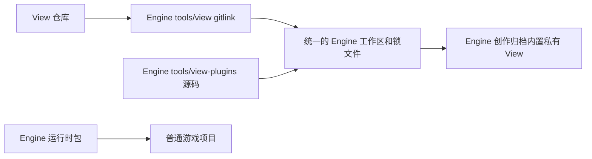

# ForgeaX View

[English](README.md) | 简体中文

View 是可选的资产查看器、项目工作区，也是 Engine AI 运行的只读观察端。
CLI 和前端都是 Engine API 的客户端。Engine 服务拥有运行、项目事实、资产、场景、观察、捕获和终止的控制权；View 负责窗口资源、标签页绑定和呈现。

## Pack 参数

在内容浏览器中选择 Pack，启用详情面板并打开参数页。
生成参数等待点击 **生成（Generate）** 后执行；运行时参数立即预览。
只显示非空参数组；仅含运行时参数的 Pack 不显示生成提示。
修改构建代码后，没有生成参数的 TS Pack 仍可使用 **重建源（Rebuild source）**。

**保存（Save）** 写入原始源文件，不生成草稿预览。面板保持 **保存中（Saving…）**，直到 Engine 发布保存后的源文件，再显示 **已保存（Saved）**。
TS 值保留在参数描述符的 `default` 中，JSON 字段保留在 JSON 中，已有 Pack 实例保留自己的 `values` 覆盖。

绑定的 Inspector 字段共享同一个 Engine 草稿、撤销历史和保存操作。
对于由代码控制的 TS 字段，**公开（Expose）** 将确切的项目、预览、源修订、反射字段 schema、当前值和解析后的绑定路径加入对话草稿。
引用包含同一 Engine 的 `asset.inspect` 参数检查，以及最小的声明编辑步骤。
无法解析的嵌套字段会请求解析源或覆盖关系，不会臆造绑定。
声明解析失败时，仍可使用 **通过 Agent 添加参数（Add parameter with Agent）**，并携带失败信息和源上下文。
不会自动提交任何内容。源冲突时保留本地编辑。
参见创作设计。

## 从这里开始

Agent 指引：[forgeax-view-start](skills/forgeax-view-start/SKILL.zh-CN.md)。

`pnpm test` 和 `pnpm test:view` 同时运行顶层测试，以及各包 `src/*.test.mjs` 和 `src/__tests__` 下由所属模块维护的回归测试。Engine 与 View 的配套 CI 使用相同入口。

### 打开工程

在游戏工程根目录运行 Engine 创作包的命令，然后打开返回的 URL。

```sh
forgeax project view --json
```

从已准备的贡献者检出启动时，可以直接运行 View 文件。

```sh
node /path/to/forgeax-engine/tools/view/start.mjs --project /path/to/game
```

Engine 安装提供配对的 View Host Pack 和已构建的界面。
源码贡献者的准备与原生宿主集成见[贡献者指南](skills/forgeax-view-start/CONTRIBUTOR.md)。

页面右下角显示宿主 Engine 包的实际版本，例如 `Engine 0.5.2`，准备连接和离线时也保留。View 自己的包版本和所选游戏不决定这个版本号。

源码文件启动时的初始 JSON 包含 `enginePackage`、`viewRoot`、`hostPack`、请求的 `project`、`url`、后端 `root` 和 `phase: preparing`。
这是启动公告，不是实时状态。`--help` 不启动服务；不加 `--json` 也会输出 JSON。
安装不完整时，在分配实例前报告缺失产物。

### 服务边界

入口文件在后端就绪前发布普通 URL，然后直接调用 Engine 公共 API `ensureDevKitView`。
使用页面时保持终端打开。Ctrl+C 关闭该呈现并取消当前启动调用；H 已有的进程管理器继续拥有后端。
后端终止后，呈现仍保留，可显式重新启动。

停止 View 会撤销前端租约，但 Engine 保留所选项目。
显式重启同一项目时，通过 Engine 的受保护准入恢复确切的丢失会话，并发布新目标。
其他终止性失败保持可见，不会自动接纳项目。

默认后端工作区 H 按规范化的 Engine/View 安装共享，位于系统临时目录，与 cwd 和项目 G 无关。
`--new-instance` 分配唯一临时 H；显式 `--root H` 优先。
后续实例控制应显式使用返回的 H。
省略 G 时，新 owner 保持未绑定，已有 owner 保留原项目。
离线 Shell 可启动后端，并可选传入 G。
已连接但未绑定的 Shell 提供已知/最近项目和浅层目录选择器；“下一步”会验证并打开选择。
已绑定的 Shell 在页头保留选择器，同时显示 Engine 会话准备与就绪状态。

DevKit 拥有位于 H、G 之外的持久目录。
`forgeax project list`、`project import --path G` 和 `project browse [--path D]` 使用同一 owner。
底层生命周期操作仍可独立使用：

```sh
forgeax backend status --root /path/to/backend --json
forgeax backend start --root /path/to/backend --host-pack /path/to/view/host.pack.json --json
forgeax view start --root /path/to/backend --project /path/to/game --json
forgeax view status --root /path/to/backend --json
```

底层 `view start` 要求兼容且正在运行的后端。显式 G 优先；否则将包含 `forge.json` 的 H 接纳为 G。此回退与文件入口启动相互独立。
普通 URL 连接采用 Engine 唯一共享的项目/会话；只有被选中的 presenter 会放置其确切文档。
显式 `?project=/path` 是可选切换命令，受当前会话/generation 保护。
刷新不会重放写入、选择、相机或 Play。

| 步骤 | 完成证据 |
|:--|:--|
| `start.mjs` 返回 | 独立 Shell 和启动器开始监听 |
| Ensure 完成 | Engine 后端和 View owner 可用；可选 G 已接纳 |
| 打开普通 URL | 保留的 Shell 可见，报告连接/项目进度 |
| 项目就绪 | Engine 的确切项目目标已就绪；检查请求的资产 |
| Play 或启动 AI 运行 | 单独请求的执行目标产生自身证据 |

URL 或分配回执不能证明浏览器或渲染验收通过。
必须在实际页面验证请求的项目身份、资产和确切目标。
项目失败时仍显示错误，Shell 和项目选择继续可用。
工作区 owner 在浏览器连接前就发布 Engine 项目状态变化。
嵌入测试先等待发布的文档，再等待 Engine 就绪标记，之后才使用认证目标；Shell 挂载不等于目标就绪。
已位于 Engine 目标内的嵌入 Shell 使用当前文档呈现；只有独立 Shell 创建项目文档 Frame。

### 使用本地 Engine 检出

显式构建本地仓库，再将游戏绑定到这些产物：

```sh
pnpm --dir /path/to/forgeax-engine build:engine
node /path/to/forgeax-engine/scripts/forgeax/prepare-shader-release-inputs.mjs --build --profile base-ssao
test -s /path/to/forgeax-engine/packages/vite-plugin-shader/dist/engine-inputs/base-ssao/manifest.json
test -s /path/to/forgeax-engine/packages/vite-plugin-shader/dist/engine-inputs/base-ssao/imports.json
cd /path/to/game
pnpm link /path/to/forgeax-engine/packages/engine
pnpm exec forgeax project engine use-local /path/to/forgeax-engine --json
pnpm exec forgeax project engine check --json
node /path/to/forgeax-engine/tools/view/start.mjs --project /path/to/game
```

显式构建和着色器准备在启动前完成；本地浏览器验证使用这些已准备产物。
启用点光源阴影时，改为准备匹配的 `point-ssao` profile。
重建着色器包后重新检查 profile 文件：缺失时，每个新后端都会回退到源码编译，可能耗时数分钟。
包链接选择本地 CLI 和 Node 侧 Pack 依赖；已有项目绑定为 Engine 浏览器宿主选择本地工作区导出。
绑定保存在 `.forgeax/engine-binding.json`，必须报告 `mode: "local"`、选定检出路径和健康构建。
这条路径不需要 SDK 归档或候选打包。源码修改后重建受影响的 Engine 包；绑定不会隐式构建 Engine，也不会将导出改写为 TypeScript 源码。
解析 `node_modules/@forgeax/engine`，确认它属于绑定记录的同一检出。
健康的浏览器绑定无法阻止 Node 侧 Pack 导入其他检出；这种不一致可能引入过期组件默认值，导致场景 cook 失败。
打开返回的普通 View URL 并验证接纳的游戏身份。
运行中的后端保留原 Engine；绑定改变后显式执行 `backend stop` / `backend start`。
独立运行保留自己的输入版本和生命周期。

Pack 初始化超时发生在加载模块及其依赖时，早于资产生成。
加载器转译可达的 TypeScript 辅助文件；已构建 Engine 包的导出仍是 JavaScript 导入。
仅凭超时不能断言整个 Engine 都被编译。调查其他本地绑定时，保留原 Pack 文件名和诊断。

Engine 可能通过编译 chunk 加载 PluginAsset。
View 从所选 View 包的 `@forgeax/view/plugin` 入口解析静态 UI，不使用该 chunk 的 URL。
游戏插件在 Engine Worker 中执行；浏览器 UI 属于前端插件。

由 Engine 拥有、被 viewer 打包引用的生成二进制（例如 RHI 检查使用的 wgpu WASM）不会复制到 `dist/viewer`。
构建将其哈希 URL 保留在 `assets/engine/<package-dir>/<hash>/<file>` 下，两个 View 服务端都从确切版本 Engine 安装的 `pkg/` 读取字节（`view-workspace-core/viewer-static`）。
浏览器现有的来源验证继续检查这些字节。

### 观察 AI 运行

```sh
forgeax engine run start --root /path/to/game --json
forgeax engine run status --root /path/to/game --json
```

在 View 中选择 **运行时捕获（Runtime capture）**，然后选择截图来源：

| 来源 | 交互 |
|:--|:--|
| **Play** | 显示当前文档 Play 目标的截图。在场景页启动并操作游戏。可见捕获页约每秒采样一次；隐藏页停止采样。停止后保留最后一张图，直到选择其他 Play 或项目。 |
| **独立 Engine 运行** | 选择 **查看项目运行（View project run）**，发现当前项目的 Engine 运行并固定其确切身份，无需输入项目路径或运行 ID。Engine 缓存截图最多每五秒刷新一次。 |

截图显示捕获时间和帧号。日志与运行身份折叠在详情中。
替代运行不会静默替换被观察运行；**重新连接当前运行（Reconnect current run）** 显式发现并固定新身份。
旧运行结束后，最后一张已接纳图片继续保留并标记状态。
**断开（Disconnect）** 清除绑定和图片，不停止游戏。

API/CLI 客户端仍可用确切的 `{root, runId}` 绑定独立项目。
在 `view.display.bind` 中省略 `runId`，会通过 `engine.run.observe` 发现一次运行；不会启动运行或跟随后续替代。
打开或关闭项目不会改变已有的独立绑定。

### 打开项目

View 已启动时，从命令行分配项目：

```sh
forgeax view project open --root /path/to/workspace --project /path/to/game --json
```

然后打开返回的 `projectTarget.url`。
已连接的空 Shell 会在快照获得该目标后导航到那里。
必需的对话框仍可使用：输入 **项目路径（Project path）**，选择 **打开项目（Open project）**。
浏览器打开 Engine 生成的工作区文档。场景和资产预览使用内联 Engine 表面；**Play** 显式创建隔离的游戏 iframe。
层级树和 Inspector 操作所选 Engine 目标。

所选 Play 附着时立即通过 Engine `preview.resize` 请求面板测量得到的设备像素尺寸，启动期间也如此；Engine 等待原生就绪后应用。
重复测量共享待处理请求，后续布局变化进行防抖。
这既保留 Retina 布局，也避免初始 resize 排在捕获和拾取命令之后。
面板分离或隐藏时取消 resize 请求；同一游戏文档继续运行，直到 Engine 确认清理。

打开项目不会启动独立 AI 运行。
在内容浏览器中选择文件夹或资产后点击 **打开（Open）**、双击或按 **Enter**；单击仅选择并检查。
**准备 Play（Preparing Play）** 表示 Engine 正在冻结游戏输入；**停止（Stop）** 可以在游戏目标出现前取消准备，也可在出现后停止目标。
停止匹配的 Play 会立即将面板观察切回场景；游戏文档仍由 Engine 拥有，直到确认清理。
停止失败时保留 Engine owner，并报告明确错误。

独立的项目 `.html` 文件在唯一的 HTML UI 页面打开。
工具栏设置手机、平板或桌面 CSS 像素尺寸、方向、适应/100% 缩放和刷新；右侧显示文件与视口详情。
预览使用不透明源的沙箱 iframe。同项目相对样式表、图片、字体和传统脚本通过项目级文件服务读取；
不支持的导入、被阻止的远程引用和缺失资源在预览旁报告。
不支持模块脚本和 CSS `@import`。
Engine `.ui.html` 片段在 ShadowRoot 内使用同名 `.ui.css`，无需运行游戏即可匹配创作的 UI 文件对。
项目扫描失败时 View 继续可用。检查 Engine 源诊断，修复项目，再次选择 **打开项目**。

### 检查状态与停止

```sh
forgeax view status --root /path/to/workspace --json
forgeax backend status --root /path/to/workspace --json
forgeax view stop --root /path/to/workspace --json
forgeax backend stop --root /path/to/workspace --json
```

 `view stop` 断开界面并释放 View 插件，保留 Engine 后端，也不关闭浏览器窗口。
关闭页面会失去其实际场景渲染目标，但不影响后端或独立 AI 运行。
`backend stop` 释放 Engine 工作区及其 Host。
使用 `forgeax engine run stop --root /path/to/game --json` 单独停止独立运行。

分离前端权限后，常驻 View 在等待服务端清理前终止自己拥有的 WebSocket 连接。
已经消失的浏览器无法通过不回应关闭握手来阻止后端退出。

底层 API/CLI 操作仍可独立使用。
View 的 `start.mjs` 通过公共 Engine API 组合后端启动和 View 准入，并保留独立前台呈现。
Ctrl+C 停止前台呈现；停止其后端后，呈现仍可显式重启。

## 源码集成与分发

View 保留独立仓库与审查边界。Engine 在 `tools/view` 固定确切源码，拥有工作区锁文件和集成构建。
`@forgeax/engine` 创作归档在 `authoring/tools/view` 内置配对的私有工具。游戏清单声明 `@forgeax/engine`。



Engine CLI 通过工具导出的 `host.pack.json` 打开 View。早期 SDK 版本从各自的 `.forgeax/cli-runtime` 使用相同契约。
常驻入口和嵌入入口使用相同的所选面板及前端插件。由内容派生的 revision 标识该构建。

| 事项 | 负责人 |
|:--|:--|
| 通用 Shell、页面/插槽/面板服务 | View |
| RHI Debug 和 Profiler 呈现 | Engine 普通 `tools/view-plugins` 源码 |
| World、Renderer、捕获和模型语义 | 已有 Engine 包 |
| 配对的包版本和创作归档 | Engine 打包流水线 |

每页声明 `context: 'project'` 或 `context: 'artifact'`。
产物页可在打开项目前检查已保存的捕获。场景页和资产页保留项目恢复能力。
插件使用 Cordis 原生所有权管理注册、挂载与释放。

## 开发与验证

初始化 Engine 固定的 View，然后使用其统一工作区：

```sh
git submodule update --init tools/view
pnpm install --frozen-lockfile
pnpm build:engine
pnpm build:tools
pnpm --dir tools/view check:packages
pnpm --dir tools/view test:view
pnpm test:view -- --candidate
```

依赖变更需要同步修改 Engine 锁文件并配套审查。
View 没有独立工作区/锁文件或独立发布流程。
View CI 选择明确的 Engine 候选提交，并覆盖拟议的 View 源码。
Engine 必需的 `view-integration` 通道验证固定版本的消费者；`primary-pnpm` 保留 main 祖先关系验证。
候选通过并不授权使用尚未合并的最终 gitlink。

工作流中的 `FORGEAX_ENGINE_COMMIT` 是配对 Engine 候选的权威来源。
当前配对包含 Pack 源草稿、实时字段绑定和源错误恢复；View 参数测试必须覆盖这些 Engine 能力。
CI 将 Engine 检出到工作区根，并在 `tools/view` 覆盖 View，使 Engine 复合构建 action 能解析嵌套 action 和源码路径。
Node、pnpm 版本来自 Engine 的 `.nvmrc`、`.pnpm-version`。
构建与浏览器通道在构建 Engine 前复用 `prepare-wgpu-wasm` 和 `prepare-rapier-wasm` action。
wgpu action 验证当前源码内容键，复用有效的本地/缓存/发布字节；产物不可用时编译固定源码。
最终来源检查始终必需；未发布候选不会回退到旧 WASM。
诊断探针在刷新或服务重启后显式选择 RHI Debug；
天空判定采样避开两个 Game 3D HUD 卡片的外边缘，保留蓝色/渐变断言与真实帧捕获。
独立的运行时捕获 UI 验证在 CI 保留合格的 1280x720 独立运行图像，包括 DOM/Shadow DOM 像素、重新加载及 View 丢失。

贡献者 Game 3D 和运行时内容探针绑定真实 Engine 源码根。
SDK npm/ZIP 消费者单独运行已安装 View 脚本，保留 JS/TS 实时发布和冷重开证据。
SDK Project 负责安装后 Game 3D 的构建、输入与渲染；Engine/View 集成负责完整的 Play、取消与 View 重启流程，已安装 View 阶段不重复这些流程。
源码验证不能替代保留的独立包证据。
准备取消探针在真实 Play 点击中安排 Stop，先让请求微任务运行，再取消其确切传输请求。
这固定了目标采用前的测试边界；原有 30 秒取消限制和独立的采用后 Stop 清理检查继续保留。

集成门禁保留启动、页面/插件生命周期、独立 AI 运行和普通 game-3d 浏览器探针。
同时在常驻与嵌入模式验证诊断产物页。
浏览器错误、目标身份缺失、不完整帧和 GPU 丢失均视为失败。
单独安装合格浏览器并设置 `FORGEAX_BROWSER_EXECUTABLE`；View 启动不会安装或打开浏览器。

非活动 Dock 页面保持挂载，但通过 `hidden` 离开浏览器布局。
Engine 现有的受控预览策略暂停连续帧循环，保留 World、工具和 renderer；
显式隐藏捕获仍使用同一 App。显示页面后恢复布局和渲染。
独立游戏和 Play 执行拥有各自生命周期，不被 View 暂停。

内容浏览器将 Engine catalog、Pack 有界源码索引和有界项目 HTML 文件列表组合起来。
列表不完整时明确显示。资产卡片通过 `assets.thumbnails` 批量查询，每批最多 32 个可见 GUID。
结果变化时，Engine 通过 `engine.workspace.state` 发布 `thumbnailEpoch`；
View 在页面级工作区状态中转发该 epoch，并刷新可见批次。
Catalog revision 在替代查询前撤销旧的就绪图片行，防止完成通知取消查询后仍保留旧图片。
图片字节只保留在内容浏览器，不进入工作区快照或 catalog。文件夹和源卡片保留各自呈现。

`summary.get` 是面向外部状态读取者的有界工作区查询：
暴露项目身份、阶段、浏览器 generation、revision 及最多 16 个目标身份，并包含 `hasMoreTargets` 标志；
不序列化 catalog 资产、资源打开记录或页面选择。完整 `tabs.get` 快照仍是 View UI 状态契约。
`pages.list` 单独返回最多 16 个已连接页面 ID 及有界工作区摘要。
`pack.reveal` 是公共工作区操作：API、`forgeax view workspace call` 或其他客户端适配器均可提交同一项目/源 revision 和可选页面 ID。
结果是页面可见回执或明确的未执行失败；reveal 不归任何适配器所有。

零输出和格式错误的 Pack 源仍显示为带诊断的文件卡片；单输出 Pack 保留源父项。
激活 Pack 仅展开它；选择具体输出才打开已有 Engine 预览路由。
来自 `.pack.ts` 的资产在存在时显示 Catalog `sourceKey`；操作身份仍为 GUID。
页面级 Pack reveal 检查项目/源 revision，定位一个认证前端连接，
仅在场景、内容浏览器 Dock 面板和 Pack 卡片均可见后接受 `shown`。
工作区选择/打开请求及 Display 运行绑定归该前端连接所有；断开会撤销其投影和待处理 reveal。

Reveal 临时允许被寻址的 Pack 穿过当前筛选器。
搜索和筛选偏好保留；手动导航取消聚焦。
请求取消和超时撤销待处理回执，并通知确切前端停止剩余异步导航。
迟到的可见确认不能完成已取消请求；旧取消不能取消新 reveal。
入口 URL 使用 `view-frontend`；有窗口项目文档内的完整 View Shell 使用确切的 `forgeax-workspace:<sessionId>:<targetId>` 调用者。
同一时刻只有一个顶层 Shell 呈现后端拥有的项目文档；其他 Shell 观察相同 Engine 事实，不创建额外执行帧。
后端在所有页面连接间拥有一个项目/会话。
刷新保留目标，仅替换浏览器 generation。
View 选择、资源打开和 Display 绑定属于确切前端连接。
Pack 回执在确认时重新检查源 revision 和项目。

> [!NOTE]
> 没有页面的 CLI 客户端，在恰好连接一个 View 前端时仍可调用 `tabs.get`、`scene.select` 和 `asset.open` 等页面操作；Broker 将调用发往该页面会话。
> 多页面时，这些操作在修改页面或 Engine 状态前返回 `view-page-ambiguous`。
> `summary.get` 和 Engine 项目事实仍是共享读取。
> 使用 `pages.list` 选择确切页面，再用 `pack.reveal` 发起绑定 revision 的 Pack 导航；两者都有 CLI 入口。

层级树和 Inspector 使用可选的实时目标工具插件；缺失时报告能力错误。
`dev:ui` 启动私有测试 Host，并提供与 `dev` 相同的 Viewer 代码路径。
Catalog 和场景响应通过 Host 工作区 API 到达。
使用 `pnpm dev -- --view-host <http-origin>` 将开发 Viewer 连接到已有前台 `start.mjs` 服务。
`--view-host` 是该服务的 HTTP origin；Vite 的 `--host` 只选择开发服务监听地址。
开发服务将 bootstrap、health 和同源启动器代理到该服务；工作区数据使用认证 Host WebSocket。
在 Engine 源码检出中，开发服务自动使用与 `pnpm build:tools` 相同的 integration 面板、前端插件和 revision 输入；Host 与源码 Viewer 因此保持配对。View workspace 导入解析到本检出的源码，并继续由 Vite 处理 React 依赖。先在单独的持久终端启动服务，再启动开发服务。
尚未实现材质编辑和运行时属性写入。

所有场景实体使用相同的分组只读 Inspector。
其有界顶部卡片显示所选实体根，以及 `entity.inspect` 返回的功能组件单层投影；
mesh filter/renderer 数据合并在同一 Static Mesh 行。
它不显示子实体，也不推断组件附着边；父子导航由场景树负责。
组件选择仅筛选 Inspector 详情，不改变场景选择；选择实体根恢复全部分组。
Common、Object、Rendering、Physics、Animation、Media、Effects、Behavior、All 在有内容时可用，空组省略。

Common 显示当前实体的变换和主要能力。
普通网格只保留 Transform、Static Mesh、Materials；场景实例显示 Transform 和 Scene Instance。
本地 `Transform.quat` 以 XYZ 角度显示；复制值和 JSON 保留 Engine 的 XYZW 四元数。
Schema 定义的集合保留 Engine 的截断/不可用状态，不能按长度推断为向量。
多选显示数量，仅检查主实体。

Inspector 显示 Engine 现有实体检查返回的引用。
World 本地 handle 仍为 handle；资源名称和链接需要显式 GUID。
材质覆盖单独显示，与不可用的声明槽位/默认材质事实区分，因此覆盖数组为空不表示网格没有材质。
All 保留原始组件字段。资源链接使用已有独立资产页，不替换场景表面，也不控制运行。

场景树实体为直接资产引用提供 **浏览到资产（Browse to Asset）** 和 **编辑资产（Edit Asset）**。
原生 Engine `entity.inspect` 通过已有确切目标检查契约，将持有资源解析到 Registry 身份，包括生效的材质槽位；
不写实体数据，也不需要 View 运行时 Pack 或查询插件。
唯一主引用可直接操作；不存在时禁用快捷操作，并引导用户使用确切 Inspector 引用字段。
场景树没有 Related Assets 子菜单。
资产名称只读；独立文件夹按钮浏览到资产，外链按钮打开资产查看器。
不支持的引用控件保持可见但禁用；多选仍操作主实体。

专用页面使用 Engine 返回的确切 owner 和资产绑定，再次打开同一资产时复用已接纳的实时预览。
并发打开同一资产共享一个请求。
新资源立即显示加载进度；打开失败保留上一次成功绑定。
切换资源页保留目标。
替换资源或关闭页面时，分离借用表面，仅等待确切预览的清理；
清理失败保留页面和错误，并允许重试。
缺失的可选显示/统计能力保持不可用。
其他已注册资产打开通用只读详情，不创建隐藏预览；资源标签使用资产名。
内置、未入 catalog 的资源和过期引用保持不可用。

复用前，资产页比较 Engine 检查返回的当前 `source.publication`。
运行时检查事实和预览已采用的绑定，与 Catalog 源元组相互独立；重开不会隐式重新加载实时运行资产。
前端服务跨面板、选择和标签变化保持常驻，并在场景绑定撤销时取消过期读取。
Runtime Content 没有需要隐藏或从保存内容中移除的内部查询 Pack。
新建页面菜单保留已注册类型标签，打开的标签显示资产名。
Play 和独立 AI 运行保留已有所有权。
参见设计与验证边界。

内容浏览器只显示 Engine 项目 `assetRoots` 指定的创作源码目录，由 `forge.json` 解析，默认 `["assets"]`。
生成文件、外部 catalog 源，以及这些根目录以外的独立文件，不显示在目录树、卡片、搜索或源导航中。
已配置空根目录仍显示。运行时 catalog 身份保持完整，供检查和资产查看器使用；浏览器不重新定义 Engine catalog。

内容浏览器设置提供可选 **运行时资产工具（Runtime asset tools）** 面板。
普通资产浏览器默认关闭此面板和详情窗格。
运行时资产工具使用 Engine 可选 `engine.runtime-pack.*` 操作：
列出已接纳生成器、编辑参数、创建或更新已标识实例、导入内容/快照，以及下载持久内容 JSON。
生成资产出现在普通 catalog 中并使用已有专用预览。
插件控件安装已有 PluginAsset，只检查/释放当前 View 连接拥有的原生安装。
缺失 Engine 支持时明确报告能力错误。

面板保留最近一次导出的 Blob URL，直到下次保存或面板释放，让异步浏览器下载能读取字节。
重复保存最多保留一次导出；替换项目时释放。

操作寻址 `projectTarget` 及其 World，与所选预览或 AI 运行独立。
项目替换重置草稿并中止待处理调用；关闭面板不会撤回保存的定义或游戏安装。
显示的已发布 generation 描述生产者输出，不代表所有预览都已切换资源绑定。
重开输出选择新打开的实时预览；其他消费者保留已获取的结果。
网格属性读取所选实时预览的 Engine `assetBinding`：
包括其发布 generation/digest，以及从同一载荷捕获的几何数量、包围盒和材质槽位。
没有消费者绑定时，由项目级 `asset.inspect` 提供事实。
View 不从源参数或生产者当前 generation 推导绑定事实。

`node scripts/verify-runtime-content-ui.mjs` 使用明确的测试响应验证真实 Chromium UI，
包括延迟下载、导出撤销、保存/导入、存在旧成功结果时生成失败、插件控件和替换取消。
必要时将 `FORGEAX_BROWSER_EXECUTABLE` 设置为已安装浏览器。
这些 UI 检查不能替代真实 Engine 执行、渲染预览或 SDK 证据。

## 浏览器验证工作负载

`FORGEAX_BROWSER_CI_LIGHTWEIGHT=1` 选择 `scripts/browser-proof-workload.mjs` 中共享的测试工作负载。
组合插件边界探针也使用其 1000x700 CI 视口（完整诊断为 1440x900），降低实际 Mesh/Material 面板渲染尺寸。
日常 CI 执行两次完整的 Play/Stop 循环：首次验证初始渲染，第二次验证重新打开后的新目标身份和清理。
Play 失败、独立运行、捕获和面板断言保留原有探针；完整诊断仍执行十次循环。
本地设置 `FORGEAX_BROWSER_CI_LIGHTWEIGHT=0` 可选择完整诊断工作负载。
内联预览新帧捕获、面板尺寸检查和原始时限继续保留。
只调整临时项目副本和重复采样；SDK/模板输入保持不变。

| 工作 | CI | 常规诊断 |
|:--|:--|:--|
| 运行时场景窗口 | 60 个已完成帧 | 300 个已完成帧 |
| 专用预览打开/捕获/关闭 | 2 个完整循环 | 6 个完整循环 |
| 浏览器视口 | 1000x700 | 运行时 1440x1000；Game 3D 1440x900 |
| Game 3D 方向光阴影贴图 | 256，三个创作级联 | 原始模板：1024，三个级联 |

诊断页面的场景流程将冷启动管线/资产就绪，与已完成画面窗口分开。
每阶段最多 90 秒（合计最多 180 秒）：先要求真实可见的就绪画面，再要求累计六十个真实就绪完成帧。
`scene-target.json` 同时记录 `readiness.wait` 和 `readiness.steadyWait`；
不缩减视口、创作场景、后端、像素断言或稳定画面时限。

Game 3D 仅修改临时项目副本中的方向光阴影贴图。
直接读取公共模板，不导入仅供贡献者使用的 Engine 脚本。
全部三个创作级联、局部光、几何、实体身份、着色器程序和材质槽位保持原样。
发现非预期的创作阴影尺寸时，在浏览器启动前失败，不静默修改负载。

JS 和 TS 都保留实时准入与保存源后的冷重开。
每次预览循环创建一个受观察 GPU device、渲染真实几何、关闭它，
并验证其全部 buffer/texture 在后续循环始终释放。
像素边界、几何宽高比、确切发布绑定、Play 控件、独立生命周期断言和全部既有时限保持不变。
证据记录所选工作负载。配对 CI 从完整 Engine 消费者名单派生任务，最多拆分为四个分片。

内联资产探针在原有面板尺寸等待内，接纳确切 canvas 的首个已完成 `ready` 帧，再请求新捕获。
布局帧和已完成预热帧不会结束等待。
捕获十秒时限、自然面板尺寸、像素和目标身份检查保持不变。

## 生命周期与操作所有权

常驻 Node 进程包含 BackendHost。
先加载 Engine 域插件，再加载可选 View PluginAsset 及其原生后端子插件。
浏览器 FrontendHost 激活 View 投影的前端根及其 Shell/面板子插件。
纯 UI 插件没有后端/API/CLI 空壳。
视口呈现 Engine 预览；内容浏览器仅挂载资源 UI。
AI Display 呈现独立 Engine 运行的缓存状态、日志和最近图片，不包含执行 iframe。

| 操作 | 结果 |
|:--|:--|
| 禁用 View 面板或释放其原生 Fiber | Engine 域工具仍可调用；独立 AI 执行不变 |
| 关闭 View 浏览器 | 其场景目标丢失；独立 AI 运行继续 |
| CLI 调用结束 | 常驻后端和 Engine 实时 owner 继续运行 |
| 显式停止 View | 释放 View 插件与连接；保留 Engine 后端、AI 运行和调用者拥有的浏览器 |

`view.*` 域操作是 Engine ToolApi handler 的薄别名。
UI 选择不会解析业务目标。
预览/相机调用必须传入 `targetId`、`targetGeneration`（来自 `preview.target.generation`）。
相机版本、冲突、幂等和断开回滚只归 Engine 所有。
View 观察仅使用 `engine.run.observe`。
前端调用者不能控制独立运行；Engine 插件执行该权限边界。
直接使用 Engine CLI 控制独立运行：

```sh
forgeax engine run start --root /path/to/game --json
forgeax engine run status --root /path/to/game --json
forgeax engine run capture --root /path/to/game --revision RUN_REVISION --require-ui --json
forgeax engine run stop --root /path/to/game --json
```

Engine 在启动私有浏览器前对源码、资产、配置和已解析依赖生成快照，默认无头运行。
场景编辑不更新该运行。停止/启动选择新输入版本；重新加载保留当前快照。
View 标签、焦点、尺寸和生命周期不能改变执行。
观察明确显示捕获时间和过期图片；输出有界且按运行共享，不为每个 viewer 单独创建截图循环。

关闭浏览器后，重新打开返回的 View URL，将连接到已有后端项目/会话；缓存路径不会重新打开项目。
健康场景刷新时保留 Engine 的项目、会话和目标，工作区报告恢复状态。
Engine 通过实际清理 owner 撤销旧浏览器资源预览和 Play，
随后接纳认证的替代浏览器并推进 `browserGeneration`。
View 在 Dock 容器消失前恢复确切的借用 canvas，绝不在新文档重建正在退役的 Play。
原 Play iframe 保留到清理确认完成。

新浏览器不恢复历史资源标签、选择、相机、Dock 布局或 Play。
保存的项目文件和主题/语言偏好保留；刷新前应保存创作修改。
已知终止性失败使用常驻 API 的受保护确切目标恢复，失败时保持可见。
刷新和恢复都不重放编辑写入、输入或 Play。
冲突和真实服务失败明确显示并支持显式重试。
独立 AI 运行保留各自执行 owner。

### 场景导航

| 输入 | 操作 |
|:--|:--|
| 左键单击 | 选择已提交显示帧中的对象 |
| 右键拖动；右键 + WASD/QE | 观察；沿相机轴移动 / 沿世界轴上下移动 |
| 右键 + 滚轮 | 调整飞行速度 |
| 滚轮；中键拖动 | 推拉（正交缩放）；平移 |
| Alt + 左/中/右键拖动 | 环绕 / 平移 / 推拉 |
| F | 聚焦所选对象的包围盒 |
| Escape、失去焦点、页面隐藏 | 释放输入并保留当前相机姿态 |

指针锁定可选；浏览器拒绝时仍可使用指针捕获。
文本字段和面板控件不会启动视口导航。
View 拥有这些绑定、灵敏度、飞行速度偏好和俯仰限制。
它发送语义速度、角度和位移请求；Engine 在实际目标执行，并拥有相机事务和环绕支点。
取消事务恢复完整相机，包括镜头和支点。

## 显式借用载体库契约

该可选库接口独立于默认的独立 AI 路径。

| 请求 | 结果 |
|:--|:--|
| `headless=true` | 现有无头路径；不联系 View |
| 有窗口，注入了已打开、兼容且空闲的 View | 使用同一 View 页面显示和捕获 |
| 有窗口，但 View 不可用 | 使用现有有窗口浏览器路径，报告实际载体及原因 |

View 使用普通浏览器和页面，不依赖 Electron，也没有桌面启动器。
在运行启动时选择载体。借用路径中，Engine 不得打开其他浏览器/窗口或加载第二份游戏。
释放运行不得关闭用户浏览器。

Engine 公共 `BrowserCarrierAdapter` 提供执行接口：
选择目标，附着其确切 owner `Page` 和执行 realm，最后释放运行租约。
View 租约使用一个子 `Frame`；owner Page 保持稳定，仅用于确切外表面的呈现封装。
`startView({ platform: createBrowserPagePlatform({ page }) })` 是进程内 owner 路径。
`page` 是已经打开的浏览器 Page；Engine 通过 `view.carrier` 获取它，释放租约只移除 View 占用。
该连接不选择 CDP、调试端口或其他传输。
嵌入应用已拥有兼容 Engine host 时，传入 `backendHost`、`frontendHost`；
View 借用其生命周期，不释放它们。

## 当前集成

`src/` 模块提供准入、身份、取消、原生 Engine Host 插件、浏览器安全的前端挂载，以及浏览器无关的 owner-Page/execution-Frame 载体接口。
`startView()` 启动不带显示载体的观察 Host。
显式提供 `platform` 才选择借用载体库接口；默认平台不会打开窗口。
在该显式接口中，Engine 载体拥有执行，View 拥有租约和呈现边界。
认证端点只传输租约元数据，绝不序列化 Page、Frame、调试端点或清理回调。
进程内 Engine 附着必须显式提供 owner Page、执行 realm 和关闭句柄契约。

后端与前端都是真实 Engine/Cordis Plugin。
项目 host PluginAsset 挂载 View 原生插件；View 在同一 BackendHost 挂载后端子插件。
`HostAssembly` v2 携带一个 View 前端根，浏览器 FrontendHost 激活该根及其原生子插件。
两条路径都不启动浏览器，也不拥有 Engine 项目状态。
只有显式借用载体消费者才向 Engine `BrowserCarrierAdapter` 传入 `view.carrier`。

显式借用载体消费者必须区分两个目标表面：
工作区目标 URL 可由唯一工作区 iframe 加载；
CLI 显示目标由 `BrowserPagePlatform` 分配的确切 iframe 呈现。
浏览器前端使用 `createBrowserPagePresentation()`，按 lease/generation/surface 身份找到该 iframe，绝不重新挂载到其他父级或移除它。
确切表面缺失或不匹配时，呈现明确失败，不创建第二个 App/World/renderer。

### 源码组织

`src/` 和 `packages/*/src/` 下产品源码使用 TypeScript：逻辑使用 `.ts`，JSX 使用 `.tsx`。
Engine 拥有的 View 诊断插件遵循相同规则。
共享 wire 和前端契约位于 workspace-core；Engine 域类型通过擦除的 `import type` 从其公共 owner 导入。
运行时依赖方向保持不变。

`pnpm check:packages` 用严格 TypeScript 检查所有产品模块，包括 workspace-core 和 CLI/host 入口。
仅允许可擦除 TypeScript 语法，使 Node 源测试无需第二条转译路径。
源测试使用 Engine 固定的 Node 版本（`.nvmrc`）；发布包保留 Node 22 运行时契约。
构建脚本和 Node 测试仍为 `.mjs`；
esbuild 为公共包生成可执行 `.mjs`，Vite 生成浏览器 JavaScript。
消费者得到编译后的代码。

| 位置 | 职责 |
|:--|:--|
| `src/` | 公共包入口、CLI 客户端、平台适配器、host 构造 |
| `src/plugins/` | 原生后端/产品组合；不包含页面 UI |
| `packages/viewer/src/host/` | 前端连接、根解析、页面/插槽基础设施、面板桥接 |
| `packages/viewer/src/plugins/` 和 `packages/viewer/src/shell/` | Shell 插件声明及其 React 呈现 |
| `packages/viewer/src/*catalog*.ts` | 静态包组合；共享 catalog 元数据不导入前端实现 |
| `packages/view-plugin-*/src/` | 功能所属身份与原生插件；仅提供实际实现的后端/API/CLI 端点 |
| `packages/view-plugin-*/src/ui/` | 对应功能的面板、DOM 呈现、样式 |
| `packages/view-workspace-core/` | 无 React 的工作区契约、客户端、绑定、共享呈现辅助函数 |
| `packages/view-components/` | 独立于工作区的 React 基础组件、token、Storybook |

场景注册位于 `view-plugin-scene`；其视口和连接拥有的 Play 呈现位于 `view-plugin-viewport`。
运行时捕获的前端生命周期、状态快照和 DOM 视图位于 `view-plugin-display` 的 `frontend.ts`、`status.ts`、`ui/`。
移动源文件不改变原生插件名称或释放 owner。
已有公共入口（包括 `@forgeax/view/pages/scene` 和 `@forgeax/view/workspace/presentation`）继续解析到同一插件。

功能包依赖 workspace-core/components 导出契约，不依赖 Viewer 内部或同级功能实现；由 Viewer 组合它们。
场景树和 Inspector 导入无依赖的 `@forgeax/view-workspace-core/scene-entity-classification` 导出。
该共享投影没有导入、插件激活或 Engine 执行所有权。
元数据放在 `identity.ts`，防止后端 catalog 导入拉入前端实现。

<a id="architecture-gate"></a>

### 架构门禁

提交修改前执行 `pnpm check:architecture`。
CI 基于同一固定输入，独立启动架构检查和 Engine 构建。
构建提供四个必需浏览器分片；最终 `bootstrap` 始终执行，要求架构、构建和所有浏览器分片成功。
失败、跳过、取消或缺失的通道不能产生成功汇总。
并行调度在 runner 可用时重叠执行，不保证排队时间或总 CI 时长。
静态门禁本身不需要 Engine 检出或浏览器。

| 约束 | 自动化证据 |
|:--|:--|
| 功能使用基础层，不使用 Viewer 或同级实现；Inspector 与场景树共享 workspace-core 纯分类导出 | 源码/manifest 依赖检查；显式 core 子路径及无依赖辅助函数反例 |
| 跨包访问使用声明的公共导出 | AST import/re-export/type-import/CommonJS 检查；拒绝相对路径、别名、符号链接和私有子路径 |
| Core 使用 Engine Host/tool runtime 契约及擦除的公共 Engine App 类型；components 独立于工作区/Engine | 依赖检查；core 中不允许 React runtime 或 JSX/TSX/CSS 源码 |
| 产品源码使用 .ts/.tsx | 严格全源码类型检查并拒绝 JavaScript 源码（Node .test.mjs 除外） |
| Host 基础设施不吸收 Shell、面板或 Engine 域实现 | 传递运行时依赖图，包含自身包和条件导出；擦除类型边仍检查方向 |
| 共享 Catalog 元数据不拉入实现 | 传递身份/契约图及真实元数据 bundle 检查 |
| 根客户端/平台不实现功能 | 具有显式公共导出、catalog、Host 组合接口的源码图 |
| 插件保持可选并拥有清理 | 构建/浏览器通道中的操作所有权、页面插件和真实浏览器移除/恢复测试 |

`scripts/check-architecture.mjs` 报告文件、规则和违规依赖链。
检查根 `src/` 与每个包的 `src/`，包括未被引用的文件。
反例测试故意引入违规；CI 同时覆盖全部 125 种成功/失败/跳过/取消/缺失的汇总组合。
已有面板 bundle 加载器仅有一个限定范围的计算导入例外；
新增计算导入需要经过审查的解析器策略，不能用忽略注释。

> [!IMPORTANT]
> 静态检查证明声明的源码边界，不证明任意业务语义或完整生命周期正确性。
> 它们不分析生成代码、任意 JavaScript loader/eval、第三方内部或所有可能的打包别名。
> 解析器、导出、护栏或例外变化，需要与边界变化同级的架构审查。
> 没有一揽子违规基线或按文件抑制机制。

Host/core/bootstrap 变更的 PR 必须说明缺失的公共接口、
已有插件为何无法拥有该变更、最小域无关契约、消费插件，以及插件缺失/移除证据。
审查还须检查贡献所有权与释放、新业务分支和重复状态；功能成功不足以通过验收。
运行时边界变化时更新所属 Harness 设计和 [AGENTS.zh-CN.md](AGENTS.zh-CN.md)；
新规则或豁免需要能拒绝违规的反例测试。

仓库管理员须在 `main` 要求 `bootstrap`，并单独配置审查/绕过策略。
工作流无法防止自身被修改，或防止绕过检查的直接推送。

<a id="page-plugins-and-names"></a>

### 页面插件与命名

场景资产打开 `scene` 页面（Shell 中为 `page-scene`）。
工作区快照暴露 `scenePreview`，`targetBinding` 为 `scene` 或 `play`。
材质、网格、纹理及其他资产页保留自己的预览与资产名。
共享表单尺寸使用 `controlRowHeight`；资产面板样式使用 `fx-asset-viewer`。
Engine canvas 输入经过 `preview` 或 `game` 路由。

每页都是 View 前端根下独立的原生前端插件与 Cordis Fiber。
关闭标签仅改变呈现。
使用 `createViewProductPlan({ disabledPages: ['scene'] })`，从该根省略页面及其面板。
页面 ID 为 `scene`、`display`、`plugins`、`material`、`mesh`、`texture`、`asset`。
场景面板依赖 `viewScenePage`；禁用页面时计划省略完整贡献。
后端工作区和检查服务继续可用。
`startView({ disabledPages: ['scene'] })` 接受相同选项；
常驻 `@forgeax/view/plugin` 也接受 `config.disabledPages`。

| 页面 | 前端 Plugin 名称 | 拥有的 UI |
|:--|:--|:--|
| 场景 | `forgeax.view.page.scene.frontend` | 场景页注册和面板依赖 |
| AI Display（运行时捕获） | `forgeax.view.page.ai-display.frontend` | 确切 Engine 显示表面 |
| 插件浏览器 | `forgeax.view.page.plugin-browser.frontend` | 真实 Host Fiber 与激活状态 |
| 材质 | `forgeax.view.page.material.frontend` | 材质预览和属性 |
| 网格 | `forgeax.view.page.mesh.frontend` | 网格预览和属性 |
| 纹理 | `forgeax.view.page.texture.frontend` | 纹理预览和属性 |
| 资产 | `forgeax.view.page.asset.frontend` | 通用资源属性 |
| HTML UI | `forgeax.view.page.html.frontend` | 独立文件预览与视口设置 |

面板声明唯一归属位置：页面（`pageType`）或 Shell 底部抽屉。
页面归属要求 `layout.dock`；Shell 底部只支持 `layout.order`，因为位置、尺寸和标签堆叠由 Shell 拥有。
Shell 抽屉初始为 32px 底部标签栏，选中时弹出面板。
Shell 归属面板可移入页面，在那里保留声明和挂载内容；关闭页面后返回 Shell 底部。
页面归属面板仍由页面拥有。
注销所属页面类型时，也会协调存续的 Shell 声明，在页面 Dockview 退役后重新附着已有挂载 host。
`presentation.get` 从实时 Dockview owner 和位置报告布局：
包含页面 ID/类型或 Shell 底部，以及 grid、floating 或 popout 位置。

原生运行时名称使用 `forgeax.view.<role>.<feature>.<side>`：
页面使用 `page`，场景面板使用 `panel`，API 客户端/提供者/目标呈现使用 `service`，UI 宿主使用 `shell`。
例如 `panel.object-inspector.frontend` 与 `service.plugin-inspection.backend` 描述不同职责。
名称在插件旁声明（产品包使用 `identity.ts`）。
场景、Shell 和 Play 呈现插件不需要空后端对应项。
所有插件使用同一原生 Host 生命周期。

资产浏览器只拥有自己的面板。
独立 Play 呈现服务拥有连接级浏览器资源；禁用场景只移除视口布局，不终止 Play。
视口面板呈现 Engine 的确切工作区目标。
插件浏览器读取实时 Host 事实；缺少激活证据时保持 `unknown`。

从导航行的新建页面菜单打开插件浏览器。
已注册 Plugins 页面拥有面板和生命周期；前端检查 reporter 只发布 Host 事实，不挂载第二个文档级 UI。

插件浏览器按报告的 Host 来源对 Fiber 分组，后端 Fiber 优先。
Host 选择、文本搜索和标签取交集；多个标签必须全部匹配。
数量描述观察到的快照，不代表所有可能的 Host。

| 筛选器 | 证据 |
|:--|:--|
| Backend / Frontend | 报告的 Host 来源类型 |
| Game | 报告的 game/engine 来源，或声明 `world` / `gameHost` 依赖的 Engine Fiber；仅 View 前端 Engine realm 不足以判定 |
| API | 归属于确切 provider / Fiber 的 Tool API 操作 |
| CLI | 这些 Tool API 操作声明的命令契约或命令路径，不表示正在运行 CLI 进程 |

共享工作区客户端使用 `sources()` 和 `inspectPlugins()`；也支持独立 inspector 客户端的 `inspect()`。
检查与 watch 的 `generation` 参数标识来源，不标识传输服务。
远程来源失败时显示部分清单提示，可用来源继续可见。
当前前端提供本地快照时，不隐藏其他前端连接。

> [!NOTE]
> 检查只覆盖已报告来源。Game 数量为零不能证明没有游戏运行；
> 不会臆造未报告检查信息的独立游戏/worker Host，也不会从名称推断。

使用匹配 Engine 候选完成 `pnpm build` 后，执行
`xvfb-run -a node scripts/verify-engine-plugin-boundary.mjs`。
其页面插件探针在真实 Engine 工作区验证标签关闭/重开、七种页面禁用/恢复路径、
服务隔离、真实后端清单、Host/标签/搜索组合、重置和窄屏布局。
截图保存在 `artifacts/page-plugins/`。
若只需页面生命周期验证而不运行 Play 压力循环，执行
`xvfb-run -a node scripts/verify-page-plugin-lifecycle.mjs`。

### 操作历史

即使 View 关闭，Engine CLI 和 SDK 命令客户端的工作也会被记录。
操作历史页读取当前项目回执：操作、时间、结果、参数、返回值/失败和保留的预览图。
选择记录可查看命令实际产生的内容。
浏览历史不会重放命令或启动游戏。
运行时观察是独立页面，定期刷新正在运行实例的输出。

最新历史页可见时每两秒刷新；较旧页保持稳定。
图片按需逐个加载。
关闭或隐藏 View 会停止读取，不删除 Engine 历史或控制独立运行。
公共 `view.workspace.history.list/get/artifact.read` 操作携带已接纳项目身份转交 Engine，无需用户输入路径或运行 ID。
Engine 也通过不依赖 View 的 `forgeax engine history ...` 暴露这些能力。
参见历史设计。

### 工作区 CLI

检查用户实际看到的 View：

```sh
forgeax view workspace presentation get --root /path/to/backend --input '{}' --json
```

结果包含服务端选择的 `connectionId`、该文档的有界工作区摘要、
实际打开页面和活动页、活动页面板、Shell 挂载/恢复状态及外观。
`tabs.get` 则描述 Scene/Display 两个运行时绑定与 Engine 资源。
呈现读取不序列化资产 catalog，也不等待 GPU 就绪。

| 操作 | 公共操作后缀 | 输入 |
|:--|:--|:--|
| 打开已注册页面类型 | `presentation.page.open` | `{ "typeId": "mesh" }` |
| 激活返回的页面 | `presentation.page.select` | `{ "pageId": "page-mesh" }` |
| 关闭可关闭的页面 | `presentation.page.close` | `{ "pageId": "page-mesh" }` |
| 显示已注册原生面板 | `presentation.panel.reveal` | `{ "panelId": "content-browser" }` |

这些后缀的公共前缀是 `view.workspace.`，CLI 路径派生在 `forgeax view workspace` 下。
通过 `--input` 传入 JSON 参数。
使用快照返回的 ID；标题是翻译后的显示文字。
资源页包含原生 controller 的确切资产 GUID/kind 或项目文件身份；
Shell 不从标签标题推断这些身份，也不保存 catalog。
存在多个连接文档时，用 `pages.list` 发现文档，再在呈现请求包含 `connectionId`。
前端只能寻址自身。
页面缺失/退役、取消、三秒响应超时和释放都会明确失败。
已应用的写入绝不重放。
成功命令返回已提交 Shell 状态。
面板事实区分原生挂载和实际可见，包括边缘抽屉及非活动页面。
所有观察按需进行；后端不拥有第二套页面/布局模型。

Agent 指引：[forgeax-view-cli](skills/forgeax-view-cli/SKILL.zh-CN.md)。
常驻工作区 API 是权威来源；浏览器和 CLI 是其客户端。

View owner 正在运行时，Engine CLI 可通过原生 ToolApi provider 调用工作区操作：

```sh
forgeax view workspace call --root /path/to/backend \
  --operation tabs.get --args '{}' --json
```

该命令由所选 View host Pack 声明，因此只在对应 Pack 后端运行时出现。
View 必须已经启动。操作结果来自常驻 View 工作区 owner。
前端工作区传输也经过同一 ToolApi provider。
浏览器呈现仍需单独检查完成。

独立进程可通过认证 Engine Host WebSocket 调用同一常驻 `view.*` API。
CLI 只作为传输客户端，不实现项目、资产、场景、相机或捕获逻辑。

```sh
forgeax-view workspace --operation project.open \
  --endpoint "$FORGEAX_VIEW_WORKSPACE_ENDPOINT" \
  --token "$FORGEAX_VIEW_WORKSPACE_TOKEN" \
  --args '{"root":"/path/to/project","tabId":"forgeax-user-workspace"}'
```

端点和 token 是 View owner 颁发的显式能力
（也可通过 `FORGEAX_VIEW_WORKSPACE_ENDPOINT` 和 `FORGEAX_VIEW_WORKSPACE_TOKEN` 提供）。
客户端与浏览器前端使用相同操作名和 JSON 参数结构。
此独立 CLI 路径面向工作区 API。
独立 AI 控制使用 `forgeax engine run`，其私有浏览器不依赖此连接。

相机手势需要保留同一认证客户端连接时，使用
`--batch '[{"operation":"camera.begin",...},{"operation":"camera.update",...},{"operation":"camera.commit",...}]'`。
单操作调用在收到 Engine API 回复后关闭连接。

视口点击使用 View `scene.pick` 选择流程，传入物理输出像素 `x`、`y` 和确切 `targetId` / `targetGeneration`。
它向 Engine `target.pick` 请求 triangle 粒度；直接调用除非显式覆盖，否则保持 bounds 粒度。
`scene.select`、`scene.pick`、`scene.clear` 共享取消和目标保护，迟到结果不能覆盖新选择。
Engine 未确认 triangle 粒度时明确失败，不修改当前选择。
查询或高亮失败保留最后确认的选择，通过普通工作区错误通道报告。

## 自定义工作区嵌入

上述 CLI 启动路径已经使用 Engine 常驻工作区 provider。
自定义嵌入应用可通过同一 Host 传输，向库传入 Engine 拥有的工作区能力：

```js
const view = await startView({ platform, workspaceEngine });
const api = await connectViewWorkspace({
  endpoint: view.workspaceEndpoint,
  clientId: 'forgeax-cli',
  token: view.workspaceAccessToken,
});

const tabId = 'forgeax-user-workspace';
const state = await api.openProject(projectRoot, { tabId });
const projectId = state.project.id;
const targetId = state.projectTarget.targetId;
const targetGeneration = state.projectTarget.generation;
const target = { projectId, tabId, targetId, targetGeneration };
const { assets } = await api.listAssets(projectId, target);
const scene = assets.find((asset) => asset.kind === 'scene');
if (scene) {
  await api.inspectAsset(scene.guid, target);
  await api.openAsset(scene.guid, target);
}
```

创作资产操作是 Engine CLI / ScriptablePack / ToolClient API 的投影。
View 不解析 `*.pack.ts`、写 DDC、执行 cook 或臆造 `applyParams`：

| View 操作 | Engine API | View 职责 |
|:--|:--|:--|
| `assets.list` | DevKit `assetList({ root })` / 已有 `listAssets` → `PackEntry[]` | 会话 catalog 快照，包括可选 `sourceKey` |
| `asset.inspect` | DevKit `assetInspect({ root, subject })` 加 ScriptablePack `inspect(sourcePath)` / gateway `inspect-meta` | 会话级 PackEntry 与 `ScriptablePackMetaJson` 检查 |
| `asset.source.rebuild` | ScriptablePack `rebuild(sourcePath, 'rebuild')` / gateway `rebuild` / ToolClient `asset.source.rebuild` | 转发及 CAS `expectedRevision` |
| `asset.source.cold-cook` | ScriptablePack `rebuild(sourcePath, 'cold-cook')` / gateway `cold-cook` / ToolClient `asset.source.cold-cook` | 转发及 CAS `expectedRevision` |

Codex 通过工作区文件编辑 `pack.ts`。
浏览器 Shell 左侧放置按 `sourcePath` 分组的 Engine catalog 和确切视口，
右侧为 **只读** Engine 元数据 Inspector（`packageId`、`importer`、`subAssets`、`cookReceiptUrl`）。
`Rebuild` / `Cold-cook` 仅转发 Engine cook。
选择已预览的 GUID 会重新检查，不打开第二个预览表面。
Engine 方法缺失时返回 `view-engine-capability-unavailable`；
Engine revision 冲突显示为 `pack-source-revision-conflict`。

在已打开的浏览器 Page 中加载浏览器入口，只挂载一次 View 前端。
返回的 `api` 与独立 CLI 使用相同 API；
返回的 `shell` 只拥有 DOM 呈现和输入采样。

```js
import { mountViewWorkspace } from '@forgeax/view/browser';

const mounted = await mountViewWorkspace({
  endpoint: view.workspaceEndpoint,
  token: view.workspaceAccessToken,
});
await mounted.api.openProject(projectRoot, { tabId: 'forgeax-user-workspace' });
```

 `mountViewWorkspace()` 必须在拥有 View 窗口的浏览器文档中执行。
它不导航页面、启动浏览器或创建第二个工作区 runtime。
自定义宿主可通过 `connectViewFrontend()` 获取底层 Engine `FrontendHost`，同时保留相同插件和传输。

`workspaceEngine` 是宿主提供的 Engine 能力。
View 绑定 Engine 公共命令和端口，不包装第二套 cook 实现。
宿主应传入 Engine 已经暴露的同一批对象：

```js
const workspaceEngine = {
  openProject,
  closeProject,
  listAssets: (input) => assetListCommand({ root: input.project.root }),
  assetInspect: (input) => assetInspectCommand({ root: input.root, subject: input.subject }),
  openPreview,
  pack: scriptablePackAuthoringPort, // inspect / preflight / rebuild
  tools: toolClient,                 // ToolClient.run('asset.source.rebuild' | 'asset.source.cold-cook')
};
const view = await startView({ platform, workspaceEngine });
```

资产列表、SceneAsset 预览、Engine 拥有的相机运动、捕获和关闭都保留在有窗口 Engine 页面。
独立 CLI 可使用认证 `workspaceEndpoint` 及带外访问 token；
`connectViewWorkspace()` 只创建客户端，绝不启动其他 Engine 目标。

对于其他 Engine 宿主，`createEngineWorkspaceProvider()` 仍是显式适配边界：
其 `openProjectSession` 必须返回 Engine 拥有的长期项目会话和有窗口目标。
View 不另造项目加载器、不复制 App/World 内部，也不提供模拟目标。
可选 `presentation.createSurface` 和 `attach`/`detach` 回调绑定确切目标表面
（Engine 宿主可返回已有 app-shell；View 不创建 renderer 副本）。
`applyInput` 将语义运动传给宿主拥有的相机执行器。
选择 CLI 显示标签仅改变呈现和输入焦点，不改变 CLI 目标或执行。
浏览器入口默认安装 `createBrowserPagePresentation()`；
只有嵌入 Engine 宿主提供不同确切表面时才需要自定义适配器。

安装匹配 Engine 插件前，工作区报告 `view-engine-capability-unavailable`。
不会回退到模拟场景、第二个游戏 runtime 或 Electron 页面。

Engine 项目捕获拥有浏览器文档 Host 时，不要在 bootstrap 页面放置 View 前端；
将后端绑定传给 Engine 捕获表面：

```js
const view = await startView({ platform, frontend: false });
const session = await createBrowserCapture(projectRoot).open({
  headless: false,
  host: view.hostBinding,
  carrier: view.carrier,
  carrierRun: { serviceId: 'forgeax-cli', runId },
  carrierGeneration: 1,
});
```

Engine host 贡献随后在实际 runtime 文档激活 View 前端根。
在对应服务器 owner 能携带相同绑定前，分离的 live-dev 和外部 `serverUrl` 路径不在支持范围。

## 初始化

使用 Node.js 22+、pnpm、Git、Python 3，并具备私有仓库认证权限。

```sh
pnpm harness:init
pnpm test
```

| 命令 / 设置 | 行为 |
|:--|:--|
| `pnpm harness:init` | 安装本地 Skill 并初始化/验证 Harness 数据 |
| `pnpm install` | 通过 `postinstall` 尝试可选 Harness 同步 |
| `FORGEAX_SKIP_HARNESS_SYNC=1` | 跳过可选同步 |

同步保留脏工作区、分叉和不同配置的克隆。
Harness 数据及机器本地安装状态不是运行时依赖。

## 设计

- 架构目标
- CLI 为权威的 View 设计
- Engine Host/Plugin 架构设计
- [贡献者指令](AGENTS.zh-CN.md)

集成构建 revision 包含所选面板、前端插件入口及其源码闭包。
原生构建元数据记录最终 viewer 字节的 digest。
Engine 集成检查实际字节，并通过临时的仅服务端产物不匹配、原生入口不匹配反例验证；
仅元数据一致不足以证明构建身份。

必需的项目对话框是非模态的：
场景仍需要确认项目，但打开项目前，产物页和工作区导航已经可用。

## 公共操作命名

资源段与动作在 API、CLI、MCP 中保持相同顺序。
View ToolApi ID `view.workspace.pack.reveal` 对应 CLI 路径
`forgeax view workspace pack reveal`，其相对工作区 API 操作为 `pack.reveal`。
通过 `summary.get` / `forgeax view workspace summary get` 读取工作区事实。
认证后端 CLI 接受包含普通操作参数的 `--input`，使用相同 owner 授权。
前端请求保留版本化工作区封装。
Engine 拥有的源操作使用 `asset.source.rebuild`、`asset.source.cold-cook`；
场景树查询使用 `scene.tree.get`。
CLI 贡献元数据使用真实操作 ID，不添加第二个 `forgeax.` 前缀或重复 inspector 命名空间。

## 前端平台提供者

`@forgeax/engine-host/platform` 拥有 `FrontendPlatform`：
前端 realm 的 document、fetch、认证 Host 连接，以及可选的宿主导航、剪贴板和宿主外观。
工作区浏览器导航显式从 `@forgeax/view/workspace/document-navigation` 导入；
普通游戏平台命名空间不包含它。
这与 Engine 的 realm 无关时钟/显示基础能力不同。
`mountViewApplication` 是共享浏览器/嵌入入口；
产品面板消费原生 Fiber 提供的能力。浏览器行为保持默认。
可选通用 MCP Apps 提供者交付隔离文档和字节；
Codex 提供者只额外提供其支持的对话草稿能力。
源码、设计和证据见统一平台契约。

公共 `view.start`、`view.status` 发布 `presentationId`：
从当前原生前端准入租约派生，不暴露凭证。
健康的重复启动保留身份；替换会改变身份，即使 URL 相同。
嵌入传输使用该身份，在接纳替代实例前撤销旧资源缓存和文档。

公共 `viewer/panels` bundle 从与浏览器构建相同的所选 `panelsEntry` 派生，
因此集成前端插件与面板导出共享一个构建输入。
连接启动失败时，控制台保留完整详情，页头显示简短描述。

主题偏好为跟随系统（默认）、浅色、深色。
系统模式优先使用宿主外观，否则使用操作系统外观。
导航行包含品牌、标签和操作。
资产上下文菜单只在平台支持时提供对话引用；
引用使用已接纳资产/项目事实，绝不提交草稿。
剪贴板反馈报告成功或失败。
隐藏的场景树、Inspector 和 Play 图片观察停止主动读取，可见时恢复，
同时保留面板状态与独立 Engine 所有权。

### 纹理查看器

从内容浏览器打开 Texture 或 Equirect 资产。
查看器支持 RGBA 通道开关（单通道灰度）、真实 mip 选择、最近邻/线性采样、
曝光、灰度、棋盘/纯色背景、适应、100% 和拖动/滚轮导航。
数组纹理提供层选择；体积纹理提供深度切片。
环境图像提供全景、方向环境、立方体十字和六个单独面。
Equirect 源只有一个 mip；光照预滤波 mip 不是源图像层级。

UI 和公共 `view.workspace.preview.texture.get/set` 操作寻址确切 Engine 目标/generation。
设置只改变该预览的显示，绝不改写资产。
像素生成仍在 Engine 拥有的表面进行。

## 配对 Engine CI

PR CI 默认使用 Engine 的 `main` 分支。
引入配套 Engine 能力的 PR 可在描述声明 `Engine-Revision: <full commit SHA>`。
构建和浏览器分片使用该确切 Engine 源码；View 仍检出当前 PR。
默认分支包含所需 API 后移除声明。
修复 CI 时，推送前声明 `CI-Repair-From: <completed run ID>`。
同一祖先 PR 运行中唯一成功的 architecture、build 或 browser 检查，
即使同批其他检查失败，也保留其原始 run/job/source 身份。
失败、缺失或歧义检查重新执行。
在一行 `CI-Repair-Rerun:` 中声明受影响的成功检查，使用逗号分隔的确切名称：
`architecture`、`build`、`browser (0)` 到 `browser (3)`。
当前上下文和工作流契约始终执行；每条最终通道仍须成功。

构建将普通 point/SSAO 着色器输入和已验证的 Rapier 包传给新的浏览器任务。
已有生产者在复用前验证源码和载荷。
构建和浏览器任务都可使用 Engine 仓库凭据获取匹配的 WASM 发布产物。
Rapier 包缺失或被拒绝时，保留 Engine 缓存和固定源码的回退路径。
新浏览器任务需要固定 Engine SHA 和原始未过期构建产物。
产物缺失或 Engine revision 浮动时需要重新构建；
成功的同批浏览器任务保留自身证据。
原有四个任务和时限保持不变。

main 推送仅在合并提交与合格 PR head 的 Git tree 完全相同时，复用已完成成功 PR 批次。
每个继承任务沿来源追溯到原始执行源码。
tree 不同或没有成功记录时，保留完整正常 CI。
最新匹配运行具有权威性：后续失败或未完成尝试会阻止提升。
PR 列表清空时，仍要求同一源码仓库/分支和独立的提交到 PR 关联；
非空的外部 PR 列表永不合格。
这允许 View 先行的配对发布，同时 Engine 仍要求 View pin 在 View main 可达。
合并后验证继承最终绿色 PR 执行，不重新应用该 PR 迭代中已消费的重新执行声明。

配对 CI 在 architecture、build 和 browser 任务安装工作区依赖前，
准备 Engine 固定的 Modeling 工作区，不改变该包或其 gitlink。
