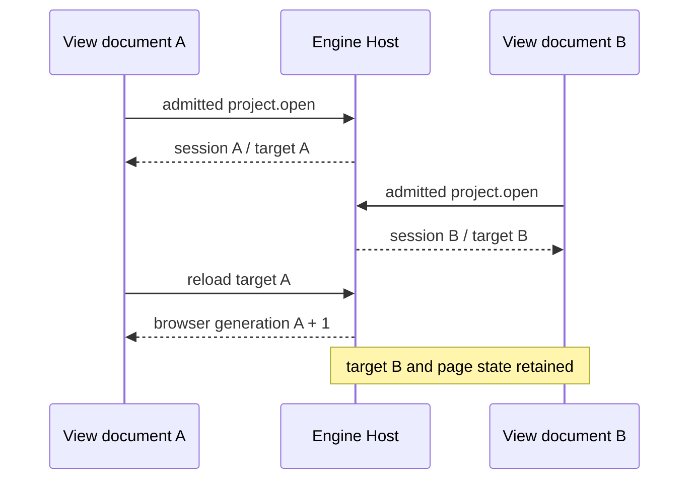

# Independent View project sessions

> [!IMPORTANT]
> Engine owns each project runtime and target. View owns presentation intent and
> connection-local page state. A second document must never replace the first
> document's accepted target browser.

| Boundary | Authority |
|:--|:--|
| Host admission | Trusted transport caller, never a supplied connection ID |
| Project/runtime/target/Play | One ordinary Engine workspace runtime per independent frontend session |
| Fresh View entry | Confirmed project intent; explicit project open obtains its own target |
| Headed reload | Same session/target, retired browser resources, new browser generation |
| Tabs, entity/target selection, resource opens | Exact View Shell's Broker; an embedded canvas admitted to that Shell's exact Engine runtime borrows the same projection |
| Display run binding and events | Exact frontend connection, independent run owner retained |
| Pack navigation | Directed intent plus visible DOM receipt; project/source revision rechecked at ACK |

The CLI workspace remains an independent owner. A page-less operation that
changes presentation is ambiguous when multiple pages exist. A Pack reveal with
an explicit live connection can target that page; no connection means a unique
page is required. Disconnect retires only that page's projection and pending
receipts, never another project or an independent run.
The public workspace API now owns `pages.list` and `pack.reveal`, with CLI
contributions derived from those same operation names. MCP clients may project
their bounded results but must not read Broker page storage or invoke reveal
through a private adapter path. The visible receipt and stale-page behavior
remain owned by the View frontend connection.

The Host resolver is an assembly capability over ordinary Engine runtimes,
not a Scene/Play mode in App or World. Existing target-specific transport
admission, command routing and reload retirement remain authoritative.

## Retained Shell And Embedded Canvas

Owning correction: 2026-10-19 embedded canvas selection.

The 2026-10-19 correction supersedes connection equality as the page boundary
when a platform retains the Shell and opens its exact Scene in another document.
The canvas's trusted `forgeax-workspace:<sessionId>:<targetId>` caller resolves
through Engine's existing `engineWorkspaceForCaller` service. Only when it
returns the identical runtime already owned by a live `view-frontend` Shell
does the canvas borrow that Shell's Broker. Fresh entries still receive their
own Engine runtimes, including entries opening the same project root.

Both connections observe the same accepted selection, tabs and resource opens;
their transport requests retain their actual authenticated callers. This adds
no Engine state or selection forwarding in a transport provider. Page inventory
and presentation commands retain the Shell connection identity rather than
counting its render-only document as a second independently selectable page.
Disconnect removes that connection's subscription. The shared Broker retires
only after its last borrowing connection disconnects.

The regression is `test/embedded-scene-selection.test.mjs`: a canvas pick must
reach its Shell subscriber, Shell clearing must reach the canvas, independent
pages remain unchanged, and canvas disposal must preserve the Shell. Native
ToolApi availability for asset reference enrichment remains a separate contract;
this correction does not infer asset GUIDs or suppress its explicit failures.

Verification on paired Engine `275219a9`: `scripts/verify-embedded-scene-selection.mjs`
builds an unchanged MCP adapter in a temporary consumer, opens real Game 3D,
observes at least 60 completed frames, and clicks its isolated canvas. The Shell
Inspector switched from Player Body to Rusted Iron Ramp with matching entity
IDs and component details; no browser runtime errors were recorded. Evidence:
`/private/tmp/view-native-selection-proof/result.json` and `selection-inspector.png`.
The 539 Node tests, strict package types, architecture counterexamples and
production build passed. The refreshed package is installed locally; this is
MCP SDK browser-host evidence, not a post-restart Codex native acceptance claim.

Native Codex follow-up on 2026-10-19 used the refreshed installed 0.4.7
plugin's injected `status` and `start` tools in a new chat. The exact Game 3D
project reached `running`, and the real MCP Apps panel mounted its Scene and
Inspector. The user confirmed that the 3D scene was visible. Native automation
could locate the nested canvas, but nested-frame screenshots were unsupported
and canvas DOM reads timed out. Verification paused before recording two
canvas selections, their Inspector IDs/components/transforms, or clearing.
Those native acceptance checks remain pending; this does not qualify them as
passed. Asset-reference enrichment remains the known independent limitation.

The bounded summary takes a running project target's generation from its exact
live root preview. Another preview or browser generation cannot supply it;
before that owner exists the generation remains absent.

Acceptance requires real simultaneous headed pages, independent Engine targets,
page selections and resource opens, Display events, refresh, directed Pack
receipts and rejection of old-page acknowledgments. Unit tests alone do not
establish browser acceptance.

## Paired acceptance

The headed matrix passed with two independent Engine targets, real Scene and Mesh opens, actual workspace and Display events, distinct run bindings, directed visible Pack reveal and refresh retirement. The View CI baseline is Engine `42d2859a4e14aa09efe34aa3b204f19638bf4d9b`, which supplies the caller-scoped runtime resolver. The preceding CI run against old Engine `b07cc7e` failed two isolation assertions because that Engine still shared its project runtime. Keep those assertions and qualify all four paired browser shards against the new baseline.

CI derives pnpm from the paired Engine `packageManager` instead of maintaining a second version. The new-baseline run originally failed action setup because the workflow still named pnpm 11.7.0 while Engine required 12.10.1; no architecture tests ran in that job.

The paired checkout uses Engine at the workspace root and View at `tools/view`, matching Engine's native composite-action paths. Both build and browser jobs call the existing source-keyed Rapier preparation action before package build. A cold new-baseline build without that owner failed `rustc unavailable`; its browser jobs were skipped, not accepted.
